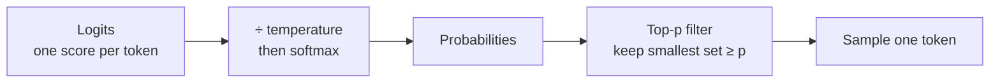
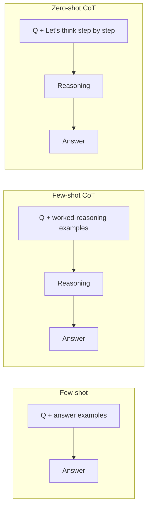
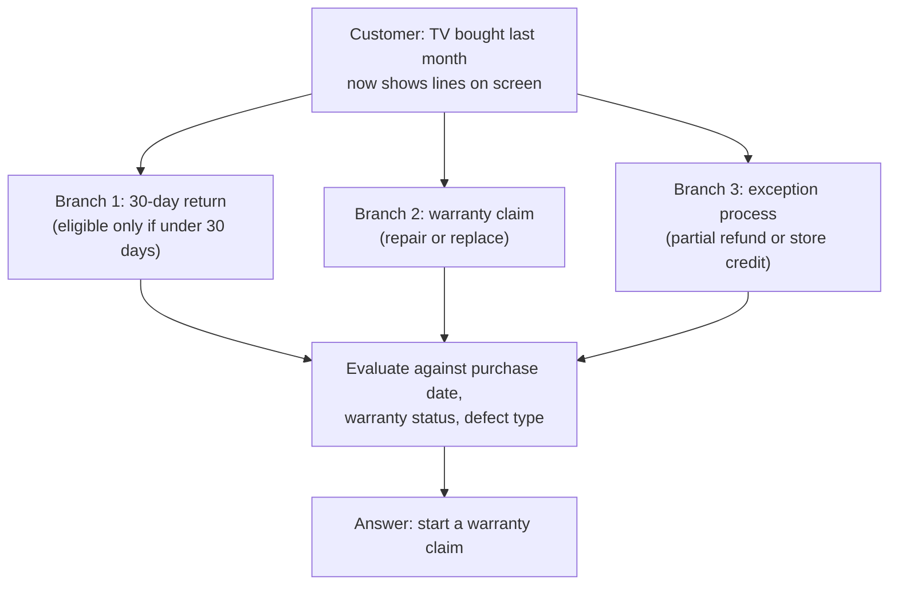
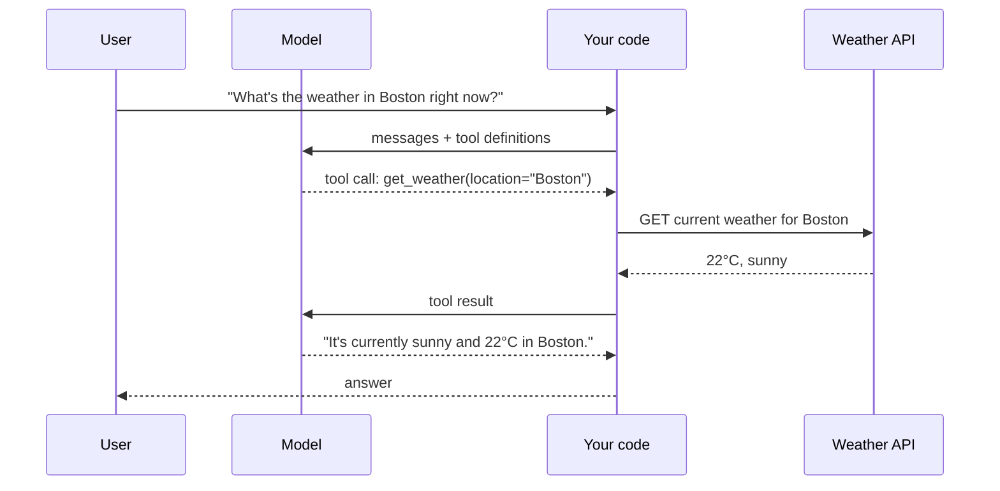

# Generating Trustworthy Responses with Prompt Engineering

> **Adapted from:** Chapter 2, "Generating trustworthy responses with prompt engineering" — rewritten and condensed for teaching, with model and API details updated for current providers.

**Prompt engineering** is the iterative work of writing, testing, and refining the instructions, context, and examples you give a large language model (LLM) such as GPT, Claude, or Gemini. Together with **sampling settings** (temperature, top-p, and others), it is your first and cheapest lever over model behavior. Later techniques such as retrieval-augmented generation (RAG) and fine-tuning build on it.

The failure we're guarding against is the **hallucination**: output that is factually wrong, made up, or unfaithful to the context provided, yet delivered with the same confidence as a correct answer. A traditional bug usually fails loudly. A hallucination looks plausible, which makes it more dangerous. This lesson covers the settings and prompting techniques that separate a demo from a dependable production system. The running example is an **e-commerce support chatbot**.

**What you'll be able to do after this lesson:**

- Treat **model choice** as a reliability decision, and keep the model name configurable.
- Explain what **temperature**, **top-p**, output limits, stop sequences, and **penalties** do, and which providers and models accept them.
- Structure prompts with clear instructions, context, focused input, output format, and quality criteria.
- Apply **zero-shot, few-shot, chain-of-thought, self-consistency, and tree-of-thought** prompting, and know their limits.
- Ground answers in real data with **function calling** (tool use).

---

## Choosing the Right Model

Pick the model before you tune anything else. It sets your **cost ceiling**, **latency floor**, **capability range**, and even **which parameters exist**.

### Reasoning vs. non-reasoning models

**Reasoning models** spend extra compute "thinking" before they answer. They are strong at multi-step math, code, planning, and careful logical analysis, but they are **slower and more expensive**, and they often **don't accept sampling parameters**:

- **OpenAI** reasoning models (the GPT-5 series, o-series) control depth with **`reasoning_effort`** rather than temperature.
- **Anthropic**: the current Claude models (Opus 5.5, Sonnet 5.5, Haiku 5.5) think adaptively. You control depth with **`output_config.effort`** (`low` through `max`), and a non-default `temperature` or `top_p` returns an error. Earlier models such as **Claude Sonnet 4.6** still accept `temperature` (range 0–1) and `top_p`.

Support changes by model version, so **check the documentation for your exact model** before relying on a parameter.

> **Rule of thumb:** start with a non-reasoning model. If good prompting still isn't enough, try a reasoning model. For simple, high-volume tasks, use the **smallest model that meets your quality bar**.

### The cost–capability spectrum

Providers usually offer at least two tiers: a **flagship** model for hard tasks and a **mini or small** model for routine work. The gap between them keeps narrowing.

**Open-weight models** (Meta's Llama, Mistral, Alibaba's Qwen) can be downloaded, self-hosted, and fine-tuned. That helps reliability in three ways:

- **You control the model's lifecycle**, so there are no surprise deprecations.
- **Data stays on your own infrastructure**, which matters in regulated industries.
- **You can fine-tune for your domain.**

The trade-off is that self-hosting needs **GPU infrastructure and operational expertise**. After domain fine-tuning, open models often match API models on specific production tasks, at a fraction of the cost per query.

A practical split: use a **smaller, cheaper model** for high-volume work (intent classification, simple queries, streaming) and a **larger model** for quality-sensitive work (LLM-as-judge evaluation, complex synthesis, safety classification).

### Model selection is an ongoing decision

Models get retired, new ones ship, and prices change. **Make the model name a configuration value, not a string hard-coded throughout the codebase**, so switching models is a config change rather than a refactor.

```python
import os

# One place to change when a model is deprecated or a better one ships.
CHAT_MODEL = os.environ.get("CHAT_MODEL", "gpt-4.1-mini")
JUDGE_MODEL = os.environ.get("JUDGE_MODEL", "claude-opus-5-5")
```

### Check: model choice

<MultipleChoice
  id="rai-ch2-model-choice"
  title="Choosing a model"
  questions={[
    {
      prompt: 'Your code sends temperature=0.3 to a reasoning model and the request fails. What is the most likely cause?',
      choices: [
        'Temperature must be an integer',
        'Many reasoning models don\'t accept sampling parameters and use an effort or reasoning_effort setting instead',
        'The API key is invalid',
        'Temperature only works with streaming',
      ],
      answer: 1,
      why: 'Parameter support varies by model. Current Claude models and OpenAI reasoning models control depth with effort settings, not temperature.',
    },
    {
      prompt: 'A hospital needs a chatbot whose patient data never leaves its own servers. Which option most directly satisfies that?',
      choices: [
        'The largest commercial API model',
        'A self-hosted open-weight model (e.g. Llama, Mistral, Qwen), optionally fine-tuned on in-house data',
        'Any model with temperature = 0',
        'A model accessed through a browser extension',
      ],
      answer: 1,
      why: 'Self-hosting keeps inference on your own infrastructure. The cost is running GPUs and the operational work that comes with them.',
    },
  ]}
/>

---

## Tuning LLM Settings for Reliability

### How sampling works

At each step the model produces a **score (logit)** for every possible next token. Those scores become **probabilities**, and one token is **sampled** from them. Temperature reshapes the probabilities, and top-p limits which tokens are eligible to be sampled.



### Temperature: predictability vs. variety

**Temperature** divides the logits before the softmax step.

- **Low temperature** (for example 0–0.3) sharpens the distribution, so the most likely token almost always wins. Output is **predictable and repeatable**.
- **High temperature** flattens it, so unlikely tokens get picked more often. Output is **more varied and conversational**. Past about 1.0, it can turn **incoherent**.

Ask the chatbot "What are the specs for the iPhone 14?" at **0.3** and you get a short, factual list: 6.1-inch OLED, A15 Bionic, dual 12 MP cameras, 128/256/512 GB. At **0.8** you get the same facts wrapped in enthusiastic, chattier prose.

Push the temperature to **2**, the maximum on OpenAI's GPT-4.1 family, and ask for "10 weird and fun things to do at the store." The first few items are fine. Then the list **dissolves into gibberish**: random code fragments, mixed-language words, and broken identifiers. Rare tokens keep winning the draw, and each bad choice makes the next one worse. At **0** the same prompt produces a tidy, sensible, slightly dull list, and nearly the same list every time.

**Low temperature is not the same as truth.** Determinism means *consistency*, not *correctness*. A model at temperature 0 can be **consistently wrong**, and studies have found that zero temperature doesn't reliably reduce hallucinations. In some setups it even increases fabrication. Real **grounding** comes from RAG and tool use (see the project at the end of this lesson).

Ranges differ by provider. OpenAI's GPT-4.1 family accepts **0–2**. Claude models that still take temperature (such as Sonnet 4.6) accept **0–1**.

| Use case | Typical temperature |
|---|---|
| Factual Q&A, extraction, legal or policy answers | 0–0.3 |
| General product questions | 0.4–0.6 |
| Recommendations, small talk, brainstorming | 0.7–1.0 |
| Above 1.0 | Rarely useful, with a high risk of incoherence |

```python
from openai import OpenAI

client = OpenAI()  # reads OPENAI_API_KEY from the environment

response = client.chat.completions.create(
    model=CHAT_MODEL,                  # e.g. "gpt-4.1-mini" (non-reasoning)
    messages=[{"role": "user", "content": "What are the specs for the iPhone 14?"}],
    temperature=0.3,
)
print(response.choices[0].message.content)
```

The Claude equivalent, using a model that still accepts temperature:

```python
import anthropic

client = anthropic.Anthropic()  # reads ANTHROPIC_API_KEY (or an `ant auth login` profile)

response = client.messages.create(
    model="claude-sonnet-4-6",  # current models (Opus/Sonnet/Haiku 5.5) reject non-default temperature
    max_tokens=1024,
    temperature=0.3,            # Claude's range is 0-1
    messages=[{"role": "user", "content": "What are the specs for the iPhone 14?"}],
)
print(response.content[0].text)
```

Treat temperature as **configuration**: keep it in your deployment config so the team can tune it without a code change, and **A/B test** variants (prompt-management platforms such as Humanloop support this).

#### Practice: temperature-scaled softmax

Implement `apply_temperature(logits, t)`. It returns a dict mapping each token to a probability:

- For `t > 0`: compute `softmax(logit / t)`. Subtract the maximum scaled logit before calling `exp` so large values don't overflow.
- For `t == 0`: **greedy decoding**. Give probability `1.0` to the highest-logit token (the first one, if there's a tie) and `0.0` to the rest.

Input: line 1 is the temperature, and line 2 is `token:logit` pairs. The wrapper prints probabilities rounded to 3 decimals.

<CodeExercise
  title="Temperature and softmax"
  heading="exercise-rai-temperature"
  lang="python"
  filename="main.py"
  prompt="Implement apply_temperature(logits, t): greedy one-hot at t == 0 (first max wins ties); otherwise a numerically stable softmax of logit / t."
  sampleLog={`1
30:3.0 14:2.0 60:1.0 banana:-1.0
30=0.657 14=0.242 60=0.089 banana=0.012`}
  starter={`import math

def apply_temperature(logits, t):
    # logits: dict token -> float (in input order)
    pass
`}
  wrapSuffix={`
import sys
lines = sys.stdin.read().strip().split('\\n')
t = float(lines[0])
logits = {k: float(v) for k, v in (p.rsplit(':', 1) for p in lines[1].split())}
probs = apply_temperature(logits, t)
print(' '.join(f'{k}={probs[k]:.3f}' for k in logits))
`}
  hint="For t > 0: scaled = {k: v / t}; m = max(scaled.values()); e = {k: math.exp(s - m)}; divide each by sum(e.values()). For t == 0: find the first key whose logit equals max(logits.values())."
  solution={`import math

def apply_temperature(logits, t):
    if t == 0:
        best = max(logits.values())
        winner = next(k for k in logits if logits[k] == best)
        return {k: (1.0 if k == winner else 0.0) for k in logits}
    scaled = {k: v / t for k, v in logits.items()}
    m = max(scaled.values())
    exps = {k: math.exp(s - m) for k, s in scaled.items()}
    total = sum(exps.values())
    return {k: e / total for k, e in exps.items()}
`}
  tests={[
    { name: 'temperature 1 (plain softmax)', stdin: '1\n30:3.0 14:2.0 60:1.0 banana:-1.0', equals: '30=0.657 14=0.242 60=0.089 banana=0.012' },
    { name: 'low temperature sharpens', stdin: '0.5\n30:3.0 14:2.0 60:1.0 banana:-1.0', equals: '30=0.867 14=0.117 60=0.016 banana=0.000' },
    { name: 'high temperature flattens', stdin: '2\n30:3.0 14:2.0 60:1.0 banana:-1.0', equals: '30=0.474 14=0.287 60=0.174 banana=0.064' },
    { name: 'temperature 0 is greedy', stdin: '0\n30:3.0 14:2.0 60:1.0 banana:-1.0', equals: '30=1.000 14=0.000 60=0.000 banana=0.000' },
    { name: 'ties at temperature 0 go to the first token', stdin: '0\nyes:2.0 no:2.0', equals: 'yes=1.000 no=0.000' },
  ]}
/>

Compare the outputs. At temperature 2, the nonsense token `banana` has a **6.4%** chance on every draw. Over a long answer, rare tokens like that are bound to be sampled at some point. That is how high-temperature output drifts into gibberish.

### Top-p (nucleus) sampling: limiting the candidate pool

**Top-p** keeps only the **smallest set of most-likely tokens whose probabilities add up to at least p**, renormalizes them, and samples from that set. With **p = 0.9**, the long tail of unlikely tokens is never eligible.

- **Lower top-p** (0.5–0.7): a narrower, safer vocabulary that is more predictable and less creative.
- **Higher top-p** (0.8–0.95): more varied word choice, and more room for odd or off-topic tokens.

Top-p shapes **which words** the model can choose, so in practice a higher value tends to give fuller, more varied answers. For "What is your return policy for the Acme SoundPro headphones?", p = 0.7 might give a tight one-sentence answer (30 days, original condition, full refund), while p = 0.95 adds friendlier detail such as free return labels and a pointer to support. Top-p **does not control length** directly, though. Use output limits for that. In high-stakes settings, lower top-p adds a layer of safety.

> **Adjust temperature *or* top-p, not both.** OpenAI recommends changing only one. For reliable output, use `temperature=0.3` and leave `top_p` at 1.0. For creative tasks, try `temperature=0.7` *or* `top_p=0.9`.

#### Practice: nucleus filtering

Implement `nucleus(probs, p)` using **integer percentages**, so the sums are exact. Sort tokens by probability (descending, with ties broken alphabetically) and keep adding them until the running total is **≥ p**. Then return the kept tokens with **renormalized** probabilities as fractions of 1.

Input: line 1 is `p` (0–100), and line 2 is `token:percent` pairs that sum to 100.

<CodeExercise
  title="Top-p (nucleus) filter"
  heading="exercise-rai-top-p"
  lang="python"
  filename="main.py"
  prompt="Implement nucleus(probs, p) with integer percentages: keep the smallest prefix of tokens (sorted by -prob, then token) whose cumulative percent >= p, and renormalize their probabilities to sum to 1."
  sampleLog={`80
the:50 a:30 one:15 zebra:5
the=0.625 a=0.375`}
  starter={`def nucleus(probs, p):
    # probs: dict token -> integer percent; p: integer percent
    pass
`}
  wrapSuffix={`
import sys
lines = sys.stdin.read().strip().split('\\n')
p = int(lines[0])
probs = {k: int(v) for k, v in (pair.split(':') for pair in lines[1].split())}
kept = nucleus(probs, p)
print(' '.join(f'{k}={v:.3f}' for k, v in kept.items()))
`}
  hint="items = sorted(probs.items(), key=lambda kv: (-kv[1], kv[0])). Accumulate until total >= p, then divide each kept value by the kept total."
  solution={`def nucleus(probs, p):
    items = sorted(probs.items(), key=lambda kv: (-kv[1], kv[0]))
    kept = []
    total = 0
    for token, pct in items:
        kept.append((token, pct))
        total += pct
        if total >= p:
            break
    return {token: pct / total for token, pct in kept}
`}
  tests={[
    { name: 'p = 80', stdin: '80\nthe:50 a:30 one:15 zebra:5', equals: 'the=0.625 a=0.375' },
    { name: 'p = 90 drops only the tail', stdin: '90\nthe:50 a:30 one:15 zebra:5', equals: 'the=0.526 a=0.316 one=0.158' },
    { name: 'p = 100 keeps everything', stdin: '100\nthe:50 a:30 one:15 zebra:5', equals: 'the=0.500 a=0.300 one=0.150 zebra=0.050' },
    { name: 'tiny p is greedy', stdin: '10\nthe:50 a:30 one:15 zebra:5', equals: 'the=1.000' },
    { name: 'ties sorted alphabetically', stdin: '50\nyes:40 no:40 maybe:20', equals: 'no=0.500 yes=0.500' },
  ]}
/>

### Limiting output length and conversation turns

Every extra claim in an answer is another chance to say something unsupported. "Our 30-day policy applies to most items, except electronics, which have 14 days, unless purchased during holidays when extended returns may apply, and premium members get additional flexibility…" may begin correctly and then wander into made-up exceptions.

The goal is not short answers for their own sake. It is answers **scoped to what the model can reliably say**. (Chain-of-thought, covered below, deliberately produces *longer* output because the reasoning improves accuracy.) Tools for this:

- **A maximum token limit** (`max_tokens` / `max_output_tokens`) caps the length of each response.
- **Stop sequences** end generation at a marker. For example, `"\n"` stops after one paragraph.
- **Conversation rules** cap the number of turns and define when a conversation ends, so long sessions don't drift.
- **User controls** let users end a topic or start a new one.

> **Tip:** start around **200–500 tokens** plus a stop sequence, and adjust from there. Limits that are too tight cut off useful detail, and no limit invites rambling. (One provider caveat: on current Claude models, a `max_tokens` set too low truncates the answer mid-thought, so size it for the complete answer and control length through instructions.)

### Frequency and presence penalties

These discourage the model from **repeating itself**. They are available on OpenAI-style APIs, range from **−2.0 to 2.0**, and are typically set to **0.5–1.0**:

- **Frequency penalty**: the more often a token has already appeared, the more its score is reduced. This cuts repeated words and phrases within a response.
- **Presence penalty**: a flat penalty on any token that has appeared at all. This pushes the model toward **new topics**.

Without penalties: "I recommend the ZenBook Pro. The ZenBook Pro is our most popular laptop. For a portable option, check out the ZenBook Pro." With a frequency penalty, the model varies its wording and suggests the ZenBook Pro 15 or the lighter ZenBook 14. With a presence penalty, a follow-up might bring in something new, such as the ZenBook Flip's 2-in-1 design.

The **Anthropic Messages API has no frequency or presence penalty parameters.** With Claude, reduce repetition through instructions and examples.

### Intrinsic randomness: seeds and voting

Even with low temperature, the **same prompt can produce slightly different outputs**. Floating-point arithmetic and parallel GPU execution introduce tiny numeric differences that occasionally change which token wins. Two runs of "good wireless headphones for running?" might recommend the same two products but in a different order or with different emphasis.

Two mitigations:

1. **A fixed seed.** OpenAI's Chat Completions accepts `seed`, which makes sampling *mostly* reproducible. It is best-effort: compare the returned `system_fingerprint` to detect backend changes. (The Anthropic API has no `seed` parameter.)

   ```python
   response = client.chat.completions.create(
       model=CHAT_MODEL,
       messages=[{"role": "user", "content": "What are some good wireless headphones for running?"}],
       max_tokens=100,
       temperature=0.1,
       seed=42,
   )
   ```

2. **Sample several times and vote.** Generate N answers and keep the most common one. **Vote on extracted answers, not raw text.** Two correct answers almost never match word for word, so `Counter(full_texts).most_common(1)` usually just returns the first sample. Pull out the part you care about (a product name, a yes/no, a number), normalize it, and count that instead. The self-consistency exercise below does exactly this.

Some randomness is **desirable** in conversation. The goal is the *right* amount of variety for the use case, not determinism everywhere.

### Check: settings

<MultipleChoice
  id="rai-ch2-settings"
  title="Sampling and limits"
  questions={[
    {
      prompt: 'A legal assistant must give the same answer to the same question every time. Which configuration fits best?',
      choices: [
        'temperature 1.5 and top_p 0.95',
        'Low temperature (e.g. 0-0.3) with top_p left at its default, plus a fixed seed where supported',
        'A high presence penalty',
        'No max token limit',
      ],
      answer: 1,
      why: 'Low temperature plus a seed maximizes repeatability. Remember that this makes the answer consistent, not correct, so grounding is still needed.',
    },
    {
      prompt: 'True or false: setting temperature to 0 eliminates hallucinations.',
      choices: [
        'True, because the model always picks the most likely token',
        'False. It makes output repeatable, and a repeatable answer can be repeatably wrong. Grounding (RAG, tools) is what ties answers to facts',
        'True, but only for OpenAI models',
        'False, because temperature 0 is not allowed',
      ],
      answer: 1,
      why: 'The most likely continuation is not necessarily the true one.',
    },
    {
      prompt: 'Your chatbot keeps recommending the same laptop three times in one reply. Which setting targets this most directly on an OpenAI-style API?',
      choices: ['A higher frequency penalty', 'A lower max_tokens', 'A higher temperature', 'A stop sequence'],
      answer: 0,
      why: 'The frequency penalty lowers a token\'s score the more often it has already appeared, which cuts repetition within a response.',
    },
    {
      prompt: 'You collect 5 sampled answers and run Counter(texts).most_common(1). Why does this usually fail as majority voting?',
      choices: [
        'Counter cannot count strings',
        'Free-text answers almost never match exactly, so every count is 1. Extract and normalize the key answer before voting',
        'You need at least 100 samples',
        'Voting only works at temperature 2',
      ],
      answer: 1,
      why: 'Vote on the decision (a product, true/false, a number), not on the surrounding prose.',
    },
  ]}
/>

---

## Foundations of Reliable Prompts

### The components of a prompt

A prompt that keeps hallucinations down usually has five parts:

- **Clear instructions**: specific and directive. "Summarize the main points, focusing on facts rather than opinions."
- **Relevant context**: background that frames the domain, such as definitions, key terms, and examples. Keep it specific.
- **Focused input data**: the material to work on, structured, with distracting extras left out.
- **Expected output format**: structure, length, and style, ideally as a template. "A bullet list of at most five facts, one sentence each."
- **Explicit quality criteria**: prioritize accuracy and coherence, forbid speculation, and require the answer to stay grounded in the given input.

An example built from those parts:

```text
Instructions:
Summarize the key points from the product review below, focusing on specific
feedback about features and performance. Do not speculate about the reviewer's
background or intentions.

Context:
The review is for a wireless Bluetooth speaker designed for outdoor use, with
waterproofing and long battery life.

Input:
"I took this speaker on my camping trip and was impressed by its durability.
It survived a few rain showers without any issues. The sound quality is quite
good for the size, with decent bass and clarity. Battery life was also solid,
lasting through a 3-day trip with moderate usage. Only drawback is the weight,
a bit hefty to pack on longer hikes. But overall, a robust and reliable option
for outdoor listening."

Output format:
Key strengths: (2-3 points)
Main limitations: (1-2 points)
Concluding sentiment: (1 sentence)

Use only attributes stated in the review. Do not add unsupported claims.
```

These techniques are widely used and generally help, but **how much they reduce hallucinations varies**, so measure on your own task.

### Specific beats vague

The prompt "The ocean is" invites an open-ended essay: a reasonable but sprawling paragraph about coverage, climate, ecosystems, trade, and culture. "**Finish this thought in one sentence:** The ocean is" gets a single crisp sentence. Specific instructions produce specific output.

For the support chatbot, that means:

- **Instructions**: "summarize order status", "recommend products".
- **Context**: "You are the support assistant for an electronics store."
- **Output shape**: "Reply in a friendly, concise manner, in at most three sentences."
- **Variable input**: the customer's actual message.

---

## Prompting Techniques That Reduce Hallucinations

> **Prompts don't transfer perfectly.** The core techniques work across models, but wording, formatting, and parameter settings often need retuning when you switch models or versions. Always test on your target model.

### Zero-shot prompting

Give the instruction **with no examples**, relying on what the model learned in pretraining and post-training (instruction tuning, RLHF).

```text
Classify this movie review's sentiment: The film had poor acting and a dull plot.
Sentiment:
```

The model answers **Negative**. Simple tasks work well this way. For company-specific tasks, though, zero-shot falls short: "I received the wrong item. What should I do?" gets generic advice, because the model doesn't know *your* return policy. That's a cue to add context and examples.

### Few-shot prompting

Include **a few demonstrations** in the prompt. The model picks up the task, the format, and the style from them. In the GPT-3 paper (Brown et al., 2020), one example was enough for the model to use a made-up word in a sentence:

```text
A "fribble" is a cute, fuzzy creature. A sentence using fribble:
The fribble scurried up the tree to find nuts.

A "blicket" means to walk in a silly way. A sentence using blicket:
```

The model replies with something like "Sarah blicketed down the sidewalk in her new shoes." It learned the pattern of definition followed by example.

In the store, few-shot teaches **house vocabulary**. A "cozzy" is a comfortable sweater, and "Gliders" is the line of rolling suitcases. Given two example customer sentences, the bot correctly understands "a cozzy that's office-appropriate and warm" as a sweater request and suggests the store's warm-wool sweater line.

**The limit: multi-step logic.** In this task from Wei et al. (2022), a few examples are not enough:

```text
The odd numbers in this set add to an even number: 4, 8, 9, 15, 12, 2, 1.  False.
The odd numbers in this set add to an even number: 16, 11, 14, 4, 8, 13, 24.  True.
The odd numbers in this set add to an even number: 15, 32, 5, 13, 82, 7, 1.
```

The model answers **True**, but 15 + 5 + 13 + 7 + 1 = **41**, which is odd, so the answer is **False**.

> **Tip:** two or three input/output examples are usually enough. For a support bot: "Customer asks for a refund → respond with the refund steps."

### Chain-of-thought (CoT) prompting

Show the **intermediate reasoning steps** in your examples, so the model works through the problem in its output instead of jumping to an answer:

```text
The odd numbers in this set add to an even number: 4, 8, 9, 15, 12, 2, 1.
A: Adding the odd numbers 9 + 15 + 1 gives 25. The answer is False.

The odd numbers in this set add to an even number: 15, 32, 5, 13, 82, 7, 1.
A:
```

Now the model writes "Adding the odd numbers 15 + 5 + 13 + 7 + 1 gives 41. The answer is False." Often a **single** worked example is enough.

**Zero-shot CoT** (Kojima et al., 2022) works with no examples at all. Append "**Let's think step by step.**"

```text
I started with 10 apples. I gave away 4 and bought 5 more. I ate 1.
How many remain? Let's think step by step.
```

The model reasons 10 → 6 → 11 → **10**.



**In the chatbot:** a rule says orders whose number ends in an odd digit qualify for a discount. With just two examples, the bot may still wrongly tell the customer with order **#17403** that they *don't* qualify. Spelling out the procedure fixes it: "Check the **last digit** of the order number; if it is odd, the customer qualifies. Apply this to #17403." The bot reasons that the last digit is **3**, which is odd, so the customer qualifies.

> **Reasoning models** (OpenAI's GPT-5 series and o3, Claude with thinking) reason internally, so explicit CoT instructions often add little. For **non-reasoning** models (GPT-4.1, GPT-4.1-mini, Gemini Flash, or Claude with thinking turned off), CoT typically gives large gains on multi-step tasks. As always, test on your model.

### Automatic CoT (Auto-CoT)

Writing reasoning chains by hand doesn't scale. **Auto-CoT** generates them automatically:

- **A "reasoner" step** produces an input-specific breakdown, which is fed into the main prompt. For example, a legal-information assistant facing "I was fired after reporting safety violations — what can I do?" would generate these steps:
  1. **Issues**: wrongful termination, retaliation.
  2. **Relevant law**: whistleblower protections, exceptions to at-will employment.
  3. **Potential claims**: retaliation, wrongful discharge against public policy.
  4. **Next steps**: document everything, consult an employment attorney, file with OSHA or the state labor board.
- **Fine-tuning on many CoT examples** teaches the model to produce its own reasoning steps.

Either way, **validate the generated chains**. A confident but flawed chain is just a hallucination with more steps.

### Self-consistency: cross-check multiple samples

Sample **several reasoning paths** for the same question, using different seeds or slight prompt variations, then **compare** them. Where the answers agree, confidence goes up. Where they disagree, you've found a likely hallucination.

A recipe bot asked for a **vegetarian** pasta with spinach and mushrooms might produce four candidates: a fettuccine Alfredo, a penne with garlic and olive oil, a lasagna, and a "**chicken** and mushroom lasagna." The first three agree on the constraints. The fourth breaks the vegetarian requirement, so it's filtered out, and the bot presents the three consistent options.

You can apply self-consistency to the **whole answer** or to **individual claims** (each ingredient, each step).

#### Practice: self-consistency voting

Implement `self_consistency(outputs, threshold)`:

- From each output, extract the final answer with the regex `answer is\s*:?\s*([A-Za-z0-9]+)` (case-insensitive) and **lower-case** it. Outputs without a match get no vote, but they **still count toward the total**.
- Return `(answer, confidence, low_confidence)`:
  - `answer` is the most-voted answer, with ties broken alphabetically, or `None` if nothing was extracted.
  - `confidence` is that answer's votes divided by **all** outputs.
  - `low_confidence` is `True` when `confidence < threshold`.

Input: line 1 is `threshold`, and each remaining line is one sampled output.

<CodeExercise
  title="Self-consistency vote"
  heading="exercise-rai-self-consistency"
  lang="python"
  filename="main.py"
  prompt="Implement self_consistency(outputs, threshold): extract and lowercase each 'answer is X', vote, return (top answer or None, votes/len(outputs), confidence < threshold)."
  sampleLog={`0.6
Adding 15 + 5 + 13 + 7 + 1 gives 41. The answer is False.
The answer is false
41 is odd, so the answer is FALSE.
I think the answer is True
answer=false confidence=0.75 low_confidence=False`}
  starter={`import re

ANSWER = re.compile(r'answer is\\s*:?\\s*([A-Za-z0-9]+)', re.IGNORECASE)

def self_consistency(outputs, threshold):
    pass
`}
  wrapSuffix={`
import sys
lines = sys.stdin.read().strip().split('\\n')
threshold = float(lines[0])
answer, conf, low = self_consistency(lines[1:], threshold)
print(f'answer={answer} confidence={conf:.2f} low_confidence={low}')
`}
  hint="Count votes in a dict. If it is empty, return (None, 0.0, True). Otherwise pick sorted(votes.items(), key=lambda kv: (-kv[1], kv[0]))[0] and divide its count by len(outputs)."
  solution={`import re

ANSWER = re.compile(r'answer is\\s*:?\\s*([A-Za-z0-9]+)', re.IGNORECASE)

def self_consistency(outputs, threshold):
    votes = {}
    for text in outputs:
        match = ANSWER.search(text)
        if match:
            key = match.group(1).lower()
            votes[key] = votes.get(key, 0) + 1
    if not votes:
        return None, 0.0, True
    answer, count = sorted(votes.items(), key=lambda kv: (-kv[1], kv[0]))[0]
    confidence = count / len(outputs)
    return answer, confidence, confidence < threshold
`}
  tests={[
    { name: 'clear majority despite different wording', stdin: '0.6\nAdding 15 + 5 + 13 + 7 + 1 gives 41. The answer is False.\nThe answer is false\n41 is odd, so the answer is FALSE.\nI think the answer is True', equals: 'answer=false confidence=0.75 low_confidence=False' },
    { name: 'split vote is flagged', stdin: '0.6\nThe answer is 10\nthe answer is 11\nThe answer is 10\nno idea\nThe answer is 12', equals: 'answer=10 confidence=0.40 low_confidence=True' },
    { name: 'nothing extractable', stdin: '0.5\nno idea\nnot sure', equals: 'answer=None confidence=0.00 low_confidence=True' },
  ]}
/>

The second test is the important one. The model's most common answer was given by only **2 of 5** samples. Rather than present it confidently, a reliable system **flags it**: it asks a clarifying question, escalates to a human, or adds a disclaimer.

### Tree-of-thought (ToT) prompting

For decisions with **several plausible paths**, a single chain of reasoning can lock onto the wrong one early. **Tree-of-thought** has the model **branch**, **evaluate** each branch, and **pick** the best:

1. **Generate** several candidate solutions.
2. **Evaluate** the pros and cons of each.
3. **Select** the best one using defined criteria, then answer.



An **internal** ToT prompt for the store, never shown to the customer:

```text
Analyze this customer query using the tree-of-thought method:
1. Generate three potential solutions.
2. Evaluate each solution's pros and cons.
3. Select the best option for the customer's situation.
4. Write a helpful, concise reply that does not reveal this internal process.

Customer query: I bought a TV from your store last month, but it's now showing
weird lines on the screen. What can I do?
```

The customer only sees the conclusion: "I'm sorry about the issue with your TV. Given your purchase timeframe and the type of problem, I recommend starting a warranty claim, which should get it repaired or replaced at no cost."

ToT can make a dramatic difference. In the Tree of Thoughts paper (Yao et al., 2023), GPT-4 with CoT solved **4%** of Game of 24 puzzles, while ToT solved **74%**.

### Check: prompting techniques

<MultipleChoice
  id="rai-ch2-techniques"
  title="Which technique fits?"
  questions={[
    {
      prompt: 'Customers use store slang ("cozzy" = sweater). The bot doesn\'t recognize it. What is the cheapest fix?',
      choices: [
        'Raise the temperature',
        'Few-shot prompting: define the terms and show one or two example customer sentences',
        'Tree-of-thought',
        'Increase max_tokens',
      ],
      answer: 1,
      why: 'Few-shot examples teach vocabulary and format directly in the prompt.',
    },
    {
      prompt: 'With two examples, a non-reasoning model still gets "do the odd numbers sum to an even number?" wrong. What should you try next?',
      choices: [
        'Remove the examples',
        'Chain-of-thought: show the intermediate addition in the examples, or append "Let\'s think step by step"',
        'A higher presence penalty',
        'A shorter stop sequence',
      ],
      answer: 1,
      why: 'Multi-step logic improves when the model writes out its intermediate steps.',
    },
    {
      prompt: 'You need to know when the model is unsure about a numeric answer. Which technique gives a direct signal?',
      choices: [
        'Zero-shot prompting',
        'Self-consistency: sample several answers, and treat low agreement as low confidence',
        'A lower top-p only',
        'Removing the system prompt',
      ],
      answer: 1,
      why: 'Disagreement across independent samples is a practical warning sign of hallucination.',
    },
    {
      prompt: 'A support request has several valid resolutions (return, warranty, store credit) that depend on the customer\'s situation. Which technique explores and compares them?',
      choices: ['Zero-shot', 'Few-shot', 'Tree-of-thought', 'Frequency penalty'],
      answer: 2,
      why: 'ToT generates several branches, evaluates each against criteria, and selects the best before answering.',
    },
    {
      type: 'order',
      prompt: 'Order the tree-of-thought procedure (top = first):',
      items: [
        'Generate several candidate solutions',
        'Evaluate the pros and cons of each candidate',
        'Select the best candidate using defined criteria',
        'Write the final user-facing answer without exposing the internal branches',
      ],
      why: 'You can\'t evaluate before generating, or select before evaluating, and the reply depends on the selection.',
      whyWrong: 'Each step consumes the output of the one before it.',
    },
  ]}
/>

---

## Project: A Grounded Weather Assistant with Function Calling

Prompting can't give a model knowledge it doesn't have. Today's weather in Paris isn't in any training set. **Function calling** (also called **tool use**) fixes this by letting the model **ask your code** to fetch real data:

1. The model sees the user's question and the **tool definitions**, and decides it needs data. It returns a **tool call** with structured arguments.
2. **Your code** runs the function, such as a weather API call, and returns the result.
3. The model writes the final answer **from that result**.



The responsibilities are split. **The model** handles understanding and wording, while **the trusted API** supplies the facts. Function calling also guarantees the arguments arrive in the **structure your function expects**. This isn't RAG in the strict sense, but it shares RAG's purpose: grounding answers in authoritative, current data.

### The weather function

```python
import os
import requests

WEATHER_API_KEY = os.environ["WEATHER_API_KEY"]  # never hard-code keys

def get_weather(location: str) -> str:
    resp = requests.get(
        "https://api.weatherapi.com/v1/current.json",
        params={"key": WEATHER_API_KEY, "q": location},  # params= handles URL encoding
        timeout=10,
    )
    data = resp.json()
    if "error" in data:
        return f"Unable to look up weather for {location}"
    temp_c = data["current"]["temp_c"]
    condition = data["current"]["condition"]["text"]
    return f"The weather in {location} is currently {temp_c}°C and {condition}."
```

### The tool definition and the loop (OpenAI)

```python
import json
from openai import OpenAI

client = OpenAI()
MODEL = CHAT_MODEL  # a model with function-calling support

tools = [{
    "type": "function",
    "function": {
        "name": "get_weather",
        "description": "Look up the current weather for a location",
        "parameters": {
            "type": "object",
            "properties": {
                "location": {
                    "type": "string",
                    "description": "City and state, ISO country code, or zip code",
                }
            },
            "required": ["location"],
        },
    },
}]

def get_chat_response(conversation):
    response = client.chat.completions.create(
        model=MODEL, messages=conversation, tools=tools, tool_choice="auto"
    )
    msg = response.choices[0].message
    conversation.append(msg)

    if msg.tool_calls:                                   # the model wants data
        for tc in msg.tool_calls:
            args = json.loads(tc.function.arguments)     # always parse JSON, never string-match
            conversation.append({
                "role": "tool",
                "tool_call_id": tc.id,
                "content": get_weather(**args),
            })
        final = client.chat.completions.create(model=MODEL, messages=conversation)
        conversation.append(final.choices[0].message)

    return conversation[-1].content

conversation = []
while True:
    user_input = input("You: ")
    conversation.append({"role": "user", "content": user_input})
    print("Chatbot:", get_chat_response(conversation))
```

### The same loop with Claude

Claude's Messages API uses `input_schema` for tools, returns `tool_use` content blocks, and expects `tool_result` blocks back in a **user** message. It loops until `stop_reason` is no longer `"tool_use"`:

```python
import anthropic

client = anthropic.Anthropic()

claude_tools = [{
    "name": "get_weather",
    "description": "Look up the current weather for a location",
    "input_schema": {
        "type": "object",
        "properties": {"location": {"type": "string", "description": "City, region, or zip code"}},
        "required": ["location"],
    },
}]

def ask(question: str) -> str:
    messages = [{"role": "user", "content": question}]
    while True:
        response = client.messages.create(
            model="claude-opus-5-5", max_tokens=16000, tools=claude_tools, messages=messages
        )
        # Production: also configure refusal fallbacks (see Anthropic's model docs).
        if response.stop_reason == "refusal":       # always check before reading content
            return "Sorry, I can't help with that request."
        if response.stop_reason != "tool_use":
            return next(b.text for b in response.content if b.type == "text")

        messages.append({"role": "assistant", "content": response.content})
        results = [
            {"type": "tool_result", "tool_use_id": block.id, "content": get_weather(**block.input)}
            for block in response.content if block.type == "tool_use"
        ]
        messages.append({"role": "user", "content": results})  # all results in one message
```

(For production Claude code, the SDK's **tool runner** (`client.beta.messages.tool_runner`) can drive this loop for you.)

Example exchanges:

| User | Tool call | Reply |
|---|---|---|
| "What's the weather like in New York today?" | `get_weather("New York")` | "In New York, it's currently 15°C with clear skies." |
| "Is it raining in Seattle right now?" | `get_weather("Seattle")` | "In Seattle, it's currently 10°C and raining." |

#### Practice: a safe tool dispatcher

The model **proposes** tool calls, and your code **decides** whether to run them. Never execute a tool call unchecked. Implement `dispatch(tool_calls)`. Each call is `{"id", "name", "arguments"}`, where `arguments` is a JSON **string**. For each call, produce a tool message `{"role": "tool", "tool_call_id": id, "content": …}`, where the content is:

- `"error: unknown tool <name>"` if the name isn't in `TOOLS`,
- `"error: arguments are not a JSON object"` if the arguments don't parse to a dict,
- `"error: missing <a, b>"` if required arguments are absent (comma-separated, in schema order),
- otherwise the tool function's return value.

The weather data is faked in the starter so the exercise runs offline. Input: one tool call per line as `id name arguments-json`.

<CodeExercise
  title="Validate and dispatch tool calls"
  heading="exercise-rai-dispatch"
  lang="python"
  filename="main.py"
  prompt="Implement dispatch(tool_calls) returning one tool message per call. Reject unknown tools, non-object or invalid JSON arguments, and missing required arguments with the exact error strings; otherwise call the tool."
  sampleLog={`c1 get_weather {"location": "Paris"}
c1: The weather in Paris is currently 18°C and Partly cloudy.`}
  starter={`import json

WEATHER = {'paris': (18, 'Partly cloudy'), 'seattle': (10, 'Rain')}

def get_weather(location):
    key = location.lower()
    if key not in WEATHER:
        return f'Unable to look up weather for {location}'
    temp, condition = WEATHER[key]
    return f'The weather in {location} is currently {temp}°C and {condition}.'

TOOLS = {'get_weather': {'fn': get_weather, 'required': ['location']}}

def dispatch(tool_calls):
    pass
`}
  wrapSuffix={`
import sys
calls = []
for line in sys.stdin.read().strip().split('\\n'):
    call_id, name, args = line.split(' ', 2)
    calls.append({'id': call_id, 'name': name, 'arguments': args})
for msg in dispatch(calls):
    print(f"{msg['tool_call_id']}: {msg['content']}")
`}
  hint="Look up TOOLS.get(name). Wrap json.loads in try/except json.JSONDecodeError and also check isinstance(args, dict). Compute missing = [r for r in spec['required'] if r not in args]."
  solution={`import json

WEATHER = {'paris': (18, 'Partly cloudy'), 'seattle': (10, 'Rain')}

def get_weather(location):
    key = location.lower()
    if key not in WEATHER:
        return f'Unable to look up weather for {location}'
    temp, condition = WEATHER[key]
    return f'The weather in {location} is currently {temp}°C and {condition}.'

TOOLS = {'get_weather': {'fn': get_weather, 'required': ['location']}}

def dispatch(tool_calls):
    messages = []
    for call in tool_calls:
        spec = TOOLS.get(call['name'])
        if spec is None:
            content = f"error: unknown tool {call['name']}"
        else:
            try:
                args = json.loads(call['arguments'])
            except json.JSONDecodeError:
                args = None
            if not isinstance(args, dict):
                content = 'error: arguments are not a JSON object'
            else:
                missing = [r for r in spec['required'] if r not in args]
                if missing:
                    content = f"error: missing {', '.join(missing)}"
                else:
                    content = spec['fn'](**args)
        messages.append({'role': 'tool', 'tool_call_id': call['id'], 'content': content})
    return messages
`}
  tests={[
    { name: 'valid call', stdin: 'c1 get_weather {"location": "Paris"}', equals: 'c1: The weather in Paris is currently 18°C and Partly cloudy.' },
    { name: 'wrong argument name', stdin: 'c2 get_weather {"city": "Paris"}', equals: 'c2: error: missing location' },
    { name: 'unknown tool and bad JSON', stdin: 'c3 get_stock {}\nc4 get_weather {bad json\nc5 get_weather ["Paris"]', equals: 'c3: error: unknown tool get_stock\nc4: error: arguments are not a JSON object\nc5: error: arguments are not a JSON object' },
    { name: 'API has no data: say so, don\'t invent it', stdin: 'c6 get_weather {"location": "Atlantis"}', equals: 'c6: Unable to look up weather for Atlantis' },
  ]}
/>

The last test captures the whole point. When the data source has nothing, the tool says so **explicitly**, so the model has something truthful to work with instead of a gap to fill with invented weather.

### Beyond weather

The same pattern works anywhere authoritative data exists:

- **Finance**: stock prices, exchange rates, market data.
- **Scheduling**: calendar availability, bookings.
- **Travel**: flight times, hotel availability, directions.
- **Retail**: product details, inventory, order status (the natural next step for our store bot).
- **Entertainment**: showtimes, reservations, event tickets.

In each case: **find the authoritative source, define a clear function interface, validate every call, and let the model handle the language.**

### Check: function calling

<MultipleChoice
  id="rai-ch2-tools"
  title="Grounding with tools"
  questions={[
    {
      prompt: 'Why does function calling reduce hallucinations for questions like "what\'s the weather now?"',
      choices: [
        'It makes the model\'s training data more recent',
        'The facts come from an authoritative API at request time, and the model only interprets and phrases them',
        'It forces temperature to 0',
        'It removes the need for a prompt',
      ],
      answer: 1,
      why: 'Grounding moves the source of truth out of the model\'s parameters and into a trusted system.',
    },
    {
      prompt: 'The model emits get_weather with {"city": "Paris"} but your schema requires "location". What should your code do?',
      choices: [
        'Guess that "city" means "location" and silently proceed',
        'Return a clear error tool result (e.g. "missing location") so the model can retry with valid arguments',
        'Crash the request',
        'Answer from the model\'s memory instead',
      ],
      answer: 1,
      why: 'Validating every call and returning a precise error lets the model correct itself, without your code guessing.',
    },
    {
      type: 'order',
      prompt: 'Order the function-calling round trip (top = first):',
      items: [
        'Send the user message and tool definitions to the model',
        'Model returns a tool call with structured arguments',
        'Your code validates the call and runs the function',
        'Send the tool result back to the model',
        'Model writes the final answer from the result',
      ],
      why: 'The model can\'t answer from data it hasn\'t received, and your code can\'t run a call the model hasn\'t made.',
      whyWrong: 'Follow the data: question, then tool call, then execution, then result, then answer.',
    },
  ]}
/>

---

## Key Takeaways

- **Model choice comes first** and keeps changing. Keep model names in config. Reasoning models often replace sampling parameters with **effort** settings (current Claude models reject non-default temperature and top-p).
- **Temperature** trades predictability against variety, and **top-p** trims the unlikely tail. Adjust one or the other, not both. **Low temperature gives consistency, not truth.**
- **Output limits and stop sequences** keep answers within what the model can reliably say. **Penalties** (OpenAI-style APIs) curb repetition. **Seeds** and **voting on extracted answers** tame run-to-run randomness.
- A reliable prompt has **instructions, context, focused input, an output format, and quality criteria**.
- **Few-shot** teaches format and vocabulary. **CoT** handles multi-step logic. **Self-consistency** surfaces uncertainty. **ToT** compares alternatives. Validate generated reasoning.
- **Function calling grounds answers in authoritative data.** Validate every tool call, and make tools report missing data explicitly.

Next lesson: [Grounding Outputs with RAG](./grounding-outputs-with-rag) — connect the model to current, authoritative knowledge with retrieval-augmented generation.

---

## References

1. Amatriain, X. (2024). *Prompt Design and Engineering: Introduction and Advanced Methods.* arXiv:2401.14423.
2. Yao, S., et al. (2023). *Tree of Thoughts: Deliberate Problem Solving with Large Language Models.* arXiv:2305.10601.
3. [OpenAI: Function calling guide](https://platform.openai.com/docs/guides/function-calling)
4. Brown, T., et al. (2020). *Language Models are Few-Shot Learners.* arXiv:2005.14165.
5. Wei, J., et al. (2022). *Chain-of-Thought Prompting Elicits Reasoning in Large Language Models.* arXiv:2201.11903.
6. Kojima, T., et al. (2022). *Large Language Models are Zero-Shot Reasoners.* arXiv:2205.11916.
7. [Anthropic: Tool use with Claude](https://docs.anthropic.com/en/docs/build-with-claude/tool-use/overview)

### Source chapter references (with practice quizzes)

These are the references cited in the source chapter. Pass a citation's quiz to unlock it, then use it in the [Essay Lab](/essay-lab).

<CitationCards chapter={2} />
