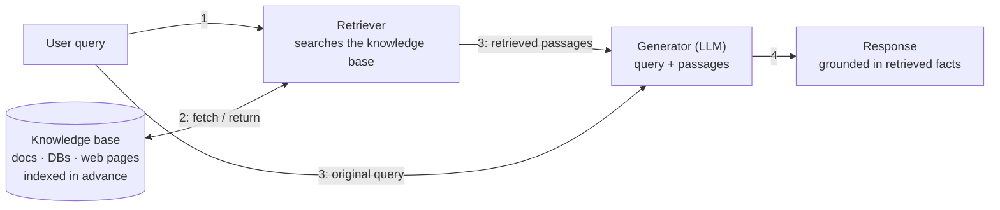
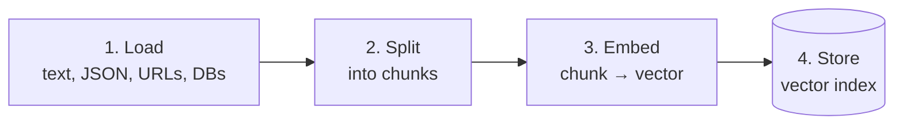
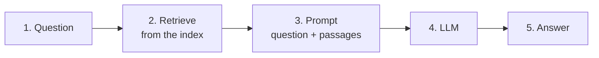
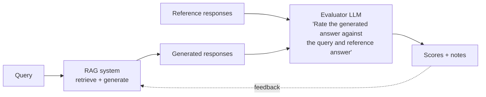
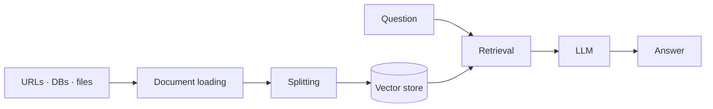

# Grounding Outputs with RAG

> **Adapted from:** Chapter 3, "Grounding outputs with RAG" — rewritten and condensed for teaching, with code corrected and updated.

[Lesson 1](./generating-trustworthy-responses-with-prompt-engineering) shaped *how* a model answers. Prompting can't change *what the model knows*, though. A shopper asks the store chatbot:

> "Do you have the OLED 55-inch TV with integrated soundbar in stock for same-day delivery?"

A model with only its training data can only apologize that it has no access to inventory. Products like ChatGPT and Claude can search the web, but that ability comes from the **application around the model** fetching data for it, not from the model itself.

Could you **fine-tune** the model on stock data instead? A trained model only knows the snapshot it was trained on. The moment inventory changes, its knowledge is **stale**, and retraining every time stock moves is not feasible. Encoding every combination of product, location, and delivery option into the model's weights is worse still. This is the **freshness problem**, and **retrieval-augmented generation (RAG)** is the standard solution.

**What you'll be able to do after this lesson:**

- Explain how RAG works (retrieve, then generate) and where it fails.
- Build the **indexing pipeline** (load, split, embed, store) and the **query pipeline** (embed, search, prompt, generate).
- Evaluate RAG with retrieval precision, grounding checks, LLM judges, and **RAGAS**, and spot a misleading metric.
- Reduce hallucinations with **relevance thresholds**, context ordering ("lost in the middle"), and **metadata filtering**.
- Know when to reach for hybrid retrieval, query rewriting, routing, **GraphRAG**, or **agentic RAG**.

---

## What Is RAG?

RAG works in **two stages**:

1. **Retrieve**: find passages relevant to the user's question in up-to-date external sources.
2. **Generate**: give those passages to the LLM along with the question, and have it answer **from them**.

Ask "What's the return policy for electronics purchased with a gift card?" Without RAG, you get a generic guess: "Most retailers allow 30 days…". With RAG, you get *your* policy: "Electronics bought with gift cards can be returned within **14 days for store credit** or **30 days for exchange**; the original gift-card receipt is required."

Or "Will the 55-inch OLED TV fit in my Toyota Prius with the back seats folded?" RAG can pull the TV's **exact dimensions** from the catalog and the car's **cargo specs**, then compare them.

When prices, products, or policies change, you **update the documents, not the model**.

### RAG is not free, and not a silver bullet

- **Up-front and ongoing compute** to embed and index the knowledge base.
- **Added latency** for retrieval on every query.
- **Retrieval errors**: relevant documents get missed and irrelevant ones get surfaced.
- **Hallucination still happens**: the model can contradict or embellish context that was correct.
- **Operational overhead** from vector storage and infrastructure.

For a **small, stable** knowledge base, just putting the facts **directly in the prompt** may be simpler and cheaper than a full RAG pipeline.

---

## RAG Architecture



- The **retriever** is the system's scout. It searches databases, documents, web pages, and APIs, which are usually **indexed beforehand** so search is fast.
- The **generator** is an LLM that turns the query plus the retrieved passages into a fluent, relevant answer. The retrieved context is what **grounds** that answer.

The flow:

1. The system receives a query.
2. The retriever searches the knowledge base.
3. The generator receives both the query and the retrieved information.
4. The generator writes a response that incorporates the retrieved context.

**Example: the Emerald Glow Lamp.** A user asks about the lamp's warranty. The retriever finds the warranty terms: a 2-year limited warranty covering defects in materials or workmanship, with repair or replacement free of charge, excluding accidents, misuse, and normal wear. The generator restates those terms conversationally and points the customer to support.

### How RAG reduces hallucinations

Asked "What is the return window for electronics I bought with store credit?", a plain LLM produces something plausible but generic. A RAG system retrieves **the exact clause**: 14 days for a store-credit refund or 30 days for an exchange of equal or greater value, with the original receipt and packaging required.

The advantages:

- **Current information** instead of a frozen training snapshot.
- **Precise answers**: exact details, not generalities. This matters where a wrong answer creates liability.
- **Credibility through sources**: answers can cite documents, and users can check them.
- **Consistency**: at any moment, every query draws on one source of truth, so different wordings of a question get the same answer. When the documents change, answers change with them, which is the point.
- **Adaptability**: add knowledge without retraining.

This matters most in **high-stakes domains**: health care (current clinical guidelines), finance, and law (current case law and regulations). Tracing an answer back to its source adds **accountability**.

But **RAG improves reliability without guaranteeing it**. Sources can be outdated, retrieval can miss the key document, and the model can still invent things. You still need oversight, guardrails, and evaluation.

### Check: RAG basics

<MultipleChoice
  id="rai-ch3-basics"
  title="Why and when RAG"
  questions={[
    {
      prompt: 'Why doesn\'t fine-tuning on last month\'s inventory solve "is this in stock today?"',
      choices: [
        'Fine-tuning is not allowed on product data',
        'A trained model only knows the snapshot it saw. Stock changes constantly, so the knowledge is stale immediately, and retraining on every change is not feasible',
        'Fine-tuned models cannot answer questions',
        'Inventory data is too small to train on',
      ],
      answer: 1,
      why: 'This is the freshness problem. RAG fetches current data at query time instead of storing it in the model\'s weights.',
    },
    {
      prompt: 'Your bot only needs a 300-word FAQ that changes once a year. What is the simplest reliable approach?',
      choices: [
        'A full vector database with hybrid retrieval and reranking',
        'Put the FAQ directly in the prompt (and cache it)',
        'Fine-tune a model monthly',
        'GraphRAG',
      ],
      answer: 1,
      why: 'For small, stable knowledge, a RAG pipeline\'s cost, latency, and ways to fail aren\'t worth it.',
    },
    {
      prompt: 'Which statement about RAG is accurate?',
      choices: [
        'RAG eliminates hallucinations',
        'RAG reduces hallucinations by grounding answers, but retrieval can miss documents and the model can still contradict correct context, so evaluation and guardrails remain necessary',
        'RAG makes responses slower but never more accurate',
        'RAG only works with OpenAI models',
      ],
      answer: 1,
      why: 'Grounding raises the odds of a correct answer, but every stage can still fail.',
    },
  ]}
/>

---

## Data Preparation and Indexing

**Indexing** organizes the knowledge base so it can be searched quickly and accurately. For the store, that means product descriptions, reviews, inventory, and policies.



1. **Load**: bring in raw data from many sources (files, JSON, web pages, reports, databases) with **document loaders**.
2. **Split**: cut long documents into **chunks**, such as paragraphs or sections. A long scroll is hard to search, while small labeled pieces are easy.
3. **Embed**: turn each chunk into a **vector** that captures its meaning. Think of a library card summarizing a book's themes: cards are much easier to sort than books. Vectors for *dog* and *puppy* end up closer together than either is to *cat*. [Lesson 3](./embeddings-and-vector-search) covers embeddings in depth.
4. **Store**: put the vectors in a **searchable index** (a vector store).

### Tooling: LangChain and alternatives

**LangChain** is an open-source Python library for composing LLM applications: prompt templates, model integrations (GPT, Claude, Gemini, Hugging Face), agents, memory, and chains. Here we use it mostly as a **helper toolkit** for loading and splitting, which keeps the RAG concepts visible. The alternatives:

- **LlamaIndex** is strong on indexing and data-source connectors.
- **Haystack** offers modular, production-ready pipelines (used below for metadata filtering).

```bash
pip install langchain langchain-community langchain-text-splitters langchain-huggingface \
            langchain-openai sentence-transformers faiss-cpu openai pandas
```

### Indexing a product catalog

Keep **one record per chunk** that remembers which product it came from. Otherwise search results can't be mapped back to the right text.

```python
import faiss
import numpy as np
import pandas as pd
from langchain_text_splitters import RecursiveCharacterTextSplitter
from sentence_transformers import SentenceTransformer

product_df = pd.read_csv("product_catalog.csv")              # columns: product_id, name, description
splitter = RecursiveCharacterTextSplitter(chunk_size=150, chunk_overlap=30)
model = SentenceTransformer("sentence-transformers/all-MiniLM-L6-v2")

# One row per chunk, so a search hit maps back to its exact text and product.
chunks = [
    {"product_id": row.product_id, "name": row.name, "text": piece}
    for row in product_df.itertuples()
    for piece in splitter.split_text(row.description)
]
vectors = model.encode([c["text"] for c in chunks], normalize_embeddings=True).astype("float32")

index = faiss.IndexFlatIP(vectors.shape[1])   # inner product on normalized vectors = cosine similarity
index.add(vectors)
faiss.write_index(index, "product_index.faiss")   # FAISS indexes live in memory; persist explicitly
```

A **vector store** holds these embeddings and answers "which chunks are most similar to this query vector?" **FAISS** (Facebook AI Similarity Search) handles large, high-dimensional collections efficiently. `IndexFlatIP` compares the query against every vector. Lesson 3 covers approximate indexes for scale.

---

## The Query Pipeline



For **Clara**, the store's assistant:

1. A query arrives.
2. It's **embedded with the same model** used for the documents.
3. The query vector is compared with the stored vectors.
4. The **most relevant chunks** are retrieved.
5. The chunks and the query go to the LLM.
6. The LLM writes a tailored answer.

```python
from openai import OpenAI

client = OpenAI()   # reads OPENAI_API_KEY

def answer(question: str, k: int = 5) -> str:
    q = model.encode([question], normalize_embeddings=True).astype("float32")
    scores, ids = index.search(q, k)
    passages = [chunks[i]["text"] for i in ids[0] if i != -1]   # -1 = no result
    context = "\n".join(f"- {p}" for p in passages)

    response = client.chat.completions.create(
        model=CHAT_MODEL,   # configured once (see Lesson 1)
        messages=[
            {"role": "system", "content": (
                "You are Clara, the store's assistant. Answer using ONLY the context. "
                "If the context does not contain the answer, say you don't know."
            )},
            {"role": "user", "content": f"Question: {question}\n\nContext:\n{context}"},
        ],
        max_completion_tokens=500,
    )
    return response.choices[0].message.content.strip()

print(answer("Are bed risers OK for my adjustable base?"))
```

Asked "Will bed risers break my adjustable base motors?", retrieval surfaces passages such as "The base can structurally support attachments up to 20 lbs safely" and "Risers may risk straining lift motors over years of use." Clara answers from those passages: the base supports up to 20 pounds, but risers may wear the lift motors over time, so stay well under the limit.

Two details in that code matter for reliability:

- **The instruction to answer only from the context** keeps the model on the retrieved material.
- **The explicit "I don't know" fallback** gives the model a truthful option when retrieval comes back empty-handed.

#### Practice: a retriever with a relevance threshold

To keep the exercise offline, a simple **bag-of-words vector** (word counts) stands in for a neural embedding. The retrieval logic is the same either way. Implement `retrieve(query, docs, k, min_score)`:

- Score every document by **cosine similarity** with the query, using the provided `vectorize` and `cosine`.
- **Drop** documents scoring below `min_score`. A threshold is how you avoid handing the LLM irrelevant context.
- Return up to `k` pairs of `(score, doc_index)`, sorted by score descending, with ties broken by lower index.

Input: line 1 is `k min_score`, line 2 is the query, and the remaining lines are documents.

<CodeExercise
  title="Top-k retrieval with a relevance threshold"
  heading="exercise-rai-retrieve"
  lang="python"
  filename="main.py"
  prompt="Implement retrieve(query, docs, k, min_score): cosine-score each doc against the query, keep scores >= min_score, sort by (-score, index), return the first k as (score, index) pairs."
  sampleLog={`2 0.1
return window for electronics bought with store credit
Electronics purchased with store credit can be returned within 14 days for store credit.
Clothing can be returned within 60 days with a receipt.
The Emerald Glow Lamp comes with a 2-year limited warranty.
Same day delivery is available for orders placed before noon.
[0.583] doc 0
[0.112] doc 1`}
  starter={`import math
import re
from collections import Counter

TOKEN = re.compile(r'[a-z0-9]+')

def vectorize(text):
    return Counter(TOKEN.findall(text.lower()))

def cosine(a, b):
    dot = sum(a[t] * b.get(t, 0) for t in a)
    na = math.sqrt(sum(v * v for v in a.values()))
    nb = math.sqrt(sum(v * v for v in b.values()))
    return 0.0 if na == 0 or nb == 0 else dot / (na * nb)

def retrieve(query, docs, k, min_score):
    pass
`}
  wrapSuffix={`
import sys
lines = sys.stdin.read().strip().split('\\n')
k, min_score = lines[0].split()
results = retrieve(lines[1], lines[2:], int(k), float(min_score))
if not results:
    print('no relevant documents: answer "I don\\'t know"')
for score, i in results:
    print(f'[{score:.3f}] doc {i}')
`}
  hint="q = vectorize(query); scored = [(cosine(q, vectorize(d)), i) for i, d in enumerate(docs)]; filter by score >= min_score; sort with key=lambda s: (-s[0], s[1]); slice [:k]."
  solution={`import math
import re
from collections import Counter

TOKEN = re.compile(r'[a-z0-9]+')

def vectorize(text):
    return Counter(TOKEN.findall(text.lower()))

def cosine(a, b):
    dot = sum(a[t] * b.get(t, 0) for t in a)
    na = math.sqrt(sum(v * v for v in a.values()))
    nb = math.sqrt(sum(v * v for v in b.values()))
    return 0.0 if na == 0 or nb == 0 else dot / (na * nb)

def retrieve(query, docs, k, min_score):
    q = vectorize(query)
    scored = [(cosine(q, vectorize(d)), i) for i, d in enumerate(docs)]
    scored = [s for s in scored if s[0] >= min_score]
    scored.sort(key=lambda s: (-s[0], s[1]))
    return scored[:k]
`}
  tests={[
    { name: 'store-credit return question', stdin: '2 0.1\nreturn window for electronics bought with store credit\nElectronics purchased with store credit can be returned within 14 days for store credit.\nClothing can be returned within 60 days with a receipt.\nThe Emerald Glow Lamp comes with a 2-year limited warranty.\nSame day delivery is available for orders placed before noon.', equals: '[0.583] doc 0\n[0.112] doc 1' },
    { name: 'threshold keeps only the relevant doc', stdin: '2 0.1\nwarranty on the emerald glow lamp\nElectronics purchased with store credit can be returned within 14 days for store credit.\nClothing can be returned within 60 days with a receipt.\nThe Emerald Glow Lamp comes with a 2-year limited warranty.\nSame day delivery is available for orders placed before noon.', equals: '[0.615] doc 2' },
    { name: 'nothing relevant: say so', stdin: '2 0.3\ndo you sell gift cards for pets\nElectronics purchased with store credit can be returned within 14 days for store credit.\nClothing can be returned within 60 days with a receipt.\nThe Emerald Glow Lamp comes with a 2-year limited warranty.\nSame day delivery is available for orders placed before noon.', equals: 'no relevant documents: answer "I don\'t know"' },
  ]}
/>

---

## Evaluating RAG Systems

RAG adds a stage that can fail on its own, so evaluate **retrieval and generation separately and together**.

### Evaluator LLMs ("LLM as judge")

Consider a **telecom support bot** answering a question about international roaming fees. Give an **evaluator LLM** the query, the retrieved documents, and the response, and ask it to score each of these on a 1–5 scale:

- **Factual correctness**: are the per-megabyte rates consistent with the official fee schedule in the retrieved documents?
- **Contextual appropriateness**: does the answer address roaming, coherently?
- **Hallucination indicators**: any unverifiable claims, or details that aren't in the documents?

A low correctness score that comes with a note like "the cited rate contradicts the schedule" flags that response for review. The value is **scale**: you can judge thousands of responses and look for patterns. A judge is only as good as its **prompt and reference examples**, so give it good and bad references with clear criteria, and **keep a log** of scores, fixes, and the trend in hallucination rate.



### Building an evaluation dataset

- **Diverse query types**: factual ("monthly price of the Unlimited Elite plan?"), comparisons ("Extra vs. Starter data allowance?"), troubleshooting ("phone says No Service"), billing ("set up AutoPay"), and hypotheticals ("what if I exceed my data?").
- **Authoritative answer sources** for each query, as ground truth: spec sheets, policy documents (terms, privacy, billing, returns), troubleshooting guides, call scripts, and FAQs.
- **Hallucination examples**: plausible but unsupported answers. For example, claiming the Elite plan includes "5G at up to 10 Gbps" and "free premium features" when the plan documents say nothing of the kind. These teach the judge what to catch.

Then look for patterns. Do comparison questions produce more unsupported claims? Does the bot embellish troubleshooting steps? Use what you find to improve retrieval precision, generator faithfulness, or knowledge-base coverage. **Update the dataset** as the product and the system change.

### Simple metrics

| Metric | Measures | Formula / method | Example |
|---|---|---|---|
| **Retrieval precision** | Share of retrieved chunks that are relevant | relevant retrieved ÷ total retrieved | 7 of 10 → **0.70** |
| **Answer relevance** | How well the answer addresses the question | Cosine similarity of question and answer embeddings | 0.85 |
| **Factual accuracy** | How often factual answers are correct | correct ÷ total | 85 of 100 → **0.85** |
| **Human evaluation** | Overall quality | Average rubric scores (1–5) | (4 + 5 + 4) ÷ 3 = **4.33** |

Answer relevance by embedding similarity is a rough signal. An answer can be **on-topic and wrong**, so pair it with factual checks.

### RAGAS

**RAGAS** (Retrieval-Augmented Generation Assessment) packages RAG-specific metrics, each on a 0–1 scale:

- **Faithfulness**: is the answer supported by the retrieved context?
- **Context precision**: how much of the retrieved context is relevant?
- **Context recall**: did retrieval find what the reference answer needed?
- **Answer relevancy**: does the answer address the question?
- **Answer correctness / similarity**: how close is the answer to a reference answer?

A sketch of the evaluation call, using a public sample dataset. RAGAS's API has changed across versions, so check the docs for the version you install.

```python
from datasets import load_dataset
from langchain_openai import ChatOpenAI, OpenAIEmbeddings
from ragas import evaluate
from ragas.metrics import answer_relevancy, context_precision, context_recall, faithfulness

amnesty_qa = load_dataset("explodinggradients/amnesty_qa", "english_v2")

result = evaluate(
    amnesty_qa["eval"],
    metrics=[context_precision, faithfulness, answer_relevancy, context_recall],
    llm=ChatOpenAI(model="gpt-4o-mini"),
    embeddings=OpenAIEmbeddings(),
)
print(result)
```

### Beware cheap grounding metrics

A tempting do-it-yourself "hallucination score" counts the share of **response words that also appear in the sources**. It's easy to compute, and it's **misleading**. The next exercise shows exactly how.

#### Practice: expose a misleading metric

Implement `grounding_score(response, sources)`: the fraction of the response's **distinct** lowercase word tokens (`[a-z0-9]+`) that appear anywhere in the sources. Return `1.0` for an empty response. Then look closely at what the tests reveal.

Input: line 1 is the source text, and each remaining line is a candidate response.

<CodeExercise
  title="Token-overlap grounding score"
  heading="exercise-rai-grounding"
  lang="python"
  filename="main.py"
  prompt="Implement grounding_score(response, sources): |distinct response tokens that occur in the sources| / |distinct response tokens|, or 1.0 if the response has no tokens."
  sampleLog={`Electronics bought with store credit can be returned within 14 days. Clothing within 30 days.
Electronics bought with store credit can be returned within 14 days.
1.000  Electronics bought with store credit can be returned within 14 days.`}
  starter={`import re

TOKEN = re.compile(r'[a-z0-9]+')

def grounding_score(response, sources):
    pass
`}
  wrapSuffix={`
import sys
lines = sys.stdin.read().strip().split('\\n')
sources = [lines[0]]
for response in lines[1:]:
    print(f'{grounding_score(response, sources):.3f}  {response}')
`}
  hint="r = set(TOKEN.findall(response.lower())); s = set of tokens across all sources; return 1.0 if not r else len(r & s) / len(r)."
  solution={`import re

TOKEN = re.compile(r'[a-z0-9]+')

def grounding_score(response, sources):
    r = set(TOKEN.findall(response.lower()))
    s = {t for doc in sources for t in TOKEN.findall(doc.lower())}
    if not r:
        return 1.0
    return len(r & s) / len(r)
`}
  tests={[
    { name: 'faithful answer', stdin: 'Electronics bought with store credit can be returned within 14 days. Clothing within 30 days.\nElectronics bought with store credit can be returned within 14 days.', equals: '1.000  Electronics bought with store credit can be returned within 14 days.' },
    { name: 'WRONG answer still scores perfectly', stdin: 'Electronics bought with store credit can be returned within 14 days. Clothing within 30 days.\nElectronics bought with store credit can be returned within 30 days.', equals: '1.000  Electronics bought with store credit can be returned within 30 days.' },
    { name: 'correct paraphrase scores badly', stdin: 'Electronics bought with store credit can be returned within 14 days. Clothing within 30 days.\nYes, within two weeks you can bring them back.', equals: '0.222  Yes, within two weeks you can bring them back.' },
    { name: 'fabrication scores low (the one case it catches)', stdin: 'Electronics bought with store credit can be returned within 14 days. Clothing within 30 days.\nYou get a full cash refund within 90 days, no receipt needed.', equals: '0.167  You get a full cash refund within 90 days, no receipt needed.' },
  ]}
/>

The second test is the lesson. "Returned within **30** days" is **wrong** for electronics, yet it scores **1.000**, because "30" appears in the sources (for clothing). Meanwhile, the **correct** paraphrase "two weeks" scores 0.222. Word overlap measures **vocabulary**, not **truth**. Use it as a cheap tripwire for blatant fabrication at most. For real faithfulness checks, use claim-level verification: an LLM judge or RAGAS faithfulness, which checks each claim against the context.

### Check: evaluation

<MultipleChoice
  id="rai-ch3-eval"
  title="Measuring RAG quality"
  questions={[
    {
      prompt: 'Your retriever returns 8 chunks, of which 6 are relevant. What is retrieval precision?',
      choices: ['0.60', '0.75', '0.80', '1.33'],
      answer: 1,
      why: 'Precision = relevant retrieved ÷ total retrieved = 6 ÷ 8 = 0.75.',
    },
    {
      prompt: 'Why include deliberately hallucinated answers in an evaluation set?',
      choices: [
        'To lower the average score',
        'To check that the evaluator actually catches plausible but unsupported claims, and to calibrate it',
        'Because real answers are too expensive',
        'To train the generator to hallucinate less automatically',
      ],
      answer: 1,
      why: 'An evaluator that has never seen a convincing fake may score fakes highly. Known bad examples test its judgment.',
    },
    {
      prompt: 'Which RAGAS metric most directly asks "is every claim in the answer supported by the retrieved context?"',
      choices: ['Answer relevancy', 'Context precision', 'Faithfulness', 'Answer similarity'],
      answer: 2,
      why: 'Faithfulness checks the answer\'s claims against the context. Relevancy only checks whether it is on topic.',
    },
  ]}
/>

---

## Reducing Hallucinations Through Better Retrieval

### "Lost in the middle": more context isn't better

Liu et al.'s *Lost in the Middle* found a **U-shaped** pattern. Models use information best when it sits at the **beginning or end** of a long context, and least reliably when it's in the **middle**. The effect holds whether you retrieve 10, 20, or 30 documents. So stuffing many long documents into the prompt can **hurt**, because the key fact gets buried.

Two responses:

1. **Retrieve less, but better.** Apply a **minimum similarity threshold** (as in the retriever exercise above) and drop documents that are merely related to the topic. Of four roaming-related pages (an FAQ, a price list, a coverage blog post, and the terms page), only the **FAQ** has the setup steps, so pass that one.
2. **Order what you keep.** Put the **strongest** passages at the **edges** of the context.

Also **compress**: extractive summarization can shrink long documents to their key sentences while preserving meaning.

#### Practice: reorder context for long prompts

Implement `edge_order(ranked)`. Given documents ranked best first, place them so the best sit at the **edges** and the weakest in the **middle**. Alternate: rank 1 goes first, rank 2 last, rank 3 second, rank 4 second-to-last, and so on. (LangChain ships the same idea as `LongContextReorder`.)

<CodeExercise
  title="Edge ordering against lost-in-the-middle"
  heading="exercise-rai-edge-order"
  lang="python"
  filename="main.py"
  prompt="Implement edge_order(ranked): even positions (0, 2, 4, ...) fill from the front, odd positions (1, 3, 5, ...) fill from the back, so the best docs sit at both edges."
  sampleLog={`d1 d2 d3 d4 d5
d1 d3 d5 d4 d2`}
  starter={`def edge_order(ranked):
    pass
`}
  wrapSuffix={`
import sys
print(' '.join(edge_order(sys.stdin.read().split())))
`}
  hint="front = ranked[0::2]; back = ranked[1::2]; return front + back reversed."
  solution={`def edge_order(ranked):
    front = ranked[0::2]
    back = ranked[1::2]
    return front + back[::-1]
`}
  tests={[
    { name: 'five documents', stdin: 'd1 d2 d3 d4 d5', equals: 'd1 d3 d5 d4 d2' },
    { name: 'six documents', stdin: 'd1 d2 d3 d4 d5 d6', equals: 'd1 d3 d5 d6 d4 d2' },
    { name: 'two documents', stdin: 'd1 d2', equals: 'd1 d2' },
    { name: 'one document', stdin: 'd1', equals: 'd1' },
  ]}
/>

### Metadata filtering

If documents are **tagged**, for example with category ("billing", "troubleshooting", "features"), plan, device, and year, you can match the **query's intent** to those tags and **search only matching documents**. A how-to question about roaming can be limited to "troubleshooting" and "features" documents.

First, a word on the retriever used here. **BM25** is a classic **keyword** ranking algorithm. It scores documents by how often the query terms appear, discounts very common words, and normalizes for document length. It is **deterministic, fast, and reproducible**, and many production systems start with BM25 as a baseline before adding semantic search.

#### Example: a telecom knowledge base with Haystack

```python
from haystack import Document

documents = [
    Document(content="To enable international roaming on your Mobile Plus plan, log in to your "
                     "account portal, open 'International Services', select 'Enable' under "
                     "International Roaming, and confirm. Roaming activates within 2 hours.",
             meta={"topic": "international_roaming", "plan_name": "Mobile Plus", "year": 2023}),
    Document(content="Subscribers on the Legacy Unlimited Data plan can upgrade to 5G at a retail "
                     "store or via support. A compatible 5G device is required; a fee may apply.",
             meta={"topic": "plan_upgrade", "plan_name": "Legacy Unlimited Data", "year": 2022}),
    Document(content="If your iPhone 14 Pro has no cellular service, check that Airplane Mode is "
                     "off, then remove and reinsert the SIM. If it persists, contact support.",
             meta={"topic": "troubleshooting", "device_type": "iPhone 14 Pro", "year": 2023}),
]
```

The customer asks: "How do I set up international roaming on my iPhone 14 Pro? I'm on the Mobile Plus plan." An LLM-powered **`QueryMetadataExtractor`** component turns the question into filters. It uses a few-shot prompt listing the metadata fields and examples, then parses the model's JSON reply into Haystack's filter format:

```python
import json
from typing import List
from haystack import Pipeline, component
from haystack.components.builders import PromptBuilder
from haystack.components.generators import OpenAIGenerator

@component
class QueryMetadataExtractor:
    def __init__(self, allowed_values: dict):
        self.allowed_values = allowed_values      # field -> set of values that exist in the index
        prompt = """Extract metadata from the user query as a JSON object.
Only include a field if the query states it explicitly. Never guess values.
###
Query: "How can I upgrade my Legacy Unlimited Data plan to include 5G?"
Fields: ["topic", "plan_name", "device_type", "year"]
Extracted: {"topic": "plan_upgrade", "plan_name": "Legacy Unlimited Data"}
###
Query: "{{query}}"
Fields: {{metadata_fields}}
Extracted:"""
        self.pipeline = Pipeline()
        self.pipeline.add_component("builder", PromptBuilder(prompt))
        self.pipeline.add_component("llm", OpenAIGenerator(model=CHAT_MODEL))
        self.pipeline.connect("builder", "llm")

    @component.output_types(filters=dict)
    def run(self, query: str, metadata_fields: List[str]):
        out = self.pipeline.run({"builder": {"query": query, "metadata_fields": metadata_fields}})
        try:
            extracted = json.loads(out["llm"]["replies"][0])
        except json.JSONDecodeError:
            return {"filters": None}                  # fail open: search without filters
        conditions = [
            {"field": f"meta.{k}", "operator": "==", "value": v}
            for k, v in extracted.items()
            if v in self.allowed_values.get(k, ())    # drop values the index doesn't contain
        ]
        return {"filters": {"operator": "AND", "conditions": conditions} if conditions else None}
```

Then wire it into a BM25 pipeline:

```python
from haystack.components.retrievers.in_memory import InMemoryBM25Retriever
from haystack.document_stores.in_memory import InMemoryDocumentStore

document_store = InMemoryDocumentStore()
document_store.write_documents(documents)

pipeline = Pipeline()
pipeline.add_component("metadata_extractor", QueryMetadataExtractor(allowed_values={
    "topic": {"international_roaming", "plan_upgrade", "troubleshooting"},
    "plan_name": {"Mobile Plus", "Legacy Unlimited Data"},
    "device_type": {"iPhone 14 Pro"},
}))
pipeline.add_component("retriever", InMemoryBM25Retriever(document_store=document_store))
pipeline.connect("metadata_extractor.filters", "retriever.filters")

query = "How do I set up international roaming on my iPhone 14 Pro? I'm on the Mobile Plus plan."
pipeline.run({
    "metadata_extractor": {"query": query, "metadata_fields": ["topic", "plan_name", "device_type", "year"]},
    "retriever": {"query": query},
})
```

:::caution The over-filtering trap
The source's version of this example asked the LLM to fill in **every** field, so it produced `topic`, `plan_name`, `device_type` **and** `year: 2023`, combined with **AND**. The roaming document has **no `device_type` field**, so a strict AND filter excludes it, and the pipeline retrieves **nothing**. The year was never in the question at all; the model guessed it. That's why the corrected component above:

- extracts **only explicitly stated** fields,
- **drops values that don't exist** in the index, and
- **fails open** (no filter) when the model's output can't be parsed.

You also need a policy for **fields a document doesn't have**. Should a missing field fail the condition (strict) or be skipped (lenient)? The next exercise makes that choice explicit.
:::

#### Practice: metadata filters with a missing-field policy

Implement `matches(meta, conditions, missing_ok)` for Haystack-style conditions such as `{"field": "meta.plan_name", "operator": "==", "value": "Mobile Plus"}`:

- Strip the `meta.` prefix from the field name.
- If the document **lacks** the field: when `missing_ok` is true, **skip** the condition; otherwise the document **fails**.
- If the field is present, its value must **equal** the condition's value.

The wrapper runs the book's three telecom documents against the conditions given on stdin, in both strict and lenient mode. Input: line 1 is a JSON list of conditions.

<CodeExercise
  title="AND filter with missing-field policy"
  heading="exercise-rai-metadata-filter"
  lang="python"
  filename="main.py"
  prompt="Implement matches(meta, conditions, missing_ok): every condition must hold; a missing field is skipped when missing_ok is True and fails otherwise; present fields must equal the value."
  sampleLog={`[{"field": "meta.topic", "operator": "==", "value": "troubleshooting"}]
strict:  [2]
lenient: [2]`}
  starter={`def matches(meta, conditions, missing_ok):
    pass
`}
  wrapSuffix={`
import json
import sys
DOCS = [
    {"topic": "international_roaming", "plan_name": "Mobile Plus", "year": 2023},
    {"topic": "plan_upgrade", "plan_name": "Legacy Unlimited Data", "year": 2022},
    {"topic": "troubleshooting", "device_type": "iPhone 14 Pro", "year": 2023},
]
conditions = json.loads(sys.stdin.read())
print('strict: ', [i for i, m in enumerate(DOCS) if matches(m, conditions, False)])
print('lenient:', [i for i, m in enumerate(DOCS) if matches(m, conditions, True)])
`}
  hint="field = c['field'].removeprefix('meta.'). If field not in meta: continue when missing_ok else return False. If meta[field] != c['value']: return False. Return True at the end."
  solution={`def matches(meta, conditions, missing_ok):
    for c in conditions:
        field = c['field'].removeprefix('meta.')
        if field not in meta:
            if missing_ok:
                continue
            return False
        if meta[field] != c['value']:
            return False
    return True
`}
  tests={[
    { name: 'single field', stdin: '[{"field": "meta.topic", "operator": "==", "value": "troubleshooting"}]', equals: 'strict:  [2]\nlenient: [2]' },
    { name: 'source example: over-filtering retrieves nothing in strict mode', stdin: '[{"field": "meta.topic", "operator": "==", "value": "international_roaming"}, {"field": "meta.plan_name", "operator": "==", "value": "Mobile Plus"}, {"field": "meta.device_type", "operator": "==", "value": "iPhone 14 Pro"}, {"field": "meta.year", "operator": "==", "value": 2023}]', equals: 'strict:  []\nlenient: [0]' },
    { name: 'only explicit fields: both modes find the roaming doc', stdin: '[{"field": "meta.topic", "operator": "==", "value": "international_roaming"}, {"field": "meta.plan_name", "operator": "==", "value": "Mobile Plus"}]', equals: 'strict:  [0]\nlenient: [0]' },
    { name: 'no conditions match everything', stdin: '[]', equals: 'strict:  [0, 1, 2]\nlenient: [0, 1, 2]' },
  ]}
/>

**Metadata best practices:**

- **Design the schema deliberately**: topic, subtopic, entity types, timestamps.
- **Annotate consistently**: missing or inconsistent tags quietly break filters.
- **Monitor and refine** the extraction prompts against real queries.
- **Balance specificity and coverage.** As the exercise shows, too many filters return nothing.
- **Combine** filtering with semantic search and reranking.

### Chunk size and embedding model

Bigger chunks carry more context but more **noise**. Smaller chunks are precise but can **separate related facts**. Treat chunk size, overlap, and the number of chunks retrieved as **experiment parameters**:

```python
for chunk_size in [100, 300, 500, 700, 900]:
    run_experiment(name=f"chunk-size-{chunk_size}", chunk_size=chunk_size, overlap=chunk_size // 5)
```

The **embedding model** matters just as much. [Lesson 3](./embeddings-and-vector-search) covers how to choose one.

### Check: retrieval quality

<MultipleChoice
  id="rai-ch3-retrieval"
  title="Filtering and context"
  questions={[
    {
      prompt: 'You retrieve 30 documents and the answer is in document 15. Why might the model miss it?',
      choices: [
        'Documents beyond 10 are deleted',
        'Models use information at the start and end of long contexts best and the middle least (lost in the middle), so a key fact buried mid-context is used unreliably',
        'Document 15 is always irrelevant',
        'Temperature is too low',
      ],
      answer: 1,
      why: 'Retrieve fewer, more relevant documents, and put the strongest at the edges.',
    },
    {
      prompt: 'An LLM-extracted metadata filter returns zero documents for an obviously answerable question. What is the most likely cause?',
      choices: [
        'BM25 is broken',
        'Over-filtering: guessed or overly specific fields (or fields the document doesn\'t have) combined with AND exclude the right document',
        'The documents are too short',
        'The embedding model is too small',
      ],
      answer: 1,
      why: 'Extract only explicitly stated values, drop values the index doesn\'t contain, decide a missing-field policy, and fail open.',
    },
  ]}
/>

---

## Advanced Techniques

- **Fine-tuned embeddings for your domain.** Generic embeddings miss domain vocabulary. Build training pairs from hand-made question–document pairs or **synthetic questions** generated from your documents, and retrain as new document types arrive (see Lesson 3).
- **Metadata to restore context.** A chunk retrieved alone loses its surroundings. Attach **file name, title, section, and keywords**, either by **embedding them with the chunk** or by **filtering on them after retrieval**. Automated keyword extraction (such as RAKE) helps, at some implementation cost.
- **Hybrid retrieval.** Combine **keyword** (BM25) and **embedding** search, mix in **date filters** for time-sensitive content, and **cascade** models, sending easy queries to a small model and hard ones to a larger one.
- **Query rewriting and augmentation.** Have an LLM **rephrase** the query with better keywords, generate **several variants** and merge the results, or use **HyDE** (Hypothetical Document Embeddings): generate a hypothetical answer document and search with *its* embedding.
- **Query routing.** **Classify** the query first, then send it to the right index (products, policies, technical support) and the right model (small for simple queries, a reasoning model for complex ones).

### GraphRAG: retrieval over a knowledge graph

Standard RAG finds relevant **chunks** but struggles with questions that **connect facts across documents**, such as "How do the Q1 risks relate to the mitigation strategies in Q3?" **GraphRAG** (Microsoft, 2024) builds a **knowledge graph** first:

- **Extract entities and relationships** with an LLM: people, organizations, concepts, and how they connect.
- **Summarize communities**: cluster related entities and write hierarchical summaries.
- **Answer global questions** that span the whole corpus.

| Traditional RAG | GraphRAG |
|---|---|
| "What is our return policy?" | "How do policies differ by region?" |
| Finding specific facts | Summarizing themes across documents |
| Single-document answers | Multi-hop reasoning |
| Low latency | Complex analytical queries (heavier indexing) |

A simplified sketch with Neo4j and LangChain:

```python
import json
from langchain_community.graphs import Neo4jGraph
from langchain_core.prompts import ChatPromptTemplate
from langchain_openai import ChatOpenAI

graph = Neo4jGraph(url="bolt://localhost:7687", username="neo4j", password=os.environ["NEO4J_PASSWORD"])
llm = ChatOpenAI(model=CHAT_MODEL)

extraction_prompt = ChatPromptTemplate.from_messages([
    ("system", 'Extract entities and relationships as JSON: '
               '{{"entities": [{{"name": "...", "type": "..."}}], '
               '"relationships": [{{"source": "...", "target": "...", "relation": "..."}}]}}'),
    ("human", "{text}"),
])

def extract_and_store(text: str) -> None:
    data = json.loads((extraction_prompt | llm).invoke({"text": text}).content)
    for e in data["entities"]:
        graph.query("MERGE (e:Entity {name: $name}) SET e.type = $type", e)
    for r in data["relationships"]:
        graph.query(
            "MATCH (a:Entity {name: $source}), (b:Entity {name: $target}) "
            "MERGE (a)-[:RELATES {type: $relation}]->(b)", r)
```

A question such as "How do Q1 risks relate to Q3 mitigation strategies?" can then be answered by graph traversal. For example, `MATCH (r:Entity)-[:RELATES]->(m:Entity) RETURN r.name, m.name` returns pairs like "Supply chain delays" → "Dual-supplier strategy", which links facts that chunk retrieval would keep apart. (Letting an LLM write **arbitrary Cypher** from user input is risky. In production, use parameterized query templates or a read-only database user.) For a full implementation, see Microsoft's open-source **GraphRAG** project.

### Agentic RAG

The most capable systems **reason about retrieval itself**. Asked "Compare your return policies for electronics and clothing, and which has better reviews?", an **agent**:

1. Recognizes that the question needs **several retrievals**.
2. Queries the policy store for **electronics** returns.
3. Queries the policy store for **clothing** returns.
4. Queries the **reviews** store for satisfaction data.
5. **Synthesizes** the results into one answer.

---

## Project: A LangChain RAG Pipeline for the Store

LangChain's higher-level pieces (loaders, splitters, vector stores, retrievers, and chains) wire the whole pipeline together:



```python
from langchain_community.document_loaders import HuggingFaceDatasetLoader
from langchain_community.vectorstores import FAISS
from langchain_core.prompts import ChatPromptTemplate
from langchain_huggingface import HuggingFaceEmbeddings
from langchain_openai import ChatOpenAI
from langchain_text_splitters import RecursiveCharacterTextSplitter

# 1. Load: product descriptions, reviews, Q&As (or an open dataset such as Amazon Reviews).
docs = HuggingFaceDatasetLoader("your_ecommerce_dataset", page_content_column="product_description").load()

# 2. Split.
chunks = RecursiveCharacterTextSplitter(chunk_size=1000, chunk_overlap=150).split_documents(docs)

# 3-4. Embed and store. FAISS.from_documents embeds every chunk itself.
embeddings = HuggingFaceEmbeddings(model_name="sentence-transformers/all-MiniLM-L6-v2",
                                   model_kwargs={"device": "cpu"})
product_db = FAISS.from_documents(chunks, embeddings)
product_db.save_local("product_faiss")   # FAISS is in-memory; persist it (or use a managed vector DB)

# 5. Retriever.
retriever = product_db.as_retriever(search_kwargs={"k": 4})

# 6. Generator: a generative chat model.
llm = ChatOpenAI(model=CHAT_MODEL, temperature=0.2)
prompt = ChatPromptTemplate.from_messages([
    ("system", "Answer using only the context. If it isn't there, say you don't know.\n\n{context}"),
    ("human", "{question}"),
])

def ask(question: str) -> dict:
    sources = retriever.invoke(question)
    context = "\n\n".join(d.page_content for d in sources)
    answer = (prompt | llm).invoke({"context": context, "question": question}).content
    return {"result": answer, "sources": sources}

print(ask("What are the best wireless headphones under $100?")["result"])
```

Notes on the choices:

- **all-MiniLM-L6-v2** is small and fast, with decent semantic quality. It's a good prototyping default.
- **FAISS** is an in-memory **library**, not a database. Save the index explicitly, or use a managed vector database such as Pinecone or Weaviate for persistence.
- The **generator must be generative**. An extractive QA model such as BERT with `AutoModelForQuestionAnswering` selects an answer **span** from a passage. It's useful for pinpointing an exact phrase, but it can't write a free-form answer, so it isn't a drop-in LLM for a "stuff the context into the prompt" chain.

### Evaluating the pipeline

Create test queries with **ground-truth answers**, and run each one through `ask`, keeping its sources:

```python
test_queries = [
    {"query": "What are the best wireless headphones under $100?",
     "answer": "The Anker Soundcore Life Q20 and Jabra Elite 45h are highly rated under $100."},
    {"query": "What is the battery life of the iPhone 12 Pro?",
     "answer": "Up to 17 hours of video playback, 11 hours streamed, or 65 hours of audio."},
]
results = [ask(t["query"]) for t in test_queries]
```

Then score faithfulness at the **claim level** (an LLM judge or RAGAS faithfulness), not by word overlap. When scores are low:

- **Inspect the failing queries**: they expose gaps in the knowledge base or the retrieval.
- **Enrich the knowledge base**: specs, FAQs, reviews.
- **Improve retrieval**: try other embedding models, hybrid search, and reranking.
- **Fine-tune the generator** to stay grounded.
- **Post-process**: check the draft answer against the sources and flag or filter unsupported claims before showing it.

### Challenges in production

- **Data quality**: keep the catalog complete and current.
- **Query diversity**: handle a wide range of question styles.
- **Accuracy**: keep re-indexing, and add answers to recently asked questions.
- **Scale**: handle peak shopping traffic.
- **Feedback loops**: learn from real customer interactions.

---

## Key Takeaways

- RAG **retrieves current, authoritative passages** and generates from them. That solves freshness without retraining, at the cost of indexing, latency, and **new ways to fail**.
- Indexing is **load → split → embed → store**. Querying is **embed → search → prompt → generate**. Keep a **chunk-to-source mapping** and an explicit **"I don't know"** path.
- Evaluate **retrieval and generation** separately. Use LLM judges, curated datasets with known hallucinations, and **RAGAS**. **Word-overlap scores are misleading**: they can pass a wrong number and fail a correct paraphrase.
- **Less, better context wins**: relevance thresholds, edge ordering against **lost in the middle**, and compression.
- **Metadata filters** sharpen retrieval. Extract only stated values, validate them, choose a missing-field policy, and fail open.
- Reach for **hybrid search, query rewriting, routing, GraphRAG, and agentic RAG** as questions get harder.

Previous lesson: [Generating Trustworthy Responses with Prompt Engineering](./generating-trustworthy-responses-with-prompt-engineering). Next lesson: [Embeddings and Vector Search](./embeddings-and-vector-search).

---

## References

1. Lewis, P., et al. (2020). *Retrieval-Augmented Generation for Knowledge-Intensive NLP Tasks.* arXiv:2005.11401.
2. [LangChain documentation](https://python.langchain.com/)
3. [Haystack documentation](https://docs.haystack.deepset.ai/)
4. Liu, N. F., et al. (2023). *Lost in the Middle: How Language Models Use Long Contexts.* arXiv:2307.03172.
5. [RAGAS documentation](https://docs.ragas.io/)
6. [Microsoft GraphRAG](https://github.com/microsoft/graphrag)

### Source chapter references (with practice quizzes)

These are the references cited in the source chapter. Pass a citation's quiz to unlock it, then use it in the [Essay Lab](/essay-lab).

<CitationCards chapter={3} />
