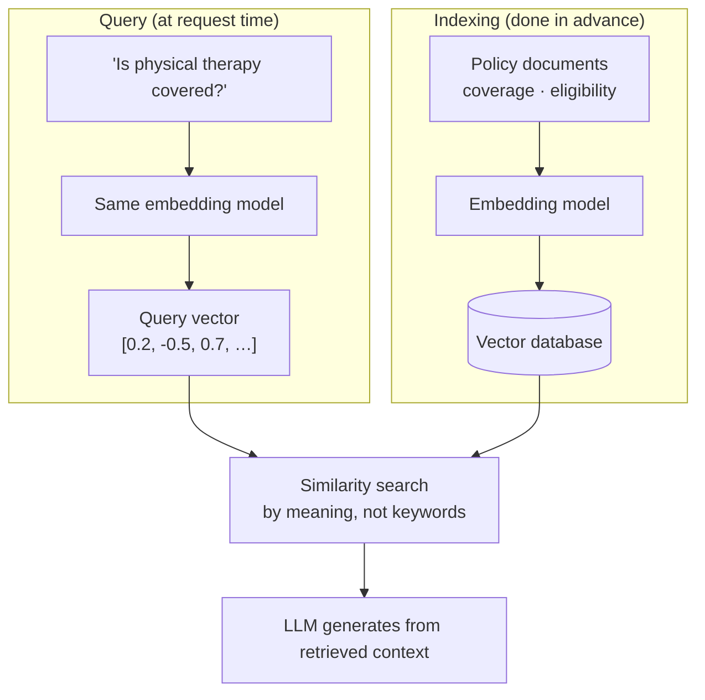
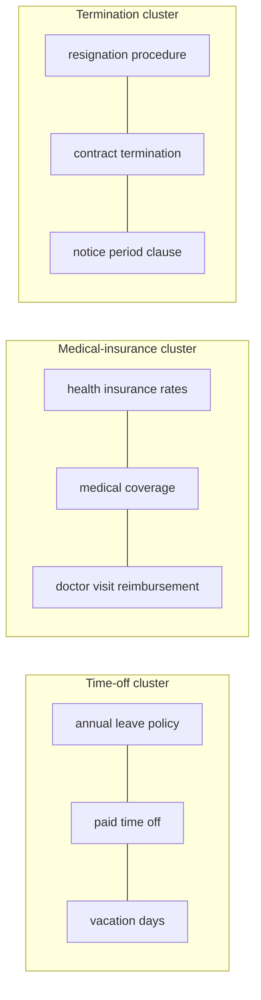
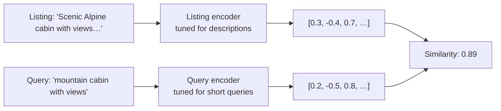
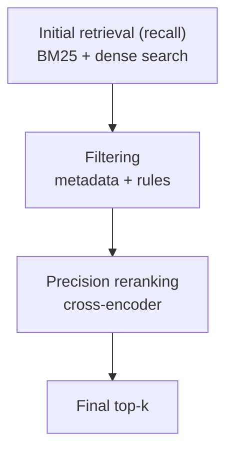
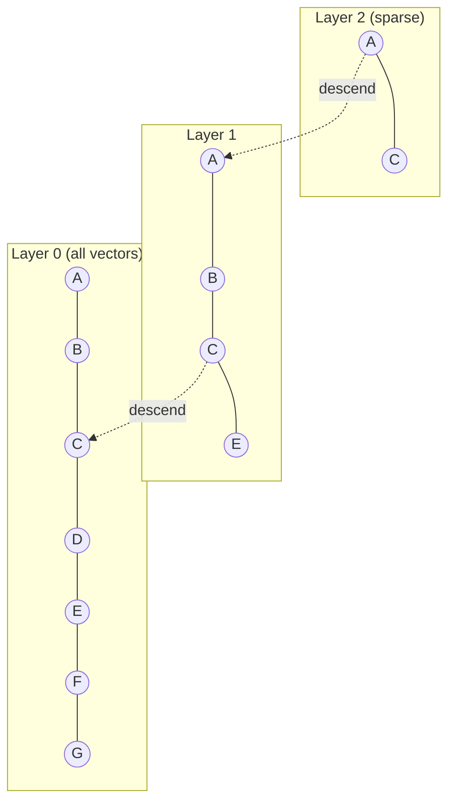

# Embeddings and Vector Search

> **Adapted from:** Chapter 4, "Embeddings and vector search" — rewritten and condensed for teaching, with code corrected and updated.

A large health-care company launched a RAG chatbot to help patients understand their insurance plans. It had a capable LLM and accurate policy documents. Shortly after launch, users reported that it **couldn't answer easy questions**. Asked whether physical therapy after surgery was covered, it gave a vague reply or "I don't know," even though the documents stated the answer plainly. Sometimes it gave outdated answers.

The LLM wasn't the problem, and neither was the content. **Retrieval** was failing, and the root cause was the **embedding model**.



A RAG system runs **two pipelines through the same embedding model**. If that model doesn't understand your domain, the query lands **far from** the right documents in vector space, and the LLM gets weak context. It then either says it doesn't know or answers **confidently and wrongly**.

[Lesson 2](./grounding-outputs-with-rag) built a basic pipeline. This lesson makes retrieval **reliable**: choosing embedding models, combining keyword and vector search, reranking, filtering, chunking, scaling with approximate nearest-neighbor indexes and vector databases, and coping with drift.

**What you'll be able to do after this lesson:**

- Explain embeddings, cosine similarity, and why **model choice decides retrieval quality**.
- Choose among **commercial, open-source, and domain-specific** embedding models.
- Build a **hybrid, multistage** retriever: BM25 plus dense search, fused, then reranked by a **cross-encoder**.
- Apply metadata filtering and **content-aware chunking** with correct overlap.
- Explain **HNSW**, use FAISS, and build a filtered RAG assistant on a **vector database**.
- Manage **embedding drift** and shrink indexes with **quantization**.

---

## What Are Embeddings?

An **embedding** is a vector of numbers, such as `[0.12, -0.87, 0.56, …]` with typically **384–1,536 dimensions**, that represents the **meaning** of a piece of text. Similar meanings land **close together**. These two questions share few words but have the same intent, so a good model places them near each other:

- "How do I get reimbursed for therapy?"
- "What's the process for submitting a mental health claim?"

**Closeness** is measured by:

- **Cosine similarity**, the angle between two vectors. It ignores vector length, which makes it the usual choice for text.
- **Dot product**, which also accounts for magnitude. On **normalized** vectors (length 1), the two are identical.

**A mental model: a map of meaning.** The embedding model is a map-maker that pins every sentence somewhere on a huge map of ideas. Vacation-policy sentences cluster together. Medical-coverage questions land near health documents. Resignation and termination requests drift toward HR and legal content. Embed your documents to pin them on the map. Embed a query, drop it on the map, and look at what's nearby. That's retrieval.



The map is only as good as the **map-maker**. Some models are trained on academic text, some on short search queries, and some on legal, medical, or financial language. **The better the model understands your content and your users' phrasing, the more reliable retrieval is.** For example, "Can I get paid during adoption leave?" should land next to "Eligible employees are granted paid parental leave for adoption or foster care." With a weak model, it doesn't.

---

## Choosing an Embedding Model

### Commercial APIs: powerful but opaque

Examples include OpenAI **text-embedding-3-small** (fast, compact, strong for general search), Cohere **embed-v4** (multimodal, with flexible dimensionality), and Google **gemini-embedding-001** (a strong MTEB performer that embeds text, images, and video in one space).

They are easy to use and strong out of the box, but:

- **Training data is unknown**, and you **can't fine-tune** them.
- You **pay per token**. Document embeddings are computed once and stored, though, so ongoing cost is mostly **query** embedding.
- There's **latency, rate limits, and data-privacy** exposure, which matters in regulated industries.
- There's **lock-in**: switching providers means **re-embedding the whole corpus**.

### Open-source: flexible and transparent

You can run these yourself and fine-tune them. Libraries such as **Sentence Transformers** and **Hugging Face Transformers** host many retrieval models:

- **E5** (for example `e5-large-v2`): instruction-tuned for natural-language queries. In such names, *large* means more parameters, better quality, and slower inference, and *v2* is the version.
- **BGE** (BAAI General Embedding, for example `bge-base-en-v1.5`), and **BGE-M3** for multilingual and multi-granularity retrieval.
- **Qwen3-Embedding** (0.6B / 4B / 8B parameters): top-ranked multilingual model with 100+ languages and long context.
- **NV-Embed-v2** (NVIDIA): strong across MTEB task categories.
- **all-MiniLM-L6-v2**: small and fast, good for edge devices and high throughput.

The cost is **self-hosting**: compute, GPUs, and maintenance. Quality also varies by domain, so **evaluate** before committing.

:::tip Use the prefixes your model was trained with
E5-family models expect inputs prefixed with **`query: `** for questions and **`passage: `** for documents. Leaving the prefixes off measurably hurts retrieval. Many instruction-tuned models (E5, BGE, Qwen3-Embedding) have conventions like this, so read the model card.
:::

### Domain-specific: purpose-built precision

**LegalBERT, SciBERT, PubMedBERT, BioSentVec, CodeBERT.** *Termination* means one thing in a contract and something else in a medical report. Domain models often **beat general models by a wide margin within their domain**, and do poorly outside it. You wouldn't build a shopping assistant on a biomedical model, but for clinical decision support it can make all the difference.

| Type | Examples | Strengths | Weaknesses | Best for |
|---|---|---|---|---|
| Commercial API | text-embedding-3-small, embed-v4, gemini-embedding-001 | Easy, high quality, robust | Cost, no fine-tuning, opaque, lock-in | General chatbots, internal search |
| Open-source | E5, BGE-M3, all-MiniLM, GTE, NV-Embed-v2 | Free, tunable, runs locally | Infrastructure, may need tuning | Privacy-sensitive, custom pipelines |
| Domain-specific | LegalBERT, BioSentVec, CodeBERT | Top accuracy in domain | Poor outside it | Legal, medical, code assistants |
| Instruction-tuned | e5-large-v2, BGE, GTE, Qwen3-Embedding | Better with natural-language queries | Larger, slower | RAG and chat-style systems |

### Beyond benchmark scores

- **Dimensionality.** 768–1,536 dimensions capture more nuance but cost more storage and compute than 384 or fewer. At millions of documents, **4× fewer dimensions** is real money saved. **Matryoshka** models (such as text-embedding-3) let you **truncate** vectors, say from 1,536 to 256 dimensions, with little quality loss.
- **Context length.** MiniLM-class models stop at **512 tokens**, while newer ones accept **8,000+**. Longer text gets **truncated**, so chunk accordingly.
- **Multilingual needs.** XLM-RoBERTa and multilingual E5 cover many languages with one model, but may trail single-language models within a language.
- **Hardware.** BERT-sized models need hundreds of MB of GPU memory. **Quantized** models can run on CPUs with little loss, which matters for edge deployments.

**By industry:**

- **Health care**: domain models (PubMedBERT, BioSentVec). High stakes justify the tuning.
- **Finance**: instruction-tuned models handle numerical and temporal relationships better.
- **Enterprise search**: robust general-purpose models, often commercial APIs.

### Case study: Airbnb's move to embedding search

Airbnb has written about moving its search from keyword matching to embedding-based retrieval. The lessons generalize well.

- **The problem.** A guest searches "peaceful retreat with mountain views within walking distance to restaurants." A great listing describes itself as a "tranquil hideaway overlooking the Alps, near the town center." Keyword search misses it. **Hosts and guests describe the same thing in different words.**
- **The architecture: a dual encoder ("two towers").** Separate encoders handle **queries** (short and ambiguous) and **listings** (long and detailed). Listing vectors are **precomputed offline**, so only the query is embedded at search time.



- **Training data from behavior.** A click or booking after a search becomes a (query, listing) **relevance pair**. Clicks are **position-biased**, since top results get clicked regardless, so the signal must be **debiased**.
- **The serving pipeline:**
  1. Embed the query in real time.
  2. Run **approximate nearest-neighbor** search.
  3. Combine the matches with **hard filters** (price, dates).
  4. Apply a final **ranker**.

  Embeddings supply meaning, and traditional filters enforce constraints.
- **Measure what matters.** The source reports a **16% reduction in ranking errors**, but the real targets were **bookings, satisfaction, and long-tail queries**.
- **Production challenges:**
  - **Cold start**: give new listings content-based embeddings, then refresh them as interaction data accumulates.
  - **Compute**: precompute listing vectors and keep the query encoder fast.
  - **Drift**: monitor continuously and retrain.

The takeaways: **start from a clear use case, mine real user signals, think in systems rather than models, plan the operations up front, and A/B test with real users.**

### Check: models

<MultipleChoice
  id="rai-ch4-models"
  title="Choosing embeddings"
  questions={[
    {
      prompt: 'A hospital must keep patient text on-premises and needs strong recall on clinical terminology. Which choice fits best?',
      choices: [
        'A commercial embedding API',
        'A self-hosted domain model (e.g. PubMedBERT-based), possibly fine-tuned on in-house data',
        'all-MiniLM-L6-v2 with no evaluation',
        'Any model, as long as cosine similarity is used',
      ],
      answer: 1,
      why: 'Privacy rules out sending text to an API, and domain vocabulary favors a biomedical model.',
    },
    {
      prompt: 'You switch from one commercial embedding provider to another. What must you do?',
      choices: [
        'Nothing; vectors are interchangeable',
        'Re-embed the entire corpus with the new model, because vectors from different models live in different spaces',
        'Only re-embed new documents',
        'Convert the vectors with cosine similarity',
      ],
      answer: 1,
      why: 'The query and documents must be embedded by the same model (and version), so a provider switch means full re-indexing.',
    },
    {
      prompt: 'Why did Airbnb precompute listing embeddings but embed queries at request time?',
      choices: [
        'Queries are longer than listings',
        'Listings change rarely and are numerous, so embedding them offline keeps search fast. Only the short query must be encoded live',
        'Listings cannot be embedded',
        'To avoid using a vector index',
      ],
      answer: 1,
      why: 'This is the two-tower pattern: expensive document-side work happens offline, and request-time work is minimal.',
    },
  ]}
/>

---

## Beyond Simple Vectors: Hybrid and Multistage Retrieval

### The limits of pure vector search

A user asks, "What's the notice period for resigning in California?" The answer, "30-day notice," is in the corpus, but none of the top 5 vector hits contain it. Why?

- **Semantic drift**: embeddings favor **broad topical similarity** over the document that actually answers.
- **Recall cut-off**: the right document ranks **just below** top-k.
- **Domain gaps**: a general model blurs fine distinctions.

The LLM is then left choosing between **hallucinating** and **"I don't know."**

### Hybrid retrieval: dense plus sparse

- **Dense retrieval** (embeddings) captures **meaning**, linking *quitting* with *resignation*.
- **Sparse retrieval** (keywords: **BM25**, TF-IDF, or learned sparse models such as SPLADE) rewards **exact terms** like *California* and *notice period*.

Each covers the other's blind spots. A typical hybrid retriever:

1. Runs **BM25**.
2. Runs **vector search**.
3. **Merges and deduplicates** the results.
4. Optionally **reranks** them.

This is standard practice in legal research, enterprise search, and similar systems.

#### Practice: BM25 from scratch

Implement `bm25_scores(query, docs, k1=1.5, b=0.75)` with the classic Okapi formula. For each distinct query term that appears in at least one document:

```text
idf(t)     = ln(1 + (N - n_t + 0.5) / (n_t + 0.5))      N = number of docs, n_t = docs containing t
score(d)  += idf(t) * tf * (k1 + 1) / (tf + k1 * (1 - b + b * len(d) / avgdl))
```

Here `tf` is the term's count in document `d`. Tokens are lowercase `[a-z0-9]+`. The wrapper scores the five HR policies below and prints each score to 3 decimals.

| # | Document |
|---|---|
| 0 | California employees must give a 30-day notice before resignation. |
| 1 | All new hires are eligible for health insurance after 90 days. |
| 2 | Termination for cause may lead to loss of severance benefits. |
| 3 | Employees may request remote work accommodations under ADA. |
| 4 | Maternity and adoption leave are fully paid for 12 weeks. |

<CodeExercise
  title="BM25 keyword scoring"
  heading="exercise-rai-bm25"
  lang="python"
  filename="main.py"
  prompt="Implement bm25_scores(query, docs, k1=1.5, b=0.75) returning one score per doc using the Okapi BM25 formula above (distinct query terms; skip terms in no document)."
  sampleLog={`Do we have paid adoption leave?
0.000 0.000 0.000 0.000 4.121`}
  starter={`import math
import re

TOKEN = re.compile(r'[a-z0-9]+')

def bm25_scores(query, docs, k1=1.5, b=0.75):
    pass
`}
  wrapSuffix={`
import sys
DOCS = [
    "California employees must give a 30-day notice before resignation.",
    "All new hires are eligible for health insurance after 90 days.",
    "Termination for cause may lead to loss of severance benefits.",
    "Employees may request remote work accommodations under ADA.",
    "Maternity and adoption leave are fully paid for 12 weeks.",
]
print(' '.join(f'{s:.3f}' for s in bm25_scores(sys.stdin.read().strip(), DOCS)))
`}
  hint="Tokenize every doc once; avgdl = average token count. For each doc, loop over set(query tokens); n_t = number of docs containing the term (skip if 0); tf = doc_tokens.count(term)."
  solution={`import math
import re

TOKEN = re.compile(r'[a-z0-9]+')

def bm25_scores(query, docs, k1=1.5, b=0.75):
    tokenized = [TOKEN.findall(d.lower()) for d in docs]
    n_docs = len(docs)
    avgdl = sum(len(t) for t in tokenized) / n_docs
    terms = set(TOKEN.findall(query.lower()))
    scores = []
    for doc in tokenized:
        score = 0.0
        for term in terms:
            n_t = sum(1 for d in tokenized if term in d)
            if n_t == 0:
                continue
            tf = doc.count(term)
            idf = math.log(1 + (n_docs - n_t + 0.5) / (n_t + 0.5))
            score += idf * tf * (k1 + 1) / (tf + k1 * (1 - b + b * len(doc) / avgdl))
        scores.append(score)
    return scores
`}
  tests={[
    { name: 'exact keywords: adoption leave', stdin: 'Do we have paid adoption leave?', equals: '0.000 0.000 0.000 0.000 4.121' },
    { name: 'California + notice', stdin: 'How much notice do I need before quitting in California?', equals: '4.121 0.000 0.000 0.000 0.000' },
    { name: 'synonyms defeat BM25: only the word "for" matches', stdin: 'What happens if someone gets fired for misconduct?', equals: '0.000 0.511 0.534 0.000 0.534' },
    { name: 'rare terms dominate', stdin: 'health insurance for new hires', equals: '0.000 5.766 0.534 0.000 0.534' },
  ]}
/>

The third test shows why you also need **dense** retrieval. "Fired for misconduct" shares **no meaningful words** with "**Termination for cause**", so BM25's only matches come from the filler word *for*. An embedding model links *fired* with *termination*, and that's the case hybrid retrieval exists for. (Production BM25 usually removes **stopwords** like *for*, too.)

### Multistage retrieval: building precision in layers

Hybrid search improves **recall**: the right document is *somewhere* in the results. **Precision** asks whether it's at the **top**. For "remote work policy for employees with disabilities," hybrid results might be:

1. "Company holiday and leave policies for 2023" (marginally relevant)
2. "Benefits enrollment deadlines" (not relevant)
3. "Employees may request remote work accommodations under ADA" (**the answer**)
4. "General remote work guidelines" (somewhat relevant)
5. "New office opening announcement" (not relevant)

The answer is there, but it's **third**. **Multistage retrieval** narrows step by step, like finding a book in a library: go to the right section, scan the shelves, then examine a few books closely.



### Bi-encoders vs. cross-encoders

- **Bi-encoders** (E5, MPNet, OpenAI embeddings) encode the query and the document **separately**, then compare the vectors. They're **fast**, since document vectors are precomputed, but the query and document **never interact**.
- **Cross-encoders** read the **query and document together** through every transformer layer and output **one relevance score**. They're **far more precise**, recognizing for instance that *work accommodation* relates to *ADA*, and **far slower**. **Only rerank the top candidates**, never the whole corpus.

### Fusing result lists: reciprocal rank fusion

Concatenating BM25 and dense hits and then deduplicating lets whichever list comes **first** win ties, and it ignores **agreement** between the lists. **Reciprocal rank fusion (RRF)** rewards documents that rank well **in several lists**, using only **ranks**, so you never compare BM25 scores with cosine scores:

```text
RRF(d) = Σ over lists of 1 / (k + rank_in_list(d))        rank starts at 1; k = 60 by convention
```

#### Practice: reciprocal rank fusion

Implement `rrf(rankings, k=60)`. `rankings` is a list of ranked document-ID lists. Return `(doc, score)` pairs sorted by score descending, with ties broken by document ID.

Input: line 1 is `k`, and each remaining line is one ranked list.

<CodeExercise
  title="Reciprocal rank fusion"
  heading="exercise-rai-rrf"
  lang="python"
  filename="main.py"
  prompt="Implement rrf(rankings, k=60): sum 1/(k + rank) over every list a doc appears in (rank from 1), return (doc, score) sorted by (-score, doc)."
  sampleLog={`60
a b c
c a d
a 0.0325
c 0.0323
b 0.0161
d 0.0159`}
  starter={`def rrf(rankings, k=60):
    pass
`}
  wrapSuffix={`
import sys
lines = sys.stdin.read().strip().split('\\n')
k = int(lines[0])
for doc, score in rrf([line.split() for line in lines[1:]], k):
    print(doc, f'{score:.4f}')
`}
  hint="Accumulate scores in a dict with enumerate(ranking, start=1); then sorted(scores.items(), key=lambda kv: (-kv[1], kv[0]))."
  solution={`def rrf(rankings, k=60):
    scores = {}
    for ranking in rankings:
        for rank, doc in enumerate(ranking, start=1):
            scores[doc] = scores.get(doc, 0.0) + 1 / (k + rank)
    return sorted(scores.items(), key=lambda kv: (-kv[1], kv[0]))
`}
  tests={[
    { name: 'BM25 list + dense list', stdin: '60\na b c\nc a d', equals: 'a 0.0325\nc 0.0323\nb 0.0161\nd 0.0159' },
    { name: 'agreement beats a single first place', stdin: '60\nx y\ny z\ny x', equals: 'y 0.0489\nx 0.0325\nz 0.0161' },
    { name: 'small k emphasizes top ranks', stdin: '1\na b c', equals: 'a 0.5000\nb 0.3333\nc 0.2500' },
  ]}
/>

In the second test, `x` is first in one list, but `y` appears **near the top of all three**, so it wins. That's the behavior you want from fusion.

### Hands-on: a hybrid retriever for an employee-policy chatbot

The full pipeline: **BM25 + E5 dense search → RRF fusion → cross-encoder rerank.**

```bash
pip install rank_bm25 sentence-transformers numpy
```

```python
import numpy as np
from rank_bm25 import BM25Okapi
from sentence_transformers import CrossEncoder, SentenceTransformer

documents = [
    "California employees must give a 30-day notice before resignation.",
    "All new hires are eligible for health insurance after 90 days.",
    "Termination for cause may lead to loss of severance benefits.",
    "Employees may request remote work accommodations under ADA.",
    "Maternity and adoption leave are fully paid for 12 weeks.",
]

# Sparse retriever.
bm25 = BM25Okapi([d.lower().split() for d in documents])

# Dense retriever. E5 expects "query: " / "passage: " prefixes.
dense_model = SentenceTransformer("intfloat/e5-base-v2")
doc_vecs = dense_model.encode([f"passage: {d}" for d in documents], normalize_embeddings=True)

# Reranker: reads (query, document) pairs jointly.
cross_encoder = CrossEncoder("cross-encoder/ms-marco-MiniLM-L-6-v2")

def rrf(rankings, k=60):
    scores = {}
    for ranking in rankings:
        for rank, idx in enumerate(ranking, start=1):
            scores[idx] = scores.get(idx, 0.0) + 1 / (k + rank)
    return sorted(scores, key=lambda i: -scores[i])

def hybrid_retrieve(query, top_k=3, candidates_k=10):
    # 1. BM25: keep only documents that actually match a term.
    bm25_scores = bm25.get_scores(query.lower().split())
    bm25_rank = [int(i) for i in np.argsort(bm25_scores)[::-1] if bm25_scores[i] > 0][:candidates_k]

    # 2. Dense: cosine similarity = dot product on normalized vectors.
    q_vec = dense_model.encode(f"query: {query}", normalize_embeddings=True)
    dense_rank = [int(i) for i in np.argsort(doc_vecs @ q_vec)[::-1]][:candidates_k]

    # 3. Fuse by rank, not by raw score.
    candidates = rrf([bm25_rank, dense_rank])[:candidates_k]

    # 4. Rerank only the short candidate list with the cross-encoder.
    scores = cross_encoder.predict([(query, documents[i]) for i in candidates])
    ranked = sorted(zip(candidates, scores), key=lambda x: -x[1])
    return [(documents[i], float(s)) for i, s in ranked[:top_k]]

for q in ["How much notice do I need before quitting in California?",
          "Do we have paid adoption leave?",
          "What happens if someone gets fired for misconduct?"]:
    print(f"\nQuery: {q}")
    for doc, score in hybrid_retrieve(q, top_k=2):
        print(f"  [{score:.3f}] {doc}")
```

Typical results (exact scores depend on model versions):

| Query | Top result | Why it works |
|---|---|---|
| "How much notice… before **quitting** in California?" | "California employees must give a 30-day notice before **resignation**." | Dense links *quitting* to *resignation*. BM25 adds *California* and *notice* |
| "Do we have paid **adoption leave**?" | "Maternity and adoption leave are fully paid for 12 weeks." | Exact keyword match, confirmed semantically |
| "What happens if someone gets **fired for misconduct**?" | "**Termination for cause** may lead to loss of severance benefits." | Only the dense side finds this (see the BM25 exercise) |

**What each component contributes:**

- **BM25 alone** finds exact terms but misses *quitting*/*resignation* and *fired*/*termination*.
- **Dense alone** can return documents that are topically related but unhelpful.
- **Without reranking**, the right documents may come back in the wrong order.

Together you get **recall** from fusion and **precision** from reranking. Rerankers help **any** RAG pipeline, not just hybrid ones.

:::note Reading cross-encoder scores
MS MARCO cross-encoders output **relevance logits**: use them to **order** candidates. Don't read them as probabilities, and don't threshold them, unless you apply a sigmoid and calibrate the cutoff on your own data.
:::

### Check: hybrid and multistage

<MultipleChoice
  id="rai-ch4-hybrid"
  title="Recall, precision, rerankers"
  questions={[
    {
      prompt: 'The right document is in your top 20 but usually ranked around 9th. Which addition helps most?',
      choices: [
        'More BM25',
        'A cross-encoder reranker over the top candidates, which fixes precision (ordering) rather than recall',
        'Fewer documents in the index',
        'A higher LLM temperature',
      ],
      answer: 1,
      why: 'The document is already retrieved (recall is fine). Reranking puts it near the top.',
    },
    {
      prompt: 'Why apply a cross-encoder only to the top candidates?',
      choices: [
        'Cross-encoders cannot read long documents',
        'They score each (query, document) pair jointly, with no precomputation, so running them over the whole corpus on every query is far too slow',
        'They only work with BM25',
        'They are less accurate than bi-encoders',
      ],
      answer: 1,
      why: 'Bi-encoders scale because document vectors are precomputed. Cross-encoders trade that for accuracy, so use them only on a short list.',
    },
    {
      prompt: 'Why fuse BM25 and dense results with RRF instead of adding their scores?',
      choices: [
        'RRF is the only method that dedupes',
        'BM25 scores and cosine similarities are on different, incomparable scales. RRF uses only ranks and rewards agreement between lists',
        'Adding scores is too slow',
        'RRF needs no retrievers',
      ],
      answer: 1,
      why: 'Rank-based fusion sidesteps score calibration entirely.',
    },
  ]}
/>

---

## Essential Retrieval Optimizations

### Metadata filtering

Semantic search sees **meaning**, but not **attributes**: whether a policy is from **2023 or 2018**, an **official** policy or a **Slack** thread, for **managers** or all staff, for **California** or **New York**, for **engineering** or **finance**. Without those attributes, results mix current and stale, and applicable and inapplicable.

The process has four parts: **extract** metadata, **store** it with the vectors, **analyze the query** for filter intent, and **apply** the filters.

**1. Extract metadata with several strategies**: file paths, regular expressions, and an LLM for semantic attributes.

```python
import json
import re
from openai import OpenAI

client = OpenAI()

def extract_metadata(document_path: str, content: str) -> dict:
    metadata = {}
    parts = document_path.split("/")                    # e.g. /policies/hr/benefits/doc.pdf
    if len(parts) >= 3:
        metadata["department"] = parts[-3]
    if m := re.search(r"Effective Date:\s*(\d{4}-\d{2}-\d{2})", content):
        metadata["effective_date"] = m.group(1)
    metadata.update(extract_with_llm(content))
    return metadata

def extract_with_llm(content: str) -> dict:
    """For large corpora, a small model (or GLiNER-style extractor) is much cheaper."""
    response = client.chat.completions.create(
        model=CHAT_MODEL,
        messages=[{"role": "user", "content":
            'Return JSON with "audience" (who this applies to) and "status" '
            '("active", "draft", or "archived").\n\nDocument:\n' + content[:500]}],
        temperature=0.1,
        response_format={"type": "json_object"},        # ask for valid JSON
    )
    try:
        return json.loads(response.choices[0].message.content)
    except json.JSONDecodeError:
        return {}
```

**2. Analyze the query for filter intent**, so users never need to know the document schema:

```python
def analyze_query_for_filters(query: str) -> dict:
    q = query.lower()
    filters = {}
    if "california" in q:
        filters["region"] = "California"
    if any(w in q for w in ("current", "latest")):
        filters["status"] = "active"
    departments = {"hr": ["benefits", "leave", "vacation"],
                   "legal": ["compliance", "contract"],
                   "engineering": ["code", "api"]}
    for dept, words in departments.items():
        if any(w in q for w in words):
            filters["department"] = dept
            break
    return filters
```

**3. Combine filters with semantic search.** Use **hard filters** for constraints such as region, and **soft adjustments** for preferences, for example halving the score of archived content instead of dropping it:

```python
def smart_metadata_search(query, document_metadata, top_k=5):
    auto_filters = analyze_query_for_filters(query)
    results = []
    for doc_id, score in semantic_search(query, top_k=top_k * 3):   # over-fetch to survive filtering
        meta = document_metadata[doc_id]
        if "region" in auto_filters and meta.get("region") not in (auto_filters["region"], "All"):
            continue
        if "status" in auto_filters and meta.get("status") != auto_filters["status"]:
            continue
        if meta.get("status") == "archived":
            score *= 0.5
        results.append((doc_id, score, meta))
    return sorted(results, key=lambda r: -r[1])[:top_k]
```

**Before and after**, for "What's the paternity leave policy in California?":

| | Pure semantic search | With filters `{region: California, status: active}` |
|---|---|---|
| 1 | [0.85] "8 weeks of paid family leave" (2019, **archived**) | [0.78] "California employees are entitled to **12 weeks** of paid paternity leave" |
| 2 | [0.82] "**New York** employees can take up to 10 weeks…" | [0.65] "All employees must submit leave requests 30 days in advance" |
| 3 | [0.78] the correct California policy, **buried third** | |

### Chunking: finding the right granularity

Chunking is the **most underrated** RAG design decision, because it determines **what can be found at all**. Consider this passage:

> The California Family Rights Act (CFRA) provides eligible employees with up to 12 weeks of job-protected leave for specified family and medical reasons. To be eligible, employees must have worked for the company for at least one year and have worked at least 1,250 hours in the 12 months preceding the leave.

- **Chunks that are too small** (100–200 tokens) can split the policy from its eligibility rules. "Am I eligible for CFRA leave?" then retrieves only the first chunk, and the criteria are missing.
- **Chunks that are too large** (500+ tokens) keep the rules together, but unrelated content in the same chunk **dilutes** the relevance score.

**Content-aware chunking** picks a strategy by document type:

```python
def chunk_document(document: str, content_type: str) -> list[str]:
    if content_type == "legal":
        return chunk_by_section(document)                  # split on "SECTION 1:", numbered clauses
    if content_type == "narrative":
        return chunk_by_paragraph(document, min_length=200)  # split on blank lines
    if content_type == "code_documentation":
        return chunk_preserving_code_blocks(document)       # keep ``` blocks with their explanation
    return sliding_window_chunks(document.split(), chunk_size=500, overlap=100)
```

- **HR policies**: section chunks, so "Paid Time Off Policy" and "Performance Review Process" each stay whole.
- **Technical documentation**: keep each API method's parameters with their descriptions, and code with its explanation.
- **Semantic chunking**: split at sentence or proposition boundaries (with spaCy, for example). This gives more meaningful boundaries than fixed windows.

**Overlap** is insurance against facts that straddle a boundary. With 100 tokens of overlap, the CFRA sentence appears in **both** neighboring chunks, so an eligibility question still finds the policy *and* its criteria. A common starting point is **section-sized chunks with about 20% overlap**, tuned against your own queries.

#### Practice: a correct sliding-window chunker

A common implementation steps through the text with `range(0, len(tokens), size - overlap)`. That loop emits **redundant tail chunks** that are already contained in the previous chunk. With 10 tokens, `size=4`, and `overlap=2`, the last chunk is `w8 w9`, a strict subset of the chunk before it, which wastes storage and pollutes results.

Implement `sliding_window(tokens, size, overlap)` correctly:

- Raise `ValueError` if `overlap >= size`.
- Start at 0 and advance by `size - overlap`.
- **Stop after the chunk that reaches the end** of the tokens.

The wrapper prints each chunk's first and last token.

<CodeExercise
  title="Sliding-window chunking without redundant tails"
  heading="exercise-rai-chunker"
  lang="python"
  filename="main.py"
  prompt="Implement sliding_window(tokens, size, overlap): validate overlap < size; emit tokens[i:i+size] starting at i=0, stepping by size-overlap, and stop once a chunk reaches the end."
  sampleLog={`4 2 10
w0-w3 w2-w5 w4-w7 w6-w9`}
  starter={`def sliding_window(tokens, size, overlap):
    pass
`}
  wrapSuffix={`
import sys
size, overlap, n = map(int, sys.stdin.read().split())
tokens = [f'w{i}' for i in range(n)]
try:
    print(' '.join(f'{c[0]}-{c[-1]}' for c in sliding_window(tokens, size, overlap)))
except ValueError as e:
    print('error:', e)
`}
  hint="Loop with i = 0; append tokens[i:i + size]; if i + size >= len(tokens): break; else i += size - overlap."
  solution={`def sliding_window(tokens, size, overlap):
    if overlap >= size:
        raise ValueError('overlap must be smaller than chunk size')
    chunks = []
    i = 0
    while True:
        chunks.append(tokens[i:i + size])
        if i + size >= len(tokens):
            break
        i += size - overlap
    return chunks
`}
  tests={[
    { name: 'overlapping windows, no redundant tail', stdin: '4 2 10', equals: 'w0-w3 w2-w5 w4-w7 w6-w9' },
    { name: 'no overlap', stdin: '5 0 10', equals: 'w0-w4 w5-w9' },
    { name: 'one chunk covers everything', stdin: '10 3 10', equals: 'w0-w9' },
    { name: 'text shorter than a chunk', stdin: '5 1 3', equals: 'w0-w2' },
    { name: 'invalid overlap', stdin: '4 4 10', equals: 'error: overlap must be smaller than chunk size' },
  ]}
/>

---

## Vector Storage at Scale

Comparing a query with **every** vector (an "exact" or "flat" search) is fine for thousands of vectors, slow for hundreds of thousands, and unusable at millions. Production systems use **approximate nearest-neighbor (ANN)** indexes.

### HNSW: the algorithm behind most vector search

**Hierarchical Navigable Small World** graphs organize vectors into **layers**:

- The **top layer** is sparse, with a few well-connected vectors.
- Each **lower layer** adds more vectors and links.
- The **bottom layer** contains **all** of them.

A search starts from the graph's **entry point** at the top layer and greedily moves toward the query. When it can't get any closer, it **drops a layer** and continues, ending in the dense bottom layer with the nearest neighbors.



Two properties make it fast: the **small-world** structure (any node is reachable in a few hops) and **hierarchical refinement**. Search cost grows roughly **logarithmically** with collection size instead of linearly, which is the difference between milliseconds and seconds.

The tuning knobs:

- **M**: the number of links per node. **16** is a common default. Higher means more accurate, with more memory.
- **efConstruction**: how thoroughly the index is built. **100** is common. Higher means a better graph and a slower build.
- **efSearch**: how many candidates to examine at query time. Higher means better recall and slower queries.

### FAISS

**FAISS** is the most widely used vector-search library: C++ with Python bindings, **GPU** support, and many index types.

```python
import faiss
import numpy as np

dimension, num_vectors = 128, 10_000
vectors = np.random.random((num_vectors, dimension)).astype("float32")

index = faiss.IndexHNSWFlat(dimension, 16)     # M = 16 links per node
index.hnsw.efConstruction = 100                # build quality
index.add(vectors)
index.hnsw.efSearch = 64                       # query-time accuracy/speed trade-off

query = np.random.random((1, dimension)).astype("float32")
distances, indices = index.search(query, 5)
print(indices[0], distances[0])
```

Beyond HNSW, **IVF** (inverted file) partitions vectors into clusters, and **IVF-PQ** adds **product quantization** for memory efficiency. That suits **frequent additions** or **tight memory budgets**, while HNSW is better when **latency** matters most and you can afford the memory. Benchmark on your own workload; [ANN-Benchmarks](https://ann-benchmarks.com) compares many implementations.

FAISS is a **library**. It doesn't give you persistence, metadata filtering, or distributed search. For those you need a vector database.

### Vector databases

A vector database combines **ANN indexes** (usually HNSW) with **metadata filtering**, so you can ask for "similar to X **and** department = Benefits **and** status = Active." It also handles the production work:

- **Persistence and durability**: no re-embedding after a restart.
- **Incremental updates**: add, change, or delete vectors without rebuilding the index.
- **Horizontal scaling**: spread vectors across nodes, past a single machine's memory.
- **Replication**: copies on several servers, for availability.
- **Monitoring**: health, latency, and search quality.

| Database | Best for | Key strength | Limitation |
|---|---|---|---|
| **Pinecone** | Rapid prototyping, managed | Serverless, minimal setup | Cost at scale |
| **Weaviate** | Complex metadata queries | GraphQL, built-in vectorizers | Setup complexity |
| **Qdrant** | High-performance filtering | Rust speed, payload filters | Smaller ecosystem |
| **Chroma** | Development and testing | Simple Python API | Fewer production features |
| **pgvector** | Existing PostgreSQL users | Vectors next to relational data | Limited at massive scale |
| **Milvus** | Massive scale | Cloud-native microservices, many index types | Operational complexity |
| **Elasticsearch** | Existing Elastic stack | Adds vectors to existing search | Not purpose-built for vectors |

### Project: a health-care policy assistant on Pinecone

**Step 1: chunk the policies and keep their metadata.**

```python
import re
import uuid
from langchain_text_splitters import RecursiveCharacterTextSplitter

policy_docs = [
    {"text": "SECTION 1: OUTPATIENT SERVICES\n\nPhysical Therapy Coverage: Plan A covers physical "
             "therapy when prescribed by a physician, up to 20 sessions per calendar year with 20% "
             "coinsurance after the deductible. Additional sessions require prior authorization and "
             "medical-necessity documentation.\n\nSpecialist Visits: Referrals are required for all "
             "specialist visits except annual gynecological exams. Without a referral, coverage is 50%.",
     "metadata": {"policy_id": "POL-2023-0042", "department": "Benefits",
                  "effective_date": "2023-01-01", "status": "Active"}},
    {"text": "SECTION 3: SURGICAL PROCEDURES\n\nKnee Surgery: Arthroscopic and reconstructive knee "
             "procedures are covered at 80% after deductible with in-network providers. Post-surgical "
             "rehabilitation including physical therapy is covered for up to 30 sessions when medically "
             "necessary. Out-of-network coverage is limited to 60% of eligible expenses.",
     "metadata": {"policy_id": "POL-2023-0042", "department": "Benefits",
                  "effective_date": "2023-01-01", "status": "Active"}},
]

splitter = RecursiveCharacterTextSplitter(chunk_size=500, chunk_overlap=100,
                                          separators=["\n\n", "\n", ". ", " ", ""])
all_chunks = []
for doc in policy_docs:
    section = re.search(r"SECTION \d+: ([^\n]+)", doc["text"])
    for i, piece in enumerate(splitter.split_text(doc["text"])):
        all_chunks.append({"chunk_id": str(uuid.uuid4()), "content": piece, "chunk_index": i,
                           "section_title": section.group(1) if section else "General Policy",
                           **doc["metadata"]})
```

Each chunk keeps the policy's **metadata** so results can be filtered by policy, department, date, or status. It also keeps its **section title**, taken from the parent document, because a later chunk may not contain the heading itself.

**Step 2: embed with a domain model.**

```python
from sentence_transformers import SentenceTransformer

model = SentenceTransformer("pritamdeka/S-PubMedBert-MS-MARCO")   # biomedical text + search training
embeddings = model.encode([c["content"] for c in all_chunks], show_progress_bar=True)
```

**Step 3: create the index** (Pinecone Python SDK v3 or later):

```python
import os
from pinecone import Pinecone, ServerlessSpec

pc = Pinecone(api_key=os.environ["PINECONE_API_KEY"])
index_name = "healthcare-policies"
if index_name not in pc.list_indexes().names():
    pc.create_index(name=index_name, dimension=embeddings.shape[1], metric="cosine",
                    spec=ServerlessSpec(cloud="aws", region="us-east-1"))
index = pc.Index(index_name)
```

The `dimension` must match the embedding model's output. `metric="cosine"` suits text embeddings.

**Step 4: Pinecone's data model.** Each record has an **ID**, a **vector**, and **metadata** key-value pairs. Together they support queries such as "active Benefits-department policies about physical therapy after surgery."

**Step 5: upsert.** An upsert inserts new IDs and updates existing ones, so you can refresh one document without rebuilding the index. Send large collections in **batches** of a few hundred or thousand records.

```python
index.upsert(vectors=[
    {"id": c["chunk_id"], "values": embeddings[i].tolist(),
     "metadata": {k: c[k] for k in ("content", "section_title", "policy_id",
                                    "department", "effective_date", "status")}}
    for i, c in enumerate(all_chunks)
])
print(index.describe_index_stats())
```

Storing the **text in metadata** saves a second lookup at query time. At millions of chunks, though, it **bloats** index memory and cost. A common pattern keeps only the **vector and chunk ID** in the vector database and the text in a cheaper document store such as DynamoDB or MongoDB.

**Step 6: search with filters.**

```python
def search_policies(query: str, filters: dict | None = None, top_k: int = 3) -> list[dict]:
    q = model.encode([query])[0].tolist()            # same model as the documents
    res = index.query(vector=q, filter=filters, top_k=top_k, include_metadata=True)
    return [{"score": m["score"], **m["metadata"]} for m in res["matches"]]

for r in search_policies("What's covered for physical therapy after knee surgery?",
                         filters={"status": "Active", "department": "Benefits"}):
    print(f'{r["score"]:.3f} {r["policy_id"]} / {r["section_title"]}: {r["content"][:80]}…')
```

**Step 7: answer with sources.**

```python
def answer_policy_question(query: str, filters: dict | None = None) -> dict:
    results = search_policies(query, filters, top_k=2)
    if not results:
        return {"answer": "I couldn't find that in our policy documents.", "sources": []}
    context = "\n".join(f"POLICY EXCERPT {i+1} ({r['policy_id']}):\n{r['content']}"
                        for i, r in enumerate(results))
    response = client.chat.completions.create(
        model=CHAT_MODEL,
        messages=[
            {"role": "system", "content": "You are a health-care policy assistant. Answer ONLY from "
                                          "the excerpts. If they don't contain the answer, say so."},
            {"role": "user", "content": f"EXCERPTS:\n{context}\n\nQUESTION: {query}"},
        ],
        temperature=0.2,
        max_completion_tokens=300,
    )
    return {"answer": response.choices[0].message.content.strip(),
            "sources": [{"policy_id": r["policy_id"], "section": r["section_title"],
                         "score": r["score"]} for r in results]}

for q in ["Does physical therapy require prior authorization?",
          "Do I need a referral to see a specialist?",
          "Is my annual wellness visit covered at 100%?"]:   # not in the excerpts: should say so
    print(q, "->", answer_policy_question(q)["answer"])
```

The **"answer only from the excerpts"** instruction, a **low temperature**, and **returned sources** make answers checkable. The third question isn't covered by the excerpts at all. A well-behaved assistant says so rather than inventing a coverage level.

### Check: indexes and databases

<MultipleChoice
  id="rai-ch4-indexes"
  title="ANN, FAISS, vector DBs"
  questions={[
    {
      prompt: 'Why does HNSW search scale far better than a flat index at millions of vectors?',
      choices: [
        'It stores fewer vectors',
        'It navigates a layered small-world graph from sparse to dense layers, so search cost grows roughly logarithmically instead of comparing the query with every vector',
        'It uses keyword matching',
        'It only works on GPUs',
      ],
      answer: 1,
      why: 'Greedy descent through the hierarchy examines a small fraction of the collection.',
    },
    {
      prompt: 'You need persistence, metadata filters, and replication for 50M vectors. FAISS alone is…',
      choices: [
        'Sufficient: it provides all of those',
        'Insufficient: it is a search library. Use a vector database (or build those features yourself)',
        'Only usable with BM25',
        'Unable to index more than 10K vectors',
      ],
      answer: 1,
      why: 'Vector databases wrap ANN indexes with durability, filtering, updates, scaling, and monitoring.',
    },
    {
      prompt: 'Your chunks store full text in vector-DB metadata, and memory costs are climbing at 20M chunks. What is the common fix?',
      choices: [
        'Delete old chunks',
        'Store only vectors and chunk IDs in the vector database and keep the text in a cheaper document store keyed by ID',
        'Switch to BM25',
        'Use bigger embedding dimensions',
      ],
      answer: 1,
      why: 'Keep the hot, memory-resident index lean and look up the text by ID only for the few hits you return.',
    },
  ]}
/>

---

## Practical Challenges: Drift and Compression

### Embedding drift

Even when your documents don't change, the **way people ask** changes: new features, new policy language, new slang. Queries slowly **diverge** from the indexed vectors. A bot that used to answer correctly starts giving vague replies, and queries that once hit precisely now return loosely related results.

Drift also happens **mechanically**. Upgrade or retrain the embedding model **without re-embedding the documents**, and queries (new model) no longer line up with documents (old model). They drift apart **numerically**, not semantically.

Treat embedding as a **living process**:

- **Re-embed on a schedule** (nightly, weekly) or **after every model change**.
- **Never mix model versions** between queries and documents.
- **Monitor** retrieval quality over time with a fixed evaluation set (see Lesson 2).
- A more **general** embedding model reduces how often you need to re-embed.

### Vector compression

At 768–1,536 float32 dimensions, millions of vectors take **tens to hundreds of gigabytes**. **Quantization** shrinks them while keeping most of their similarity structure:

- **Scalar quantization (SQ)**: each float32 becomes an **int8**, about **4× smaller**.
- **Product quantization (PQ)**: split each vector into sub-vectors and store a **codebook ID** for each one, often **10–30× smaller**.
- **Binary quantization (BQ)**: **1 bit** per dimension, 32× smaller, usually followed by re-scoring.

These options appear as configuration in Qdrant, Weaviate, and FAISS. Some embedding APIs (Cohere's, for example) also return compressed variants directly. Compression pairs naturally with **multistage retrieval**: a fast first pass over compressed vectors, then exact re-scoring or a cross-encoder on the few candidates.

#### Practice: int8 scalar quantization

Implement **symmetric int8 quantization**, one scale per vector:

- `quantize(v)` returns `(codes, scale)`. Set `scale = max(|x|) / 127` (or `1.0` for an all-zero vector) and `codes = [round(x / scale) for x in v]`.
- `dequantize(codes, scale)` returns `[c * scale for c in codes]`.

The wrapper reports the codes, the **cosine similarity** between the original vector and its reconstruction, and the storage size: float32 is 4 bytes per value, and int8 is 1 byte per value plus a 4-byte scale.

<CodeExercise
  title="int8 scalar quantization"
  heading="exercise-rai-quantize"
  lang="python"
  filename="main.py"
  prompt="Implement quantize(v) -> (codes, scale) with scale = max|x|/127 (1.0 if all zero) and codes = round(x/scale), and dequantize(codes, scale) -> [c*scale]."
  sampleLog={`0.12 -0.87 0.56 0.03
codes: [18, -127, 82, 4]
cosine(original, restored): 0.999991
bytes: float32=16 int8=8`}
  starter={`import math

def quantize(v):
    pass

def dequantize(codes, scale):
    pass
`}
  wrapSuffix={`
import sys
v = [float(x) for x in sys.stdin.read().split()]
codes, scale = quantize(v)
restored = dequantize(codes, scale)
def cos(a, b):
    na = math.sqrt(sum(x * x for x in a)); nb = math.sqrt(sum(y * y for y in b))
    return 1.0 if na == 0 and nb == 0 else sum(x * y for x, y in zip(a, b)) / (na * nb)
print('codes:', codes)
print(f'cosine(original, restored): {cos(v, restored):.6f}')
print(f'bytes: float32={4 * len(v)} int8={len(v) + 4}')
`}
  hint="m = max(abs(x) for x in v); scale = m / 127 if m else 1.0; codes = [round(x / scale) for x in v]."
  solution={`import math

def quantize(v):
    m = max(abs(x) for x in v)
    scale = m / 127 if m else 1.0
    return [round(x / scale) for x in v], scale

def dequantize(codes, scale):
    return [c * scale for c in codes]
`}
  tests={[
    { name: 'typical embedding values', stdin: '0.12 -0.87 0.56 0.03', equals: 'codes: [18, -127, 82, 4]\ncosine(original, restored): 0.999991\nbytes: float32=16 int8=8' },
    { name: 'max value maps to 127', stdin: '1.0 0.5 -0.25 0.0', equals: 'codes: [127, 64, -32, 0]\ncosine(original, restored): 0.999994\nbytes: float32=16 int8=8' },
    { name: 'all zeros', stdin: '0 0 0', equals: 'codes: [0, 0, 0]\ncosine(original, restored): 1.000000\nbytes: float32=12 int8=7' },
  ]}
/>

The reconstruction keeps the vector's **direction** almost perfectly (cosine above 0.99999 here), which is what similarity search depends on. The **storage saving grows with dimension**: for a 768-dimensional vector it's 3,072 bytes versus 772, nearly **4×**.

### Check: drift and compression

<MultipleChoice
  id="rai-ch4-drift"
  title="Keeping retrieval healthy"
  questions={[
    {
      prompt: 'You upgrade the embedding model and re-embed only new documents. Retrieval quality collapses. Why?',
      choices: [
        'New models are always worse',
        'Queries now use the new model\'s vector space while most documents are still in the old one. The spaces don\'t align, so you must re-embed the whole corpus',
        'The vector database needs more replicas',
        'Cosine similarity stops working after upgrades',
      ],
      answer: 1,
      why: 'This is mechanical drift. Queries and documents must come from the same model version.',
    },
    {
      prompt: 'Which compression gives about 4× savings by storing each dimension in one byte?',
      choices: ['Binary quantization', 'Scalar (int8) quantization', 'Matryoshka truncation to 1,536 dims', 'HNSW'],
      answer: 1,
      why: 'float32 is 4 bytes and int8 is 1 byte. Binary quantization is 1 bit per dimension (32×). HNSW is an index, not compression.',
    },
  ]}
/>

---

## Key Takeaways

- **Embeddings map meaning to vectors**, and the **embedding model decides which documents your LLM ever sees**. Match it to your domain and query style, and follow its conventions (for example E5's `query:` / `passage:` prefixes).
- **Commercial** models are easy but opaque and lock you in. **Open-source** models offer control and privacy. **Domain** models win inside their field. Weigh **dimensionality, context length, languages, and hardware**.
- **Hybrid retrieval** (BM25 plus dense search) fixes each method's blind spots, **RRF** fuses lists by rank, and **cross-encoder reranking** fixes the order.
- **Metadata filters** add the structure that meaning alone lacks: date, status, region, audience. **Chunk by content type**, with overlap and without redundant tails.
- **HNSW** gives roughly logarithmic ANN search. **FAISS** is the library, and **vector databases** add persistence, filtering, updates, and scale.
- Expect **drift**: re-embed consistently, and never mix model versions. **Quantize** (SQ, PQ, BQ) as the index grows, and re-score candidates for precision.

Previous lesson: [Grounding Outputs with RAG](./grounding-outputs-with-rag).

Next lesson: [Fine-Tuning LLMs](./fine-tuning-llms) — when to fine-tune, preparing data, OpenAI fine-tuning, QLoRA on open models, and distillation.

---

## References

1. Muennighoff, N., et al. (2022). *MTEB: Massive Text Embedding Benchmark.* arXiv:2210.07316.
2. Wang, L., et al. (2022). *Text Embeddings by Weakly-Supervised Contrastive Pre-training* (E5). arXiv:2212.03533.
3. Robertson, S., & Zaragoza, H. (2009). *The Probabilistic Relevance Framework: BM25 and Beyond.*
4. Cormack, G., Clarke, C., & Büttcher, S. (2009). *Reciprocal Rank Fusion Outperforms Condorcet and Individual Rank Learning Methods.* SIGIR.
5. Malkov, Y., & Yashunin, D. (2016). *Efficient and Robust Approximate Nearest Neighbor Search Using Hierarchical Navigable Small World Graphs.* arXiv:1603.09320.
6. [FAISS](https://github.com/facebookresearch/faiss)
7. [Pinecone documentation](https://docs.pinecone.io/)
8. [ANN-Benchmarks](https://ann-benchmarks.com)
