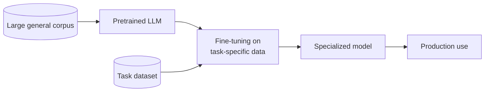
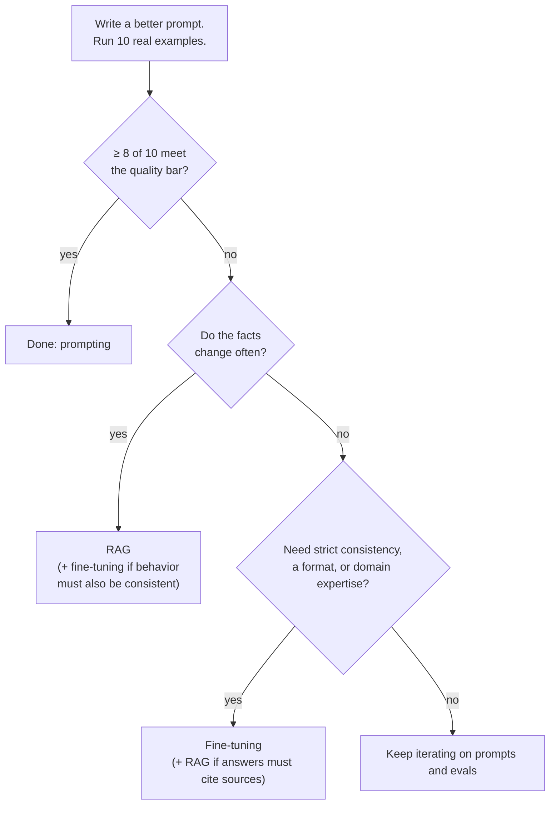
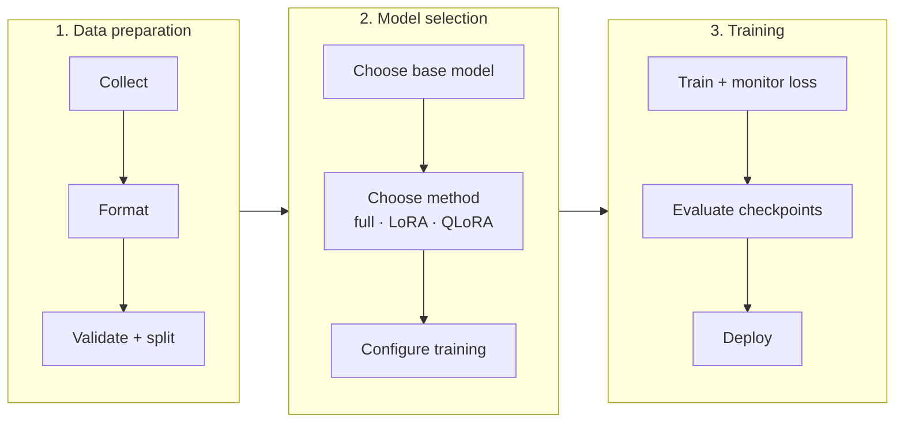
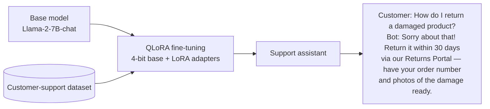
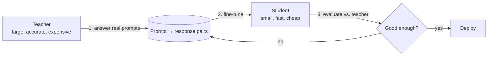

# Fine-Tuning LLMs for Improved Performance

> **Adapted from:** Chapter 5, "Fine-tuning LLMs for improved performance" — rewritten and condensed for teaching, with facts checked and code corrected for current libraries.

Teams adopting LLMs often hit complaints like these:

- "It's okay, but it isn't precise enough with our **medical terminology**."
- "It writes well, but it doesn't understand our **internal jargon**."
- "General models make too many subtle errors on **legal documents**."

[Prompting](./generating-trustworthy-responses-with-prompt-engineering) and [RAG](./grounding-outputs-with-rag) improve results **without changing the model's weights**. Sometimes that isn't enough. **Fine-tuning** continues training a pretrained model on **your own examples**, turning a generalist into a specialist.



**What you'll be able to do after this lesson:**

- Decide between **prompting, RAG, fine-tuning, or a hybrid**.
- Prepare, validate, and **split** a fine-tuning dataset without leakage.
- Fine-tune through **OpenAI's API**, and fine-tune an open model with **QLoRA**.
- Size **LoRA** adapters and estimate **GPU memory**.
- Use validation loss and checkpoints to **stop before overfitting**.
- **Distill** a large teacher model into a small, cheap student for production.

---

## Prompting, RAG, or Fine-Tuning?

| | Prompting | RAG | Fine-tuning |
|---|---|---|---|
| Changes weights | No | No | **Yes** |
| Domain knowledge | Limited to what the model knows | **External sources** | Built into the model |
| Cost and setup | **Cheapest** | Medium (retrieval infrastructure) | **Highest** (data, compute, iteration) |
| Control of tone and format | Hard to keep consistent | Limited | **Precise** |
| Knowledge freshness | Static | **Dynamic** | Static until retrained |
| Can cite sources | No | **Yes** | No |
| Best for | Quick experiments, basic tasks | Changing facts, grounding | Domain behavior, strict formats, internal workflows |

**Prompting** is fast. It needs no training and is flexible, but it adds tokens to every request, gives inconsistent results, and is limited to what the model already knows. **RAG** keeps answers current and grounded, but it needs a retrieval system and is bounded by the context window. **Fine-tuning** gives deep, consistent specialization and **shorter prompts** at inference time, but it needs training data, costs more up front, and risks **catastrophic forgetting**.

### A practical decision framework



1. **The prompting test.** Improve the prompt and run **10 real examples**. If **8 of 10** meet the bar, stop. Prompting takes minutes and costs almost nothing. A chatbot that sounds robotic, for example, can often be fixed with one system-prompt line: "Respond professionally and warmly, as if helping a valued friend."
2. **The freshness question.** If the facts change daily, weekly, or monthly, use **RAG**. A model fine-tuned when there were 50 blue shirts in stock will keep **telling customers there are 50 blue shirts** after they sell out.
3. **The consistency question.** If you need **unwavering style or format**, or **specialized expertise**, fine-tune. A legal assistant that must use Bluebook citations, and must never invent cases, might drift from the format in long conversations despite detailed prompts. After fine-tuning on about 500 correct examples, including examples of answering "I cannot find that case" when unsure, it holds the format far better.

### Hybrid: fine-tuning plus RAG

Many production systems use **both**. A financial-advice bot can be **fine-tuned** to follow the firm's planning principles and risk frameworks, and use **RAG** for **current** interest rates and tax rules. You get consistent reasoning *and* live data.

:::warning Fine-tuned knowledge has no citations
What a model learns in fine-tuning lives in its weights, with **no record of which document it came from**. If answers must reference sources, combine fine-tuning with **RAG** or tools.
:::

#### Practice: encode the decision framework

Implement `choose(pass_rate, facts_change, needs_consistency, needs_citations)` following the flowchart above. It should return exactly one of:

- `'prompting'` if `pass_rate >= 0.8`,
- otherwise, if `facts_change`: `'fine-tuning + RAG'` when `needs_consistency` is true, else `'RAG'`,
- otherwise, if `needs_consistency`: `'fine-tuning + RAG'` when `needs_citations` is true, else `'fine-tuning'`,
- otherwise `'iterate on prompts and evaluate'`.

Input: one scenario per line, `pass_rate facts_change needs_consistency needs_citations`, with booleans written as `y` or `n`.

<CodeExercise
  title="Prompting vs. RAG vs. fine-tuning"
  heading="exercise-rai-ft-decision"
  lang="python"
  filename="main.py"
  prompt="Implement choose(pass_rate, facts_change, needs_consistency, needs_citations) following the decision rules above."
  sampleLog={`0.9 y y y
0.9 y y y -> prompting`}
  starter={`def choose(pass_rate, facts_change, needs_consistency, needs_citations):
    pass
`}
  wrapSuffix={`
import sys
for line in sys.stdin.read().strip().split('\\n'):
    rate, *flags = line.split()
    print(line, '->', choose(float(rate), *(f == 'y' for f in flags)))
`}
  hint="Check the conditions in flowchart order: pass rate first, then freshness, then consistency."
  solution={`def choose(pass_rate, facts_change, needs_consistency, needs_citations):
    if pass_rate >= 0.8:
        return 'prompting'
    if facts_change:
        return 'fine-tuning + RAG' if needs_consistency else 'RAG'
    if needs_consistency:
        return 'fine-tuning + RAG' if needs_citations else 'fine-tuning'
    return 'iterate on prompts and evaluate'
`}
  tests={[
    { name: 'prompting already good enough', stdin: '0.9 y y y', equals: '0.9 y y y -> prompting' },
    { name: 'inventory bot', stdin: '0.5 y n n', equals: '0.5 y n n -> RAG' },
    { name: 'financial advisor: fixed frameworks + live rates', stdin: '0.5 y y n', equals: '0.5 y y n -> fine-tuning + RAG' },
    { name: 'legal citation formatter', stdin: '0.5 n y n\n0.5 n y y\n0.5 n n n', equals: '0.5 n y n -> fine-tuning\n0.5 n y y -> fine-tuning + RAG\n0.5 n n n -> iterate on prompts and evaluate' },
  ]}
/>

---

## Fine-Tuning in the Real World

- **Medicine: Med-PaLM 2.** Google adapted PaLM 2 with medical domain fine-tuning and prompting strategies. It reached about **86.5%** on MedQA (US medical-licensing-style questions), and its successor **Med-Gemini** reached about **91%**. (The source attributes the 91% figure to Med-PaLM 2. That number belongs to Med-Gemini.) Google has continued with the open-weight **MedGemma** models for multimodal medical tasks. The caution: **benchmark scores aren't clinical reliability**, and models trained on exam questions can be brittle on novel cases.
- **Finance: BloombergGPT and FinGPT.** **BloombergGPT** (50B parameters) was actually **trained from scratch** on a mix of financial and general text, roughly half each. That mix is deliberate: training heavily on narrow data can erase general ability, which is **catastrophic forgetting**. The more accessible **FinGPT** projects **fine-tune open models** (such as Llama) with LoRA on financial news and sentiment data, and they outperform much larger general models on financial sentiment tasks.
- **Code: Codex.** OpenAI's original **Codex** fine-tuned GPT-3 on public source code and powered the first GitHub Copilot. Today "Codex" also names OpenAI's coding agent built on newer models. The lasting lesson: code models are excellent at **patterns and boilerplate**, and still need **human review** for complex logic.

In every case, **the quality of the training data drove the results.**

---

## The Fine-Tuning Process



### Data preparation: garbage in, garbage out

**Collect examples that mirror real use.**

- **Reuse what you already have**: support chat logs, emails, FAQs, or public legal datasets. Real text captures real jargon, style, and questions. **Make sure you have the rights** to use it.
- **Annotate where needed.** Classification needs humans to tag the labels. Quality goals, such as "more polite" or "more thorough," need raters to **rank** outputs.
- **Prefer quality over quantity.** A small, expert-reviewed dataset beats a large noisy one. **Fix wrong examples**: a model trained on errors learns the errors. Remove **sensitive** data. Watch for **bias**, which fine-tuning can amplify.
- **Cover the input space.** Include varied phrasings and **every** scenario: login, billing, how-to, and returns for a support bot. Represent each class or format enough times, and don't over-represent one category unless real traffic does.

**Format consistently.**

Older OpenAI completion models used a **prompt/completion** JSONL format:

```json
{"prompt": "Customer: <issue description>\nAgent:", "completion": " <step-by-step resolution>\n"}
```

Current chat models, including the GPT-4.1 family, train on the **chat format**, with one conversation per line:

```json
{"messages": [
  {"role": "system", "content": "You are a friendly customer support agent for TrendyThreads."},
  {"role": "user", "content": "Hi, how do I return an item?"},
  {"role": "assistant", "content": "No problem! You can return anything within 30 days. Just visit our Returns Portal and follow the instructions."}
]}
```

Whichever format you use:

- **Pick one convention and use it everywhere.** Mixing "Q:" with "User:", or different system prompts, confuses the model.
- **Make the outputs exactly what you want**: always JSON, always "Yes"/"No", always the house tone.
- **Show several examples of each style** if the model should switch styles. One bulleted example won't teach when to use bullets.
- **Keep examples well under the context limit**, and split long documents into separate examples.
- **Clean the text** of broken markup and odd Unicode, but **keep** domain notation such as `[LAW] Section 5(a)` or code.

#### Practice: validate a chat fine-tuning file

Bad lines either break a fine-tuning job or quietly teach the wrong thing. Implement `validate(lines)` and return one report line per input line:

- `line N: invalid JSON`
- `line N: missing messages` (not a JSON object with a non-empty `messages` list)
- `line N: invalid message` (any message whose role isn't system/user/assistant, or whose content isn't a non-blank string)
- `line N: last message must be from the assistant` (the assistant turn is what the model learns)
- `line N: duplicate of line M` (same roles and contents after lower-casing and collapsing whitespace)
- `line N: ok`

Check the conditions in that order, and stop at the first failure for each line.

<CodeExercise
  title="Fine-tuning dataset validator"
  heading="exercise-rai-ft-validate"
  lang="python"
  filename="main.py"
  prompt="Implement validate(lines) returning one status string per JSONL line, applying the checks in order: invalid JSON, missing messages, invalid message, last message not from assistant, duplicate (normalized), ok."
  sampleLog={`{"messages": [{"role": "user", "content": "Where is my order?"}]}
line 1: last message must be from the assistant`}
  starter={`import json

ROLES = {'system', 'user', 'assistant'}

def validate(lines):
    pass
`}
  wrapSuffix={`
import sys
for status in validate(sys.stdin.read().strip().split('\\n')):
    print(status)
`}
  hint="Keep seen = {} mapping a normalized key to its first line number. key = json.dumps([(m['role'], ' '.join(m['content'].lower().split())) for m in msgs])."
  solution={`import json

ROLES = {'system', 'user', 'assistant'}

def validate(lines):
    report = []
    seen = {}
    for n, line in enumerate(lines, start=1):
        try:
            example = json.loads(line)
        except json.JSONDecodeError:
            report.append(f'line {n}: invalid JSON')
            continue
        msgs = example.get('messages') if isinstance(example, dict) else None
        if not isinstance(msgs, list) or not msgs:
            report.append(f'line {n}: missing messages')
            continue
        if any(not isinstance(m, dict) or m.get('role') not in ROLES
               or not isinstance(m.get('content'), str) or not m['content'].strip()
               for m in msgs):
            report.append(f'line {n}: invalid message')
            continue
        if msgs[-1]['role'] != 'assistant':
            report.append(f'line {n}: last message must be from the assistant')
            continue
        key = json.dumps([(m['role'], ' '.join(m['content'].lower().split())) for m in msgs])
        if key in seen:
            report.append(f'line {n}: duplicate of line {seen[key]}')
            continue
        seen[key] = n
        report.append(f'line {n}: ok')
    return report
`}
  tests={[
    { name: 'good example', stdin: '{"messages": [{"role": "system", "content": "You are TrendyThreads support."}, {"role": "user", "content": "How do I return an item?"}, {"role": "assistant", "content": "Visit our Returns Portal within 30 days."}]}', equals: 'line 1: ok' },
    { name: 'structural problems', stdin: '{"messages": [{"role": "user", "content": "Where is my order?"}]}\n{"prompt": "Q: hi", "completion": "hello"}\nnot json\n{"messages": [{"role": "customer", "content": "hi"}, {"role": "assistant", "content": "hello"}]}\n{"messages": [{"role": "user", "content": "Hi"}, {"role": "assistant", "content": "   "}]}', equals: 'line 1: last message must be from the assistant\nline 2: missing messages\nline 3: invalid JSON\nline 4: invalid message\nline 5: invalid message' },
    { name: 'near-duplicate caught', stdin: '{"messages": [{"role": "user", "content": "How do I return an item?"}, {"role": "assistant", "content": "Visit our Returns Portal."}]}\n{"messages": [{"role": "user", "content": "how do I  RETURN an item?"}, {"role": "assistant", "content": "Visit our  returns portal."}]}', equals: 'line 1: ok\nline 2: duplicate of line 1' },
  ]}
/>

### Train/validation split, without leakage

Hold out **10–20%** of the data as a **validation set** with the same distribution as the training set. Watch the **validation loss** after each **epoch** (one full pass over the training data). The **loss** measures how wrong the model's predictions are, and lower is better. When validation loss **starts rising while training loss keeps falling**, the model is **overfitting**: memorizing the training examples instead of learning patterns.

**Leakage** quietly ruins this measurement. If near-identical examples land in **both** splits, the validation set no longer measures generalization. A robust fix is to split by a **hash of the normalized prompt**, so duplicates always end up on the same side. And be explicit about intent: sometimes, such as teaching a reference text, you *do* want memorization.

#### Practice: leakage-proof hash split

Implement `assign(prompt, val_pct)`. Normalize the prompt by lower-casing it and collapsing whitespace. Hash it with SHA-256, take the integer value modulo 100, and return `'val'` if the result is less than `val_pct`, otherwise `'train'`. The split is deterministic, so it's the same on every run and every machine, and near-duplicates always land together.

<CodeExercise
  title="Deterministic hash-based split"
  heading="exercise-rai-ft-split"
  lang="python"
  filename="main.py"
  prompt="Implement assign(prompt, val_pct): normalize (lowercase + collapse whitespace), sha256, int(hex, 16) % 100 < val_pct -> 'val', else 'train'."
  sampleLog={`20
Do you ship to Canada?
val   Do you ship to Canada?`}
  starter={`import hashlib

def assign(prompt, val_pct):
    pass
`}
  wrapSuffix={`
import sys
lines = sys.stdin.read().strip().split('\\n')
pct = int(lines[0])
for p in lines[1:]:
    print(f'{assign(p, pct):5} {p}')
`}
  hint="normalized = ' '.join(prompt.lower().split()); bucket = int(hashlib.sha256(normalized.encode()).hexdigest(), 16) % 100."
  solution={`import hashlib

def assign(prompt, val_pct):
    normalized = ' '.join(prompt.lower().split())
    bucket = int(hashlib.sha256(normalized.encode()).hexdigest(), 16) % 100
    return 'val' if bucket < val_pct else 'train'
`}
  tests={[
    { name: '20% validation', stdin: '20\nHow do I return an item?\nWhere is my order?\nCan I change my address?\nDo you ship to Canada?\nCancel my subscription', equals: 'train How do I return an item?\ntrain Where is my order?\ntrain Can I change my address?\nval   Do you ship to Canada?\ntrain Cancel my subscription' },
    { name: 'near-duplicates land on the same side', stdin: '20\nHow do I return an item?\nhow do I   RETURN an item?', equals: 'train How do I return an item?\ntrain how do I   RETURN an item?' },
    { name: 'val_pct 0 and 100', stdin: '0\nDo you ship to Canada?', equals: 'train Do you ship to Canada?' },
  ]}
/>

### Check: data

<MultipleChoice
  id="rai-ch5-data"
  title="Preparing training data"
  questions={[
    {
      prompt: 'Your support logs contain some agent answers that quoted an outdated return policy. What should you do before fine-tuning?',
      choices: [
        'Keep them; more data is always better',
        'Fix or remove them. A model trained on wrong answers learns the wrong answers',
        'Duplicate the correct ones to outweigh them',
        'Raise the learning rate',
      ],
      answer: 1,
      why: 'Garbage in, garbage out. Every example is a lesson the model will repeat.',
    },
    {
      prompt: 'Why might a random split overstate validation accuracy for support data?',
      choices: [
        'Random splits are too small',
        'Customers ask the same questions in near-identical words, so random splits put near-duplicates in both sets (leakage), and validation measures memorization rather than generalization',
        'Validation sets must be larger than training sets',
        'Random splits change the loss function',
      ],
      answer: 1,
      why: 'Hash-based splitting on normalized prompts keeps duplicates together.',
    },
  ]}
/>

---

## Fine-Tuning a Closed Model: OpenAI's API

OpenAI's fine-tuning API handles the infrastructure, optimization, and checkpoints. You provide the data. For the store, the goal is a **consistent brand voice** and correct handling of tricky return scenarios. OpenAI suggests starting with **50–100 well-chosen examples**. The minimum is 10.

```python
from openai import OpenAI

client = OpenAI()

# 1. Upload training (and validation) data in chat format.
train = client.files.create(file=open("support_train.jsonl", "rb"), purpose="fine-tune")
val = client.files.create(file=open("support_val.jsonl", "rb"), purpose="fine-tune")

# 2. Start a supervised fine-tuning job.
job = client.fine_tuning.jobs.create(
    model="gpt-4.1-mini",
    training_file=train.id,
    validation_file=val.id,
    suffix="trendythreads-support",
    method={"type": "supervised",
            "supervised": {"hyperparameters": {"n_epochs": 3}}},   # 1-3 for most tasks; watch val loss
)

# 3. Monitor.
print(client.fine_tuning.jobs.retrieve(job.id).status)
for event in client.fine_tuning.jobs.list_events(fine_tuning_job_id=job.id).data:
    print(event.message)
```

A few hundred examples over 3 epochs usually trains in **under 30 minutes**. More than 10,000 examples can take **hours**. When the job finishes, its `fine_tuned_model` field holds the model name, which looks like `ft:gpt-4.1-mini-…:your-org:trendythreads-support:…`. Read it from the job rather than typing it by hand:

```python
done = client.fine_tuning.jobs.retrieve(job.id)
completion = client.chat.completions.create(
    model=done.fine_tuned_model,
    messages=[
        {"role": "system", "content": "You are a helpful agent for TrendyThreads."},
        {"role": "user", "content": "Can I exchange my hoodie for a different size?"},
    ],
)
print(completion.choices[0].message.content)
```

**Checkpoints.** OpenAI saves a checkpoint at the end of epochs. If a later epoch overfits, an **earlier checkpoint may be better**:

```python
for ckpt in client.fine_tuning.jobs.checkpoints.list(job.id).data:
    print(ckpt.fine_tuned_model_checkpoint, ckpt.metrics.full_valid_loss)
```

The fine-tuned model should keep the brand voice, apply the policies, and handle hard cases such as "Can I return a gift someone bought me?" or "My item was stolen after delivery." Verify that on held-out examples rather than assuming it.

---

## Fine-Tuning Methods for Open Models

### Full fine-tuning

**Every** parameter is updated. This has the most adaptation potential and no architectural limits. The costs:

- **Memory.** A 7B model's **weights alone** are about 28 GB in fp32 (7B × 4 bytes). **Training** also needs gradients and optimizer state. With Adam in mixed precision, plan on roughly **16 bytes per parameter**, about **112 GB** for 7B, which means several GPUs. (The source quotes 28 GB for full fine-tuning; that covers only the weights.)
- **Compute**: slow and expensive.
- **Forgetting risk**, since every weight can drift from its general-purpose value.

In practice, full fine-tuning is feasible for **small models** (around 1B parameters or fewer) or for well-resourced teams.

### Parameter-efficient fine-tuning (PEFT): LoRA

**Low-Rank Adaptation (LoRA)** **freezes** the base model and adds **two small trainable matrices**, A and B, beside chosen weight matrices. The update is their product **B·A**, with **rank r**. Think of it as sticky notes in a book rather than a rewrite. Typically **0.1–1%** of parameters train, memory drops sharply, and quality usually lands close to full fine-tuning.

For a weight matrix of shape `d_in × d_out`, LoRA adds **`r × (d_in + d_out)`** parameters.

**On forgetting:** the source claims LoRA can forget *more* than full fine-tuning. The evidence points the other way. Biderman et al. (2024), *LoRA Learns Less and Forgets Less*, found that LoRA generally **preserves more of the base model's abilities**, at the price of **learning less** of the new domain. Either way, mixing in **diverse "reminder" examples** from general data is a sensible safeguard.

### QLoRA: LoRA on a 4-bit base model

**QLoRA** loads the frozen base model in **4-bit** precision and trains LoRA adapters on top:

- **4-bit weights**: about **75% less** weight memory than 16-bit. Quantization is like compressing a photo: some detail is lost, and size drops sharply.
- **NF4 ("NormalFloat 4")**: 4-bit levels spaced for **normally distributed** weights, which keeps precision where most values sit, near zero.
- **Double quantization**: the quantization constants are themselves quantized ("zipping the zip file").
- **Compute in 16-bit**: weights are dequantized on the fly, so math runs in fp16/bf16 for stability.

The result: a **7B model fine-tunes on a single 24 GB consumer GPU**, and models of about 65–70B fit on **one 48–80 GB GPU**. The original QLoRA paper fine-tuned 65B on a single 48 GB GPU.

| Method | Trainable params | Quality vs. full | Memory | Choose when |
|---|---|---|---|---|
| **Full** | 100% | Highest | Highest | Several high-end GPUs, maximum adaptation |
| **LoRA** | ~0.1–1% | Usually close | Low | A decent GPU, strong results |
| **QLoRA** | ~0.1–1% | Slightly below LoRA | **Lowest** | Limited GPUs, large models |

#### Practice: size LoRA adapters and GPU memory

Implement two functions:

- `lora_params(layers, modules, r)`: `modules` is a list of `(d_in, d_out)` weight shapes adapted **in each layer**. Return `layers × Σ r × (d_in + d_out)`.
- `weight_memory_gb(params, bits)`: `params × bits / 8 / 1e9`.

The wrapper uses **Llama-2-7B's** shapes: 32 layers, hidden size 4096, MLP size 11008, and 6.74B parameters in total. Input: `r` and a target set, either `qv` (query and value projections) or `all` (every linear layer: q, k, v, o, gate, up, down).

<CodeExercise
  title="LoRA parameter count and memory"
  heading="exercise-rai-lora-size"
  lang="python"
  filename="main.py"
  prompt="Implement lora_params(layers, modules, r) = layers * sum(r * (d_in + d_out)) and weight_memory_gb(params, bits) = params * bits / 8 / 1e9."
  sampleLog={`8 qv
trainable LoRA params: 4,194,304 (0.062% of 6.74B)
base weights fp32: 27.0 GB | fp16: 13.5 GB | 4-bit: 3.4 GB`}
  starter={`def lora_params(layers, modules, r):
    pass

def weight_memory_gb(params, bits):
    pass
`}
  wrapSuffix={`
import sys
r, target = sys.stdin.read().split()
H, MLP, LAYERS, TOTAL = 4096, 11008, 32, 6.74e9
shapes = {
    'qv': [(H, H), (H, H)],
    'all': [(H, H)] * 4 + [(H, MLP), (H, MLP), (MLP, H)],
}
p = lora_params(LAYERS, shapes[target], int(r))
print(f'trainable LoRA params: {p:,} ({p / TOTAL * 100:.3f}% of 6.74B)')
print(f'base weights fp32: {weight_memory_gb(TOTAL, 32):.1f} GB | '
      f'fp16: {weight_memory_gb(TOTAL, 16):.1f} GB | 4-bit: {weight_memory_gb(TOTAL, 4):.1f} GB')
`}
  hint="sum(r * (d_in + d_out) for d_in, d_out in modules) * layers."
  solution={`def lora_params(layers, modules, r):
    return layers * sum(r * (d_in + d_out) for d_in, d_out in modules)

def weight_memory_gb(params, bits):
    return params * bits / 8 / 1e9
`}
  tests={[
    { name: 'source config: r=8 on q/v', stdin: '8 qv', equals: 'trainable LoRA params: 4,194,304 (0.062% of 6.74B)\nbase weights fp32: 27.0 GB | fp16: 13.5 GB | 4-bit: 3.4 GB' },
    { name: 'r=16 on q/v doubles it', stdin: '16 qv', equals: 'trainable LoRA params: 8,388,608 (0.124% of 6.74B)\nbase weights fp32: 27.0 GB | fp16: 13.5 GB | 4-bit: 3.4 GB' },
    { name: 'all linear layers, r=8', stdin: '8 all', equals: 'trainable LoRA params: 19,988,480 (0.297% of 6.74B)\nbase weights fp32: 27.0 GB | fp16: 13.5 GB | 4-bit: 3.4 GB' },
  ]}
/>

The source's configuration trains about **4.2M** parameters, **0.06%** of the model. Even targeting **every** linear layer stays under **0.3%**, and the frozen 4-bit base weighs about **3.4 GB**. That's why QLoRA fits on consumer GPUs.

---

## Project: A Customer-Support Assistant with QLoRA



**Llama-2-7B-chat** is a good fit: strong at conversation, and trainable on a single **24 GB** GPU. The 13B and 70B variants need several GPUs or cloud infrastructure.

### Setup

```bash
pip install -U transformers peft accelerate datasets bitsandbytes trl
```

```python
import torch
from datasets import load_dataset
from peft import LoraConfig
from transformers import AutoModelForCausalLM, AutoTokenizer, BitsAndBytesConfig
from trl import SFTConfig, SFTTrainer
```

### Data: Bitext customer support

The **Bitext** dataset contains realistic support queries about orders, shipping, returns, and products. It ships as a single `train` split, so **create the validation split yourself**:

```python
raw = load_dataset("bitext/Bitext-customer-support-llm-chatbot-training-dataset", split="train")
raw = raw.shuffle(seed=42).select(range(1200))                # small subset for a quick run
splits = raw.train_test_split(test_size=200 / 1200, seed=42)  # 1,000 train / 200 validation
train_ds, eval_ds = splits["train"], splits["test"]
```

1,000 examples is enough for a demonstration with PEFT. Production runs typically use more, ideally drawn from **your own** support transcripts:

```python
company = load_dataset("csv", data_files="your_company_support_data.csv")["train"]
company = company.map(lambda x: {"instruction": x["customer_query"], "response": x["agent_response"]})
```

### Load the base model in 4-bit

```python
base_model = "NousResearch/Llama-2-7b-chat-hf"

bnb_config = BitsAndBytesConfig(
    load_in_4bit=True,
    bnb_4bit_quant_type="nf4",              # NormalFloat4
    bnb_4bit_use_double_quant=True,         # quantize the quantization constants
    bnb_4bit_compute_dtype=torch.bfloat16,  # math in 16-bit (use float16 on older GPUs)
)
model = AutoModelForCausalLM.from_pretrained(base_model, quantization_config=bnb_config, device_map="auto")
tokenizer = AutoTokenizer.from_pretrained(base_model)
tokenizer.pad_token = tokenizer.eos_token
```

:::warning Start from full- or half-precision weights
QLoRA quantizes the base model **when it loads**, from the original fp16/bf16 checkpoint, and the adapters are trained against those values. Don't start from a checkpoint that was **already quantized and saved** in a lossy format. Its weights already carry rounding errors, and training adapters around them compounds those errors.
:::

### LoRA configuration

```python
peft_config = LoraConfig(
    r=8,                                   # rank: adaptation capacity (4-8 small, 16-32 larger)
    lora_alpha=16,                         # scaling: effective scale = alpha / r = 2
    target_modules=["q_proj", "v_proj"],   # start here; add k/o/gate/up/down_proj for more capacity
    lora_dropout=0.1,                      # regularization against memorizing
    bias="none",                           # don't train bias terms
    task_type="CAUSAL_LM",                 # next-token prediction
)
```

**Weights and biases.** A layer computes `output = input × weight + bias`. Weights do the main transformation, and biases shift the baseline. For adaptation, weights matter far more, so `bias="none"` spends the limited training budget on them.

### Training fundamentals

Each training step:

1. **Forward pass**: the inputs flow through the model to produce predictions.
2. **Loss**: measure how wrong the predictions are.
3. **Backward pass (backpropagation)**: compute each parameter's **gradient**, its share of the error and the direction to adjust it.
4. **Update**: nudge the parameters to reduce the error.

It's like darts: throw, see the miss, work out why, adjust your aim. The knobs that matter:

- **Batch size**: examples per update. Larger batches give steadier updates and use more memory.
- **Learning rate**: the step size. Too large overshoots, and too small crawls.
- **Epochs**: passes over the data. Too many overfit.
- **Gradient accumulation**: sum gradients over several small batches before each update, to get a large effective batch on a small GPU.

```python
args = SFTConfig(
    output_dir="./finetuned-llama2-bitext",
    per_device_train_batch_size=1,
    gradient_accumulation_steps=4,     # effective batch size 4
    num_train_epochs=1,                # often enough with LoRA on clean data
    learning_rate=2e-4,                # higher than full fine-tuning: few params need a strong signal
    bf16=True,
    logging_steps=10,
    eval_strategy="steps", eval_steps=50,
    save_strategy="steps", save_steps=50,          # must match eval cadence to keep the best one
    load_best_model_at_end=True, metric_for_best_model="eval_loss",
)
```

### Format examples with the model's chat template

Each model family expects its own conversation markup. Llama-2-chat wraps the user turn in `[INST] … [/INST]` inside `<s> … </s>`. Rather than writing those strings by hand (it's easy to double the `<s>` start token, since the tokenizer adds it itself), let the **tokenizer's chat template** render them:

```python
def to_messages(example):
    return {"messages": [
        {"role": "user", "content": example["instruction"]},
        {"role": "assistant", "content": example["response"]},
    ]}

# If your tokenizer has no chat template (tokenizer.chat_template is None),
# set one from the model card before training.
train_ds = train_ds.map(to_messages, remove_columns=train_ds.column_names)
eval_ds = eval_ds.map(to_messages, remove_columns=eval_ds.column_names)
```

### Train

Pass the LoRA config to the trainer and let it attach the adapters. Don't also wrap the model yourself with `get_peft_model`, because that applies the adapters twice.

```python
trainer = SFTTrainer(
    model=model,
    args=args,
    train_dataset=train_ds,
    eval_dataset=eval_ds,
    peft_config=peft_config,
    processing_class=tokenizer,
)
trainer.train()
```

Training on 1,000 examples takes about **15–30 minutes** on a 24 GB GPU, versus hours or days for full fine-tuning.

### Test it

```python
def chat(instruction: str) -> str:
    prompt = tokenizer.apply_chat_template([{"role": "user", "content": instruction}],
                                           tokenize=False, add_generation_prompt=True)
    inputs = tokenizer(prompt, return_tensors="pt", add_special_tokens=False).to(model.device)
    output = model.generate(**inputs, max_new_tokens=150)
    new_tokens = output[0][inputs["input_ids"].shape[1]:]          # drop the echoed prompt
    return tokenizer.decode(new_tokens, skip_special_tokens=True)

for q in ["How can I return my order {{Order Number}}?",   # Bitext uses {{...}} placeholders
          "I want to update my shipping address.",
          "Can I get a refund for my last purchase?",
          "Where is my order?",
          "How do I download the invoice?"]:
    print(f"\nCustomer: {q}\nBot: {chat(q)}")
```

Compare against the base model on the **held-out** set. You should see:

- **Domain vocabulary** and the right procedures.
- **A consistent, professional tone.**
- **Structured, step-by-step guidance.**
- **Fewer invented policies.**

Then measure it: validation loss, plus a quality rubric or LLM judge, as in [Lesson 2](./grounding-outputs-with-rag#evaluating-rag-systems).

### Save and reload

```python
trainer.save_model("customer-support-assistant")   # saves the small LoRA adapter, not the full model
tokenizer.save_pretrained("customer-support-assistant")

from peft import PeftModel
base = AutoModelForCausalLM.from_pretrained(base_model, quantization_config=bnb_config, device_map="auto")
assistant = PeftModel.from_pretrained(base, "customer-support-assistant")
```

The same workflow applies to legal, medical, or technical-documentation assistants. Pick the method your hardware allows, curate excellent data, and configure and evaluate carefully.

#### Practice: pick the best checkpoint

`load_best_model_at_end` follows a simple rule that's worth implementing yourself. Implement `best_checkpoint(val_losses, patience)`:

- Track the **lowest** validation loss seen so far.
- Count consecutive evaluations that **fail to improve on it**. When that count reaches `patience`, **stop early**.
- Return `(best_epoch, stopped_at)`, both **1-based**. If training never stops early, `stopped_at` is the last epoch.

Input: line 1 is `patience`, and line 2 is the validation loss per epoch.

<CodeExercise
  title="Early stopping on validation loss"
  heading="exercise-rai-early-stop"
  lang="python"
  filename="main.py"
  prompt="Implement best_checkpoint(val_losses, patience) -> (best_epoch, stopped_at), 1-based; stop when `patience` consecutive epochs fail to beat the best loss."
  sampleLog={`1
1.2 0.9 0.85 0.88 0.95
best epoch 3, stopped after epoch 4`}
  starter={`def best_checkpoint(val_losses, patience):
    pass
`}
  wrapSuffix={`
import sys
lines = sys.stdin.read().strip().split('\\n')
best, stopped = best_checkpoint([float(x) for x in lines[1].split()], int(lines[0]))
print(f'best epoch {best}, stopped after epoch {stopped}')
`}
  hint="best = 0, bad = 0. For i from 1: if loss[i] < loss[best]: best = i, bad = 0; else bad += 1 and if bad >= patience return (best + 1, i + 1). After the loop return (best + 1, len(losses))."
  solution={`def best_checkpoint(val_losses, patience):
    best = 0
    bad = 0
    for i in range(1, len(val_losses)):
        if val_losses[i] < val_losses[best]:
            best = i
            bad = 0
        else:
            bad += 1
            if bad >= patience:
                return best + 1, i + 1
    return best + 1, len(val_losses)
`}
  tests={[
    { name: 'overfitting begins after epoch 3', stdin: '1\n1.2 0.9 0.85 0.88 0.95', equals: 'best epoch 3, stopped after epoch 4' },
    { name: 'patience lets a late recovery count', stdin: '2\n1.2 0.9 0.85 0.88 0.84', equals: 'best epoch 5, stopped after epoch 5' },
    { name: 'still improving', stdin: '1\n1.0 0.8 0.7 0.6', equals: 'best epoch 4, stopped after epoch 4' },
    { name: 'gets worse immediately', stdin: '1\n0.5 0.6 0.7', equals: 'best epoch 1, stopped after epoch 2' },
  ]}
/>

### Check: methods and training

<MultipleChoice
  id="rai-ch5-methods"
  title="LoRA, QLoRA, and training"
  questions={[
    {
      prompt: 'You have one 24 GB GPU and want to adapt a 7B model. Which method is the realistic choice?',
      choices: [
        'Full fine-tuning in fp32',
        'QLoRA: a 4-bit frozen base (about 3.4 GB of weights) plus small trainable LoRA adapters',
        'Full fine-tuning in fp16',
        'Pretraining from scratch',
      ],
      answer: 1,
      why: 'Full fine-tuning of 7B needs on the order of 100 GB with gradients and optimizer state. QLoRA fits comfortably in 24 GB.',
    },
    {
      prompt: 'Doubling LoRA rank r from 8 to 16 on the same modules does what to the trainable parameter count?',
      choices: ['Halves it', 'Leaves it unchanged', 'Doubles it', 'Squares it'],
      answer: 2,
      why: 'Each adapted matrix adds r × (d_in + d_out) parameters, which is linear in r.',
    },
    {
      prompt: 'Validation loss falls for 3 epochs and then rises while training loss keeps falling. What is happening, and what should you deploy?',
      choices: [
        'Underfitting; train longer',
        'Overfitting; use the checkpoint with the lowest validation loss (epoch 3)',
        'A data-loading bug; deploy the final epoch',
        'Normal; validation loss is meaningless',
      ],
      answer: 1,
      why: 'Diverging train and validation loss is the signature of memorization. Checkpoints let you roll back to the best epoch.',
    },
    {
      prompt: 'According to current evidence (e.g., "LoRA Learns Less and Forgets Less"), how does LoRA compare with full fine-tuning?',
      choices: [
        'LoRA forgets more and learns more',
        'LoRA typically preserves more general ability (forgets less) but absorbs less of the new domain',
        'They are identical',
        'LoRA cannot be used for chat models',
      ],
      answer: 1,
      why: 'The low-rank constraint limits how far the model moves, which is both a regularizer and a capacity limit.',
    },
  ]}
/>

---

## Knowledge Distillation: Small Models for Production

A large, fine-tuned flagship model may be accurate but **too slow or expensive** to serve at scale. **Knowledge distillation** transfers a strong **teacher's** behavior into a smaller **student**.

Classic distillation trains the student to match the teacher's **probability distributions** (soft labels). Proprietary APIs don't expose those, and you don't need them. **Sequence-level distillation** trains the student on the teacher's **final outputs**:

1. Run **domain-specific prompts** through the teacher and record its responses.
2. **Fine-tune the student** on those (prompt, response) pairs.
3. **Evaluate** the student against the teacher, then deploy.



**Why it matters for production:**

- **Cost**: students are often **5–20× smaller**.
- **Latency**: faster responses for live chat.
- **Flexibility**: runs on small GPUs, CPUs, and edge devices.

Examples captured from the teacher, in chat format:

```json
{"messages": [
  {"role": "user", "content": "How do I return a damaged product?"},
  {"role": "assistant", "content": "Sorry to hear that! You can return any damaged item within 30 days by visiting our Returns Center..."}
]}
```

### Distillation with OpenAI

1. **Capture the teacher's completions.** Set `store=True`, with metadata so you can filter them later:

   ```python
   response = client.chat.completions.create(
       model="gpt-4.1",
       messages=[{"role": "user", "content": "Can I exchange an item after 30 days?"}],
       store=True,
       metadata={"domain": "ecommerce"},
   )
   ```

2. **Define a benchmark before training.** Hold out a set of prompts with reference answers and grading criteria: correctness, format, and tone. OpenAI's dashboard and Evals tooling can run graders over stored completions. Alternatively, run your own evaluation loop with an LLM judge, as in Lesson 2.
3. **Fine-tune the student.** Export the stored completions, filtered by metadata, to chat-format JSONL. The dashboard can do this directly, or you can build the file yourself. Then fine-tune a small model:

   ```python
   student_file = client.files.create(file=open("teacher_completions.jsonl", "rb"), purpose="fine-tune")
   job = client.fine_tuning.jobs.create(
       model="gpt-4.1-mini",
       training_file=student_file.id,
       method={"type": "supervised", "supervised": {"hyperparameters": {"n_epochs": 3}}},
   )
   ```

4. **Evaluate the student** on the same benchmark, and compare it against the teacher. If it falls short, add more or harder examples and repeat.

(The source shows `client.beta.evals.create_eval(...)` and `get_run(...)` calls. Those don't match the OpenAI SDK, so check the current Evals documentation for the exact API.)

**Best practices:**

- **Start with a strong teacher.** The student can only learn what the teacher demonstrates.
- **Use diverse, real prompts** that reflect actual traffic.
- **Evaluate tone, format, and correctness**, not just one accuracy number.
- **Re-distill** when the domain or user needs change.

### Check: distillation

<MultipleChoice
  id="rai-ch5-distill"
  title="Teachers and students"
  questions={[
    {
      prompt: 'Why is sequence-level distillation the practical choice with proprietary teacher models?',
      choices: [
        'It needs the teacher\'s internal probabilities',
        'It only needs the teacher\'s final text outputs, which any API returns. The student fine-tunes on (prompt, response) pairs',
        'It requires no training',
        'It makes the student larger',
      ],
      answer: 1,
      why: 'Classic logit-matching needs probability outputs that closed APIs don\'t expose.',
    },
    {
      prompt: 'Your distilled student matches the teacher on easy prompts but fails on rare return scenarios. What is the best next step?',
      choices: [
        'Deploy anyway',
        'Collect more teacher outputs for those rare scenarios, add them to the training data, re-train, and re-evaluate',
        'Lower the temperature',
        'Switch the teacher to a smaller model',
      ],
      answer: 1,
      why: 'The student learns only what the data shows. Close the coverage gap and measure again.',
    },
  ]}
/>

---

## Key Takeaways

- Try **prompting** first (8 of 10 passing means you're done). Use **RAG** for facts that change. **Fine-tune** for consistent behavior, strict formats, and domain expertise. Use **both** when you need consistency *and* fresh or citable facts.
- **Data quality decides the outcome**: real, correct, diverse, consistently formatted examples. Validate the file, and split by **hash** to avoid leakage.
- Prompt/completion JSONL is legacy. Current chat models fine-tune on **`messages`** conversations. The OpenAI API manages training, so read the model name from the finished job, and compare checkpoints.
- **LoRA** trains a tiny fraction of parameters (`r × (d_in + d_out)` per matrix). **QLoRA** adds a 4-bit NF4 base, so 7B fits on a 24 GB GPU. Full fine-tuning needs about **16 bytes per parameter**.
- Use the model's **chat template**, pass `peft_config` once, keep **eval and save cadences aligned**, and stop at the **best validation checkpoint**.
- **Distill** a strong teacher into a small student for cost and latency, then evaluate tone, format, and correctness before shipping.

Previous lesson: [Embeddings and Vector Search](./embeddings-and-vector-search).

Next lesson: [Creating Effective AI Agents](./creating-effective-ai-agents) — memory, tools, ReAct decision loops, and agentic RAG.

---

## References

1. [OpenAI: Fine-tuning guide](https://platform.openai.com/docs/guides/fine-tuning)
2. Touvron, H., et al. (2023). *Llama 2: Open Foundation and Fine-Tuned Chat Models.* arXiv:2307.09288.
3. Hu, E., et al. (2021). *LoRA: Low-Rank Adaptation of Large Language Models.* arXiv:2106.09685.
4. Dettmers, T., et al. (2023). *QLoRA: Efficient Finetuning of Quantized LLMs.* arXiv:2305.14314.
5. Biderman, D., et al. (2024). *LoRA Learns Less and Forgets Less.* arXiv:2405.09673.
6. Singhal, K., et al. (2023). *Towards Expert-Level Medical Question Answering with Large Language Models* (Med-PaLM 2). arXiv:2305.09617.
7. Wu, S., et al. (2023). *BloombergGPT: A Large Language Model for Finance.* arXiv:2303.17564.
8. Chen, M., et al. (2021). *Evaluating Large Language Models Trained on Code* (Codex). arXiv:2107.03374.
9. [Hugging Face TRL: SFTTrainer](https://huggingface.co/docs/trl/sft_trainer)

### Source chapter references (with practice quizzes)

These are the references cited in the source chapter. Pass a citation's quiz to unlock it, then use it in the [Essay Lab](/essay-lab).

<CitationCards chapter={5} />
