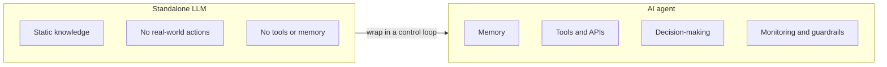
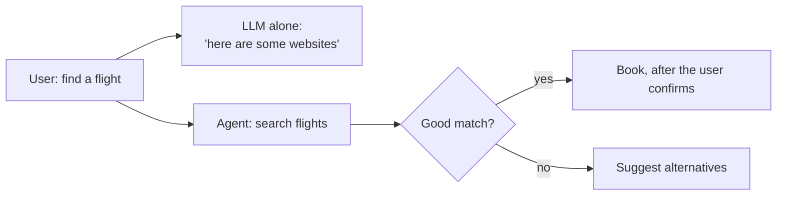
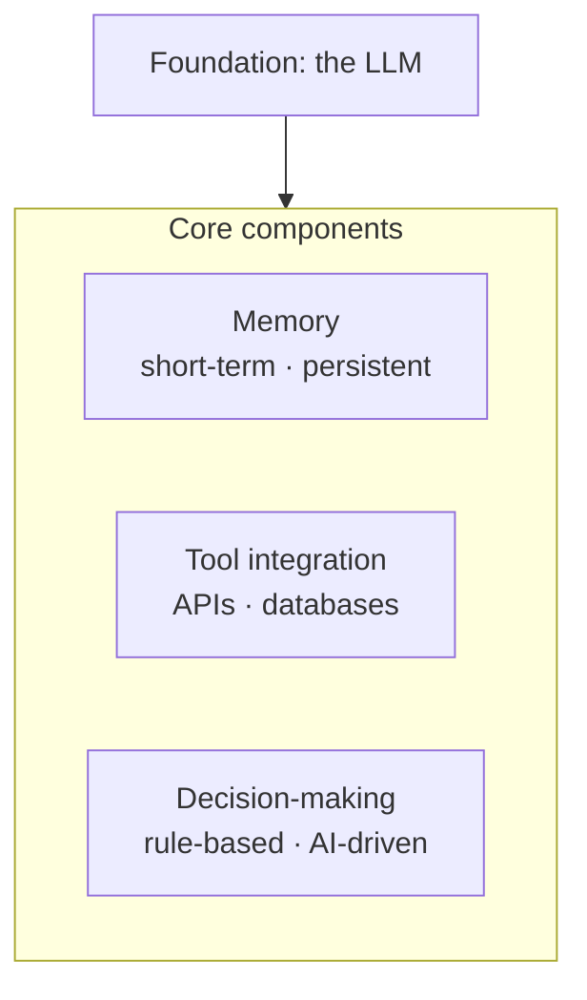
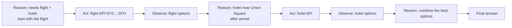
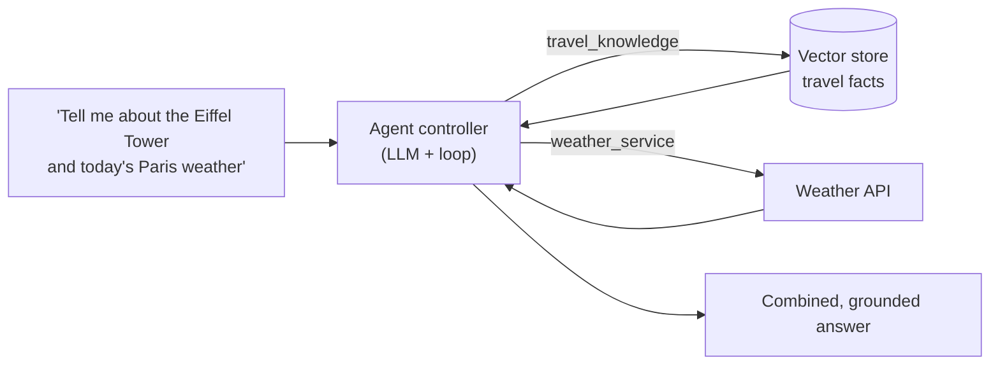

# Creating Effective AI Agents

> **Adapted from:** Chapter 6, "Creating effective AI agents" — rewritten and condensed for teaching, with code corrected and the project rewritten in Python.

Ask an LLM, "Find me a morning flight from New York to San Francisco for next Tuesday," and the best it can offer is "You could try Delta or JetBlue." It **understands** the request perfectly, but it can't check live schedules or book anything. An **AI agent** closes that gap. It wraps the LLM's reasoning in a control system that can:

- **Connect** to external tools: APIs, databases, services.
- **Act**: retrieve data, change state, trigger workflows.
- **Adapt**: keep context across turns and adjust its plan to what it observes.

A well-designed agent also includes **decision-flow controls and monitoring**, so it can't, for example, call the same tool forever without making progress.



**What you'll be able to do after this lesson:**

- Explain the three gaps agents close: **static knowledge, inability to act, and no workflow management**.
- Design **short-term and persistent memory**, including trimming, summarization, and user control.
- Integrate tools that **validate output, fail safely, and cross-check** each other.
- Implement a **ReAct** loop with step limits and **loop detection**.
- Build an **agentic RAG** assistant that combines a knowledge base with live tools.
- Apply guardrails, transparency, and lessons from production deployments.

---

## Why Do We Need Agents?

### 1. Static knowledge

Training produces a **snapshot**, like a huge library where every book was printed on the same day. "What are the latest Tesla and Apple stock prices?" gets an apology. Products like ChatGPT can fetch live data because the **application** gives the model tools. A standalone model can't.

### 2. Inability to act

The model sits behind a **glass wall**: it can describe digital systems but can't reach them. "Schedule a meeting with my team tomorrow at 3 PM" gets "Here's a suggestion: send an email to your team." The model understands the task but has no calendar to write to.

### 3. No workflow management

"Find a flight to San Francisco next Tuesday **and** book a hotel near SFO" requires **decomposing** the request, **sequencing** the steps, and **coordinating** several systems. An LLM can *describe* those steps, like an expert adviser, but can't *run* them.

### How agents solve these problems

An agent is an **LLM inside a control loop**. It is the difference between a colleague who can explain how to book a flight and one who books it.

- **External tools**: "Tesla is trading at \$245.67 and Apple at \$178.43," fetched from a market-data API.
- **Actions**: "The meeting is scheduled for tomorrow at 3 PM, and invitations have been sent."
- **Workflows**: for the flight request, the agent:
  1. Queries a flight API.
  2. Filters by price and departure time.
  3. Presents the options.
  4. Asks whether to book.
  5. Books if the user agrees.



Agents also appear across industries:

- **Health care**: pulling records, test results, and history into one patient overview.
- **Finance**: live market data, portfolio risk calculations, and reports.
- **E-commerce**: personalized recommendations, live product information, and order handling.

Progress has been fast. The source cites Stanford's AI Index reporting that agent success on real-world computer tasks jumped from about **12% to 66%** within a year.

---

## Core Components of Reliable Agents

Three foundations: **memory** (context that persists), **tool integration** (reaching real systems), and **decision-making** (choosing and sequencing actions).



### Memory: context that sticks

Without memory:

> **User:** Find me a flight to New York for next Tuesday.
> **Agent:** Here are some options…
> **User:** Oh, and make sure it's a window seat.
> **Agent:** I'm sorry, I don't know what you're referring to.

With memory, the agent replies "Got it. Filtering for window seats now." Memory keeps context **within a session**, supports **long-term personalization**, and spares users from repeating themselves in multistep workflows.

| | Short-term memory | Persistent memory |
|---|---|---|
| Lifetime | One session | Across sessions |
| Typical store | In-memory list or dictionary | Database (SQLite, Postgres, MongoDB…) |
| Examples | Chat history, current search filters, order ID | Preferences ("window seats"), history, learned patterns |
| Concerns | Context-window size | Scale, **privacy (GDPR)**, user control |

**Short-term memory** is a notepad for the session. A support bot jots down your name, device, OS, and error message, so it never asks twice. In code, it's often just a list:

```python
class ShortTermMemory:
    def __init__(self):
        self.messages = []

    def add(self, role: str, content: str) -> None:
        self.messages.append({"role": role, "content": content})
```

**Persistent memory** is a diary kept for each user. It needs **structured, indexed storage**, and it raises **privacy** obligations: encrypt sensitive fields, minimize what you keep, and **let users see and delete it**. The typical flow:

1. The user says, "I prefer window seats."
2. The agent **stores** that preference.
3. In the next session, it **applies it automatically**.

**When to promote a fact to persistent memory:** explicit instructions ("Remember that I prefer…"), facts referenced across several sessions, and details that would clearly improve later interactions. Implement it as an **extraction step** that pulls key facts from the conversation into structured records.

#### Buffer vs. summary memory

**Buffer memory** keeps the full transcript. LangChain chat models accept a plain list of messages directly:

```python
from langchain_core.messages import AIMessage, HumanMessage

chat_history = [
    HumanMessage(content="What's the weather in Paris?"),
    AIMessage(content="It's sunny and 25°C."),
]
for m in chat_history:
    print(("Human" if isinstance(m, HumanMessage) else "AI") + ":", m.content)
```

It's simple and has perfect recall, but the history **grows without bound** and eventually overflows the context window.

**Summary memory** compresses older turns into a running summary with an LLM:

```python
from langchain_core.messages import HumanMessage, SystemMessage
from langchain_openai import ChatOpenAI

llm = ChatOpenAI(model="gpt-4.1-mini", temperature=0)

def summarize_history(messages, existing_summary: str = "") -> str:
    transcript = "\n".join(
        f"{'Human' if isinstance(m, HumanMessage) else 'AI'}: {m.content}" for m in messages)
    return llm.invoke([
        SystemMessage(content="Summarize this conversation concisely. Keep names, "
                              "preferences, decisions, and open requests."),
        HumanMessage(content=f"Summary so far:\n{existing_summary}\n\nNew turns:\n{transcript}"),
    ]).content
```

Each summary costs an **extra LLM call** in latency and money, and summaries can **drop details**. A common production pattern is to **keep recent turns verbatim, summarize older ones, and store key facts separately**. Start with a buffer, and add summarization when you actually hit context limits.

> **Framework note:** **LangGraph**, built on LangChain, provides production-grade **state management**: checkpointing (pause and resume), human-in-the-loop approval steps, and persistence across sessions. Prefer it over ad-hoc memory classes for production agents.

#### Practice: trim a conversation to a token budget

Implement `trim(messages, budget)` for `(role, text)` messages, using **word count** as a stand-in for tokens:

- **Always keep `system` messages.**
- Keep the **newest** non-system messages that fit within the budget, walking backward and stopping at the first one that doesn't fit. **Always keep the latest message**, even if it alone exceeds the budget.
- Return the kept messages in their **original order**.

<CodeExercise
  title="Context-window trimming"
  heading="exercise-rai-agent-trim"
  lang="python"
  filename="main.py"
  prompt="Implement trim(messages, budget): keep all system messages plus the newest non-system messages that fit (walking backward, stop at the first that doesn't fit; the very latest is always kept), preserving original order."
  sampleLog={`20
system|You are a travel assistant.
user|Find me a flight to New York for next Tuesday.
assistant|Here are three options: 7am, 9am, 1pm.
user|Make sure it is a window seat.
system: You are a travel assistant.
assistant: Here are three options: 7am, 9am, 1pm.
user: Make sure it is a window seat.`}
  starter={`def trim(messages, budget):
    # messages: list of (role, text); cost = number of words
    pass
`}
  wrapSuffix={`
import sys
lines = sys.stdin.read().strip().split('\\n')
budget = int(lines[0])
messages = [tuple(line.split('|', 1)) for line in lines[1:]]
for role, text in trim(messages, budget):
    print(f'{role}: {text}')
`}
  hint="Compute used = words in system messages. Iterate over reversed non-system messages with enumerate; keep index 0 unconditionally, otherwise keep while used + cost <= budget, then break. Rebuild in original order with a set of kept indexes."
  solution={`def trim(messages, budget):
    def cost(m):
        return len(m[1].split())
    used = sum(cost(m) for m in messages if m[0] == 'system')
    keep = {i for i, m in enumerate(messages) if m[0] == 'system'}
    others = [i for i, m in enumerate(messages) if m[0] != 'system']
    for n, i in enumerate(reversed(others)):
        c = cost(messages[i])
        if n == 0 or used + c <= budget:
            keep.add(i)
            used += c
        else:
            break
    return [m for i, m in enumerate(messages) if i in keep]
`}
  tests={[
    { name: 'everything fits', stdin: '100\nsystem|You are a travel assistant.\nuser|Find me a flight to New York for next Tuesday.\nassistant|Here are three options: 7am, 9am, 1pm.\nuser|Make sure it is a window seat.', equals: 'system: You are a travel assistant.\nuser: Find me a flight to New York for next Tuesday.\nassistant: Here are three options: 7am, 9am, 1pm.\nuser: Make sure it is a window seat.' },
    { name: 'oldest turn dropped first', stdin: '20\nsystem|You are a travel assistant.\nuser|Find me a flight to New York for next Tuesday.\nassistant|Here are three options: 7am, 9am, 1pm.\nuser|Make sure it is a window seat.', equals: 'system: You are a travel assistant.\nassistant: Here are three options: 7am, 9am, 1pm.\nuser: Make sure it is a window seat.' },
    { name: 'latest message always survives', stdin: '1\nsystem|You are a travel assistant.\nuser|Find me a flight to New York for next Tuesday.\nuser|Make sure it is a window seat.', equals: 'system: You are a travel assistant.\nuser: Make sure it is a window seat.' },
  ]}
/>

Look at the second test. Under a 20-word budget, the agent keeps "make sure it is a window seat" but **loses "flight to New York"**, so it no longer knows what the seat is for. Plain trimming throws away the original request. That's the case for **summarizing** dropped turns, or **storing key facts** ("trip: NYC, Tuesday") separately.

#### Practice: persistent preferences with user control

Use Python's built-in **`sqlite3`** to implement `Prefs`:

- `__init__(conn)` creates the table `prefs(user, key, value)` with primary key `(user, key)` if it doesn't exist.
- `remember(user, key, value)` **upserts**: a newer value replaces the old one.
- `recall(user)` returns a dict of `key → value`, ordered by key.
- `forget(user)` deletes **all** of the user's rows and returns how many it deleted. This is the "delete my data" control that privacy rules require.

The wrapper creates **two separate `Prefs` objects** on the same database to simulate two sessions. Each input line is `remember user key value`, `recall user`, or `forget user`.

<CodeExercise
  title="SQLite persistent memory"
  heading="exercise-rai-agent-prefs"
  lang="python"
  filename="main.py"
  prompt="Implement Prefs(conn) with remember (upsert on (user, key)), recall (dict ordered by key), and forget (delete all rows for a user; return the count)."
  sampleLog={`remember ana seat window
recall ana
recall ana -> {'seat': 'window'}`}
  starter={`import sqlite3

class Prefs:
    def __init__(self, conn):
        self.conn = conn
        # CREATE TABLE IF NOT EXISTS prefs (user TEXT, key TEXT, value TEXT, PRIMARY KEY (user, key))

    def remember(self, user, key, value):
        pass

    def recall(self, user):
        pass

    def forget(self, user):
        pass
`}
  wrapSuffix={`
import sys
conn = sqlite3.connect(':memory:')
sessions = [Prefs(conn), Prefs(conn)]          # two sessions, one database
lines = sys.stdin.read().strip().split('\\n')
for n, line in enumerate(lines):
    store = sessions[0] if n < len(lines) // 2 else sessions[1]
    cmd, *args = line.split()
    if cmd == 'remember':
        store.remember(*args)
    elif cmd == 'recall':
        print(f'recall {args[0]} -> {store.recall(args[0])}')
    else:
        print(f'forget {args[0]} -> deleted {store.forget(args[0])}')
`}
  hint="remember: INSERT INTO prefs VALUES (?, ?, ?) ON CONFLICT(user, key) DO UPDATE SET value = excluded.value. recall: dict(conn.execute('SELECT key, value FROM prefs WHERE user = ? ORDER BY key', (user,)).fetchall()). forget: return cursor.rowcount."
  solution={`import sqlite3

class Prefs:
    def __init__(self, conn):
        self.conn = conn
        self.conn.execute(
            'CREATE TABLE IF NOT EXISTS prefs '
            '(user TEXT, key TEXT, value TEXT, PRIMARY KEY (user, key))')

    def remember(self, user, key, value):
        self.conn.execute(
            'INSERT INTO prefs VALUES (?, ?, ?) '
            'ON CONFLICT(user, key) DO UPDATE SET value = excluded.value',
            (user, key, value))

    def recall(self, user):
        rows = self.conn.execute(
            'SELECT key, value FROM prefs WHERE user = ? ORDER BY key', (user,)).fetchall()
        return dict(rows)

    def forget(self, user):
        return self.conn.execute('DELETE FROM prefs WHERE user = ?', (user,)).rowcount
`}
  tests={[
    { name: 'survives across sessions', stdin: 'remember ana seat window\nrecall ana', equals: "recall ana -> {'seat': 'window'}" },
    { name: 'newer preference replaces older; users isolated', stdin: 'remember ana seat window\nremember ana seat aisle\nremember ana airline JetBlue\nremember bo seat window\nrecall ana\nrecall bo', equals: "recall ana -> {'airline': 'JetBlue', 'seat': 'aisle'}\nrecall bo -> {'seat': 'window'}" },
    { name: 'forget me', stdin: 'remember ana seat window\nremember ana airline JetBlue\nforget ana\nrecall ana', equals: "forget ana -> deleted 2\nrecall ana -> {}" },
  ]}
/>

Use **parameterized queries** (`?` placeholders), as here, and never build SQL by inserting user text into strings.

### Tool integration: grounding agents in reality

LLMs **hallucinate** because they predict plausible text. They can't **verify** answers, **reach** current knowledge, or **cite** evidence. Tools fix all three by grounding the agent in **sources of truth**:

- **APIs** for live data (prices, weather).
- **Databases** for structured records (customers, orders).
- **Systems** for actions (bookings, email).

Standardization used to be the hard part, since every API had its own authentication, formats, and errors. The **Model Context Protocol (MCP)** has become the standard way to expose tools to agents, and most frameworks support it natively.

**Active tools vs. passive retrieval.** RAG only *reads*. An agent can also *change state*: after retrieving flight options, it can **book** the chosen flight, **email** the confirmation, and **update** the calendar. That ability to act is what turns retrieval into an agent, and it's also why actions need **confirmation and safeguards**.

Without a tool, "What's the weather in Paris right now?" gets a confident invention: "It's sunny and 25°C." With a tool, the agent says "Let me check," calls a weather API, and reports "20°C and cloudy." The source cites research showing large factual gains when models **decide to consult tools when unsure**. In one study, a self-assessing model chose to query an API for about **77%** of the questions it couldn't answer itself.

#### Anchor, validate, and fall back

Three habits make tools trustworthy:

1. **Anchor** answers to tool results.
2. **Validate** tool output before using it.
3. **Fall back** to an honest message when the tool fails, never to a guess.

```python
import os
import requests

OWM_KEY = os.environ["OPENWEATHER_API_KEY"]

def fetch_weather(location: str) -> dict:
    resp = requests.get(
        "https://api.openweathermap.org/data/2.5/weather",
        params={"q": location, "appid": OWM_KEY, "units": "metric"},   # default units are KELVIN
        timeout=10,
    )
    resp.raise_for_status()
    return resp.json()

def is_valid_weather(data: dict) -> bool:
    temp = data.get("main", {}).get("temp")
    return isinstance(temp, (int, float)) and -90 <= temp <= 60 and bool(data.get("weather"))

def get_weather(location: str) -> str:
    try:
        data = fetch_weather(location)
    except requests.RequestException:
        return f"I couldn't reach the weather service for {location}. Please try again later."
    if not is_valid_weather(data):
        return f"I received unusable weather data for {location}, so I won't guess."
    return (f"The current weather in {location} is {data['main']['temp']:.0f}°C "
            f"with {data['weather'][0]['description']}.")
```

:::caution Two bugs in the source's weather code
1. **Units.** The source calls OpenWeatherMap **without `units=metric`**. The API then returns **Kelvin**, so a mild 20 °C day comes back as about 293, and the source prints it as "293°C." Its own sanity check (−90 to 60 °C) would reject **every** real reading.
2. **Fragile fallback.** The source detects failure by searching the response text for the word "Error." Return **structured results** (or raise exceptions) and branch on those instead.
:::

### Cross-referencing sources

For high-stakes values, query **several independent sources** and compare them. Agreement means confidence. Disagreement means **flag it, ask, or escalate**, and don't pick one silently. Comparing raw strings, as the source does with `"Tesla: $800" == "Tesla: $800"`, breaks on harmless differences such as formatting or a one-cent update. Compare **numbers within a tolerance**.

#### Practice: cross-reference quotes with a tolerance

Implement `cross_reference(quotes, tol_pct)`. `quotes` maps a source name to a price, or `None` if that source failed.

- Ignore `None` and non-positive values. With fewer than two usable values, return `'insufficient sources'`.
- If `(max - min) / min * 100 <= tol_pct`, return `'verified <median>'`, formatted to 2 decimals.
- Otherwise return `'discrepancy: '` followed by each usable `name=value` pair (2 decimals), joined by `', '`, in input order.

Input: line 1 is `tol_pct`, and each remaining line is `source price`, where the price may be `none`.

<CodeExercise
  title="Cross-referencing with a tolerance"
  heading="exercise-rai-agent-crossref"
  lang="python"
  filename="main.py"
  prompt="Implement cross_reference(quotes, tol_pct): ignore None/non-positive values; <2 usable -> 'insufficient sources'; spread within tol_pct -> 'verified <median>'; else 'discrepancy: a=..., b=...'."
  sampleLog={`0.5
api1 800
api2 801.2
verified 800.60`}
  starter={`import statistics

def cross_reference(quotes, tol_pct):
    pass
`}
  wrapSuffix={`
import sys
lines = sys.stdin.read().strip().split('\\n')
tol = float(lines[0])
quotes = {}
for line in lines[1:]:
    name, price = line.split()
    quotes[name] = None if price == 'none' else float(price)
print(cross_reference(quotes, tol))
`}
  hint="usable = {k: v for k, v in quotes.items() if v is not None and v > 0}. Spread = (max - min) / min * 100. statistics.median gives the verified value."
  solution={`import statistics

def cross_reference(quotes, tol_pct):
    usable = {k: v for k, v in quotes.items() if v is not None and v > 0}
    if len(usable) < 2:
        return 'insufficient sources'
    lo, hi = min(usable.values()), max(usable.values())
    if (hi - lo) / lo * 100 <= tol_pct:
        return f'verified {statistics.median(usable.values()):.2f}'
    return 'discrepancy: ' + ', '.join(f'{k}={v:.2f}' for k, v in usable.items())
`}
  tests={[
    { name: 'exact agreement', stdin: '0.5\napi1 800\napi2 800', equals: 'verified 800.00' },
    { name: 'tiny difference is not a discrepancy', stdin: '0.5\napi1 800\napi2 801.2', equals: 'verified 800.60' },
    { name: 'real discrepancy is flagged', stdin: '0.5\napi1 800\napi2 845', equals: 'discrepancy: api1=800.00, api2=845.00' },
    { name: 'a failed source cannot verify alone', stdin: '0.5\napi1 800\napi2 none', equals: 'insufficient sources' },
    { name: 'three sources', stdin: '0.1\na 245.67\nb 245.70\nc 245.60', equals: 'verified 245.67' },
  ]}
/>

### Decision-making: choosing and sequencing actions

Memory and tools make an agent *functional*. **Decision-making** makes it *intelligent*. Take "Flight NYC→SFO next Tuesday, **and** a hotel near Union Square." The agent must:

1. Recognize **two subtasks**.
2. Use the **flight** tool for that date.
3. Use the **hotel** tool for Union Square.
4. **Present** the results and, if the user approves, **book**, in a sensible order (confirm the flight before the hotel).

**Rule-based** routing ("if the query mentions *flight*, call the flight API") is simple and transparent but **rigid**: "a **pet-friendly** hotel near Union Square" falls outside its rules. **AI-driven** routing lets the LLM reason about which steps are needed. It can notice a preference for morning flights and adjust the query, but it needs good models, compute, and **evaluation**. Many production systems **mix the two**: rules for hard constraints and safety, and the LLM for flexibility.

### ReAct: reason, act, observe, repeat

**ReAct** (Yao et al., 2022) interleaves **reasoning** with **actions**, so each step is informed by the previous results:

1. **Reason** about what to do next.
2. **Act**: call a tool.
3. **Observe** the result.
4. **Repeat** until the agent can give a final answer.



**Tree-of-thought** (see [Lesson 1](./generating-trustworthy-responses-with-prompt-engineering#tree-of-thought-tot-prompting)) complements ReAct when there are **several valid strategies**. For "reduce shipping costs for European customers," the agent can explore new carriers, **warehouse consolidation**, and **bulk discounts** in parallel, then pick the best.

#### Practice: a ReAct loop with safety stops

The **loop** is the part of an agent you control, so make it safe. Implement `run_agent(policy, tools, max_steps)`. `policy(history)` stands in for the LLM. It returns either `('final', text)` or `('act', tool_name, arg)`.

- On `final`: log `final: <text>` and stop.
- If the **same `(tool, arg)` was already called**: log `stopped: repeated call <tool>(<arg>)` and stop. This is **loop detection**.
- Otherwise run the tool, or produce `error: unknown tool <name>` if it doesn't exist. Log `step N: <tool>(<arg>) -> <observation>`, and append `(tool, arg, observation)` to the history.
- After `max_steps` actions without a final answer, log `stopped: step limit <max_steps>`.

The wrapper runs a scripted scenario: `travel`, `loopy`, `wander`, or `bad`.

<CodeExercise
  title="ReAct loop with step limit and loop detection"
  heading="exercise-rai-agent-react"
  lang="python"
  filename="main.py"
  prompt="Implement run_agent(policy, tools, max_steps) returning log lines; stop on final, on a repeated (tool, arg), or after max_steps; unknown tools produce an error observation rather than crashing."
  sampleLog={`travel 5
step 1: search_flights(NYC-SFO Tue) -> UA 101 7:05am $289
step 2: search_hotels(Union Square) -> Hotel Union $210/night
final: Flight: UA 101 7:05am $289; Hotel: Hotel Union $210/night`}
  starter={`def run_agent(policy, tools, max_steps):
    pass
`}
  wrapSuffix={`
import sys
TOOLS = {
    'search_flights': lambda a: 'UA 101 7:05am $289',
    'search_hotels': lambda a: 'Hotel Union $210/night',
    'weather': lambda a: '18C cloudy',
}
def travel(h):
    if not h: return ('act', 'search_flights', 'NYC-SFO Tue')
    if len(h) == 1: return ('act', 'search_hotels', 'Union Square')
    return ('final', f'Flight: {h[0][2]}; Hotel: {h[1][2]}')
def loopy(h): return ('act', 'weather', 'Paris')
def wander(h): return ('act', 'weather', f'city{len(h)}')
def bad(h): return ('act', 'book_spaceship', 'Mars') if not h else ('final', 'I could not do that.')
name, steps = sys.stdin.read().split()
for line in run_agent({'travel': travel, 'loopy': loopy, 'wander': wander, 'bad': bad}[name], TOOLS, int(steps)):
    print(line)
`}
  hint="Keep history = [], log = [], seen = set(). For step in range(1, max_steps + 1): decision = policy(history); handle 'final'; check (tool, arg) in seen; run tools.get(tool) or produce the error string; append to log and history. After the loop add the step-limit line."
  solution={`def run_agent(policy, tools, max_steps):
    history = []
    log = []
    seen = set()
    for step in range(1, max_steps + 1):
        decision = policy(history)
        if decision[0] == 'final':
            log.append(f'final: {decision[1]}')
            return log
        _, tool, arg = decision
        if (tool, arg) in seen:
            log.append(f'stopped: repeated call {tool}({arg})')
            return log
        seen.add((tool, arg))
        observation = tools[tool](arg) if tool in tools else f'error: unknown tool {tool}'
        log.append(f'step {step}: {tool}({arg}) -> {observation}')
        history.append((tool, arg, observation))
    log.append(f'stopped: step limit {max_steps}')
    return log
`}
  tests={[
    { name: 'multi-step plan completes', stdin: 'travel 5', equals: 'step 1: search_flights(NYC-SFO Tue) -> UA 101 7:05am $289\nstep 2: search_hotels(Union Square) -> Hotel Union $210/night\nfinal: Flight: UA 101 7:05am $289; Hotel: Hotel Union $210/night' },
    { name: 'infinite loop is caught', stdin: 'loopy 5', equals: 'step 1: weather(Paris) -> 18C cloudy\nstopped: repeated call weather(Paris)' },
    { name: 'never-ending variation hits the step limit', stdin: 'wander 3', equals: 'step 1: weather(city0) -> 18C cloudy\nstep 2: weather(city1) -> 18C cloudy\nstep 3: weather(city2) -> 18C cloudy\nstopped: step limit 3' },
    { name: 'unknown tool becomes an observation, not a crash', stdin: 'bad 5', equals: 'step 1: book_spaceship(Mars) -> error: unknown tool book_spaceship\nfinal: I could not do that.' },
  ]}
/>

Each safety stop catches a different failure. Loop detection catches an agent **stuck** repeating one call. The step limit catches an agent **wandering** with endless variations. Turning unknown tools into observations lets the model **recover** instead of crashing the loop.

### Check: core components

<MultipleChoice
  id="rai-ch6-components"
  title="Memory, tools, decisions"
  questions={[
    {
      prompt: 'A user tells the assistant "I always want aisle seats." Where should that go, and what obligation comes with it?',
      choices: [
        'Only in the current prompt',
        'Persistent memory (a database), with privacy obligations: protect it and let the user view and delete it',
        'In the model weights via fine-tuning',
        'Nowhere; agents should not remember',
      ],
      answer: 1,
      why: 'Stable preferences belong in persistent memory, and storing personal data brings consent, security, and deletion duties.',
    },
    {
      prompt: 'An agent calls get_weather("Paris") ten times in a row and never answers. Which control prevents this?',
      choices: [
        'A higher temperature',
        'Loop detection (repeated identical calls) plus a maximum step count in the agent loop',
        'A larger context window',
        'Summary memory',
      ],
      answer: 1,
      why: 'You own the loop, so it must enforce termination whatever the model decides.',
    },
    {
      prompt: 'Two price APIs return $800.00 and $800.40. Your check reports a "discrepancy." What is wrong with the check?',
      choices: [
        'Nothing; any difference is a discrepancy',
        'It compares exact values (or strings). Use a tolerance appropriate to the domain, and flag only meaningful disagreements',
        'It should average three APIs',
        'Prices cannot be cross-referenced',
      ],
      answer: 1,
      why: 'Sources legitimately differ by rounding and timing. Tolerances separate noise from real conflicts.',
    },
    {
      prompt: 'What distinguishes an agent\'s tool use from plain RAG?',
      choices: [
        'RAG uses embeddings and agents don\'t',
        'Agents can take actions that change external state (book, send, update), not just read information',
        'Agents never retrieve documents',
        'RAG is always slower',
      ],
      answer: 1,
      why: 'Acting is the defining capability, and the reason actions need confirmation and guardrails.',
    },
  ]}
/>

---

## Project: An Agentic RAG Travel Assistant

Traditional RAG is a brilliant librarian who never leaves the library. It knows the Eiffel Tower is 324 m tall, but not whether it's raining in Paris right now. **Agentic RAG** gives the agent **both** a knowledge-base tool and live tools, and lets it **decide which to use** for each part of a question.



The source builds this in TypeScript with a React chat UI. Below is a framework-free **Python** version of the same logic: a small knowledge base, two tools, a tool-calling loop with a step limit, conversation memory, and visible reasoning steps.

```python
import json
from openai import OpenAI

client = OpenAI()
MODEL = CHAT_MODEL   # see Lesson 1: keep model names in config

# 1. Knowledge base (a real system would use the vector store from Lessons 2-3).
TRAVEL_DOCS = [
    "The Eiffel Tower is 324 meters tall.",
    "The Louvre houses the Mona Lisa.",
    "Notre-Dame Cathedral reopened in December 2024 after restoration.",
    "The Seine River runs through Paris.",
]

def travel_knowledge(query: str) -> str:
    words = set(query.lower().split())
    hits = [d for d in TRAVEL_DOCS if words & set(d.lower().split())]
    return "\n".join(hits) if hits else "No matching travel facts found."

# 2. Tools: one function each, with clear descriptions.
TOOLS = {"travel_knowledge": travel_knowledge, "weather_service": get_weather}
TOOL_SPECS = [
    {"type": "function", "function": {
        "name": "travel_knowledge",
        "description": "Facts about travel destinations, landmarks, and attractions. Not for live data.",
        "parameters": {"type": "object", "properties": {"query": {"type": "string"}},
                       "required": ["query"]}}},
    {"type": "function", "function": {
        "name": "weather_service",
        "description": "Current weather for a specific city. Use for anything about today's conditions.",
        "parameters": {"type": "object", "properties": {"location": {"type": "string"}},
                       "required": ["location"]}}},
]

SYSTEM = ("You are a concise travel assistant. Use travel_knowledge for facts and "
          "weather_service for current conditions. If a tool fails, say so; never guess.")

def run_turn(history: list, user_msg: str, max_steps: int = 5, on_step=print) -> str:
    messages = [{"role": "system", "content": SYSTEM}, *history, {"role": "user", "content": user_msg}]
    for _ in range(max_steps):
        msg = client.chat.completions.create(model=MODEL, messages=messages,
                                             tools=TOOL_SPECS).choices[0].message
        if not msg.tool_calls:                                   # final answer
            history += [{"role": "user", "content": user_msg},
                        {"role": "assistant", "content": msg.content}]
            return msg.content
        messages.append(msg)
        for call in msg.tool_calls:
            args = json.loads(call.function.arguments)
            on_step(f"Thinking: using {call.function.name} with {args}")   # transparency
            fn = TOOLS.get(call.function.name)
            result = fn(**args) if fn else f"error: unknown tool {call.function.name}"
            messages.append({"role": "tool", "tool_call_id": call.id, "content": result})
    return "I couldn't finish that request within the step limit."

history = []
print(run_turn(history, "Tell me about the Eiffel Tower and the current weather in Paris."))
print(run_turn(history, "Is it a good day to go up it?"))   # 'it' resolved from memory
```

For the first question, the agent calls **`travel_knowledge`** for the tower facts and **`weather_service`** for Paris, then **combines** them. The follow-up works because of **conversation memory**. The `on_step` callback is the hook for a UI that shows users **which tool was used and why**. (The equivalent with Claude's Messages API is shown in [Lesson 1](./generating-trustworthy-responses-with-prompt-engineering#the-same-loop-with-claude).)

**Production checklist:**

- **Focused, reliable tools**: each one does one thing well.
- **Clear, specific descriptions** that say *when* to use each tool and when not to.
- **Graceful error handling** for timeouts, outages, and bad data, with honest messages instead of guesses.
- **Hard limits** on steps, time, and cost, plus **confirmation** before any action that changes state.

---

## Advanced Techniques

### Guardrails

Agents can drift **off task** or into **unsafe territory** while reasoning. **Guardrails** keep outputs within the agent's intended scope. The simplest form is a keyword filter:

```python
BLOCKED = {
    "off_topic": ["crypto", "gambling"],
    "sensitive": ["social security number", "passport number"],
}

def violates(text: str) -> str | None:
    lowered = text.lower()
    for category, terms in BLOCKED.items():
        if any(term in lowered for term in terms):
            return category
    return None

draft = "Let me show you some crypto investment tips..."
if category := violates(draft):
    draft = "I can help with travel planning. For investment questions, please consult a licensed adviser."
```

Keyword lists are **brittle**. Users get around them with synonyms, and broad terms cause **false positives**: blocking "medical" would also block "Do I need travel medical insurance?", a perfectly good travel question. Production systems use **classifier or LLM-judge guardrails** that judge meaning rather than words (for example, Llama Guard or NeMo Guardrails), layered with rules for hard limits.

### Learning from feedback (RLAIF)

**Reinforcement Learning from AI Feedback** trains models using **AI-generated** preference judgments instead of, or alongside, human ones. More broadly, collect explicit feedback from users and evaluators on agent outputs, and feed it into prompts, tool design, routing, and fine-tuning.

### Transparency

Users trust what they can **inspect**. Show intermediate steps ("I'll use the weather_service tool to check Paris") and **cite sources**, as answer engines like Perplexity do. Visible reasoning also helps users **catch mistakes early**.

### Case studies in production

The figures below are as reported by the organizations and the source.

- **Mass General Brigham, ambient clinical documentation.** A pilot with **20 physicians** across specialties recorded patient–clinician conversations securely and drafted clinical notes. Demand pushed a planned 400-clinician rollout to **800+**. The reported outcomes were a **21% drop in burnout**, more physicians saying they'd extend their careers, and about **80%** saying they look at patients, not screens, during visits.
- **JPMorgan Chase, enterprise scale.** **450+** AI use cases. An **LLM Suite** used by about **200,000** employees. **Coach AI** helps advisers answer during market volatility, with about **95% faster** research. The **EVEE** Q&A agent supports call-center staff. Developers report **10–20%** productivity gains, including help with COBOL-to-Java migration.
- **SS&C Technologies, document processing.** **20 specialized agents** processed **50,000** documents in one month, with **90%+** automation on loan documents. Humans review only flagged edge cases.
- **H&M, retail customer experience.** A shopping assistant remembers preferences, handles routine sizing, shipping, and returns questions, and hands complex cases to people. The company reports lower cart abandonment and support costs and higher revenue per visitor.

The broader trend: AI code assistants in most enterprises, support chatbots in a large minority, rapid growth in RAG adoption, and a growing share of truly **agentic** systems that plan, execute, and adapt.

### Choosing a framework

- **LangGraph**: graph-based orchestration with checkpointing and human-in-the-loop support, for **complex stateful workflows**.
- **OpenAI Agents SDK**: agent-to-agent **handoffs**, built-in **tracing** and guardrails.
- **Claude Agent SDK** (Anthropic): packages the **Claude Code agent harness** as a library, with built-in file, shell, and search tools, subagents, hooks, and permissions.
- **CrewAI**: role-based multi-agent prototypes, built quickly.
- **Google ADK**: integrates with Vertex AI and supports the **Agent-to-Agent (A2A)** protocol.

The right choice depends on your model provider, your infrastructure, and whether you need a **simple tool loop** or **multi-agent orchestration**.

### Check: production agents

<MultipleChoice
  id="rai-ch6-production"
  title="Guardrails and trust"
  questions={[
    {
      prompt: 'A keyword guardrail blocks the word "medical." What is the most likely production problem?',
      choices: [
        'It slows the agent down',
        'False positives (blocking legitimate questions like travel medical insurance) and easy bypasses with synonyms. Semantic classifiers or LLM-judge guardrails work better',
        'It uses too much memory',
        'Keywords cannot be lower-cased',
      ],
      answer: 1,
      why: 'Keyword lists know nothing about meaning. Use them only for narrow, hard rules.',
    },
    {
      prompt: 'Your weather tool reports 293°C for Paris. What is the most likely cause?',
      choices: [
        'A heat wave',
        'The API returned Kelvin (no units=metric), and the code labeled it °C. Validation should have rejected it',
        'Floating-point error',
        'The LLM hallucinated the number',
      ],
      answer: 1,
      why: 'Check API defaults, and validate ranges. A grounded agent is only as good as its tool\'s output.',
    },
    {
      prompt: 'Why show users which tools an agent used?',
      choices: [
        'It is required by HTTP',
        'Transparency builds trust and lets users spot wrong steps early. Sources make answers verifiable',
        'It makes the model more accurate on its own',
        'To reduce token cost',
      ],
      answer: 1,
      why: 'Visible reasoning and citations turn a black box into something users can check.',
    },
  ]}
/>

---

## Key Takeaways

- Standalone LLMs have **static knowledge**, **can't act**, and **can't run workflows**. Agents add **tools, actions, and orchestration** inside a control loop you own.
- **Memory**: short-term buffers (trim them, or summarize old turns) and persistent stores (structured, private, user-deletable).
- **Tools** ground answers. **Validate** outputs (check units and ranges), **fall back honestly**, and **cross-reference** numbers within a tolerance. **MCP** standardizes tool access.
- **Decision-making**: rules for hard constraints, LLM reasoning for flexibility. **ReAct** alternates reason, act, observe. Enforce **step limits and loop detection**, and turn tool errors into observations.
- **Agentic RAG** lets one agent combine a knowledge base with live tools, and show its steps.
- In production, add **semantic guardrails, transparency, feedback loops, and confirmation before actions**, and pick a framework that fits your workflow's complexity.

Previous lesson: [Fine-Tuning LLMs](./fine-tuning-llms).

Next lesson: [Tool Integration and MCP](./tool-integration-and-mcp) — build MCP servers, let models discover and chain tools, and handle failures safely.

---

## References

1. Stanford HAI. *AI Index Report.* [aiindex.stanford.edu](https://aiindex.stanford.edu/report/)
2. Yao, S., et al. (2022). *ReAct: Synergizing Reasoning and Acting in Language Models.* arXiv:2210.03629.
3. Mass General Brigham. Ambient clinical documentation pilot (as reported by the organization).
4. [Model Context Protocol](https://modelcontextprotocol.io/)
5. [LangGraph documentation](https://langchain-ai.github.io/langgraph/)
6. [OpenWeatherMap: Current weather API](https://openweathermap.org/current)

### Source chapter references (with practice quizzes)

These are the references cited in the source chapter. Pass a citation's quiz to unlock it, then use it in the [Essay Lab](/essay-lab).

<CitationCards chapter={6} />
