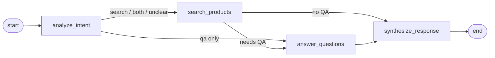
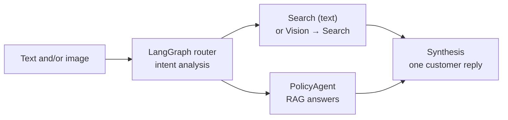
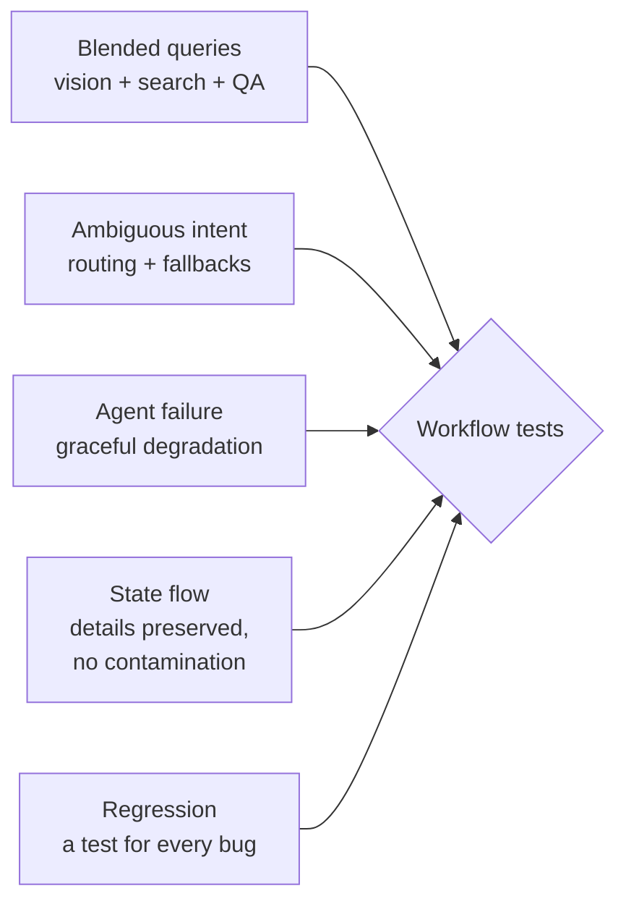

# Multi-Agent Systems

> **Adapted from:** Chapter 8, "Multi-agent systems" — rewritten and condensed for teaching, with the source's orchestration bugs fixed and its tests made deterministic.

A customer texts a **photo** of their hiking boots and writes, "Do you have something similar but **waterproof**?" Seconds later: "What's your **return policy** if they don't fit?" Answering takes **image understanding**, **product search**, **policy retrieval**, and **one coherent reply**. A single LLM juggling all of that gets mediocre at everything. Its context fills with irrelevant material, its behavior becomes inconsistent, and every new capability means rewriting the whole system.

The fix is a **multi-agent architecture**: **specialized agents**, each good at one job, coordinated by an **orchestrator**. In this lesson you'll build **ShopBot** on top of the tools from [Lesson 7](./tool-integration-and-mcp), orchestrate it with **LangGraph**, and test it the way multi-agent systems actually fail: **at the seams between agents**.

**What you'll be able to do after this lesson:**

- Explain the **monolithic agent problem** and when specialization pays off.
- Model a workflow as a **graph**: shared **state**, **nodes**, **edges**, and **conditional routing**.
- Build a **search agent**, a RAG **policy agent**, a **vision** adapter, and a **synthesis** step, then wire them together in LangGraph.
- Make agents **degrade gracefully** and keep per-request **state isolated**.
- Write **deterministic workflow tests** instead of brittle checks on LLM output.
- Compare **LangGraph** with **CrewAI**, and choose between them.

---

## Why Multi-Agent?

Consider this request: "I need a **warm jacket** for winter camping **under \$200**, and what's your **warranty** on outdoor gear?" It requires three kinds of intelligence:

- **Product search**: warm jackets under \$200.
- **Policy knowledge**: the warranty terms for outdoor gear.
- **Coordination**: merging both into one helpful answer.

One agent doing everything needs the whole product database, every policy, product-category expertise, *and* coordination logic in a single prompt. That's the **monolithic agent problem**. Split the work instead:

| Agent | Expert at |
|---|---|
| **SearchAgent** | Turning fuzzy requests into product queries and results |
| **PolicyAgent** (QA) | Returns, shipping, warranties, care, and sizing, grounded by RAG |
| **VisionAgent** | Turning an image into a text description that search can use |
| **Coordinator** | Understanding intent, routing to agents, and synthesizing the final reply |

Specialization brings several benefits:

- **Modularity**: test and improve each agent on its own.
- **Extensibility**: add a RecommendationAgent or an InventoryAgent without touching the others.
- **Resilience**: one failing agent doesn't take down the rest.
- **Maintainability**: a new return policy touches only the PolicyAgent.
- **Cost control**: give each agent the right model. A **small model** can handle intent classification and parameter extraction, and a **stronger model** can handle synthesis and nuanced policy answers.

Multi-agent systems also cost something: **more LLM calls, more latency, and more places to fail**. Use them when the work **genuinely splits** into distinct skills. A single agent with good tools ([Lesson 6](./creating-effective-ai-agents)) is often enough.

---

## LangGraph: Workflows as Graphs

**LangGraph** builds stateful agent workflows as **graphs**:

- **State**: a typed, shared data structure that every node reads and updates.
- **Nodes**: agents or processing steps. Each one is a function that takes the state and **returns updates** to it.
- **Edges**: fixed transitions from one node to the next.
- **Conditional edges**: a **router** function inspects the state and picks the next node.
- **Graph**: the compiled workflow. It supports **cycles**, such as retrying or looping back for clarification, plus checkpointing and human-in-the-loop steps.



### Intent analysis with structured output

Keyword matching is brittle. Instead, have a small model **fill in a schema** describing the request, using function calling or structured output, and keep a safe fallback:

```python
from pydantic import BaseModel, Field
from langchain_openai import ChatOpenAI

class Intent(BaseModel):
    search_needed: bool = Field(description="User wants products found or compared")
    qa_needed: bool = Field(description="User asks about policies, care, sizing, shipping, warranty")
    reasoning: str

intent_llm = ChatOpenAI(model=ROUTER_MODEL).with_structured_output(Intent)   # small, cheap model

async def analyze_intent(query: str) -> Intent:
    try:
        return await intent_llm.ainvoke(f"Classify this customer request: {query}")
    except Exception:
        return Intent(search_needed=True, qa_needed=False, reasoning="fallback")
```

`with_structured_output` binds the schema for you. If you call tools directly, bind them first with `llm.bind_tools(tools, tool_choice=...)`. Passing `tools=` straight to `ainvoke` won't bind them.

### Conditional routing

```python
def route_after_analysis(state: "ShopBotState") -> str:
    if state["needs_search"] and state["needs_qa"]:
        return "both_needed"
    if state["needs_search"]:
        return "search_only"
    if state["needs_qa"]:
        return "qa_only"
    return "unclear"
```

The router is a **plain, deterministic function of the state**. That makes it easy to unit-test, which matters below.

#### Practice: build the graph engine

To see what LangGraph does under the hood, implement a tiny graph runner. `Graph.run(state, max_steps)` should:

- Start at the entry node. At each step, call the node's function with the current state, and **merge** the dict it returns into the state. Nodes return **updates**, not whole states.
- Record each visited node in a **trace**.
- Choose the next node:
  - If the node has **conditional edges**, call the router and look its result up in the mapping. An unknown result raises `ValueError(f'router returned unknown route: {key}')`.
  - Otherwise follow its plain **edge**. A node with no outgoing edge raises `ValueError(f'no edge out of {node}')`.
- Stop and return `(state, trace)` when the next node is `END`.
- Raise `RuntimeError('step limit reached')` after `max_steps` nodes, which guards against runaway **cycles**.

The wrapper wires up a ShopBot with fake agents and runs one query per input line. The special inputs `@badroute` and `@cycle` test the error paths.

<CodeExercise
  title="Mini LangGraph: state, nodes, conditional edges"
  heading="exercise-rai-mas-graph"
  lang="python"
  filename="main.py"
  prompt="Implement Graph.run(state, max_steps=20): copy the state, run nodes from the entry, merge returned updates, follow conditional edges (router + mapping) or plain edges, stop at END, and raise on unknown routes, missing edges, or exceeding max_steps."
  sampleLog={`waterproof jacket and your return policy
analyze -> search -> qa -> synth | Waterproof Rain Jacket $79.99 + 30-day returns`}
  starter={`END = '__end__'

class Graph:
    def __init__(self):
        self.nodes, self.edges, self.cond, self.entry = {}, {}, {}, None

    def add_node(self, name, fn): self.nodes[name] = fn
    def add_edge(self, a, b): self.edges[a] = b
    def add_conditional_edges(self, a, router, mapping): self.cond[a] = (router, mapping)
    def set_entry_point(self, name): self.entry = name

    def run(self, state, max_steps=20):
        pass
`}
  wrapSuffix={`
import sys

def build(bad_route=False, cycle=False):
    g = Graph()
    def analyze(st):
        q = st['query'].lower()
        return {'needs_search': any(w in q for w in ['jacket', 'boots', 'shoes', 'vest']),
                'needs_qa': any(w in q for w in ['return', 'shipping', 'warranty', 'policy'])}
    def search(st):
        return {'results': ['Waterproof Rain Jacket $79.99'] if 'jacket' in st['query'] else []}
    def qa(st):
        return {'policy': '30-day returns'}
    def synth(st):
        parts = [', '.join(st.get('results', [])), st.get('policy', '')]
        return {'answer': ' + '.join(p for p in parts if p) or 'Could you tell me more about what you need?'}
    for name, fn in [('analyze', analyze), ('search', search), ('qa', qa), ('synth', synth)]:
        g.add_node(name, fn)
    g.set_entry_point('analyze')
    def route(st):
        if bad_route:
            return 'mystery'
        if st['needs_search'] and st['needs_qa']: return 'both'
        if st['needs_search']: return 'search'
        if st['needs_qa']: return 'qa'
        return 'unclear'
    g.add_conditional_edges('analyze', route, {'both': 'search', 'search': 'search', 'qa': 'qa', 'unclear': 'synth'})
    g.add_conditional_edges('search', lambda st: 'qa' if st['needs_qa'] else 'synth', {'qa': 'qa', 'synth': 'synth'})
    g.add_edge('qa', 'analyze' if cycle else 'synth')
    g.add_edge('synth', END)
    return g

for line in sys.stdin.read().strip().split('\\n'):
    flags = {'bad_route': line == '@badroute', 'cycle': line == '@cycle'}
    query = 'jacket and returns' if line.startswith('@') else line
    original = {'query': query}
    try:
        state, trace = build(**flags).run(original, max_steps=8)
        assert original == {'query': query}, 'run() must not mutate the caller\\'s state'
        print(' -> '.join(trace), '|', state['answer'])
    except (ValueError, RuntimeError) as e:
        print(f'{type(e).__name__}: {e}')
`}
  hint="state = dict(state); current = self.entry; loop for _ in range(max_steps): if current == END return; trace.append(current); state.update(self.nodes[current](state) or {}); then pick the next node from self.cond or self.edges. After the loop, raise RuntimeError."
  solution={`END = '__end__'

class Graph:
    def __init__(self):
        self.nodes, self.edges, self.cond, self.entry = {}, {}, {}, None

    def add_node(self, name, fn): self.nodes[name] = fn
    def add_edge(self, a, b): self.edges[a] = b
    def add_conditional_edges(self, a, router, mapping): self.cond[a] = (router, mapping)
    def set_entry_point(self, name): self.entry = name

    def run(self, state, max_steps=20):
        state = dict(state)
        trace = []
        current = self.entry
        for _ in range(max_steps):
            if current == END:
                return state, trace
            trace.append(current)
            state.update(self.nodes[current](state) or {})
            if current in self.cond:
                router, mapping = self.cond[current]
                key = router(state)
                if key not in mapping:
                    raise ValueError(f'router returned unknown route: {key}')
                current = mapping[key]
            elif current in self.edges:
                current = self.edges[current]
            else:
                raise ValueError(f'no edge out of {current}')
        if current == END:
            return state, trace
        raise RuntimeError('step limit reached')
`}
  tests={[
    { name: 'search + policy', stdin: 'waterproof jacket and your return policy', equals: 'analyze -> search -> qa -> synth | Waterproof Rain Jacket $79.99 + 30-day returns' },
    { name: 'search only, policy only, unclear', stdin: 'show me a jacket\nwhat is your shipping policy\ncan you help me?', equals: 'analyze -> search -> synth | Waterproof Rain Jacket $79.99\nanalyze -> qa -> synth | 30-day returns\nanalyze -> synth | Could you tell me more about what you need?' },
    { name: 'unknown route is caught', stdin: '@badroute', equals: 'ValueError: router returned unknown route: mystery' },
    { name: 'runaway cycle hits the step limit', stdin: '@cycle', equals: 'RuntimeError: step limit reached' },
  ]}
/>

Because routing is ordinary code over state, you can **test every path with fake agents**, with no LLM involved. Also note the `unclear` route. It goes straight to a **clarifying question** instead of guessing a search, which is better than the source's default of sending unclear requests to search.

---

## Building ShopBot

### The policy agent's knowledge base (RAG)

Customers ask about returns, warranties, care, and sizing as well as products. Ground those answers in **your documents** ([Lesson 2](./grounding-outputs-with-rag)):

```python
from langchain_community.document_loaders import TextLoader
from langchain_community.vectorstores import FAISS
from langchain_openai import OpenAIEmbeddings
from langchain_text_splitters import RecursiveCharacterTextSplitter

TOPIC_KEYWORDS = {
    "return_policy": ["return", "refund", "exchange"],
    "shipping": ["shipping", "delivery"],
    "product_care": ["material", "care", "wash"],
    "sizing": ["sizing", "fit", "size"],
}

class BusinessKnowledgeRAG:
    def __init__(self, path: str = "business_knowledge.txt"):
        docs = TextLoader(path).load()
        chunks = RecursiveCharacterTextSplitter(               # policies are dense: smaller chunks
            chunk_size=800, chunk_overlap=100,
            separators=["\n\n", "\n", ".", "!", "?", " "]).split_documents(docs)
        for i, c in enumerate(chunks):
            c.metadata.update({"chunk_id": i, "source": path, "topic": self._topic(c.page_content)})
        self.store = FAISS.from_documents(chunks, OpenAIEmbeddings())

    @staticmethod
    def _topic(text: str) -> str:
        lowered = text.lower()
        return next((t for t, kws in TOPIC_KEYWORDS.items() if any(k in lowered for k in kws)), "general")

    def context(self, query: str, max_chars: int = 2000) -> str:
        expanded = query + {"return": " refund exchange", "shipping": " delivery time cost",
                            "care": " cleaning maintenance"}.get(
            next((k for k in ("return", "shipping", "care") if k in query.lower()), ""), "")
        parts, used = [], 0
        for d in self.store.similarity_search(expanded, k=3):
            if used + len(d.page_content) > max_chars:
                break
            parts.append(d.page_content)
            used += len(d.page_content)
        return "\n\n".join(parts)
```

Two techniques here:

- **Topic tags** on each chunk enable filtering later (Lesson 3).
- **Query expansion** adds synonyms: a question about "returns" also searches for refund and exchange.

### A shared response type

```python
from dataclasses import dataclass, field

@dataclass
class AgentResponse:
    agent_name: str
    content: str
    products: list[dict] = field(default_factory=list)   # never a shared mutable default
    ok: bool = True
```

### SearchAgent

The search agent extracts **structured parameters** with a small model, runs the catalog search (the word-matching search from Lesson 7, or that MCP server itself), and falls back to a plain search if extraction fails:

```python
from typing import Optional
from pydantic import BaseModel

class SearchParams(BaseModel):
    query: str
    max_price: Optional[float] = None

class SearchAgent:
    name = "SearchAgent"

    def __init__(self, catalog_search):
        self.search = catalog_search                           # e.g. Lesson 7's search_products
        self.extract = ChatOpenAI(model=ROUTER_MODEL).with_structured_output(SearchParams)

    async def process_query(self, text: str) -> AgentResponse:
        try:
            p = await self.extract.ainvoke(f"Extract the product search and any price limit: {text}")
            products = self.search(p.query, p.max_price)
        except Exception:                                      # extraction failed: still search
            products = self.search(text, None)
        return AgentResponse(self.name, f"{len(products)} matching products", products)
```

:::caution Bugs in the source's agents
- **Silent extraction failure.** The source reads `response.tool_calls[0]["function"]["arguments"]`. LangChain's `tool_calls` entries keep the arguments under **`"args"`**, so that lookup raises on **every call**, and a bare `except:` quietly falls back. Price limits were never actually extracted.
- **Template injection.** It builds `ChatPromptTemplate` messages with **f-strings**. Any `{` or `}` in the retrieved context breaks formatting. Use template **variables** and pass the values to `format_messages(...)`.
- **Missing helpers.** `_route_after_analysis` and `_assess_confidence` are called but never defined.
:::

### PolicyAgent (QA)

```python
from langchain_core.prompts import ChatPromptTemplate

POLICY_PROMPT = ChatPromptTemplate.from_messages([
    ("system", "You are a customer service representative. Answer ONLY from the context about "
               "returns, shipping, warranties, care, and sizing. Cite the policy you use. "
               "If the context doesn't cover it, say so and suggest contacting support."),
    ("human", "Context:\n{context}\n\nCustomer question: {question}"),   # variables, not f-strings
])

class PolicyAgent:
    name = "PolicyAgent"

    def __init__(self, rag: BusinessKnowledgeRAG):
        self.rag = rag
        self.llm = ChatOpenAI(model=SYNTHESIS_MODEL)       # stronger model for nuanced policy answers

    async def process_query(self, question: str) -> AgentResponse:
        messages = POLICY_PROMPT.format_messages(context=self.rag.context(question), question=question)
        return AgentResponse(self.name, (await self.llm.ainvoke(messages)).content)
```

### VisionAgent

Customers sometimes **show** rather than describe: "Something like this, but waterproof and under \$120." A **vision model** (any multimodal LLM, or a captioning model) turns the image into a short description, such as "brown leather hiking boots." VisionAgent then combines that caption with the user's text and **reuses SearchAgent**, with no new search logic:

```python
class VisionAgent:
    name = "VisionAgent"

    def __init__(self, search_agent: SearchAgent):
        self.search_agent = search_agent

    async def process(self, image_caption: str, user_text: str = "") -> AgentResponse:
        return await self.search_agent.process_query(f"{image_caption} {user_text}".strip())
```

The **captioning step runs first**, in your app code or a preprocessing node, and VisionAgent receives the caption as input.

### Orchestrating with LangGraph

```python
from typing import Annotated, Any
from typing_extensions import TypedDict
from langchain_core.messages import BaseMessage, HumanMessage
from langgraph.graph import END, StateGraph
from langgraph.graph.message import add_messages

class ShopBotState(TypedDict, total=False):
    messages: Annotated[list[BaseMessage], add_messages]
    user_query: str
    image_caption: str
    needs_search: bool
    needs_qa: bool
    search_results: list[dict[str, Any]]
    qa_response: str
    notices: list[str]          # user-safe notes about anything that failed
    final_response: str

SYNTH_PROMPT = ChatPromptTemplate.from_messages([
    ("system", "You are a helpful shopping assistant. Combine the product results and policy "
               "information into one friendly reply. Mention specific products and prices when "
               "present. Never mention internal agents or errors; use the notices as given."),
    ("human", "Customer: {query}\nProducts: {products}\nPolicy info: {policy}\nNotices: {notices}"),
])

class ShopBot:
    def __init__(self, search: SearchAgent, policy: PolicyAgent, vision: VisionAgent):
        self.search, self.policy, self.vision = search, policy, vision
        self.synth_llm = ChatOpenAI(model=SYNTHESIS_MODEL)
        self.graph = self._build()

    def _build(self):
        g = StateGraph(ShopBotState)
        g.add_node("analyze_intent", self._analyze)
        g.add_node("search_products", self._search)
        g.add_node("answer_questions", self._answer)
        g.add_node("synthesize_response", self._synthesize)
        g.set_entry_point("analyze_intent")
        g.add_conditional_edges("analyze_intent", route_after_analysis, {
            "search_only": "search_products", "both_needed": "search_products",
            "qa_only": "answer_questions", "unclear": "synthesize_response"})
        g.add_conditional_edges("search_products",
                                lambda s: "needs_qa" if s.get("needs_qa") else "synthesis",
                                {"needs_qa": "answer_questions", "synthesis": "synthesize_response"})
        g.add_edge("answer_questions", "synthesize_response")
        g.add_edge("synthesize_response", END)
        return g.compile()

    async def _analyze(self, s: ShopBotState) -> dict:
        intent = await analyze_intent(s["user_query"])
        return {"needs_search": intent.search_needed or bool(s.get("image_caption")),
                "needs_qa": intent.qa_needed}

    async def _search(self, s: ShopBotState) -> dict:          # handles text and image queries
        try:
            if s.get("image_caption"):
                r = await self.vision.process(s["image_caption"], s["user_query"])
            else:
                r = await self.search.process_query(s["user_query"])
            return {"search_results": r.products}
        except Exception:
            return {"search_results": [],
                    "notices": s.get("notices", []) + ["Product search is unavailable right now."]}

    async def _answer(self, s: ShopBotState) -> dict:
        try:
            return {"qa_response": (await self.policy.process_query(s["user_query"])).content}
        except Exception:
            return {"qa_response": "",
                    "notices": s.get("notices", []) + ["Policy details are unavailable; "
                                                       "please contact support."]}

    async def _synthesize(self, s: ShopBotState) -> dict:
        products = "; ".join(f"{p['title']} (${p['price']:.2f})" for p in s.get("search_results", [])[:3])
        reply = await self.synth_llm.ainvoke(SYNTH_PROMPT.format_messages(
            query=s["user_query"], products=products or "none", policy=s.get("qa_response") or "none",
            notices="; ".join(s.get("notices", [])) or "none"))
        return {"final_response": reply.content}

    async def chat(self, text: str, image_caption: str = "") -> str:
        state = {"messages": [HumanMessage(content=text)], "user_query": text,      # fresh per request
                 "image_caption": image_caption, "search_results": [], "notices": []}
        return (await self.graph.ainvoke(state))["final_response"]
```

What changed from the source, and why:

- **Nodes return partial updates** (`{"search_results": …}`) instead of mutating and returning the whole state. That's LangGraph's model, and it keeps each node's effect explicit.
- **Synthesis receives product titles and prices.** The source passed only "Found 3 products," so the final answer **couldn't name a single product**.
- **Vision is wired in.** The source defined a `_vision_search` node but never added it to the graph. Here the search node uses the caption whenever one is present.
- **Failures become user-safe `notices`**, never stack traces. Synthesis is told to use them as written.
- **Fresh state for every request**, so nothing leaks between conversations. There's an exercise on this below.



### Running it

```python
import asyncio

async def demo(bot: ShopBot):
    for q in ["I need waterproof hiking gear under $150",
              "What's your return policy for outdoor gear?",
              "I want a down jacket but need to know how to care for it",
              "Show me trail running shoes and explain your shipping policy"]:
        print(f"\n> {q}\n{await bot.chat(q)}")
    print(await bot.chat("Do you have something like this but waterproof under $120?",
                         image_caption="brown leather hiking boots with laces"))
```

#### Practice: degrade gracefully

When one agent fails, the customer should still get **everything that worked**, plus a **plain-language note**, and never the raw exception. Implement two functions:

- `run_agents(agents, query)`: `agents` is a list of `(name, fn)` pairs. Call each `fn(query)`. Collect the successful outputs in a dict, and collect the **names** of agents that raised in a list. Return `(outputs, failed)`.
- `synthesize(outputs, failed)`: join the successful outputs in agent order with `' '`. For each failed agent, append `FALLBACKS[name]`. If **nothing** succeeded, return `"Sorry, I can't help with that right now. Please try again shortly."`

The wrapper defines a product agent and a policy agent. Input: `query|failing_agents`, where the failing agents are a comma-separated list or blank.

<CodeExercise
  title="Partial failure, user-safe responses"
  heading="exercise-rai-mas-degrade"
  lang="python"
  filename="main.py"
  prompt="Implement run_agents(agents, query) -> (outputs dict in agent order, failed names) catching exceptions per agent, and synthesize(outputs, failed) that joins successes, appends FALLBACKS for failures, and returns the apology if nothing succeeded. Never include exception text."
  sampleLog={`waterproof jackets + returns|policy
Waterproof Rain Jacket ($79.99). I couldn't check our policies just now. Please contact support for return details.`}
  starter={`FALLBACKS = {
    'products': "I couldn't search the catalog just now.",
    'policy': "I couldn't check our policies just now. Please contact support for return details.",
}

def run_agents(agents, query):
    pass

def synthesize(outputs, failed):
    pass
`}
  wrapSuffix={`
import sys
for line in sys.stdin.read().strip().split('\\n'):
    query, failing = line.split('|')
    down = set(f for f in failing.split(',') if f)
    def products(q):
        if 'products' in down: raise TimeoutError('catalog DB timeout at db-7:5432')
        return 'Waterproof Rain Jacket ($79.99).'
    def policy(q):
        if 'policy' in down: raise ConnectionError('vector store refused connection')
        return 'Returns are accepted within 30 days.'
    outputs, failed = run_agents([('products', products), ('policy', policy)], query)
    answer = synthesize(outputs, failed)
    assert 'timeout' not in answer.lower() and 'refused' not in answer.lower(), 'leaked an exception'
    print(answer)
`}
  hint="Loop over agents with try/except Exception: on success outputs[name] = fn(query), on failure failed.append(name). synthesize: if not outputs return the apology; else ' '.join(list(outputs.values()) + [FALLBACKS[n] for n in failed])."
  solution={`FALLBACKS = {
    'products': "I couldn't search the catalog just now.",
    'policy': "I couldn't check our policies just now. Please contact support for return details.",
}

def run_agents(agents, query):
    outputs, failed = {}, []
    for name, fn in agents:
        try:
            outputs[name] = fn(query)
        except Exception:
            failed.append(name)
    return outputs, failed

def synthesize(outputs, failed):
    if not outputs:
        return "Sorry, I can't help with that right now. Please try again shortly."
    return ' '.join(list(outputs.values()) + [FALLBACKS[name] for name in failed])
`}
  tests={[
    { name: 'everything works', stdin: 'waterproof jackets + returns|', equals: 'Waterproof Rain Jacket ($79.99). Returns are accepted within 30 days.' },
    { name: 'policy agent down: keep the products', stdin: 'waterproof jackets + returns|policy', equals: "Waterproof Rain Jacket ($79.99). I couldn't check our policies just now. Please contact support for return details." },
    { name: 'search down', stdin: 'waterproof jackets + returns|products', equals: "Returns are accepted within 30 days. I couldn't search the catalog just now." },
    { name: 'everything down', stdin: 'waterproof jackets + returns|products,policy', equals: "Sorry, I can't help with that right now. Please try again shortly." },
  ]}
/>

### Check: orchestration

<MultipleChoice
  id="rai-ch8-orchestration"
  title="Graphs, state, and agents"
  questions={[
    {
      prompt: 'In LangGraph, what should a node function return?',
      choices: [
        'Nothing; it must print results',
        'A dict of state updates, which LangGraph merges into the shared state (using reducers such as add_messages where defined)',
        'A new graph',
        'A raw LLM response object',
      ],
      answer: 1,
      why: 'Returning partial updates keeps each node\'s effect explicit and lets reducers combine fields correctly.',
    },
    {
      prompt: 'ShopBot finds three boots, but the final reply never names any of them. Which bug from the source causes this?',
      choices: [
        'The router sends everything to QA',
        'Synthesis receives only a count ("Found 3 products"), not titles and prices, so the LLM has nothing specific to mention',
        'FAISS returns too few chunks',
        'The vision model is too small',
      ],
      answer: 1,
      why: 'Every agent\'s useful output has to reach the synthesis step through state. A summary string loses the details.',
    },
    {
      prompt: 'Why use a small model for intent analysis and a larger one for synthesis?',
      choices: [
        'Large models cannot classify',
        'Routing is a simple, high-volume decision a small model handles well, while customer-facing synthesis and nuanced policy answers benefit from a stronger model. This saves cost without hurting quality where it matters',
        'Small models write better prose',
        'LangGraph requires two models',
      ],
      answer: 1,
      why: 'Per-agent model choice is one of the practical advantages of a multi-agent design.',
    },
  ]}
/>

---

## Testing Multi-Agent Workflows

**Test the workflows, not just the agents.** Bugs live at the **seams**: when agents hand off, when state updates, and when one component fails.



The source writes these tests as **assertions on the LLM's final prose**, for example `assert "$150" in response.lower()` or `assert "error" not in response.lower()`. Tests like that are **flaky**: the model may write "under 150 dollars," legitimately use the word "error," or phrase a correct answer differently. They're also **slow and costly**, since every run calls models.

Test in layers instead:

1. **Deterministic workflow tests**, which run on every commit. Replace the LLM-backed pieces with **fakes** and assert on **state and routing**: which nodes ran, what each wrote, and what reached synthesis.
2. **LLM evaluations**, which run on a schedule. Score real end-to-end answers with rubrics or an **LLM judge** on a curated dataset, as in [Lesson 2](./grounding-outputs-with-rag#evaluating-rag-systems), and track the pass rates.
3. **Regression cases**: every bug you fix becomes a test.

Here are deterministic versions of the source's five test categories, using fakes:

```python
import pytest

class FakeSearch:
    def __init__(self, results=None, fail=False):
        self.results, self.fail, self.calls = results or [], fail, []
    async def process_query(self, text):
        self.calls.append(text)
        if self.fail:
            raise TimeoutError("Product database timeout")
        return AgentResponse("SearchAgent", "", self.results)

class FakePolicy:
    def __init__(self, answer="30-day returns", fail=False):
        self.answer, self.fail, self.calls = answer, fail, []
    async def process_query(self, q):
        self.calls.append(q)
        if self.fail:
            raise ConnectionError("Knowledge base unavailable")
        return AgentResponse("PolicyAgent", self.answer)

@pytest.fixture
def bot(monkeypatch):
    async def fake_intent(q):                       # deterministic intent for tests
        ql = q.lower()
        return Intent(search_needed=any(w in ql for w in ("boot", "jacket", "shoe")),
                      qa_needed=any(w in ql for w in ("return", "policy", "fit", "shipping")),
                      reasoning="test")
    monkeypatch.setattr("shopbot.analyze_intent", fake_intent)   # module where ShopBot lives
    search = FakeSearch([{"title": "Trail Boot", "price": 95.0}])
    b = ShopBot(search, FakePolicy(), VisionAgent(search))
    b._synthesize = lambda s: {"final_response": s}    # capture what synthesis receives
    b.graph = b._build()
    return b

# 1. Blended query: vision + search + policy all contribute
async def test_blended(bot):
    state = (await bot.graph.ainvoke({"user_query": "like these boots, return policy?",
                                      "image_caption": "brown leather boots",
                                      "search_results": [], "notices": []}))["final_response"]
    assert state["search_results"] and state["qa_response"]
    assert bot.search.calls == ["brown leather boots like these boots, return policy?"]

# 2. Ambiguous intent routes to a clarifying answer, not a blind search
async def test_unclear_routes_to_synthesis(bot):
    state = (await bot.graph.ainvoke({"user_query": "Can you help me?", "notices": []}))["final_response"]
    assert bot.search.calls == [] and bot.policy.calls == []

# 3. Agent failure: partial results preserved, user-safe notice added
async def test_policy_failure(bot):
    bot.policy.fail = True
    state = (await bot.graph.ainvoke({"user_query": "jackets and returns",
                                      "search_results": [], "notices": []}))["final_response"]
    assert state["search_results"] and "contact support" in state["notices"][0]

# 4. State flow: the user's constraints reach the search agent intact
async def test_constraints_reach_search(bot):
    await bot.graph.ainvoke({"user_query": "size 10 men's waterproof boots under $120", "notices": []})
    assert "under $120" in bot.search.calls[0] and "size 10" in bot.search.calls[0]
```

(Run them with `pytest-asyncio` or a similar async test plugin.) The fifth category, **no contamination between conversations**, comes from a classic bug that's worth practicing on its own.

#### Practice: isolate state per request

A **shared mutable default** is a classic way for one customer's data to leak into another's reply. The `DEFAULT_STATE` template below holds lists. Copying it shallowly (`dict(DEFAULT_STATE)`), or using it directly, means every request **appends to the same list objects**.

Implement `new_state(query)` so that it returns a **fully independent** state built from `DEFAULT_STATE`, with `user_query` set. Mutating the result must **never** change `DEFAULT_STATE` or another request's state. `copy.deepcopy` is one way to do it.

The wrapper runs two conversations in a row through a fake search that **appends** to `state['search_results']`. It prints each reply, then checks that the template is still pristine. Input: one query per line.

<CodeExercise
  title="No state contamination between requests"
  heading="exercise-rai-mas-state"
  lang="python"
  filename="main.py"
  prompt="Implement new_state(query): return an independent copy of DEFAULT_STATE (including its nested lists/dicts) with user_query set. Mutations must not leak into DEFAULT_STATE or other requests."
  sampleLog={`Show me red winter jackets
What's your shipping policy?
Show me red winter jackets -> results: ['Red Winter Jacket'] notices: []
What's your shipping policy? -> results: [] notices: []
template untouched: True`}
  starter={`import copy

DEFAULT_STATE = {
    'user_query': '',
    'search_results': [],
    'notices': [],
    'intent': {'search': False, 'qa': False},
}

def new_state(query):
    pass
`}
  wrapSuffix={`
import sys
def handle(query):
    state = new_state(query)
    if 'jacket' in query.lower():
        state['search_results'].append('Red Winter Jacket')
        state['intent']['search'] = True
    return state
for q in sys.stdin.read().strip().split('\\n'):
    s = handle(q)
    print(f"{q} -> results: {s['search_results']} notices: {s['notices']}")
pristine = DEFAULT_STATE == {'user_query': '', 'search_results': [], 'notices': [],
                             'intent': {'search': False, 'qa': False}}
print('template untouched:', pristine)
`}
  hint="state = copy.deepcopy(DEFAULT_STATE); state['user_query'] = query; return state. A shallow dict(DEFAULT_STATE) would still share the inner lists and the intent dict."
  solution={`import copy

DEFAULT_STATE = {
    'user_query': '',
    'search_results': [],
    'notices': [],
    'intent': {'search': False, 'qa': False},
}

def new_state(query):
    state = copy.deepcopy(DEFAULT_STATE)
    state['user_query'] = query
    return state
`}
  tests={[
    { name: 'second conversation is clean', stdin: "Show me red winter jackets\nWhat's your shipping policy?", equals: "Show me red winter jackets -> results: ['Red Winter Jacket'] notices: []\nWhat's your shipping policy? -> results: [] notices: []\ntemplate untouched: True" },
    { name: 'repeated searches do not accumulate', stdin: 'red jacket\nblue jacket', equals: "red jacket -> results: ['Red Winter Jacket'] notices: []\nblue jacket -> results: ['Red Winter Jacket'] notices: []\ntemplate untouched: True" },
  ]}
/>

With a shallow copy, the second test would show **two** jackets on the second request, and the template's `intent.search` would be stuck at `True`. That's exactly what the source's "red jacket" contamination test is trying to catch, now caught deterministically.

**Regression habit:** when a bug ships, write the test that would have caught it, then fix it. Rerun the whole suite every time you add an agent, model, or tool.

### Check: testing

<MultipleChoice
  id="rai-ch8-testing"
  title="Testing at the seams"
  questions={[
    {
      prompt: 'Why is `assert "$150" in response` a weak test for a multi-agent system?',
      choices: [
        'Python cannot search strings',
        'LLM wording varies ("under 150 dollars"), so the test flakes. It also hits real models (slow, costly) and doesn\'t show which seam broke. Assert on state and routing with fakes, and evaluate prose separately',
        'Dollar signs are invalid in tests',
        'It only works for CrewAI',
      ],
      answer: 1,
      why: 'Deterministic workflow tests catch orchestration bugs reliably. LLM-judge evaluations cover answer quality.',
    },
    {
      prompt: 'Which test verifies that the system degrades gracefully?',
      choices: [
        'Checking the router\'s docstring',
        'Make one agent raise (with a fake), then assert that the other agents\' results still reach synthesis along with a user-safe notice, and that no exception text leaks',
        'Increasing max_tokens',
        'Running the same query twice',
      ],
      answer: 1,
      why: 'Inject failures on purpose. Resilience you haven\'t tested is resilience you don\'t have.',
    },
  ]}
/>

---

## An Alternative: CrewAI

**CrewAI** takes a different view. Where LangGraph has you **draw the flowchart** (state, nodes, edges), CrewAI has you **staff a team**: agents get **roles, goals, and backstories**, tasks get **descriptions and expected outputs**, and the framework coordinates them.

```bash
pip install crewai
```

```python
from crewai import Agent, Crew, Process, Task
from crewai.tools import tool        # newer CrewAI; older versions exported it from crewai_tools

@tool("Search Products")
def search_products(query: str, max_price: float | None = None) -> str:
    """Search the product catalog for in-stock items matching the query (USD max_price optional)."""
    results = catalog_search(query, max_price)        # reuse Lesson 7's word-matching search
    return "\n".join(f"- {p['title']}: ${p['price']:.2f}" for p in results[:3]) or "No products found."

@tool("Lookup Policy")
def lookup_policy(topic: str) -> str:
    """Look up business policies about returns, shipping, warranty, or sizing."""
    policies = {"return": "30-day returns; items unworn with tags.",
                "shipping": "Free shipping over $50; standard delivery 3-5 days.",
                "warranty": "1-year warranty on outdoor gear against manufacturing defects.",
                "sizing": "See our size guide; we recommend your usual size."}
    return next((v for k, v in policies.items() if k in topic.lower()),
                "Please contact customer service for detailed policy information.")

product_agent = Agent(role="Product Specialist",
                      goal="Find the right products for each customer's needs",
                      backstory="An outdoor-gear expert who knows the catalog inside out.",
                      tools=[search_products], llm=ROUTER_MODEL)
service_agent = Agent(role="Customer Service Representative",
                      goal="Give accurate policy information",
                      backstory="A friendly rep who knows every company policy.",
                      tools=[lookup_policy], llm=ROUTER_MODEL)
coordinator = Agent(role="Response Coordinator",
                    goal="Combine findings into one clear, friendly reply",
                    backstory="Writes seamless customer replies without mentioning internal processes.",
                    llm=SYNTHESIS_MODEL)

def handle_customer_query(query: str) -> str:
    search_task = Task(description=f"If this asks about products, search for them: {query}",
                       expected_output="Product recommendations, or a note that none were requested",
                       agent=product_agent)
    policy_task = Task(description=f"If this needs policy information, look it up: {query}",
                       expected_output="Relevant policy details, or a note that none were needed",
                       agent=service_agent)
    reply_task = Task(description=f"Write the customer reply to: {query}. Be specific; acknowledge gaps.",
                      expected_output="A complete, helpful customer reply",
                      agent=coordinator, context=[search_task, policy_task])   # depends on both
    crew = Crew(agents=[product_agent, service_agent, coordinator],
                tasks=[search_task, policy_task, reply_task],
                process=Process.sequential)            # or Process.hierarchical with a manager agent
    return crew.kickoff().raw
```

(Recent CrewAI versions take model names directly as `llm=` strings, or a CrewAI `LLM` object, rather than LangChain chat models. Check your version's documentation.)

### LangGraph or CrewAI?

| | LangGraph | CrewAI |
|---|---|---|
| Mental model | Engineer drawing a **state machine** | Manager staffing a **team** |
| Control | Explicit state, routing, and cycles | Role-based, with framework-managed coordination |
| Best for | Complex branching, retries, human approval steps, shared infrastructure | Fast prototypes, mostly linear task flows |
| Trade-off | More code, steeper learning curve | Less visibility and fine-grained control |

Other options include **AutoGen** (Microsoft; agents that converse with each other), **Agency Swarm** (autonomy-focused), and **Haystack** (pipelines, strong for RAG and search).

The framework matters less than the **patterns**: **intent analysis, specialization, explicit state, failure handling, and synthesis**. Master those and you can build with any tool. Start simple, and add agents only when a single one really struggles.

### Check: frameworks

<MultipleChoice
  id="rai-ch8-frameworks"
  title="Choosing a framework"
  questions={[
    {
      prompt: 'Your workflow retries a search with relaxed filters when results are empty, then asks the user to confirm before placing an order. Which framework fits best?',
      choices: [
        'CrewAI sequential process',
        'LangGraph: explicit cycles (retry), conditional routing, and human-in-the-loop checkpoints',
        'A single prompt',
        'No framework can do this',
      ],
      answer: 1,
      why: 'Branches, loops, and approval steps are exactly where an explicit state graph pays off.',
    },
    {
      prompt: 'When is a multi-agent design NOT worth it?',
      choices: [
        'When the task truly spans distinct skills',
        'When one agent with a few good tools already handles the task well. Extra agents add latency, cost, and failure points',
        'When you need different models per step',
        'When you need graceful degradation',
      ],
      answer: 1,
      why: 'Specialization is a tool, not a goal. Add agents when a single agent demonstrably struggles.',
    },
  ]}
/>

---

## Key Takeaways

- One agent doing everything becomes **mediocre at everything**. **Specialized agents** (search, policy, vision) with a **coordinator** give modularity, extensibility, resilience, and per-agent model choice, at the cost of more calls and more seams.
- **LangGraph** models workflows as **state + nodes + (conditional) edges**. Nodes return **partial updates**, routers are **plain functions**, and graphs can **cycle**. Guard cycles with step limits.
- Use **structured output** for intent and parameter extraction (`with_structured_output` / `bind_tools`), read `tool_calls[...]["args"]`, and use template **variables** rather than f-strings in prompts.
- **Synthesis needs the details** (titles, prices, policy text), not counts. Wire every agent into the graph, including vision.
- Turn failures into **user-safe notices**, keep the partial results, and **build fresh state for every request**.
- **Test the seams deterministically** with fakes (routing, state flow, failure injection, isolation), evaluate the prose with judges on a schedule, and turn every bug into a regression test.
- **CrewAI** trades control for speed with role-based crews. Choose by workflow complexity, and remember that the patterns outlast any framework.

Previous lesson: [Tool Integration and MCP](./tool-integration-and-mcp).

Next lesson: [Evaluation and Performance](./evaluation-and-performance) — measure hallucinations, speed up and cut costs with streaming, batching, caching, and routing, and evaluate agent trajectories.

---

## References

1. [LangGraph documentation](https://langchain-ai.github.io/langgraph/)
2. [LangChain: structured output](https://python.langchain.com/docs/concepts/structured_outputs/)
3. [CrewAI documentation](https://docs.crewai.com/)
4. [Microsoft AutoGen](https://microsoft.github.io/autogen/)
5. [Haystack documentation](https://docs.haystack.deepset.ai/)
