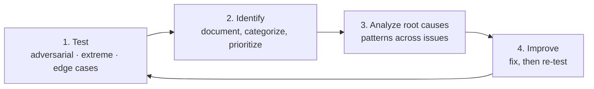
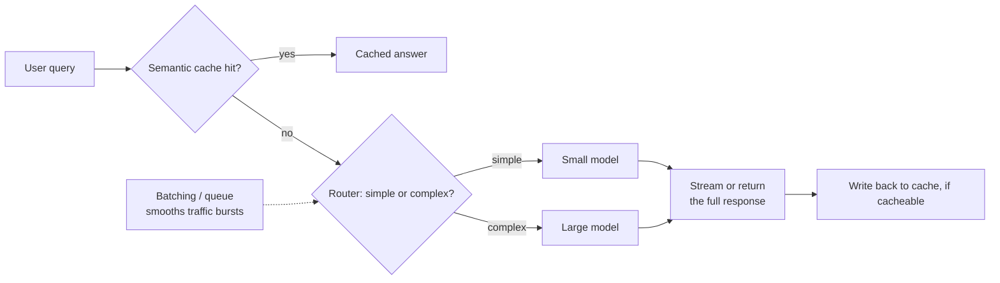
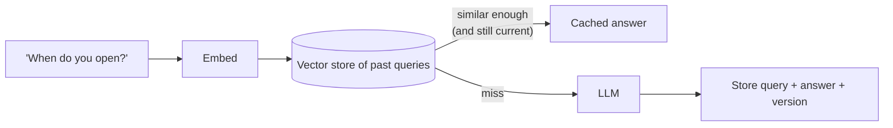
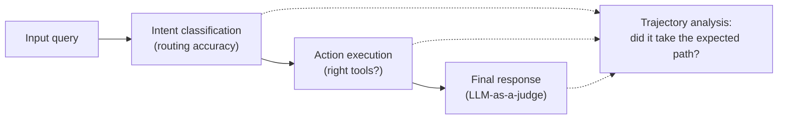

# Evaluation and Performance for LLMs and Agents

> **Adapted from:** Chapter 9, "Evaluation and performance for LLMs and agents" — rewritten and condensed for teaching, with the source's caching, batching, and evaluation code corrected.

Every layer we've added in this course has added ways to fail. A prompt can be badly written. Structured output can fail to parse. Retrieval can fetch the wrong documents. An agent can pick the wrong tool or loop forever. **Hallucination** runs through all of them, and it's the most insidious failure because it doesn't raise an error. It gets past users and erodes trust before anyone notices.

Production adds a second problem: **performance**. One question to the [multi-agent ShopBot](./multi-agent-systems) might trigger an orchestrator call, a routing decision, a specialist agent, several tools, and a synthesis step. Then a **flash sale** hits and traffic jumps tenfold. "What are your store hours?" goes to the most expensive model. There's no cache, so identical questions are answered from scratch every time. Under load, agents take shortcuts: they **invent** product specs instead of waiting for slow database lookups, and **guess** shipping estimates instead of calling the logistics API.

This lesson covers both halves:

1. **Measuring hallucinations**: grounding data, test sets, **grounding defect rate**, **FActScore**, **ROUGE** (and its limits), **LLM-as-a-judge**, **red teaming**, and production **monitoring**.
2. **Performance patterns**: **streaming**, **batching** (in your system and through the Batch API), **semantic caching** done safely, and **multi-model routing**.
3. **Evaluating agents**: the **final answer**, the **tool calls**, and the **trajectory** of steps.

---

## Identifying and Measuring Hallucinations

You can't fix what you can't find, and you can't find it systematically without measuring.

### Four steps

**1. Identify the grounding data.** This is the source of truth for every claim the system might make. For ShopBot, that means the **product catalog** (specs, prices, availability), **shipping** and **return policies**, and the **support knowledge base**. Every fact needs a **clear, citable source**: if the return window is 30 days, that has to be written down somewhere explicit. Organize it by domain, for example products in a database and policies as **versioned** documents.

**2. Create two test sets.**

- A **generic** set: **100–500** questions that **mirror production traffic**. If 40% of real questions are about availability, 40% of the test set should be too.
- An **adversarial** set: questions **designed to provoke** hallucination. Examples include comparisons that invite invented features, discontinued products, limited-time offers, ambiguous questions with several readings, and requests that mix topics.

**3. Extract claims and validate them.** A **claim** is any checkable assertion: "2-year warranty," "ships in 3–5 business days," "returns within 30 days." Validate each claim against the grounding data automatically, using exact matches for prices and dates, rules for structured fields, and semantic matching for prose. For the adversarial set, add **expert human review** that labels each response accurate, partially accurate, or hallucinated.

**4. Report metrics.**

- **Grounding defect rate (GDR)**: ungrounded responses ÷ total responses. For example, **8%** on the generic set and **25%** on the adversarial set means edge cases are the weak spot. Track it over time to catch regressions.
- **Hallucination severity score (HSS)**: human-rated severity from **1** (minor, such as "2–3 days" when the policy says "2–4") to **5** (critical, such as inventing a feature).
- **Topic-wise analysis**: break GDR down by topic. For example, products might sit at 3% while shipping sits at **15%**, so shipping is where to start.

#### Practice: a hallucination report

Implement `report(rows)`. Each row is `(test_set, topic, hallucinated, severity)`. Return a dict mapping each group name to `(gdr, hss, count)`. The groups are `'ALL'`, each **test set** (prefixed `set:`, such as `set:adversarial`), and each **topic** (prefixed `topic:`).

- `gdr` is the hallucinated count ÷ the group's row count.
- `hss` is the mean severity over the **hallucinated** rows only, or `0.0` if there are none.

Input: one row per line, as `set topic hallucinated(y/n) severity`. The wrapper prints the groups in sorted order.

<CodeExercise
  title="GDR, HSS, and topic breakdown"
  heading="exercise-rai-eval-report"
  lang="python"
  filename="main.py"
  prompt="Implement report(rows) -> {group: (gdr, hss, count)} for 'ALL', 'set:<name>' and 'topic:<name>' groups; hss averages severity over hallucinated rows only (0.0 if none)."
  sampleLog={`generic product n 0
generic shipping y 2
ALL                gdr=50.0% hss=2.00 n=2
set:generic        gdr=50.0% hss=2.00 n=2
topic:product      gdr=0.0% hss=0.00 n=1
topic:shipping     gdr=100.0% hss=2.00 n=1`}
  starter={`def report(rows):
    # rows: list of (test_set, topic, hallucinated: bool, severity: int)
    pass
`}
  wrapSuffix={`
import sys
rows = []
for line in sys.stdin.read().strip().split('\\n'):
    s, t, h, sev = line.split()
    rows.append((s, t, h == 'y', int(sev)))
out = report(rows)
for name in sorted(out):
    gdr, hss, n = out[name]
    print(f'{name:<18} gdr={gdr:.1%} hss={hss:.2f} n={n}')
`}
  hint="Write a helper stats(group_rows) computing gdr and hss; call it for all rows, then for rows filtered by each distinct set and each distinct topic."
  solution={`def report(rows):
    def stats(group):
        bad = [r for r in group if r[2]]
        gdr = len(bad) / len(group)
        hss = sum(r[3] for r in bad) / len(bad) if bad else 0.0
        return gdr, hss, len(group)

    out = {'ALL': stats(rows)}
    for s in {r[0] for r in rows}:
        out[f'set:{s}'] = stats([r for r in rows if r[0] == s])
    for t in {r[1] for r in rows}:
        out[f'topic:{t}'] = stats([r for r in rows if r[1] == t])
    return out
`}
  tests={[
    { name: 'generic vs adversarial and per-topic breakdown', stdin: 'generic product n 0\ngeneric product n 0\ngeneric shipping y 2\ngeneric shipping n 0\nadversarial product y 5\nadversarial returns y 1\nadversarial returns n 0\ngeneric product n 0', equals: 'ALL                gdr=37.5% hss=2.67 n=8\nset:adversarial    gdr=66.7% hss=3.00 n=3\nset:generic        gdr=20.0% hss=2.00 n=5\ntopic:product      gdr=25.0% hss=5.00 n=4\ntopic:returns      gdr=50.0% hss=1.00 n=2\ntopic:shipping     gdr=50.0% hss=2.00 n=2' },
    { name: 'clean run', stdin: 'generic product n 0\ngeneric product n 0', equals: 'ALL                gdr=0.0% hss=0.00 n=2\nset:generic        gdr=0.0% hss=0.00 n=2\ntopic:product      gdr=0.0% hss=0.00 n=2' },
  ]}
/>

Look at `topic:product` in the first test. Its GDR is only 25%, but its **HSS is 5.00**: when product answers go wrong, they go *badly* wrong. Rate and severity together tell you where to look first.

### FActScore: grading individual facts

GDR scores a whole response as grounded or not, but a single response usually contains **several claims**. **FActScore** (Min et al., University of Washington) breaks each response into **atomic facts**, verifies each one, and reports the **fraction that are supported**.

Take this answer: "The wireless headphones have **6 hours** of battery life, a **1-year warranty**, and are on sale for **\$79.99**." Suppose the grounding data says the battery lasts **8 hours**, and confirms the warranty and the price.

| Atomic fact | Grounding | Score |
|---|---|---|
| Battery life is 6 hours | 8 hours | **0** |
| 1-year warranty | 1-year warranty | 1 |
| On sale for \$79.99 | \$79.99 | 1 |
| **FActScore** | (0 + 1 + 1) ÷ 3 | **0.67** |

That's far more informative than labeling the whole answer "hallucinated." In practice, an LLM **extracts** the atomic facts and a verifier **checks** each one against the grounding data:

```python
import json
from openai import OpenAI
from pydantic import BaseModel

client = OpenAI()

class Facts(BaseModel):
    facts: list[str]

def extract_atomic_facts(response: str) -> list[str]:
    parsed = client.chat.completions.parse(
        model=JUDGE_MODEL,
        messages=[{"role": "user", "content":
                   "Split this response into atomic, independently verifiable facts:\n" + response}],
        response_format=Facts,                 # structured output instead of hoping for valid JSON
    )
    return parsed.choices[0].message.parsed.facts

def factscore(response: str, verify) -> float:
    facts = extract_atomic_facts(response)
    return sum(verify(f) for f in facts) / len(facts) if facts else 1.0
```

The `verify` function is your fact checker. It might look the fact up in a database, run retrieval plus a judge, or both.

#### Practice: FActScore with structured facts

To make verification deterministic, represent each atomic fact as an `(attribute, value)` pair and check it against a grounding dict. Implement `factscore(facts, grounding)`, which returns `(score, marks)`:

- `marks` is a list of `(attribute, value, supported)`, where `supported` means the grounding has that attribute **with exactly that value**. Attributes **missing** from the grounding are **unsupported**, because you can't verify them.
- `score` is the supported count ÷ the number of facts, or `1.0` if there are no facts.

Grounding: `battery_hours=8`, `warranty_years=1`, `sale_price=79.99`. Input: one response per line, as space-separated `attribute=value` facts (or `-` for none).

<CodeExercise
  title="FActScore"
  heading="exercise-rai-eval-factscore"
  lang="python"
  filename="main.py"
  prompt="Implement factscore(facts, grounding) -> (score, marks): each fact (attr, value) is supported iff grounding.get(attr) == value; score = supported / len(facts), 1.0 if no facts."
  sampleLog={`battery_hours=6 warranty_years=1 sale_price=79.99
0.67  battery_hours=6:x warranty_years=1:ok sale_price=79.99:ok`}
  starter={`def factscore(facts, grounding):
    pass
`}
  wrapSuffix={`
import sys
GROUNDING = {'battery_hours': '8', 'warranty_years': '1', 'sale_price': '79.99'}
for line in sys.stdin.read().strip().split('\\n'):
    facts = [] if line.strip() == '-' else [tuple(p.split('=', 1)) for p in line.split()]
    score, marks = factscore(facts, GROUNDING)
    print((f'{score:.2f}  ' + ' '.join(f"{a}={v}:{'ok' if ok else 'x'}" for a, v, ok in marks)).rstrip())
`}
  hint="marks = [(a, v, grounding.get(a) == v) for a, v in facts]; score = sum(m[2] for m in marks) / len(marks)."
  solution={`def factscore(facts, grounding):
    if not facts:
        return 1.0, []
    marks = [(attr, value, grounding.get(attr) == value) for attr, value in facts]
    return sum(m[2] for m in marks) / len(marks), marks
`}
  tests={[
    { name: 'source example: one wrong fact of three', stdin: 'battery_hours=6 warranty_years=1 sale_price=79.99', equals: '0.67  battery_hours=6:x warranty_years=1:ok sale_price=79.99:ok' },
    { name: 'unverifiable claims count against the score', stdin: 'battery_hours=8 color=blue', equals: '0.50  battery_hours=8:ok color=blue:x' },
    { name: 'fully supported, and empty', stdin: 'warranty_years=1 sale_price=79.99\n-', equals: '1.00  warranty_years=1:ok sale_price=79.99:ok\n1.00' },
  ]}
/>

### ROUGE: fast, but blind to meaning

**ROUGE** measures how much a response **overlaps** with a reference answer:

- **ROUGE-1**: overlap of single words.
- **ROUGE-2**: overlap of word pairs.
- **ROUGE-L**: the **longest common subsequence** of words.

It's cheap and needs no LLM, but it measures **words, not truth**:

- A **high** score doesn't mean the answer is accurate. Changing a single number keeps almost every word the same.
- A **low** score doesn't mean it's wrong. An accurate paraphrase shares few words with the reference.

#### Practice: implement ROUGE-1 and ROUGE-L, then watch them fail

Implement `rouge1(ref, gen)` and `rouge_l(ref, gen)` as **F1 scores** over lowercase `[a-z0-9]+` tokens, using the provided `tokens()` and `f1()`:

- **ROUGE-1**: overlap = the multiset intersection of token counts. Precision = overlap ÷ generated length, and recall = overlap ÷ reference length.
- **ROUGE-L**: L = the length of the **longest common subsequence** of the two token lists. Precision = L ÷ generated length, and recall = L ÷ reference length.

The reference is "The product comes with a 2-year warranty." Each input line is a generated response.

<CodeExercise
  title="ROUGE-1 and ROUGE-L"
  heading="exercise-rai-eval-rouge"
  lang="python"
  filename="main.py"
  prompt="Implement rouge1 (multiset unigram overlap F1) and rouge_l (longest-common-subsequence F1) using tokens() and f1()."
  sampleLog={`The product comes with a 2-year warranty.
R1=1.000 RL=1.000  The product comes with a 2-year warranty.`}
  starter={`import re
from collections import Counter

def tokens(text):
    return re.findall(r'[a-z0-9]+', text.lower())

def f1(p, r):
    return 0.0 if p + r == 0 else 2 * p * r / (p + r)

def rouge1(ref, gen):
    pass

def lcs_length(x, y):
    pass

def rouge_l(ref, gen):
    pass
`}
  wrapSuffix={`
import sys
REF = 'The product comes with a 2-year warranty.'
for gen in sys.stdin.read().strip().split('\\n'):
    print(f'R1={rouge1(REF, gen):.3f} RL={rouge_l(REF, gen):.3f}  {gen}')
`}
  hint="rouge1: a, b = Counter(tokens(ref)), Counter(tokens(gen)); overlap = sum((a & b).values()). lcs_length: classic DP table dp[i+1][j+1] = dp[i][j] + 1 if x[i] == y[j] else max(dp[i][j+1], dp[i+1][j])."
  solution={`import re
from collections import Counter

def tokens(text):
    return re.findall(r'[a-z0-9]+', text.lower())

def f1(p, r):
    return 0.0 if p + r == 0 else 2 * p * r / (p + r)

def rouge1(ref, gen):
    a, b = Counter(tokens(ref)), Counter(tokens(gen))
    overlap = sum((a & b).values())
    return f1(overlap / max(sum(b.values()), 1), overlap / max(sum(a.values()), 1))

def lcs_length(x, y):
    dp = [[0] * (len(y) + 1) for _ in range(len(x) + 1)]
    for i in range(len(x)):
        for j in range(len(y)):
            dp[i + 1][j + 1] = dp[i][j] + 1 if x[i] == y[j] else max(dp[i][j + 1], dp[i + 1][j])
    return dp[-1][-1]

def rouge_l(ref, gen):
    x, y = tokens(ref), tokens(gen)
    l = lcs_length(x, y)
    return f1(l / max(len(y), 1), l / max(len(x), 1))
`}
  tests={[
    { name: 'identical', stdin: 'The product comes with a 2-year warranty.', equals: 'R1=1.000 RL=1.000  The product comes with a 2-year warranty.' },
    { name: 'WRONG warranty still scores high', stdin: 'The product comes with a 3-year warranty.', equals: 'R1=0.875 RL=0.875  The product comes with a 3-year warranty.' },
    { name: 'CORRECT paraphrase scores zero', stdin: 'It is covered for two years.', equals: 'R1=0.000 RL=0.000  It is covered for two years.' },
  ]}
/>

The wrong answer ("**3**-year") scores **0.875**, and the correct paraphrase scores **0**. Use ROUGE as a quick regression signal for **fixed-format** outputs. For factual correctness, use something that understands meaning.

### LLM-as-a-judge

An LLM can compare a response against the reference **by meaning**. It identifies unsupported claims, rates their severity, and explains its verdict:

```python
class HallucinationJudgment(BaseModel):
    has_hallucination: bool
    severity: int                        # 1-5
    explanation: str
    hallucinated_claims: list[str]

def judge(reference: str, generated: str) -> HallucinationJudgment:
    r = client.chat.completions.parse(
        model=JUDGE_MODEL,
        messages=[{"role": "user", "content":
                   f"Reference (ground truth):\n{reference}\n\nResponse:\n{generated}\n\n"
                   "List claims in the response that the reference does not support or contradicts."}],
        response_format=HallucinationJudgment,
    )
    return r.choices[0].message.parsed
```

**Judges have biases and make mistakes of their own.** They favor longer answers and answers in their own style, and they miss subtle factual errors. Mitigations:

- **Several judges with a majority vote.**
- **Human review of a random sample** to calibrate the judges against people.
- **Structured checks against databases** for facts that can be looked up, such as prices.
- **Few-shot examples** in the judge prompt, including known hallucinations (see [Lesson 2's evaluation dataset](./grounding-outputs-with-rag#building-an-evaluation-dataset)).

### Red teaming

**Red teaming** is a dedicated team trying to make the system **fail**. Metrics catch systematic problems. Creative humans find the **unexpected** ones. A ShopBot red team would try to:

- extract a fake refund policy,
- get the bot to describe products that don't exist,
- get it to promise impossible delivery dates,
- leak internal information.



It's a **continuous loop** that complements automated metrics; it doesn't replace them. LLMs can **generate** adversarial test cases at scale, but keep humans checking that those cases are relevant.

### Monitoring in production

Development-time evaluation doesn't cover production:

- **Scale**: thousands of interactions a day.
- **Speed**: problems need to be detected in near real time.
- **Drift**: the kinds of questions people ask change over time.
- **MLOps integration**: monitoring has to fit into the deployment pipeline.

Tools such as **Arize** and the open-source **Phoenix** ship ready-made hallucination evaluators. In Phoenix, a prebuilt **judge template**, a set of **"rails"** (the allowed labels, such as `hallucinated` and `factual`), and `llm_classify` run the evaluation over a DataFrame:

```python
import pandas as pd
from phoenix.evals import (HALLUCINATION_PROMPT_RAILS_MAP, HALLUCINATION_PROMPT_TEMPLATE,
                           OpenAIModel, llm_classify)

df = pd.DataFrame({
    "input": ["What's the warranty?"],
    "reference": ["Product has a 2-year warranty."],
    "output": ["The product comes with a 3-year warranty."],
})
results = llm_classify(
    df, model=OpenAIModel(model=JUDGE_MODEL), template=HALLUCINATION_PROMPT_TEMPLATE,
    rails=list(HALLUCINATION_PROMPT_RAILS_MAP.values()), provide_explanation=True,
)
print(results[["label", "explanation"]])     # -> "hallucinated", plus why
```

Column names and arguments change between Phoenix versions, so match them to your version's template. In production, run this on a **sample of real outputs on a schedule**, track the hallucination rate, and **alert** when it crosses a threshold. [Lesson 10](./deploying-and-monitoring) covers observability.

### Check: measuring hallucinations

<MultipleChoice
  id="rai-ch9-measure"
  title="Metrics and their limits"
  questions={[
    {
      prompt: 'GDR is 8% on the generic set and 25% on the adversarial set. What is the right interpretation?',
      choices: [
        'The system is equally reliable everywhere',
        'Typical traffic is mostly grounded, but edge cases are a major weakness, so prioritize adversarial-style failures',
        'The adversarial set is broken',
        'GDR cannot compare sets',
      ],
      answer: 1,
      why: 'Splitting by test set (and topic) shows where hallucinations concentrate.',
    },
    {
      prompt: 'A response has five atomic facts, four of them supported. What is its FActScore, and what would a binary label lose?',
      choices: [
        '0.8, whereas a binary "hallucinated" label hides that 80% of the content is correct',
        '1.0, because most facts are right',
        '0.2',
        'FActScore only works with ROUGE',
      ],
      answer: 0,
      why: 'Fact-level scoring keeps the nuance: one wrong claim among several correct ones.',
    },
    {
      prompt: 'Why can\'t a high ROUGE score prove a response is accurate?',
      choices: [
        'ROUGE ignores punctuation',
        'ROUGE measures word overlap. Changing a single number (2-year to 3-year) keeps almost all words the same while making the answer wrong',
        'ROUGE needs GPUs',
        'ROUGE only measures length',
      ],
      answer: 1,
      why: 'Surface overlap isn\'t factual consistency. Use fact-level checks or judges for correctness.',
    },
    {
      prompt: 'Which practice most directly guards against a biased or mistaken LLM judge?',
      choices: [
        'Using a longer judge prompt',
        'Calibrating with human review of a random sample, and using several judges with majority voting',
        'Raising the judge\'s temperature',
        'Trusting the judge\'s explanation',
      ],
      answer: 1,
      why: 'Judges are models too. Measure their agreement with humans and reduce single-judge bias.',
    },
  ]}
/>

---

## Architectural Patterns for Performance



Four patterns, usually combined: **streaming**, **batching**, **semantic caching**, and **multi-model routing**.

### 1. Token streaming vs. full responses

**Streaming** shows tokens as they're generated. Users see the reply start almost immediately, which feels responsive in chat. The trade-off is that a half-written sentence may confuse readers, and you can't **check the whole answer before showing it**. For **formal outputs** (legal briefs, reports), or anything you want to **validate before display**, generate the **full response** first.

| Use case | Recommended |
|---|---|
| Chatbots, real-time assistants | Streaming |
| Reports, summaries, formal letters | Full response |
| Search results, quick recommendations | Streaming |
| Outputs that must be checked before display | Full response |

```python
import asyncio
from openai import AsyncOpenAI

client = AsyncOpenAI()

async def stream_response(prompt: str) -> None:
    stream = await client.chat.completions.create(
        model=CHAT_MODEL, messages=[{"role": "user", "content": prompt}], stream=True)
    async for chunk in stream:
        if chunk.choices and chunk.choices[0].delta.content:
            print(chunk.choices[0].delta.content, end="", flush=True)
    print()

asyncio.run(stream_response("How can I reset my password?"))
```

### 2. Batching: two different tools

**System-level batching** (real time). Chat endpoints take one conversation per request, but you can still **queue** incoming requests and dispatch them in **small groups**, limiting how many run at once. That **smooths bursts**, keeps you under **rate limits**, and spreads per-request overhead. Users may wait a fraction of a second longer, and throughput under load improves.

```python
import asyncio

queue: asyncio.Queue = asyncio.Queue()
MAX_IN_FLIGHT = asyncio.Semaphore(8)                     # cap concurrent model calls

async def enqueue(query: str) -> str:
    future = asyncio.get_running_loop().create_future()
    await queue.put((query, future))
    return await future                                  # caller awaits its own answer

async def batch_worker(batch_size: int = 4, window: float = 0.05):
    while True:
        batch = [await queue.get()]                      # block until work arrives (no busy-polling)
        deadline = asyncio.get_running_loop().time() + window
        while len(batch) < batch_size:
            timeout = deadline - asyncio.get_running_loop().time()
            if timeout <= 0:
                break
            try:
                batch.append(await asyncio.wait_for(queue.get(), timeout))
            except asyncio.TimeoutError:
                break
        await asyncio.gather(*(serve(q, f) for q, f in batch))

async def serve(query: str, future: asyncio.Future):
    async with MAX_IN_FLIGHT:
        try:
            future.set_result(await answer(query))       # answer() = cache → route → model
        except Exception as e:
            future.set_exception(e)
```

:::caution Bugs in the source's batching project
- **Callbacks are never awaited.** The source defines `async def print_result(...)` and then calls it as `cb(answer)` without `await`, so the coroutine never runs and **nothing prints**. Return results through futures (as above), or `await` the callback.
- **Blocking sleep inside async code.** Its mock calls `time.sleep(0.25)` inside the event loop, which **blocks every other request**. Use `await asyncio.sleep(...)`.
- **Busy polling.** It drains the queue with `get_nowait()`, then sleeps a fixed interval even when work is waiting. Blocking on `await queue.get()` reacts immediately.
- **Legacy SDK calls.** `openai.ChatCompletion.create(..., stream=True)` is the pre-1.0 synchronous API, and you can't `async for` over it. Use `AsyncOpenAI` as shown in the streaming example.
:::

**The OpenAI Batch API** (offline) is for work that **doesn't need an immediate answer**: nightly evaluations, bulk classification, embedding a whole library. You upload a `.jsonl` file of requests, each with its own `custom_id`. Results arrive **within 24 hours** at about **half the price**, with much higher throughput limits.

```python
from openai import OpenAI

client = OpenAI()
batch_file = client.files.create(file=open("nightly_eval.jsonl", "rb"), purpose="batch")
batch = client.batches.create(input_file_id=batch_file.id, endpoint="/v1/chat/completions",
                              completion_window="24h", metadata={"description": "nightly eval job"})
# Later: poll client.batches.retrieve(batch.id); when completed, download the output file.
# Results can arrive in ANY order, so match them to requests by custom_id, never by position.
```

The two coexist: system-level batching serves **live users**, and the Batch API handles **background** jobs.

### 3. Semantic caching, done safely

Hundreds of shoppers ask "What time do you close today?" Answering each one from scratch wastes money and time. **Exact-match caching** only helps with **identical** strings. **Semantic caching** embeds each query and reuses the answer to a **sufficiently similar** earlier query.



**The danger is a confident wrong hit.** Similarity measures **topic**, not **answer equivalence**. "What time do you **open**?" and "What time do you **close**?" are very similar to almost any embedding model, but they need **different** answers. The source sets a 0.75 threshold and treats exactly this pair as a cache hit, which is a bug that serves the wrong hours with complete confidence.

Safeguards:

- **Tune the threshold on real paraphrase pairs and near-miss pairs.** Measure both false hits and missed hits.
- **Cache only stable FAQs.** Never cache live data such as stock or order status.
- **Version or date every entry.** When a policy or prompt changes, bump the version and old entries stop matching.
- **Key by context**: locale, store, logged-in versus guest.
- **Fall back to the model** whenever no entry clears the bar.

A corrected LangChain + FAISS cache:

```python
from langchain_community.vectorstores import FAISS
from langchain_openai import OpenAIEmbeddings

CACHE_VERSION = "policies-2026-10"
store = FAISS.from_texts(["What are your store hours?", "What's your refund policy?"],
                         OpenAIEmbeddings(),
                         metadatas=[{"answer": "We're open 9 AM to 9 PM.", "version": CACHE_VERSION},
                                    {"answer": "Refunds are accepted within 30 days.", "version": CACHE_VERSION}])

def cached_answer(query: str, threshold: float = 0.9) -> str | None:
    # Relevance scores: 0..1, higher = more similar. (Raw FAISS scores are DISTANCES: lower = closer.)
    for doc, score in store.similarity_search_with_relevance_scores(query, k=1):
        if score >= threshold and doc.metadata["version"] == CACHE_VERSION:
            return doc.metadata["answer"]
    return None

def handle(query: str) -> str:
    if (hit := cached_answer(query)) is not None:
        return hit
    answer = call_model(query)
    if is_stable_faq(query):                                        # selective caching
        store.add_texts([query], metadatas=[{"answer": answer, "version": CACHE_VERSION}])
    return answer
```

The source's version has several bugs: it constructs `FAISS(embedding_model=...)`, which isn't a real constructor; it reads a `.score` field that search results don't have; and it compares a raw **distance** with `>=`, as if higher meant closer. **Turnkey libraries** such as GPTCache wrap the whole flow, but check that they work with the current OpenAI SDK. GPTCache's adapter targets the pre-1.0 `openai.ChatCompletion` API. Building the cache yourself gives you control over thresholds, metadata, and invalidation.

#### Practice: a semantic cache with a threshold and versions

Implement `SemanticCache` with:

- `put(query, answer)`, which stores the entry tagged with the cache's **current** `version`.
- `get(query)`, which returns `(answer_or_None, best_score)`:
  - Among entries whose version equals the **current** version, find the highest cosine similarity, using the provided `vector()` and `cosine()`.
  - Return that entry's answer if the best score is **≥ threshold**. Otherwise return `None` with the best score.

Bag-of-words vectors stand in for embeddings here, and they show the same failure that real embeddings do. Input: line 1 is the threshold, and the remaining lines are commands: `put question|answer`, `get question`, or `bump version`.

<CodeExercise
  title="Semantic cache: threshold, false hits, invalidation"
  heading="exercise-rai-eval-cache"
  lang="python"
  filename="main.py"
  prompt="Implement SemanticCache.put/get: entries carry the version at insert time; get considers only current-version entries, returns (answer, score) if best cosine >= threshold else (None, score)."
  sampleLog={`0.75
put What time do you open?|We open at 9 AM.
get What time do you open?
get What time do you open? -> HIT 'We open at 9 AM.' (1.00)`}
  starter={`import math
import re
from collections import Counter

def vector(text):
    return Counter(re.findall(r'[a-z0-9]+', text.lower()))

def cosine(a, b):
    dot = sum(a[t] * b.get(t, 0) for t in a)
    na = math.sqrt(sum(v * v for v in a.values()))
    nb = math.sqrt(sum(v * v for v in b.values()))
    return 0.0 if na == 0 or nb == 0 else dot / (na * nb)

class SemanticCache:
    def __init__(self, threshold, version='v1'):
        self.threshold = threshold
        self.version = version
        self.entries = []   # (query, answer, version)

    def put(self, query, answer):
        pass

    def get(self, query):
        pass
`}
  wrapSuffix={`
import sys
lines = sys.stdin.read().strip().split('\\n')
cache = SemanticCache(float(lines[0]))
for line in lines[1:]:
    cmd, arg = line.split(' ', 1)
    if cmd == 'put':
        q, a = arg.split('|', 1)
        cache.put(q, a)
    elif cmd == 'bump':
        cache.version = arg
    else:
        answer, score = cache.get(arg)
        status = f"HIT {answer!r}" if answer is not None else 'MISS'
        print(f'get {arg} -> {status} ({score:.2f})')
`}
  hint="put appends (query, answer, self.version). get: q = vector(query); loop entries skipping other versions; track the best score and answer; compare best with self.threshold."
  solution={`import math
import re
from collections import Counter

def vector(text):
    return Counter(re.findall(r'[a-z0-9]+', text.lower()))

def cosine(a, b):
    dot = sum(a[t] * b.get(t, 0) for t in a)
    na = math.sqrt(sum(v * v for v in a.values()))
    nb = math.sqrt(sum(v * v for v in b.values()))
    return 0.0 if na == 0 or nb == 0 else dot / (na * nb)

class SemanticCache:
    def __init__(self, threshold, version='v1'):
        self.threshold = threshold
        self.version = version
        self.entries = []   # (query, answer, version)

    def put(self, query, answer):
        self.entries.append((query, answer, self.version))

    def get(self, query):
        q = vector(query)
        best_answer, best_score = None, 0.0
        for cached_q, answer, version in self.entries:
            if version != self.version:
                continue
            score = cosine(q, vector(cached_q))
            if score > best_score:
                best_answer, best_score = answer, score
        if best_answer is not None and best_score >= self.threshold:
            return best_answer, best_score
        return None, best_score
`}
  tests={[
    { name: 'exact and case-insensitive hits', stdin: '0.75\nput What time do you open?|We open at 9 AM.\nget What time do you open?\nget what time do YOU open', equals: "get What time do you open? -> HIT 'We open at 9 AM.' (1.00)\nget what time do YOU open -> HIT 'We open at 9 AM.' (1.00)" },
    { name: 'the source threshold serves OPEN hours for a CLOSE question', stdin: '0.75\nput What time do you open?|We open at 9 AM.\nget What time do you close?', equals: "get What time do you close? -> HIT 'We open at 9 AM.' (0.80)" },
    { name: 'a stricter threshold refuses the false hit', stdin: '0.9\nput What time do you open?|We open at 9 AM.\nget What time do you close?', equals: 'get What time do you close? -> MISS (0.80)' },
    { name: 'unrelated question misses', stdin: "0.75\nput What's your refund policy?|Refunds within 30 days.\nget Do you sell gift cards?", equals: 'get Do you sell gift cards? -> MISS (0.00)' },
    { name: 'version bump invalidates old answers', stdin: '0.75\nput What time do you open?|We open at 9 AM.\nbump v2\nget What time do you open?\nput What time do you open?|We open at 10 AM.\nget What time do you open?', equals: "get What time do you open? -> MISS (0.00)\nget What time do you open? -> HIT 'We open at 10 AM.' (1.00)" },
  ]}
/>

The second test is the important one. A threshold chosen without testing **near-miss pairs** will serve the wrong store hours with complete confidence. Tune the threshold on pairs like *open/close*, *ship to/from*, and *return/exchange*, and keep fast-changing facts out of the cache.

### 4. Multi-model routing

Most traffic is routine (hours, shipping, returns), and only a small fraction needs deep reasoning (legal, tax, or multi-order cases). **Routing** sends easy queries to a **small, fast** model and escalates the hard ones:

- **Heuristics**: keywords (legal, tax, medical) or very long queries. Cheap but brittle.
- **A classifier**: a small model trained, or prompted, to label queries simple or complex.
- **Two passes**: try the small model, **check confidence**, and escalate if needed. Borderline queries cost more latency, and average cost drops.

A heuristic router is a few lines:

```python
ADVANCED_TERMS = ("legal", "medical", "regulatory", "tax", "lawsuit", "compliance", "bulk return")

def is_complex(query: str) -> bool:
    q = query.lower()
    return any(t in q for t in ADVANCED_TERMS) or len(query.split()) > 30

def route(query: str) -> str:
    return ADVANCED_MODEL if is_complex(query) else SMALL_MODEL
```

Heuristics misroute things like "Detail the new tax rules in under 100 words": it's short, but it's hard. An LLM classifier using **forced tool calling** on a small model handles that kind of case better:

```python
ROUTE_TOOL = {"type": "function", "function": {
    "name": "route_query",
    "description": "Classify whether a query needs advanced reasoning.",
    "parameters": {"type": "object", "properties": {
        "complexity": {"type": "string", "enum": ["simple", "complex"]},
        "reasoning": {"type": "string"}}, "required": ["complexity"]}}}

def route_with_llm(query: str) -> str:
    r = client.chat.completions.create(
        model=SMALL_MODEL,
        messages=[{"role": "system", "content": "Decide if this query needs advanced reasoning."},
                  {"role": "user", "content": query}],
        tools=[ROUTE_TOOL],
        tool_choice={"type": "function", "function": {"name": "route_query"}},   # always classify
    )
    args = json.loads(r.choices[0].message.tool_calls[0].function.arguments)
    return ADVANCED_MODEL if args["complexity"] == "complex" else SMALL_MODEL
```

(The source uses the legacy `openai.ChatCompletion` with `functions=`. Current SDKs use `tools` and `tool_choice`.)

**Payoffs and pitfalls:**

- **Cost**: if 80–90% of traffic fits the small model, per-query cost drops sharply.
- **Speed**: small models answer faster.
- **Under-classification risk**: hard questions sent to the small model get weak answers. **Log every routing decision and audit samples.**
- **Two-pass latency**: borderline queries make two calls.
- **Drift**: as the product changes, retune the router.

These patterns compound. Even complex questions **repeat**, so cache them. Some simple questions don't need an LLM **at all**: a direct database lookup will do.

### Further optimizations

- **Monitoring and cost tracking**: tokens per request, small-model versus large-model share, and cache hit rate. These numbers guide tuning ([Lesson 10](./deploying-and-monitoring)).
- **Prompt compression**: rewrite or distill prompts to fewer tokens, with tools such as LLMLingua.
- **Meta-prompting**: use a strong model to write or improve the prompts a smaller model runs on.
- **Fine-tuned specialists**: see [Lesson 4](./fine-tuning-llms).
- **Parallelism within batches**, bounded by your rate limits.

### Check: performance

<MultipleChoice
  id="rai-ch9-performance"
  title="Streaming, batching, caching, routing"
  questions={[
    {
      prompt: 'You need to re-score 2 million product descriptions overnight. What fits best?',
      choices: [
        'System-level batching through the chat endpoint',
        'The OpenAI Batch API: asynchronous, about half the price, high throughput, results within 24h, matched by custom_id',
        'Token streaming',
        'Semantic caching',
      ],
      answer: 1,
      why: 'Offline bulk work belongs on the Batch API. System-level batching serves live traffic.',
    },
    {
      prompt: 'Your semantic cache answers "When do you close?" with your opening time. What is the fix?',
      choices: [
        'Lower the threshold',
        'Raise and tune the threshold using near-miss pairs (open/close), and consider excluding questions whose answers differ on a single word from caching',
        'Remove versioning',
        'Cache order-status questions too',
      ],
      answer: 1,
      why: 'Embedding similarity measures topic, not answer equivalence. Thresholds must be calibrated against confusable pairs.',
    },
    {
      prompt: 'Why should "Is this item in stock?" usually not be semantically cached?',
      choices: [
        'It is too short to embed',
        'The answer changes constantly, so a cached reply goes stale. Cache stable FAQs and fetch live data on every request',
        'Caches cannot store booleans',
        'It is always a complex query',
      ],
      answer: 1,
      why: 'Selective caching keeps speed gains without serving outdated facts.',
    },
    {
      prompt: 'A heuristic router sends "Detail the new tax rules in under 100 words" to the small model. What is the best improvement?',
      choices: [
        'Make the keyword list longer forever',
        'Use an LLM or trained classifier for routing (or a two-pass check that escalates low-confidence answers), and monitor misroutes',
        'Always use the large model',
        'Remove the length rule',
      ],
      answer: 1,
      why: 'Keyword heuristics can\'t judge difficulty. A learned or LLM classifier, plus confidence-based escalation, can.',
    },
  ]}
/>

---

## Evaluating Agents

LLM evaluation checks **output quality**: accuracy, hallucination, latency, and tokens. **Agents** also make **decisions**: they classify intent, pick tools, take actions, and chain steps. Each of those can fail independently. A correct final answer can **hide** a flawed path, and a sound path can still end wrong if a **tool fails**. So evaluate at three levels:



### 1. The final answer (end to end)

Run real tasks from start to finish. For a refund request, check whether the agent identified the request, processed it, and confirmed it. **LangSmith** stores datasets, runs your **agent** on every example, and applies **evaluators** to the results:

```python
from langsmith import Client
from pydantic import BaseModel

client = Client()
DATASET = "Customer Support Agent: End-to-End"
if not client.has_dataset(dataset_name=DATASET):
    ds = client.create_dataset(dataset_name=DATASET)
    client.create_examples(
        dataset_id=ds.id,
        inputs=[{"question": "I want a refund for the album 'Thriller'. My order ID is 12345."}],
        outputs=[{"response": "Your refund for 'Thriller' has been processed."}],
    )

class Grade(BaseModel):
    is_correct: bool
    reason: str

grader = ChatOpenAI(model=JUDGE_MODEL).with_structured_output(Grade)

async def final_answer_correct(inputs: dict, outputs: dict, reference_outputs: dict) -> bool:
    g = await grader.ainvoke(
        "Judge whether the agent response correctly handles the request. Extra helpful detail is "
        "fine; factual errors are not.\n"
        f"QUESTION: {inputs['question']}\nEXPECTED: {reference_outputs['response']}\n"
        f"AGENT: {outputs['response']}")
    return g.is_correct

async def run_agent(inputs: dict) -> dict:                      # the system under test
    return {"response": await support_agent.answer(inputs["question"])}

results = await client.aevaluate(
    run_agent,                                # TARGET: the agent being evaluated
    data=DATASET,
    evaluators=[final_answer_correct],        # EVALUATORS: how to score it
    experiment_prefix="agent-end-to-end",
    max_concurrency=4,
)
```

The source passes the **evaluator** as the first argument to `aevaluate`, which is the slot for the **target**, so it would "evaluate" the grader instead of the agent. It also indexes the judge's chat message as `grade["is_correct"]`. Structured output, as above, makes that field real.

### 2. Tool calls

Did the agent call the **right tools**? Compare the tools it used with the expected set. **Precision** and **recall** say more than a pass/fail equality check:

- **Precision**: of the tools it called, how many were expected? Extra calls cost money and can have side effects.
- **Recall**: of the expected tools, how many did it call? Missed calls mean missing data or actions.

### 3. The trajectory

A refund should follow **identify the customer → validate the request → process the refund → confirm**. Record the agent's **execution trace** and compare it with the expected **trajectory**. When they differ, report **where**, not just *whether*.

Not every workflow needs an **exact** match. Some steps can run in either order, and a clarifying question may be fine. For those cases, check **subsequence order** (the required steps appear in order) or **step sets**, and save exact matching for strict processes like refunds.

#### Practice: trajectory and tool-call evaluation

Implement two functions:

- `compare_trajectory(expected, actual)` returns:
  - `'match'`;
  - `'diverged at step N: expected X, got Y'` for the **first** mismatch (1-based);
  - `'stopped early: missing X'` if `actual` is a strict prefix of `expected`;
  - `"extra steps: [...]"` if `expected` is a strict prefix of `actual`.
- `tool_precision_recall(expected, used)` returns `(precision, recall)` over **sets**. An empty `used` gives precision `1.0`, and an empty `expected` gives recall `1.0`.

Input: pairs of lines, with comma-separated expected steps on one line and actual steps on the next. A final line `tools expected|used` (comma-separated) tests the tool metrics.

<CodeExercise
  title="Agent trajectory and tool evaluation"
  heading="exercise-rai-eval-trajectory"
  lang="python"
  filename="main.py"
  prompt="Implement compare_trajectory(expected, actual) with match / first-divergence / stopped-early / extra-steps messages, and tool_precision_recall(expected, used) over sets (empty used -> precision 1.0, empty expected -> recall 1.0)."
  sampleLog={`intent_classifier,refund_agent,gather_info,compile_followup
intent_classifier,refund_agent,gather_info,compile_followup
match`}
  starter={`def compare_trajectory(expected, actual):
    pass

def tool_precision_recall(expected, used):
    pass
`}
  wrapSuffix={`
import sys
lines = sys.stdin.read().strip().split('\\n')
i = 0
while i < len(lines):
    if lines[i].startswith('tools '):
        exp, used = lines[i][6:].split('|')
        p, r = tool_precision_recall([t for t in exp.split(',') if t], [t for t in used.split(',') if t])
        print(f'tools precision={p:.2f} recall={r:.2f}')
        i += 1
    else:
        print(compare_trajectory(lines[i].split(','), lines[i + 1].split(',')))
        i += 2
`}
  hint="Walk zip(expected, actual) looking for the first e != a; afterwards compare lengths. For tools: e, u = set(expected), set(used); tp = len(e & u)."
  solution={`def compare_trajectory(expected, actual):
    for i, (e, a) in enumerate(zip(expected, actual), start=1):
        if e != a:
            return f'diverged at step {i}: expected {e}, got {a}'
    if len(actual) < len(expected):
        return f'stopped early: missing {expected[len(actual)]}'
    if len(actual) > len(expected):
        return f'extra steps: {actual[len(expected):]}'
    return 'match'

def tool_precision_recall(expected, used):
    e, u = set(expected), set(used)
    tp = len(e & u)
    precision = tp / len(u) if u else 1.0
    recall = tp / len(e) if e else 1.0
    return precision, recall
`}
  tests={[
    { name: 'refund path matches', stdin: 'intent_classifier,refund_agent,gather_info,compile_followup\nintent_classifier,refund_agent,gather_info,compile_followup', equals: 'match' },
    { name: 'misrouted to the product agent', stdin: 'intent_classifier,refund_agent,gather_info,compile_followup\nintent_classifier,product_inquiry_agent,lookup_discounts,compile_followup', equals: 'diverged at step 2: expected refund_agent, got product_inquiry_agent' },
    { name: 'stopped early and extra steps', stdin: 'intent_classifier,refund_agent,gather_info,compile_followup\nintent_classifier,refund_agent,gather_info\nintent_classifier,refund_agent\nintent_classifier,refund_agent,send_survey', equals: "stopped early: missing compile_followup\nextra steps: ['send_survey']" },
    { name: 'tool precision and recall', stdin: 'tools lookup_order,process_refund|lookup_order,process_refund,send_email\ntools process_refund|', equals: 'tools precision=0.67 recall=1.00\ntools precision=1.00 recall=0.00' },
  ]}
/>

The last test shows why you need **both** numbers. An agent that called nothing has "perfect" precision (it made no wrong calls) and **zero recall** (it did nothing). An agent that sent an **unexpected email** has full recall but only **0.67 precision**, and for an action with side effects, that extra call might matter more than anything else.

### Check: agent evaluation

<MultipleChoice
  id="rai-ch9-agents"
  title="Answer, tools, trajectory"
  questions={[
    {
      prompt: 'An agent gives the correct refund confirmation, but it skipped validate_request. Which evaluation catches this?',
      choices: [
        'Final-answer LLM judge',
        'Trajectory analysis (and tool-call recall): the expected path includes validation, and the trace shows it missing',
        'ROUGE against the reference answer',
        'Latency monitoring',
      ],
      answer: 1,
      why: 'Correct output can hide an unsafe path. Step-level evaluation exposes it.',
    },
    {
      prompt: 'What goes wrong with client.aevaluate(final_answer_correct, data=..., ...) in the source?',
      choices: [
        'Nothing; that is correct',
        'The first argument is the target system under test, so the grader gets evaluated instead of the agent. Pass the agent as the target and the grader in evaluators=[...]',
        'aevaluate only accepts sync functions',
        'Datasets cannot have outputs',
      ],
      answer: 1,
      why: 'Separate the system being tested from the functions that score it.',
    },
    {
      prompt: 'When is exact trajectory matching the wrong check?',
      choices: [
        'For strict, regulated workflows like refunds',
        'When steps can legitimately vary in order or include optional clarifications. Use ordered-subsequence or step-set checks there',
        'Always; never compare trajectories',
        'Only for single-step agents',
      ],
      answer: 1,
      why: 'Match the strictness of the check to how strict the process really is.',
    },
  ]}
/>

---

## Key Takeaways

- Measure hallucinations with **grounding data**, **generic and adversarial** test sets, **claim validation**, and **GDR, HSS, and topic** breakdowns. Severity and rate tell different stories.
- **FActScore** grades individual facts. **ROUGE** measures overlap: a wrong number can score 0.875 and a correct paraphrase 0. **LLM judges** understand meaning, but **calibrate** them with humans and majority votes.
- **Red-team** continuously, and **monitor** sampled production outputs with alerts.
- **Stream** for chat, return **full responses** when output must be checked first. **Batch** live traffic with queues and concurrency limits, and send offline work to the **Batch API**.
- **Semantic caching** saves money, and can serve **confidently wrong** answers. Tune thresholds on **near-miss pairs**, **version** entries, and cache **only stable** facts.
- **Route** easy queries to small models and escalate hard ones. Log and audit routing decisions.
- Evaluate agents at three levels: the **final answer** (judged against a reference), the **tools** (precision *and* recall), and the **trajectory** (where it diverged). Pass the **agent as the target** and the **graders as evaluators**.

Previous lesson: [Multi-Agent Systems](./multi-agent-systems).

Next lesson: [Deploying and Monitoring](./deploying-and-monitoring).

---

## References

1. [OpenAI: Streaming responses](https://platform.openai.com/docs/guides/streaming-responses)
2. [OpenAI: Batch API](https://platform.openai.com/docs/guides/batch)
3. Min, S., et al. (2023). *FActScore: Fine-grained Atomic Evaluation of Factual Precision in Long Form Text Generation.* arXiv:2305.14251.
4. Lin, C.-Y. (2004). *ROUGE: A Package for Automatic Evaluation of Summaries.*
5. Zheng, L., et al. (2023). *Judging LLM-as-a-Judge with MT-Bench and Chatbot Arena.* arXiv:2306.05685.
6. [Arize Phoenix: evals](https://docs.arize.com/phoenix/evaluation/llm-evals)
7. [LangSmith: evaluation](https://docs.smith.langchain.com/evaluation)
8. [GPTCache](https://github.com/zilliztech/GPTCache)

### Source chapter references (with practice quizzes)

These are the references cited in the source chapter. Pass a citation's quiz to unlock it, then use it in the [Essay Lab](/essay-lab).

<CitationCards chapter={9} />
