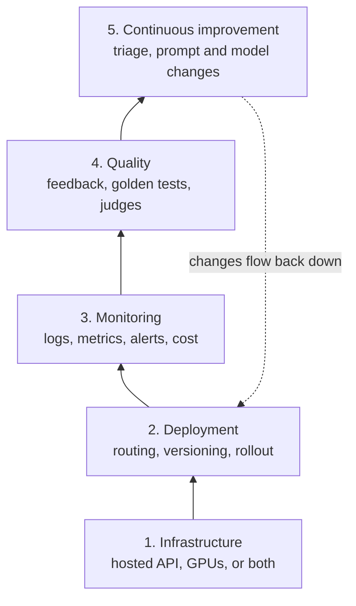
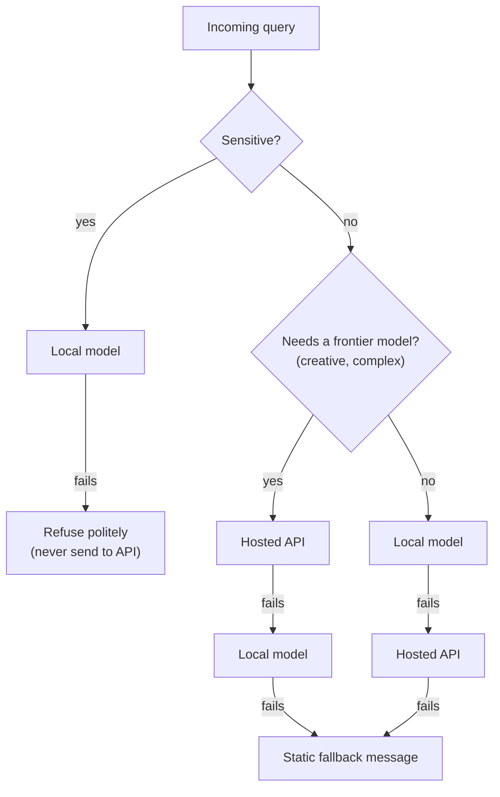
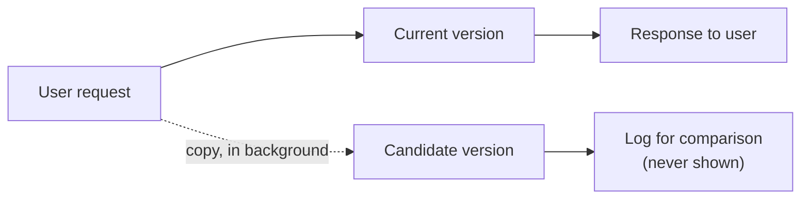

# Deploying and Monitoring LLM Applications

> **Adapted from:** Chapter 10, "Deploying and monitoring" — rewritten and condensed for teaching, with the source's routing, cost-tracking, prompt-versioning, and shadow-testing code corrected.

ShopBot passed every check in the [previous lesson](./evaluation-and-performance): it scored well on the generic and adversarial test sets, its semantic cache was tuned, and its router sent easy questions to a small model. Then it went live.

On day one, nothing crashed and the error rate was close to zero. By the end of the week, the API bill was three times the forecast, a product manager had found ShopBot confidently quoting a discontinued return policy, and users were quietly abandoning chats about billing. **None of these were errors.** No exception fired, no 500 was logged, and a traditional dashboard showed all green.

That is the core lesson of operating LLM applications: **an LLM system can fail while every request succeeds.** Correctness, cost, and user satisfaction all drift silently. This lesson covers the practices that make the drift visible and fixable:

1. **Deployment choices**: hosted APIs, self-hosted models, and a **hybrid** of both, with the economics done properly.
2. **Monitoring**: what to log, what to alert on, and how to catch **cost anomalies**.
3. **Quality in production**: user feedback, **prompt versioning**, **golden tests**, and **shadow testing**.
4. **Observability tools** such as Langfuse.

---

## LLMOps: What Changes from Traditional Ops

**LLMOps** is the set of practices for running LLM applications in production. It borrows from DevOps and MLOps, but three differences shape everything in this lesson:

| Traditional service | LLM application |
|---|---|
| Same input → same output | Same input can produce **different** outputs, and a model update can change behavior with no code change |
| Failures raise errors | The worst failures are **fluent, wrong answers** with HTTP 200 |
| Cost tracks infrastructure (servers, hours) | Cost tracks **tokens**, so a longer prompt or a looping agent changes the bill per request |

A useful way to organize the work is as five layers, each depending on the one below it:



The arrow from the top back to deployment matters most: monitoring and quality checks exist to **drive changes**, and every change goes back through versioned, gradual deployment.

---

## Deployment: Hosted, Self-Hosted, or Hybrid

### Hosted APIs

With a hosted API (Anthropic, OpenAI, Google, or a cloud provider's model service), you send requests and pay per token. The provider handles GPUs, scaling, and model updates.

**Strengths:** no infrastructure, immediate access to frontier models, and costs that scale to zero when traffic does.

**Weaknesses:**

- **Data leaves your network.** Contracts, retention settings, and regional processing options help, but some data (regulated health records, unreleased financials, some government work) may not be allowed to leave at all.
- **Per-token cost grows with volume.** At high, steady traffic, the bill can exceed what dedicated hardware would cost.
- **Rate limits and provider outages** become your outages unless you plan for them.
- **Model changes.** Providers retire model versions. Pin an explicit model ID in production and test a new one before switching, rather than relying on an alias that can move.

A minimal hosted call, with the model pinned and usage captured for cost tracking:

```python
import anthropic

client = anthropic.Anthropic()  # reads ANTHROPIC_API_KEY

MODEL = "claude-opus-5-5"  # pinned explicitly; change only after testing

def ask(question: str) -> tuple[str, dict]:
    response = client.messages.create(
        model=MODEL,
        max_tokens=1024,
        system="You are ShopBot, a customer-support assistant for an online store.",
        messages=[{"role": "user", "content": question}],
    )
    text = "".join(b.text for b in response.content if b.type == "text")
    usage = {
        "input_tokens": response.usage.input_tokens,
        "output_tokens": response.usage.output_tokens,
        "stop_reason": response.stop_reason,
    }
    return text, usage
```

Always log `stop_reason`. A response that ended with `max_tokens` was **cut off**, and a spike in truncated responses is a quality problem that the error rate will never show.

### Self-hosted models

Self-hosting means running an open-weight model (such as Llama, Mistral, or Qwen) on hardware you control.

**Strengths:** data never leaves your environment, no per-token fees, and full control over the model version and fine-tuning.

**Weaknesses:** you own GPU provisioning, scaling, monitoring, security patching, and upgrades, plus the engineers who do that work. Open models that fit on modest hardware are generally less capable than frontier hosted models, so test quality on *your* tasks, not on leaderboard scores.

The source builds a self-hosted service directly on Hugging Face `transformers`. A corrected version of the core generation step:

```python
import torch
from transformers import AutoModelForCausalLM, AutoTokenizer

MODEL_ID = "mistralai/Mistral-7B-Instruct-v0.3"

tokenizer = AutoTokenizer.from_pretrained(MODEL_ID)
model = AutoModelForCausalLM.from_pretrained(
    MODEL_ID, torch_dtype=torch.bfloat16, device_map="auto"
)

def generate(question: str, max_new_tokens: int = 300) -> str:
    # Use the model's own chat template instead of hand-built prompt strings.
    input_ids = tokenizer.apply_chat_template(
        [{"role": "user", "content": question}],
        add_generation_prompt=True,
        return_tensors="pt",
    ).to(model.device)

    with torch.no_grad():
        output = model.generate(
            input_ids,
            max_new_tokens=max_new_tokens,
            do_sample=True,
            temperature=0.7,
            pad_token_id=tokenizer.eos_token_id,
        )

    # Decode only the NEW tokens.
    new_tokens = output[0, input_ids.shape[-1]:]
    return tokenizer.decode(new_tokens, skip_special_tokens=True).strip()
```

:::caution[Two bugs in the source's local model service]
1. **It strips the prompt by string length**, decoding the whole output and then slicing `response[len(prompt):]`. Decoding doesn't reliably reproduce the original prompt text character for character (whitespace and special tokens can differ), so this slice can cut into the answer or leave prompt fragments behind. Slice the **token IDs** instead, as above.
2. **It formats the prompt by hand** instead of using the model's **chat template**. Instruction-tuned models are trained on a specific format, and getting it slightly wrong quietly degrades answers.
:::

`model.generate` in a web handler serves **one request at a time** per GPU and wastes most of the hardware. For production traffic, use a dedicated inference server such as **vLLM** or **Hugging Face Text Generation Inference (TGI)**. They provide continuous batching (new requests join a batch already in progress), efficient KV-cache memory management, and an OpenAI-compatible HTTP API, which typically multiplies throughput many times over on the same GPU.

### Doing the economics properly

The source claims self-hosting "breaks even" at **about 10,000 requests per month**. That figure doesn't follow from its own inputs: it quotes GPU servers at **\$3,000–\$8,000 per month** and hosted costs of **\$0.03–\$0.30 per request**. Break-even is the fixed monthly cost divided by the per-request API cost it replaces:

```text
break-even requests per month = monthly self-hosting cost ÷ API cost per request
```

| Scenario | Calculation | Break-even |
|---|---|---|
| Cheapest GPU, priciest requests | \$3,000 ÷ \$0.30 | **10,000** requests/month |
| Priciest GPU, cheapest requests | \$8,000 ÷ \$0.03 | **≈266,700** requests/month |

So 10,000 is the **most optimistic** corner, not a general rule. And the real numbers are often further apart:

- **Per-request API cost depends on tokens, and input and output are priced differently.** Output tokens commonly cost several times more than input tokens. A support answer with ~350 input and ~900 output tokens costs roughly **\$0.0016** on a small model priced at \$0.40/\$1.60 per million tokens, and roughly **\$0.014** at \$3/\$15. At those prices, a \$5,000/month GPU server breaks even at about **3.2 million** and **350,000** requests per month respectively.
- **The fixed cost isn't just the GPU.** Add engineering time for operations, redundancy (one GPU is a single point of failure), and monitoring.
- **Quality differs.** If the self-hosted model resolves fewer tickets, the "savings" show up as escalations to human agents.

Compute the cost per request from **your own logged token counts**, with separate input and output prices:

```python
PRICES = {  # USD per million tokens: (input, output). Use your provider's current price sheet.
    "small": (0.40, 1.60),
    "large": (3.00, 15.00),
}

def request_cost(tier: str, input_tokens: int, output_tokens: int) -> float:
    in_price, out_price = PRICES[tier]
    return input_tokens / 1e6 * in_price + output_tokens / 1e6 * out_price
```

:::note[The source's cost estimate]
The source estimates cost as `total_tokens × 0.00002`, which is a single flat rate. Because output tokens usually cost much more than input tokens, a flat rate can be badly off for traffic that is mostly reading (long RAG contexts) or mostly writing (long generated answers). Price input and output separately, and keep the price table in configuration, since prices change.
:::

### The hybrid approach

Many teams end up with both: a **self-hosted model** for sensitive or high-volume routine traffic, and a **hosted API** for queries that need stronger reasoning or creativity. A router decides per request.



:::warning[The source's hybrid router leaks the data it is meant to protect]
The source routes sensitive queries (those mentioning "confidential," "internal," and so on) to the local model **for privacy**, and then, if the local model errors, **falls back to the hosted API with the same query**. The fallback path sends exactly the confidential text that the routing rule was written to keep in-house. It happens under load or during a GPU failure, which is precisely when no one is watching.

**A privacy rule must hold on every path, including failure paths.** If sensitive data may not leave, a failed local call must end in a refusal or a retry-later message, never an external call.
:::

Two more cautions about the source's router:

- **Keyword detection is a weak sensitivity classifier.** "Confidential" catches some cases and misses a pasted customer record with no keyword at all. In practice, sensitivity is better determined by **where data came from** (which tenant, which database, which document labels) than by scanning the user's wording. Treat keyword checks as a backstop, not the policy.
- **Log every routing decision** with its reason, so you can audit what went where.

#### Practice: a router whose privacy rule survives failures

Implement `route(query, local, api)`. `local` and `api` are functions that take the query and return text, or **raise an exception** when that backend is down. Return a tuple `(route_name, text)`:

- If the query contains any term in `SENSITIVE` (case-insensitive), try `local`. On success, return `('local', text)`. On failure, return `('refused', REFUSAL)`. **Never call `api`.**
- Otherwise, if it contains any term in `CREATIVE`, try `api` first, then `local`. If not, try `local` first, then `api`. Return the name of whichever succeeded first.
- If both fail, return `('fallback', FALLBACK)`.

Input: one line per request, `query|local_status|api_status`, where each status is `ok` or `fail`. The wrapper builds fake backends that **record every call**, so a test fails if `api` is ever called for a sensitive query.

<CodeExercise
  title="Privacy-preserving hybrid router"
  heading="exercise-rai-deploy-router"
  lang="python"
  filename="main.py"
  prompt="Implement route(query, local, api) -> (route_name, text). Sensitive queries try only local and are refused on failure; creative queries try api then local; others try local then api; if both fail, return the fallback."
  sampleLog={`Summarize the confidential salary bands|fail|ok
refused: Unavailable right now; this request cannot leave our servers.`}
  starter={`SENSITIVE = ('confidential', 'internal', 'salary', 'ssn', 'patient')
CREATIVE = ('write a', 'poem', 'story', 'slogan', 'brainstorm')
REFUSAL = 'Unavailable right now; this request cannot leave our servers.'
FALLBACK = 'Technical difficulties; please try again.'

def route(query, local, api):
    pass
`}
  wrapSuffix={`
import sys
api_calls = []
def make(name, ok, query):
    def backend(q):
        if name == 'api':
            api_calls.append(q)
        if not ok:
            raise RuntimeError(name + ' down')
        return name + ' answer'
    return backend
for line in sys.stdin.read().strip().split('\\n'):
    q, l, a = line.split('|')
    api_calls.clear()
    r, t = route(q, make('local', l == 'ok', q), make('api', a == 'ok', q))
    leaked = any(term in q.lower() for term in SENSITIVE) and api_calls
    print(f'{r}: {t}' + ('  <-- LEAK: sensitive query sent to api' if leaked else ''))
`}
  hint="Check SENSITIVE first and return inside that branch, so the api function is unreachable for sensitive queries. For the rest, build an ordered list of (name, function) pairs and try each one inside try/except."
  solution={`SENSITIVE = ('confidential', 'internal', 'salary', 'ssn', 'patient')
CREATIVE = ('write a', 'poem', 'story', 'slogan', 'brainstorm')
REFUSAL = 'Unavailable right now; this request cannot leave our servers.'
FALLBACK = 'Technical difficulties; please try again.'

def route(query, local, api):
    q = query.lower()
    if any(term in q for term in SENSITIVE):
        try:
            return 'local', local(query)
        except Exception:
            return 'refused', REFUSAL   # never fall back to the API

    if any(term in q for term in CREATIVE):
        order = [('api', api), ('local', local)]
    else:
        order = [('local', local), ('api', api)]

    for name, backend in order:
        try:
            return name, backend(query)
        except Exception:
            continue
    return 'fallback', FALLBACK
`}
  tests={[
    { name: 'routine, creative, and sensitive routing', stdin: 'Where is my order?|ok|ok\nWrite a poem about shoes|ok|ok\nSummarize the confidential salary bands|ok|ok', equals: 'local: local answer\napi: api answer\nlocal: local answer' },
    { name: 'sensitive query with local down is refused, not leaked', stdin: 'Summarize the confidential salary bands|fail|ok\nLook up PATIENT 4471 allergies|fail|ok', equals: 'refused: Unavailable right now; this request cannot leave our servers.\nrefused: Unavailable right now; this request cannot leave our servers.' },
    { name: 'fallbacks for non-sensitive queries', stdin: 'Write a poem about shoes|ok|fail\nWhere is my order?|fail|ok\nWhere is my order?|fail|fail', equals: 'local: local answer\napi: api answer\nfallback: Technical difficulties; please try again.' },
  ]}
/>

The second test is the one the source's design fails: with its fallback, both lines would print `api: api answer` and a leak warning.

### Check: deployment choices

<MultipleChoice
  id="rai-ch10-deploy"
  title="Hosted, self-hosted, and hybrid"
  questions={[
    {
      prompt: 'A GPU server costs $5,000/month all-in, and your hosted API costs average $0.0016 per request. Roughly how many requests per month before self-hosting is cheaper on direct costs alone?',
      choices: ['About 10,000', 'About 300,000', 'About 3 million', 'Self-hosting is always cheaper'],
      answer: 2,
      why: '$5,000 ÷ $0.0016 ≈ 3.1 million. Break-even depends entirely on your per-request token cost, so a rule of thumb like "10,000 requests" can be off by orders of magnitude.',
    },
    {
      prompt: 'Your router sends sensitive queries to a local model. What should happen when the local model is down?',
      choices: [
        'Retry against the hosted API so the user gets an answer',
        'Return a refusal or retry-later message. The privacy rule must also hold on the failure path',
        'Strip the keywords and send the rest to the API',
        'Cache the query and send it to the API overnight',
      ],
      answer: 1,
      why: 'Falling back to the API sends exactly the data the rule exists to protect, and does it during incidents, when no one is watching.',
    },
    {
      prompt: 'Why use vLLM or TGI instead of calling model.generate() inside your web handler?',
      choices: [
        'They make the model more accurate',
        'They batch concurrent requests continuously and manage KV-cache memory, giving much higher throughput per GPU',
        'They are required by the model license',
        'They remove the need for monitoring',
      ],
      answer: 1,
      why: 'A plain generate() call serves one request at a time and leaves the GPU mostly idle.',
    },
    {
      prompt: 'Why should a cost estimate price input and output tokens separately?',
      choices: [
        'Providers usually charge more per output token, so a flat rate misprices read-heavy or write-heavy traffic',
        'Input tokens are free',
        'Output tokens are not billed',
        'It only matters for self-hosted models',
      ],
      answer: 0,
      why: 'Long RAG contexts are mostly input; long generated answers are mostly output. A single rate gets at least one of them wrong.',
    },
  ]}
/>

---

## Monitoring: Making Silent Failures Visible

### Four questions monitoring must answer

1. **Is it working?** Availability, error rate, latency (time to first token and total), timeouts, and rate-limit responses.
2. **Is it good?** Quality signals: judge scores on sampled outputs, golden-test results, truncation rate, refusal rate, and user feedback.
3. **What does it cost?** Tokens and dollars per request, per feature, per customer, and per model, against a budget.
4. **What are users experiencing?** Abandonment, rephrased questions, escalations to humans, and thumbs up or down.

Traditional monitoring covers only the first. The other three are where LLM applications fail.

### Structured logs

Log one structured record per LLM call, so every question above can be answered with a query instead of a code change:

```json
{
  "timestamp": "2026-03-04T14:22:31Z",
  "request_id": "req_8f2a",
  "trace_id": "trace_41c9",
  "feature": "order_status",
  "route": "local",
  "route_reason": "default_local_first",
  "model": "mistral-7b-instruct-v0.3",
  "prompt_version": "support_v2.0",
  "input_tokens": 356,
  "output_tokens": 128,
  "cost_usd": 0.0,
  "latency_ms": 1840,
  "time_to_first_token_ms": 210,
  "stop_reason": "end_turn",
  "cache_hit": false,
  "tool_calls": ["lookup_order"],
  "error": null,
  "feedback": null
}
```

Three fields deserve special attention:

- **`prompt_version`** and **`model`** let you attribute any change in quality or cost to the deployment that caused it.
- **`trace_id`** ties together every call made for one user request: the orchestrator, router, specialist agent, and tools from the [multi-agent lesson](./multi-agent-systems).
- **What you *don't* log.** Full prompts and responses are invaluable for debugging, and they are also user data. Redact personal information, apply retention limits, restrict access, and respect your privacy commitments. The sensitive queries the router keeps on-premises must not end up in a third-party logging service either.

### Alerts that people don't learn to ignore

Alerts that fire constantly get muted, and then the real one is missed. Use **tiers**:

| Tier | Example conditions | Response |
|---|---|---|
| **Page** (wake someone) | Error rate > 5% for 5 minutes; spend pace would exceed the daily budget; a safety filter is triggered at an unusual rate | Immediate |
| **Ticket** (same day) | p95 latency up 50% versus last week; truncation rate doubled; judge score down 10% | Business hours |
| **Report** (weekly review) | Slow drift in feedback rate; topic-level quality trends | Weekly triage |

Compare against a **seasonal baseline**: the same hour on the same weekday last week, rather than the last hour. Traffic at 9 a.m. Monday looks like an anomaly compared to 3 a.m. Sunday.

### Cost anomalies: spikes versus efficiency changes

The source's cost-anomaly detector compares current spend to a historical average, but it references variables that are never defined (`total_tokens_processed`, `historical_efficiency_threshold`, `calculate_trend`). The idea behind it is sound and worth making concrete, because it distinguishes **two different problems**:

- **A cost spike**: total spend far above baseline. If the cost **per request** is normal, this is likely **traffic growth**. That may be fine (a successful launch) or not (a scraper or a retry storm).
- **An efficiency regression**: cost **per request** above baseline. Something changed in *how* requests are served. Typical causes are a prompt that grew, a RAG change that retrieves more chunks, an agent that loops, a cache that stopped hitting, or a route that now sends easy queries to the large model.

An efficiency regression can be serious even when total spend looks normal, for example during a quiet period. That's why the check is per request, not just in total.

#### Practice: flag cost anomalies against a baseline

Implement `check(cost, requests, base_cost, base_requests)` returning a list of flags:

- If `base_cost` or `base_requests` is 0, return `['no_baseline']`.
- Add `'cost_spike'` if `cost > 2 × base_cost`.
- Add `'cost_per_request'` if `requests > 0` and `cost / requests > 1.5 × (base_cost / base_requests)`.
- If no flags were added, return `['ok']`.

Input: one line per hour, `label cost requests base_cost base_requests`. The baseline is the same hour last week.

<CodeExercise
  title="Cost spikes and efficiency regressions"
  heading="exercise-rai-deploy-cost-anomaly"
  lang="python"
  filename="main.py"
  prompt="Implement check(cost, requests, base_cost, base_requests) -> list of flags: 'no_baseline', or any of 'cost_spike' (cost > 2x baseline) and 'cost_per_request' (cost per request > 1.5x baseline), else ['ok']."
  sampleLog={`tue-09 95.0 4800 40.0 2000
tue-09 cost_spike`}
  starter={`def check(cost, requests, base_cost, base_requests):
    pass
`}
  wrapSuffix={`
import sys
for line in sys.stdin.read().strip().split('\\n'):
    label, c, r, bc, br = line.split()
    print(label, ','.join(check(float(c), int(r), float(bc), int(br))))
`}
  hint="Handle the missing baseline first. Then compute both conditions independently and append each flag that applies."
  solution={`def check(cost, requests, base_cost, base_requests):
    if base_cost == 0 or base_requests == 0:
        return ['no_baseline']
    flags = []
    if cost > 2 * base_cost:
        flags.append('cost_spike')
    if requests > 0 and cost / requests > 1.5 * (base_cost / base_requests):
        flags.append('cost_per_request')
    return flags or ['ok']
`}
  tests={[
    { name: 'normal, traffic spike, and both', stdin: 'mon-09 41.0 2000 40.0 2000\ntue-09 95.0 4800 40.0 2000\nwed-09 88.0 2100 40.0 2000', equals: 'mon-09 ok\ntue-09 cost_spike\nwed-09 cost_spike,cost_per_request' },
    { name: 'efficiency regressions hidden by normal totals', stdin: 'thu-09 30.0 900 40.0 2000\nsat-14 61.0 2000 40.0 2000', equals: 'thu-09 cost_per_request\nsat-14 cost_per_request' },
    { name: 'no baseline yet', stdin: 'fri-03 4.0 120 0 0', equals: 'fri-03 no_baseline' },
  ]}
/>

Look at `thu-09`: total spend is **lower** than last week (\$30 vs. \$40), so a spend-only alert stays silent. But each request costs \$0.033 instead of \$0.020, which is 67% more. Something changed, and the bill will show it as soon as traffic returns.

### Dashboards

Build dashboards for the people who read them:

- **Engineering:** latency percentiles, error and timeout rates, rate-limit hits, route distribution, cache hit rate, and truncation rate.
- **Product:** quality scores, feedback rates by topic, escalation rate, and resolution rate.
- **Finance and leadership:** spend against budget, cost per resolved conversation, and the trend.

**Cost per resolved conversation** is often more meaningful than cost per request. A cheap model that needs three attempts and an escalation isn't cheap.

### Check: monitoring

<MultipleChoice
  id="rai-ch10-monitor"
  title="Logs, alerts, and anomalies"
  questions={[
    {
      prompt: 'Error rate is 0.1% and latency is normal, yet users are increasingly unhappy. What does this most likely indicate?',
      choices: [
        'Monitoring is working perfectly',
        'A quality problem: fluent but wrong or unhelpful answers that return HTTP 200, which only quality signals and user feedback reveal',
        'A network outage',
        'The users are wrong',
      ],
      answer: 1,
      why: 'LLM systems fail silently. "Is it working?" is only one of the four questions.',
    },
    {
      prompt: 'Total spend is down 25% this hour, but cost per request is up 67% versus the same hour last week. What is the right reading?',
      choices: [
        'Nothing to see: spend is down',
        'An efficiency regression, such as a longer prompt, more retrieved chunks, a looping agent, or a misrouted model, hidden by low traffic',
        'A traffic spike',
        'A pricing error by the provider',
      ],
      answer: 1,
      why: 'Spikes and efficiency regressions are different problems; check cost per request as well as totals.',
    },
    {
      prompt: 'Which logged field lets you tie a quality drop to a specific deployment?',
      choices: ['latency_ms', 'prompt_version (together with model)', 'timestamp only', 'cache_hit'],
      answer: 1,
      why: 'If every call records which prompt version and model served it, you can compare quality before and after any change.',
    },
    {
      prompt: 'Why compare against the same hour last week instead of the previous hour?',
      choices: [
        'It uses less storage',
        'Traffic and cost follow daily and weekly cycles, so the previous hour produces false alarms every morning',
        'Providers bill weekly',
        'It is required by the API',
      ],
      answer: 1,
      why: 'A seasonal baseline compares like with like.',
    },
  ]}
/>

---

## Quality in Production

Pre-launch evaluation (Lesson 9) tells you how the system performed on your test sets. Production quality is about what happens on **real traffic, which keeps changing**: new products, new policies, new kinds of questions, and model updates.

### Three layers of defense

1. **Before deployment:** golden tests and evaluation sets gate every prompt or model change.
2. **During deployment:** gradual rollout (canary or shadow testing) compares the new version with the old on real traffic.
3. **After deployment:** sampled judge scoring, user feedback, and weekly triage catch what the first two missed.

### User feedback: explicit and implicit

**Explicit feedback** (thumbs up/down, ratings, comments) is clear but sparse. Usually only a small share of users leave it, and those who do are skewed toward the very satisfied and the very annoyed. Treat the absolute numbers with caution and watch the **trend** and the **comments**.

**Implicit feedback** is plentiful but noisy:

- **Rephrasing** the same question right after an answer suggests the answer missed.
- **Abandonment** mid-conversation.
- **Escalation** to a human agent.
- **Copying** the answer, or clicking a suggested link, suggests it helped.
- **Follow-up questions** can mean either engagement or confusion, so don't treat them as a clear signal.

None of these signals is reliable alone. Combine them, and validate them occasionally against human review.

### Weekly triage

Feedback is useful only if someone acts on it. A lightweight weekly loop:

1. Pull the week's negative feedback, escalations, and low judge scores.
2. **Cluster by topic** (billing, shipping, returns, products).
3. Read examples from the worst cluster and find the root cause.
4. Fix it with a prompt change, a knowledge-base update, a new tool, or a routing rule.
5. Add the failing cases to the **golden test set**, so the fix stays fixed.
6. Track the cluster's rate the following weeks.

The source gives an example: billing questions made up a disproportionate share of negative feedback, about **23%**. Investigation showed that ShopBot was answering from an outdated policy document. After the knowledge base was updated and the policy questions were added to the tests, billing's share fell to about **8%**. The numbers are the source's illustration, but the pattern is typical: **many "model" failures are data failures**, fixed by changing what the model is given rather than the model itself.

:::note[Why public trust matters]
In December 2022, Stack Overflow temporarily banned answers generated by ChatGPT. The stated reason was that such answers had a high rate of being incorrect while looking plausible, and that the volume overwhelmed volunteer reviewers. It's a reminder that **plausible-but-wrong output at scale damages trust faster than it can be reviewed**. The defenses in this lesson exist so you catch that before users do.
:::

### Prompt versioning

Prompts are code. They change behavior as much as any function, so they need **versions, reviews, gradual rollout, and rollback**. Store them in version control or a prompt registry, and log the version used for every request.

The source selects the latest prompt with `max(PROMPT_VERSIONS.keys())`, which **compares version strings alphabetically**:

```python
>>> max(["billing_v3.2", "billing_v3.10", "billing_v10.0"])
'billing_v3.2'
```

Alphabetically, `"3.2"` sorts after both `"3.10"` and `"10.0"`, because `'3' > '1'` and then `'2' > '1'`. The moment a prompt reaches version 1.10 or 10.0, the system silently rolls back to an old prompt, with no error. Versions must be **parsed into numbers** and compared as tuples.

And "always use the latest" is itself a risky default. Production should normally use an **explicitly pinned** version, with the latest used only when nothing is pinned, so that a rollback means changing one pin.

#### Practice: select a prompt version safely

Implement `select(versions, name, pin=None)`. Version names look like `name_vMAJOR.MINOR` (such as `support_v1.10`). Names that don't match this pattern should be ignored.

- If `pin` is given, return it if it's in `versions`. Otherwise raise `KeyError(pin)`.
- Otherwise, return the version of `name` with the highest `(major, minor)` compared **numerically**. Raise `KeyError(name)` if there are none.

Input: the first line is the space-separated list of versions, and each later line is a query `name` or `name pin`.

<CodeExercise
  title="Numeric prompt-version selection with pins"
  heading="exercise-rai-deploy-prompt-version"
  lang="python"
  filename="main.py"
  prompt="Implement select(versions, name, pin=None): return the pin if present (KeyError if unknown), else the version of name with the numerically highest (major, minor); KeyError(name) if none. Ignore malformed names."
  sampleLog={`billing_v3.2 billing_v3.10 billing_v10.0
billing
billing -> billing_v10.0`}
  starter={`import re

def select(versions, name, pin=None):
    pass
`}
  wrapSuffix={`
import sys
lines = sys.stdin.read().strip().split('\\n')
versions = lines[0].split()
for q in lines[1:]:
    parts = q.split()
    try:
        print(q, '->', select(versions, *parts))
    except KeyError as e:
        print(q, '-> ERROR unknown', e.args[0])
`}
  hint={`Use re.fullmatch(r'([a-z_]+)_v(\\d+)\\.(\\d+)', v) to parse each version. Collect the (major, minor) pairs for the requested name as ints, and take max() of those tuples.`}
  solution={`import re

def parse(v):
    m = re.fullmatch(r'([a-z_]+)_v(\\d+)\\.(\\d+)', v)
    return (m.group(1), int(m.group(2)), int(m.group(3))) if m else None

def select(versions, name, pin=None):
    if pin is not None:
        if pin not in versions:
            raise KeyError(pin)
        return pin
    candidates = [p for p in map(parse, versions) if p and p[0] == name]
    if not candidates:
        raise KeyError(name)
    n, major, minor = max(candidates, key=lambda p: (p[1], p[2]))
    return f'{n}_v{major}.{minor}'
`}
  tests={[
    { name: 'numeric, not alphabetical, ordering', stdin: 'support_v1.0 support_v1.9 support_v1.10 billing_v3.2 billing_v3.10 billing_v10.0 notes\nsupport\nbilling', equals: 'support -> support_v1.10\nbilling -> billing_v10.0' },
    { name: 'pins win, unknown pins and names error', stdin: 'support_v1.0 support_v1.9 support_v2.0\nsupport support_v1.9\nsupport support_v9.9\nrefunds', equals: 'support support_v1.9 -> support_v1.9\nsupport support_v9.9 -> ERROR unknown support_v9.9\nrefunds -> ERROR unknown refunds' },
  ]}
/>

### Golden tests: a gate before every change

A **golden test set** is a curated list of inputs with **checkable expectations**, run automatically before any prompt or model change ships. It's smaller and stricter than the evaluation sets in Lesson 9: every case encodes something that **must not break**, often a past production failure.

Useful checks are cheap and deterministic:

- **Must include:** facts the answer has to contain ("30 days," "receipt").
- **Must not include:** dangerous or outdated content ("lifetime warranty," an old policy, a leaked internal term).
- **Length limits:** a support answer that runs to 400 words is a regression even if every word is correct.
- **Structure:** valid JSON, a required citation, the right tool call.

Layer an LLM judge on top for qualities that rules can't check, such as tone and helpfulness, with the calibration practices from Lesson 9.

:::caution[Two problems with the source's quality checks]
- **Its quick quality score penalizes hedging** ("I'm not sure," "I don't know"). That rewards exactly the behavior this course has been trying to remove: an honest "I don't have that information" scores *lower* than a confident invention. Penalize hedging only when the grounding data shows the answer was available.
- **Its LLM judge asks for a one-token numeric score** with a very small output limit and parses whatever comes back. Ask for structured output (a score *and* a short reason) and validate it; a judge whose output can't be parsed should count as a failed check, not a default score.
:::

#### Practice: a golden-test deployment gate

Implement two functions:

- `evaluate(test, response)` returns a list of failure reasons (empty means pass). `test` is a dict with `must` (list), `never` (list), and `max_words` (int). Matching is **case-insensitive substring**. Reasons, in this order:
  - `missing=a,b` for `must` items not found;
  - `forbidden=x,y` for `never` items found;
  - `too_long(N>M)` if the response has more than `max_words` words (split on whitespace).
- `gate(results, threshold=0.9)` takes the list of reason lists and returns `(pass_rate, deploy)`, where `deploy` is `pass_rate >= threshold`.

Input: one test per line, `id|must;...|never;...|max_words|response`. An empty field means an empty list.

<CodeExercise
  title="Golden tests and a deploy gate"
  heading="exercise-rai-deploy-golden-tests"
  lang="python"
  filename="main.py"
  prompt="Implement evaluate(test, response) -> list of reasons ('missing=...', 'forbidden=...', 'too_long(N>M)') and gate(results, threshold=0.9) -> (pass_rate, deploy)."
  sampleLog={`shipping|3-5 business days||20|Standard shipping takes 3-5 business days.
shipping: PASS
pass_rate=100% deploy=yes`}
  starter={`def evaluate(test, response):
    pass

def gate(results, threshold=0.9):
    pass
`}
  wrapSuffix={`
import sys
results = []
for line in sys.stdin.read().strip().split('\\n'):
    tid, must, never, mx, resp = line.split('|')
    test = {'must': [x for x in must.split(';') if x],
            'never': [x for x in never.split(';') if x],
            'max_words': int(mx)}
    reasons = evaluate(test, resp)
    results.append(reasons)
    print(f'{tid}: ' + ('PASS' if not reasons else 'FAIL ' + ' '.join(reasons)))
rate, deploy = gate(results)
print(f'pass_rate={rate:.0%} deploy={"yes" if deploy else "no"}')
`}
  hint="Lowercase the response once. Build each reason only if its list is non-empty. In gate, count the results that are empty lists."
  solution={`def evaluate(test, response):
    text = response.lower()
    reasons = []
    missing = [w for w in test['must'] if w.lower() not in text]
    forbidden = [w for w in test['never'] if w.lower() in text]
    words = len(response.split())
    if missing:
        reasons.append('missing=' + ','.join(missing))
    if forbidden:
        reasons.append('forbidden=' + ','.join(forbidden))
    if words > test['max_words']:
        reasons.append(f"too_long({words}>{test['max_words']})")
    return reasons

def gate(results, threshold=0.9):
    passed = sum(1 for r in results if not r)
    rate = passed / len(results)
    return rate, rate >= threshold
`}
  tests={[
    { name: 'mixed results block the deploy', stdin: 'refund|30 days;receipt|guarantee|25|You can return items within 30 days with a receipt.\nshipping|3-5 business days||20|Standard shipping takes 3-5 business days.\nwarranty|1 year|lifetime|20|Every product has a lifetime warranty, no questions asked.\npassword|reset link|password is|15|Click Forgot password and we will email you a reset link right away so you can choose a new one today.', equals: 'refund: PASS\nshipping: PASS\nwarranty: FAIL missing=1 year forbidden=lifetime\npassword: FAIL too_long(21>15)\npass_rate=50% deploy=no' },
    { name: 'case-insensitive matching, all pass', stdin: 'refund|30 Days|Lifetime|25|Returns are accepted within 30 days.\nhours|9am||10|We are open from 9AM to 6PM.', equals: 'refund: PASS\nhours: PASS\npass_rate=100% deploy=yes' },
  ]}
/>

### Shadow testing and canaries

Golden tests catch known failures. To see how a change behaves on **real, unpredictable traffic** without exposing users to it, use one of two rollout patterns:

- **Shadow testing:** every request goes to the current version, whose answer the user sees. A copy also goes to the candidate, whose answer is **logged, not shown**. Compare the two offline with judges, rules, and cost and latency stats.
- **Canary release:** route a small, stable share of users (say 5%) to the candidate for real. Pick users with a **hash of the user ID**, so each user consistently gets one version, and watch their metrics before widening the rollout.



A corrected shadow call: the candidate runs in the background and **must never slow down or break** the user's response.

```python
import asyncio
import logging

async def handle(question: str, current, candidate, log_comparison) -> str:
    answer = await current(question)

    async def shadow():
        try:
            shadow_answer = await asyncio.wait_for(candidate(question), timeout=30)
            log_comparison(question, answer, shadow_answer)
        except Exception:
            logging.exception("shadow call failed")  # never affects the user

    task = asyncio.create_task(shadow())
    _background.add(task)               # keep a reference so it isn't garbage-collected
    task.add_done_callback(_background.discard)
    return answer

_background: set[asyncio.Task] = set()
```

:::caution[The source's shadow test blocks the user]
The source wraps **synchronous** `generate()` calls in `asyncio.create_task`. A synchronous call inside a coroutine doesn't yield, so it **blocks the event loop**: every user waits for the candidate model too, which is the opposite of shadowing. `current` and `candidate` must be genuinely async (such as the SDK's `AsyncAnthropic` client), or run synchronous calls in a thread with `asyncio.to_thread`. Also keep a reference to background tasks, since the event loop holds only weak references to them.
:::

Shadow testing doubles the model cost for the traffic you mirror, so mirror a **sample** rather than everything, and **exclude sensitive requests** if the candidate runs somewhere they are not allowed to go.

### When to switch models

A new model is a deployment like any other. Consider switching when:

- golden tests and evaluation sets show a **meaningful quality gain** on your tasks;
- cost or latency improves **at equal quality**;
- your current model is **scheduled for retirement**;
- you need a capability the current model lacks, such as longer context, better tool use, or vision.

Then roll out the same way: golden tests, shadow or canary, metrics, and a pinned model ID you can roll back. **Re-tune prompts** for the new model: a prompt tuned for one model is rarely optimal for another, and parameters can differ too. For example, some newer Claude models don't accept custom `temperature` or `top_p` values and use an effort setting instead, so check the model's documentation before porting request code.

### Check: quality in production

<MultipleChoice
  id="rai-ch10-quality"
  title="Feedback, versions, and rollouts"
  questions={[
    {
      prompt: 'Your registry contains support_v1.9 and support_v1.10. What does max() of those strings return, and why does it matter?',
      choices: [
        "'support_v1.10': string comparison handles versions correctly",
        "'support_v1.9', because strings compare character by character, so the system silently serves an older prompt",
        'It raises a TypeError',
        'It returns both',
      ],
      answer: 1,
      why: "'9' > '1', so '1.9' sorts after '1.10'. Parse versions into integer tuples, and pin production versions explicitly.",
    },
    {
      prompt: 'Which statement about shadow testing is correct?',
      choices: [
        'Users see the candidate\'s answer',
        'The candidate receives a copy of real traffic and its answers are logged, not shown, and it must not slow down or break the user\'s response',
        'It costs nothing extra',
        'It replaces golden tests',
      ],
      answer: 1,
      why: 'Shadowing compares versions on real traffic with zero user exposure, at the cost of extra model calls.',
    },
    {
      prompt: 'A quality score subtracts points whenever the answer says "I don\'t know." What is the problem?',
      choices: [
        'There is no problem',
        'It rewards confident invention over honest uncertainty. Penalize "I don\'t know" only when the answer was actually available',
        'It makes answers too short',
        'It is too slow',
      ],
      answer: 1,
      why: 'A metric that punishes honesty pushes the system toward hallucination.',
    },
    {
      type: 'order',
      prompt: 'Order the weekly triage loop (top = first):',
      items: [
        'Collect negative feedback, escalations, and low judge scores',
        'Cluster the failures by topic',
        'Read examples from the worst cluster and find the root cause',
        'Ship a fix and add the failing cases to the golden tests',
        'Track the cluster\'s rate over the following weeks',
      ],
      why: 'Collect, cluster, diagnose, fix (and lock the fix in with tests), then confirm the fix worked.',
      whyWrong: 'You can\'t diagnose before clustering shows where failures concentrate, and a fix isn\'t done until the trend confirms it.',
    },
  ]}
/>

---

## Observability Tools: Langfuse

You can build all of this yourself, but **LLM observability platforms** provide it out of the box: traces of every call and tool step, token and cost tracking, prompt management with versions, user-feedback capture, evaluation datasets, and LLM-judge scoring. Options include **Langfuse** (open source and self-hostable), **LangSmith**, **Arize Phoenix**, and **Helicone**, plus general tools such as OpenTelemetry with your existing monitoring stack.

Langfuse instruments code with a decorator. Nested decorated functions become nested spans in one trace:

```python
from langfuse import observe, get_client
import anthropic

client = anthropic.Anthropic()
langfuse = get_client()  # reads LANGFUSE_PUBLIC_KEY, LANGFUSE_SECRET_KEY, LANGFUSE_HOST

@observe(as_type="generation")
def call_model(question: str, context: str) -> str:
    response = client.messages.create(
        model="claude-opus-5-5",
        max_tokens=1024,
        system=f"Answer using only this context:\n{context}",
        messages=[{"role": "user", "content": question}],
    )
    langfuse.update_current_generation(
        model="claude-opus-5-5",
        usage_details={
            "input": response.usage.input_tokens,
            "output": response.usage.output_tokens,
        },
    )
    return "".join(b.text for b in response.content if b.type == "text")

@observe()
def answer(question: str) -> str:
    context = retrieve(question)          # also decorated with @observe() in a real app
    return call_model(question, context)
```

The Langfuse SDK's API has changed between major versions (the import paths and the methods for updating spans differ), so check the version you install against its documentation.

The source's case study is **Huntr**, a job-search platform that it reports used Langfuse to trace its AI features, track costs, and compare prompt versions. Treat the specific results as the source reports them. The general lesson holds regardless: **the teams that improve fastest are the ones that can see every request**, from the user's question through retrieval, tool calls, and the model's answer, along with what it cost and whether the user was helped.

Before sending traces to any hosted observability service, apply the same rules as for model providers: **redact personal data**, and don't send what your privacy commitments say must stay in-house. Self-hosting the observability tool is one way to keep sensitive traces under your control.

---

## Key Takeaways

- **LLM systems fail while every request succeeds.** Monitor quality, cost, and user experience, not just errors and latency.
- **Hosted, self-hosted, or hybrid** is an economics *and* a privacy decision. Compute break-even from **your own token counts** with separate input and output prices; it can range from thousands to millions of requests per month.
- In a hybrid router, **privacy rules must hold on failure paths**: a sensitive query whose local model fails gets refused, never forwarded to an external API.
- Self-hosted inference belongs behind a server like **vLLM** or **TGI**, decoded by **token IDs** with the model's **chat template**.
- Log **structured records** with model, prompt version, tokens, cost, stop reason, and trace ID, and redact what shouldn't be stored.
- **Tier alerts** and compare against **seasonal baselines**. Watch **cost per request**, not just total spend, to catch efficiency regressions.
- Treat **prompts as code**: compare versions **numerically**, **pin** production versions, and make rollback a one-line change.
- Gate every change with **golden tests**, roll out with **shadow tests or canaries**, and close the loop with **weekly triage**, where many "model" problems turn out to be data problems.

Previous lesson: [Evaluation and Performance](./evaluation-and-performance).

Next lesson: [Bias, Privacy, and Responsible AI](./bias-privacy-and-responsible-ai).

---

## References

1. [Anthropic: Messages API](https://docs.anthropic.com/en/api/messages)
2. [Hugging Face Transformers: chat templates](https://huggingface.co/docs/transformers/main/en/chat_templating)
3. [vLLM documentation](https://docs.vllm.ai/)
4. [Hugging Face Text Generation Inference](https://huggingface.co/docs/text-generation-inference/index)
5. [Langfuse documentation](https://langfuse.com/docs)
6. [Python docs: asyncio.create_task](https://docs.python.org/3/library/asyncio-task.html#asyncio.create_task)
7. [Stack Overflow: Temporary policy — Generative AI (e.g., ChatGPT) is banned](https://meta.stackoverflow.com/questions/421831/temporary-policy-generative-ai-e-g-chatgpt-is-banned)
8. Kwon, W., et al. (2023). *Efficient Memory Management for Large Language Model Serving with PagedAttention.* arXiv:2309.06180.
