# Scale From Zero to Millions of Users

> **Adapted from:** Alex Xu, *System Design Interview – An Insider's Guide* (2020), Chapter 1 — rewritten and condensed for teaching.

No large system starts large. This lesson begins with one server handling one user, then adds one component at a time — each time asking *what breaks next?* — until the design can serve millions of users. The components you meet along the way (load balancers, replicas, caches, CDNs, queues, shards) are the vocabulary of nearly every system design interview.

**What you'll be able to do after this lesson:**

- Trace a request from a browser through DNS to a web server.
- Explain why each new tier (database, load balancer, cache, CDN, queue) is added and what problem it solves.
- Compare vertical and horizontal scaling, and stateful and stateless web tiers.
- Choose a sharding key and name the problems sharding introduces.

---

## Step 1: A Single Server

The simplest possible setup puts everything — the web app, the database, the cache — on one machine.

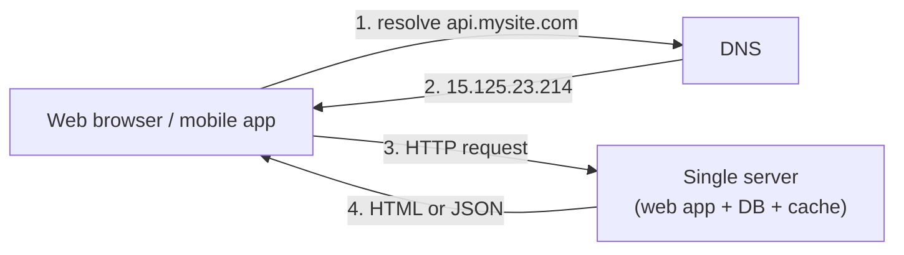

The request flow:

1. The user types a domain name such as `api.mysite.com`. DNS is almost always a paid third-party service, not something you host.
2. DNS answers with an IP address — say `15.125.23.214`.
3. The client sends HTTP requests straight to that IP.
4. The server responds with an HTML page (for browsers) or JSON (for apps).

Traffic arrives from two kinds of clients:

- **Web applications** combine server-side code (Java, Python, …) for business logic and storage with client-side HTML and JavaScript for presentation.
- **Mobile applications** talk to the server over HTTP and usually exchange **JSON**, because it is lightweight and easy to parse. For example, `GET /users/12` might return:

```json
{
  "id": 12,
  "firstName": "John",
  "lastName": "Smith",
  "address": {
    "streetAddress": "21 2nd Street",
    "city": "New York",
    "state": "NY",
    "postalCode": 10021
  },
  "phoneNumbers": ["212 555-1234", "646 555-4567"]
}
```

---

## Step 2: Separate the Database

As usage grows, one box can't do everything. The first split is to move the database onto its own server: a **web tier** for request handling and a **data tier** for storage. Now each tier can be sized and scaled independently.

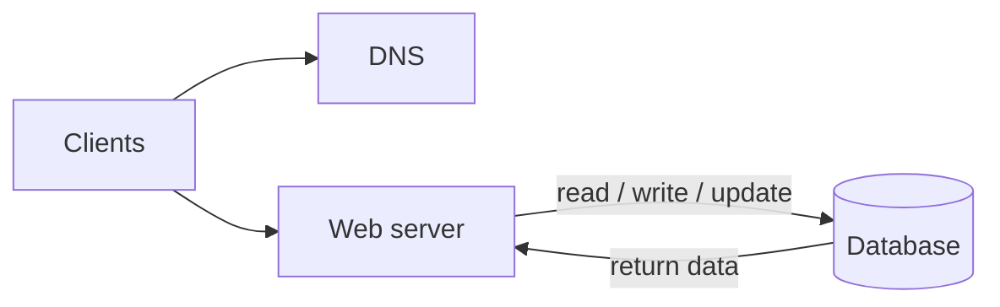

### Relational or non-relational?

| | Relational (RDBMS / SQL) | Non-relational (NoSQL) |
|---|---|---|
| Examples | MySQL, PostgreSQL, Oracle | Cassandra, DynamoDB, HBase, CouchDB, Neo4j |
| Data shape | Tables and rows with a schema | Key-value, document, column-family, or graph |
| Joins | Yes, across tables via SQL | Generally not supported |
| Track record | 40+ years of production use | Newer; tuned for specific workloads |

A relational database is the sensible default for most applications. Look at a NoSQL store when:

- you need **very low latency**,
- your data is **unstructured** or has few relationships,
- you mostly **serialize and deserialize** blobs (JSON, XML, YAML), or
- you must store a **massive** volume of data.

### Check: choosing a database

<MultipleChoice
  id="sdi-ch1-database-choice"
  title="Picking a data store"
  questions={[
    {
      prompt: 'An e-commerce app stores orders, customers, and products and frequently reports on "orders per customer per product category." Which is the better default choice?',
      choices: [
        'A key-value store, because it is always faster',
        'A relational database, because the data is highly related and the queries need joins',
        'A graph database, because every dataset is a graph',
        'No database — keep everything in the web server memory',
      ],
      answer: 1,
      why: 'Strongly related data with join-heavy queries is exactly what relational databases are built for. NoSQL wins on specific needs (latency, scale, unstructured data), not by default.',
    },
  ]}
/>

---

## Vertical vs. Horizontal Scaling

There are two ways to give a system more capacity:

- **Vertical scaling ("scale up")** — buy a bigger machine: more CPU, more RAM, faster disks.
- **Horizontal scaling ("scale out")** — add more machines to a pool.

Scaling up is the simplest option while traffic is modest, but it has two hard limits:

1. **A ceiling.** There is only so much CPU and memory you can put in one box.
2. **No redundancy.** If that one server dies, the whole site goes down with it.

For large systems, horizontal scaling wins. But in our current design, clients connect *directly* to a single web server: if it goes offline, or gets swamped by a traffic spike, users see errors or slow pages. The fix is a load balancer.

---

## Step 3: Add a Load Balancer

A **load balancer** spreads incoming requests across a set of web servers.

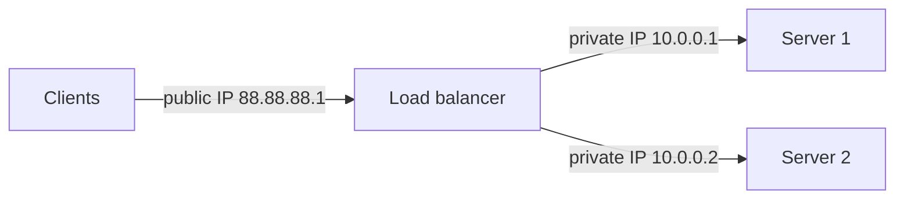

Clients now connect only to the load balancer's **public IP**. The web servers sit behind it on **private IPs** — addresses reachable inside the data center's network but not from the internet — which also shrinks the attack surface.

This one change fixes both problems:

- **Failover:** if Server 1 goes down, the load balancer sends all traffic to Server 2, and you add a fresh server to the pool.
- **Elastic capacity:** if traffic outgrows two servers, add more to the pool; the load balancer starts routing to them automatically.

The web tier now has redundancy. The data tier still has exactly one database — a single point of failure.

---

## Step 4: Database Replication

**Replication** keeps copies of the database on several servers. The classic arrangement is one **primary** (historically called *master*) and several **replicas** (historically *slaves*):

- The **primary** accepts all writes — `INSERT`, `UPDATE`, `DELETE`.
- **Replicas** receive a copy of the primary's changes and serve **reads**.

Most applications read far more than they write, so a system typically has many more replicas than primaries.

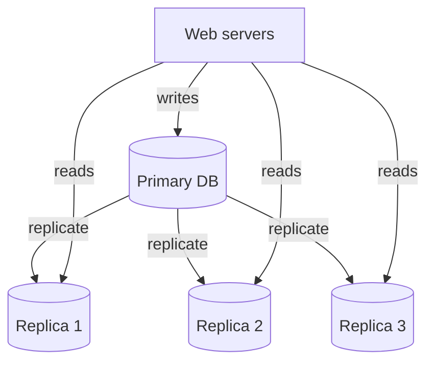

Why it helps:

- **Performance** — reads are spread across replicas, so more queries run in parallel.
- **Reliability** — if a server is destroyed (fire, flood, earthquake), the data survives on other machines, ideally in other locations.
- **Availability** — if one database is offline, the site keeps running on the others.

### What happens when a database fails?

- **A replica fails.** If other replicas exist, reads shift to them. If it was the *only* replica, reads temporarily go to the primary. Either way, a new replica is provisioned to replace it.
- **The primary fails.** A replica is **promoted** to become the new primary, and a new replica is added. In practice promotion is tricky: replication is often asynchronous, so the promoted replica may be missing the last few writes, which must be recovered. Multi-primary and circular replication can help but are much more complex — the [Leaders and Followers](../distributed-data/leaders-and-followers) and [Multi-Leader Replication](../distributed-data/multi-leader-replication) lessons go deeper.

### The design so far

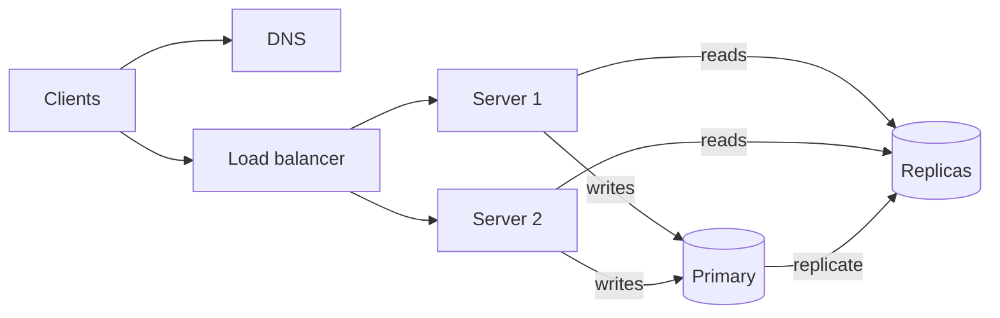

1. DNS returns the load balancer's IP.
2. The client connects to the load balancer.
3. The request lands on Server 1 or Server 2.
4. Reads go to a replica; writes, updates, and deletes go to the primary.

### Check: load balancing and replication

<MultipleChoice
  id="sdi-ch1-lb-replication"
  title="Load balancer and replicas"
  questions={[
    {
      prompt: 'Why do the web servers use private IPs once a load balancer is added?',
      choices: [
        'Private IPs are faster than public IPs',
        'Clients should reach only the load balancer; keeping servers off the public internet improves security and lets the LB control routing',
        'DNS cannot resolve more than one public IP',
        'Databases only accept connections from private IPs',
      ],
      answer: 1,
      why: 'The load balancer is the single public entry point. Servers behind it are reachable only inside the network.',
    },
    {
      prompt: 'The primary database crashes. What is the standard recovery step, and what is the hidden risk?',
      choices: [
        'Restart the web servers; there is no risk',
        'Promote a replica to primary; it may be missing recent writes that had not yet replicated',
        'Send writes to all replicas at once; this is always safe',
        'Switch reads to the primary; the risk is higher latency',
      ],
      answer: 1,
      why: 'Promotion restores write availability, but asynchronous replication means the new primary can lag behind the old one — those missing writes need recovery.',
    },
  ]}
/>

---

## Step 5: Add a Cache

The web and data tiers are now robust. Next: speed. Every page load currently triggers one or more database queries, and repeated trips to the database are slow. A **cache** keeps the results of expensive or frequently requested lookups **in memory** so the next request is served much faster.

### The cache tier

A separate **cache tier** is a fast, temporary data store between the web servers and the database. It improves response time, takes load off the database, and can be scaled independently.

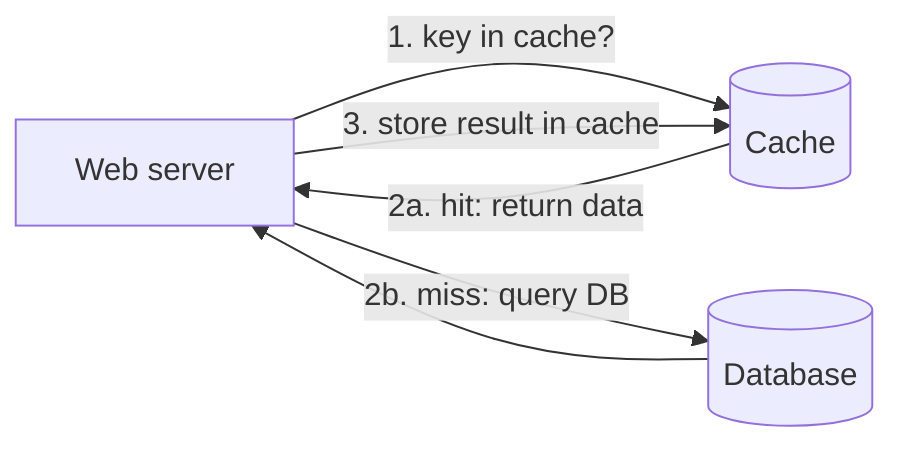

On each request the server checks the cache first. On a **hit**, it returns the cached value. On a **miss**, it queries the database, stores the result in the cache, then returns it. Because the *application* does the loading, this pattern is commonly called **cache-aside** (or lazy loading); the book calls it *read-through*, a name some sources reserve for caches that fetch from the database themselves. Other strategies — write-through, write-behind — suit different access patterns.

Cache servers expose simple APIs. With Memcached, for example:

```python
SECONDS = 1
cache.set('myKey', 'hi there', 3600 * SECONDS)  # expires in 1 hour
cache.get('myKey')                              # -> 'hi there'
```

### Practice: cache-aside lookup

Implement `get_user(user_id, cache, db)` using the cache-aside pattern. Both `cache` and `db` are dictionaries. On a hit, return the cached value. On a miss, read from `db`, store the value in `cache`, and return it. The script prints each result and whether it was a hit or a miss.

<CodeExercise
  title="Cache-aside lookup"
  heading="exercise-sdi-cache-aside"
  lang="python"
  filename="main.py"
  prompt="Implement get_user(user_id, cache, db). Return (value, 'hit') if user_id is in cache. Otherwise read db[user_id], store it in cache, and return (value, 'miss')."
  sampleLog={`(no input)
('alice', 'miss')
('alice', 'hit')
('bob', 'miss')
('alice', 'hit')`}
  starter={`def get_user(user_id, cache, db):
    # 1. Check the cache first.
    # 2. On a miss, read the database and populate the cache.
    pass

db = {1: 'alice', 2: 'bob'}
cache = {}
print(get_user(1, cache, db))
print(get_user(1, cache, db))
print(get_user(2, cache, db))
print(get_user(1, cache, db))
`}
  hint="Use 'user_id in cache' to detect a hit. On a miss, assign cache[user_id] = db[user_id] before returning."
  solution={`def get_user(user_id, cache, db):
    if user_id in cache:
        return (cache[user_id], 'hit')
    value = db[user_id]
    cache[user_id] = value
    return (value, 'miss')

db = {1: 'alice', 2: 'bob'}
cache = {}
print(get_user(1, cache, db))
print(get_user(1, cache, db))
print(get_user(2, cache, db))
print(get_user(1, cache, db))
`}
  tests={[
    { name: 'miss then hit per key', stdin: '', equals: "('alice', 'miss')\n('alice', 'hit')\n('bob', 'miss')\n('alice', 'hit')" },
  ]}
/>

### Things to decide before you cache

- **When to cache.** Caching pays off for data that is **read often and changed rarely**. Cache memory is volatile — a restart wipes it — so the cache must never be the only copy of important data.
- **Expiration (TTL).** Give cached entries an expiry. Too short, and the database gets hammered with reloads; too long, and users see stale data.
- **Consistency.** The database write and the cache update are not one atomic transaction, so the two can drift apart. Keeping them in sync gets much harder across regions — Facebook's *Scaling Memcache at Facebook* paper is the classic case study.
- **Failure handling.** A single cache server is a **single point of failure (SPOF)** — a component whose failure takes the whole system down. Run multiple cache servers, ideally across data centers, and **overprovision** memory so there is headroom as usage grows.
- **Eviction.** When the cache is full, adding an item forces another out. **LRU** (least recently used) is the most common policy; **LFU** (least frequently used) and **FIFO** fit other access patterns.

---

## Step 6: Add a CDN

A **content delivery network (CDN)** is a fleet of servers spread around the world that cache **static content** — images, video, CSS, JavaScript. (Caching *dynamic* HTML at the edge is also possible, but this lesson sticks to static assets.)

The idea is simple: serve each user from the CDN server nearest to them. A user in Los Angeles gets content from a nearby edge far faster than if it had to travel from a server in Europe.

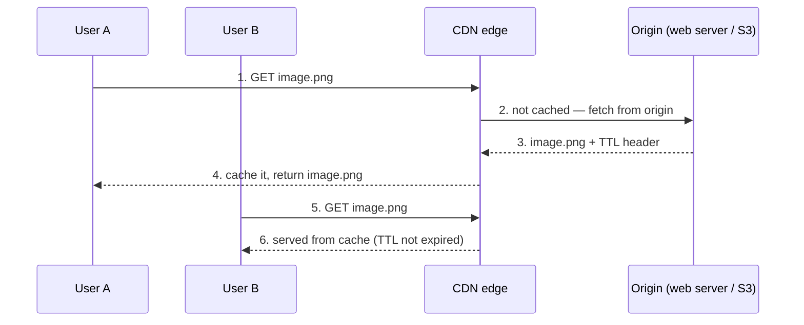

Asset URLs point at the CDN provider's domain, for example `https://mysite.cloudfront.net/logo.jpg` (Amazon CloudFront) or `https://mysite.akamai.com/image-manager/img/logo.jpg` (Akamai). The origin's response carries a **Time-to-Live (TTL)** header saying how long the edge may keep the file.

### CDN considerations

- **Cost.** You pay the provider for data transferred in and out. Rarely requested assets gain little from the CDN — consider serving them from the origin instead.
- **Cache expiry.** Same trade-off as the cache tier: too long means stale content, too short means constant re-fetching from the origin.
- **Fallback.** If the CDN has an outage, clients should detect it and fetch from the origin.
- **Invalidation.** To replace a file before its TTL ends, either call the vendor's invalidation API, or use **object versioning** — change the URL, e.g. `image.png?v=2`, so clients request a new object.

### The design with cache and CDN

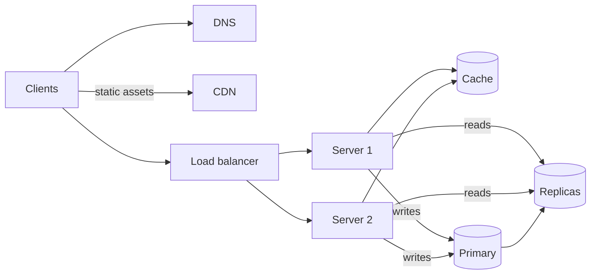

1. Static assets (JS, CSS, images) are served by the CDN, not the web servers.
2. The cache absorbs repeated reads, lightening database load.

### Check: caches and CDNs

<MultipleChoice
  id="sdi-ch1-cache-cdn"
  title="Caching and CDN trade-offs"
  questions={[
    {
      prompt: 'Your team sets the cache TTL for product prices to 30 days to minimize database load. What is the main risk?',
      choices: [
        'The cache will crash from too many keys',
        'Users may see stale prices long after they change in the database',
        'The database will be overloaded with reloads',
        'LRU eviction will stop working',
      ],
      answer: 1,
      why: 'A long TTL trades freshness for fewer reloads. Prices change, so a month-long TTL makes stale data very likely.',
      whyWrong: 'An overloaded database is the risk of a TTL that is too *short*, not too long.',
    },
    {
      prompt: 'You shipped a new logo but users still see the old one from the CDN. Which fix works without waiting for the TTL?',
      choices: [
        'Restart the web servers',
        'Add another replica database',
        'Reference a versioned URL such as logo.png?v=2, or call the CDN vendor\'s invalidation API',
        'Increase the TTL',
      ],
      answer: 2,
      why: 'Versioning creates a new cache key the CDN has never seen; the invalidation API explicitly evicts the old object.',
    },
    {
      prompt: 'Which of these data is the best candidate for the cache tier?',
      choices: [
        'A user\'s bank balance immediately after every transfer',
        'The only copy of uploaded photos',
        'A product catalog page read thousands of times per minute and updated once a day',
        'Write-heavy event logs that are never read',
      ],
      answer: 2,
      why: 'Caching pays off for read-heavy, rarely changing data. The cache is volatile, so it should never hold the only copy of anything.',
    },
  ]}
/>

---

## Step 7: Make the Web Tier Stateless

To scale the web tier horizontally — adding and removing servers freely — the servers must not hold **state** such as user session data. Move that state into shared storage.

### Stateful architecture

A **stateful** server remembers client data between requests. Suppose User A's session lives on Server 1, User B's on Server 2, and User C's on Server 3. Every request from User A *must* reach Server 1; if it lands on Server 2, authentication fails because Server 2 has never seen that session.

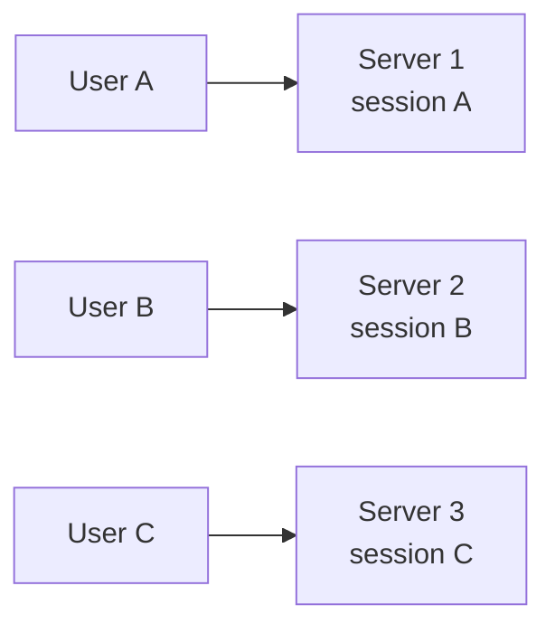

Load balancers can enforce this with **sticky sessions**, but stickiness adds overhead, makes adding or removing servers awkward, and turns a server failure into lost sessions.

### Stateless architecture

A **stateless** server keeps nothing between requests. Any server can handle any request because it fetches state from a **shared data store**.

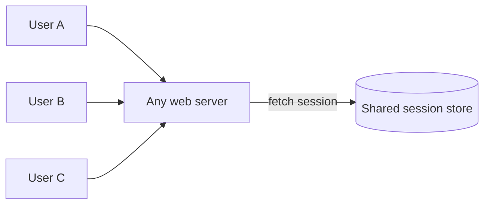

Stateless systems are simpler, more robust, and easier to scale. The shared store can be a relational database, Memcached/Redis, or a NoSQL store; NoSQL is a common choice because it scales easily. With state out of the servers, **autoscaling** — adding or removing web servers automatically based on load — becomes straightforward.

### Practice: why sticky routing fails

Implement `route(user, servers)` that sends a user to a server using a stable hash: `servers[hash_value % len(servers)]`, where `hash_value` is the sum of the character codes (`ord`) in the user's name. The script shows which server each user hits with 3 servers, then again after one server is removed. In a stateful design, every user whose server changed would lose their session.

<CodeExercise
  title="Sticky routing under pool changes"
  heading="exercise-sdi-sticky-routing"
  lang="python"
  filename="main.py"
  prompt="Implement route(user, servers): compute the sum of ord(ch) for each character in user, then return servers[total % len(servers)]. The script counts how many users are routed to a different server after the pool shrinks from 3 to 2."
  sampleLog={`(no input)
before: {'alice': 's1', 'bob': 's2', 'carol': 's2', 'dave': 's3', 'erin': 's2', 'frank': 's3'}
after: {'alice': 's1', 'bob': 's2', 'carol': 's2', 'dave': 's1', 'erin': 's1', 'frank': 's1'}
moved: 3`}
  starter={`def route(user, servers):
    # Sum the character codes of the name, then pick servers[total % n].
    pass

users = ['alice', 'bob', 'carol', 'dave', 'erin', 'frank']
before = {u: route(u, ['s1', 's2', 's3']) for u in users}
after = {u: route(u, ['s1', 's2']) for u in users}
print('before:', before)
print('after:', after)
print('moved:', sum(1 for u in users if before[u] != after[u]))
`}
  hint="sum(ord(ch) for ch in user) gives the total. Index the list with total % len(servers)."
  solution={`def route(user, servers):
    total = sum(ord(ch) for ch in user)
    return servers[total % len(servers)]

users = ['alice', 'bob', 'carol', 'dave', 'erin', 'frank']
before = {u: route(u, ['s1', 's2', 's3']) for u in users}
after = {u: route(u, ['s1', 's2']) for u in users}
print('before:', before)
print('after:', after)
print('moved:', sum(1 for u in users if before[u] != after[u]))
`}
  tests={[
    { name: 'routing before and after shrinking the pool', stdin: '', equals: "before: {'alice': 's1', 'bob': 's2', 'carol': 's2', 'dave': 's3', 'erin': 's2', 'frank': 's3'}\nafter: {'alice': 's1', 'bob': 's2', 'carol': 's2', 'dave': 's1', 'erin': 's1', 'frank': 's1'}\nmoved: 3" },
  ]}
/>

Half of the users would lose their sessions from a single server change. A stateless tier sidesteps the problem entirely: whichever server a user lands on reads the session from the shared store.

---

## Step 8: Multiple Data Centers

As the user base goes international, a single data center becomes both a latency problem and an availability risk. With two data centers, **geoDNS** (geo-routing) resolves the domain to the data center closest to each user — for example *x*% of traffic to US-East and (100 − *x*)% to US-West.

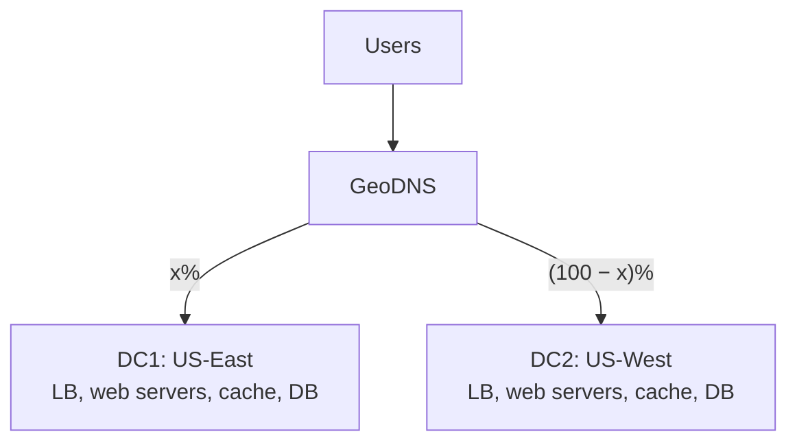

If one data center suffers a major outage, **all** traffic is sent to the healthy one.

Running multiple data centers raises new problems:

- **Traffic redirection.** You need tooling (e.g. geoDNS) to steer users to the right data center and to fail over.
- **Data synchronization.** Each region may have its own databases and caches. After a failover, users may land where their data hasn't arrived yet. The usual answer is to **replicate data across data centers**, often asynchronously, as Netflix does.
- **Testing and deployment.** Test from multiple locations, and use automated deployment to keep every data center running the same version.

---

## Step 9: Add a Message Queue

To keep scaling, components must be **decoupled** so each can scale on its own. A **message queue** is a durable buffer that enables asynchronous communication:

- **Producers** (publishers) create messages and publish them to the queue.
- **Consumers** (subscribers) pull messages and do the work.

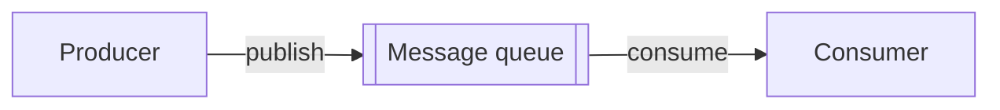

Because the queue sits in the middle, the producer can keep publishing while consumers are down, and consumers can keep draining the queue while producers are down.

**Example — photo processing.** Cropping, sharpening, and blurring photos takes time. Instead of making the user wait, web servers publish a job to the queue and return immediately; a pool of photo-processing workers picks jobs up asynchronously. Producers and workers scale independently: when the queue grows long, add workers; when it's mostly empty, remove them.

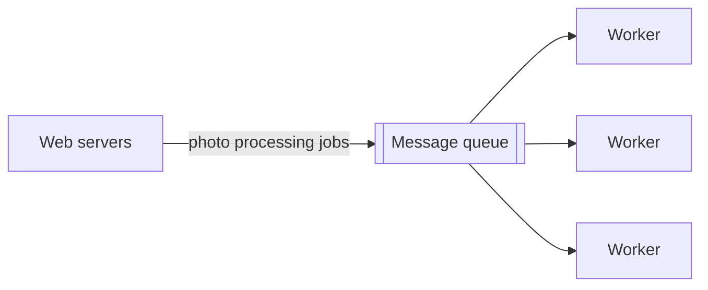

---

## Step 10: Logging, Metrics, and Automation

On a handful of servers these are nice-to-haves. For a large business they are essential.

- **Logging.** Error logs reveal problems. Rather than reading them server by server, aggregate them into a central service where they can be searched.
- **Metrics.** Track health and business performance at several levels:
  - **Host level** — CPU, memory, disk I/O.
  - **Aggregated level** — performance of the whole database tier, cache tier, etc.
  - **Business level** — daily active users, retention, revenue.
- **Automation.** **Continuous integration** verifies every check-in automatically so problems surface early. Automating build, test, and deploy pays off hugely in developer productivity.

The [Monitoring and Observability Patterns](../distributed-systems/monitoring-and-observability) lesson covers these tools in more depth.

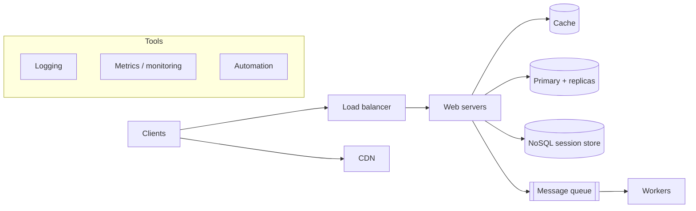

### Check: stateless tiers, data centers, and queues

<MultipleChoice
  id="sdi-ch1-stateless-dc-queue"
  title="Decoupling and redundancy"
  questions={[
    {
      prompt: 'Which change most directly makes autoscaling the web tier straightforward?',
      choices: [
        'Enabling sticky sessions on the load balancer',
        'Moving session data out of the web servers into a shared data store',
        'Increasing each web server\'s RAM',
        'Adding a CDN',
      ],
      answer: 1,
      why: 'Once servers hold no per-user state, any server can serve any request, so servers can be added or removed without breaking sessions.',
      whyWrong: 'Sticky sessions are the workaround for *stateful* servers — they make adding and removing servers harder, not easier.',
    },
    {
      prompt: 'Video uploads must be transcoded, which takes minutes. Users complain that the upload page hangs. What is the best fix?',
      choices: [
        'Buy a faster web server',
        'Have the web server publish a transcoding job to a message queue and return immediately; workers process jobs asynchronously',
        'Cache the uploaded videos in the CDN before transcoding',
        'Shard the database by video ID',
      ],
      answer: 1,
      why: 'A queue decouples the slow work from the request. Workers can be scaled with queue length independently of the web tier.',
    },
    {
      prompt: 'After a data-center failover, some users see their recent posts missing. Which multi-DC challenge is this?',
      choices: [
        'Traffic redirection',
        'Data synchronization',
        'Test and deployment',
        'Cache eviction',
      ],
      answer: 1,
      why: 'The traffic moved correctly, but the data hadn\'t fully replicated to the surviving data center yet.',
    },
  ]}
/>

---

## Step 11: Scale the Database

Data keeps growing and the database becomes overloaded. Again there are two approaches.

### Vertical scaling

Add more power — CPU, RAM, disk — to the existing database server. This goes surprisingly far: managed services such as Amazon RDS offer instances with **24 TB of RAM**, and in 2013 Stack Overflow served over 10 million monthly unique visitors from a **single** primary database. But:

- Hardware limits still apply; a very large user base eventually outgrows any single machine.
- It concentrates risk in one place — a larger single point of failure.
- High-end servers are disproportionately **expensive**.

### Horizontal scaling: sharding

**Sharding** splits a large database into smaller pieces called **shards**, each on its own server. Every shard has the **same schema**, but holds a **different, non-overlapping subset** of the data.

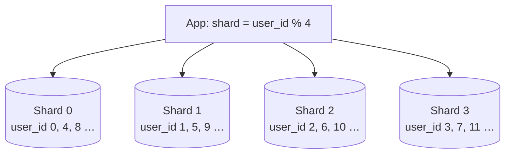

Here user data is placed by `user_id % 4`: a result of 0 goes to shard 0, 1 to shard 1, and so on. Every read and write applies the same function to find the right shard.

The most important decision is the **sharding key** (also called the **partition key**): the column or columns that determine where a row lives — `user_id` in this example. A good key routes each query to exactly one shard and, above all, **distributes data evenly**.

### Practice: shard routing

Implement `shard_for(user_id, num_shards)` returning the shard index, and `distribute(user_ids, num_shards)` returning a list where element *i* is the count of users on shard *i*. Input is one line: `num_shards` followed by user IDs.

<CodeExercise
  title="Route users to shards"
  heading="exercise-sdi-shard-routing"
  lang="python"
  filename="main.py"
  prompt="Implement shard_for(user_id, num_shards) using user_id % num_shards, and distribute(user_ids, num_shards) returning a list of per-shard counts (index i = number of users on shard i, including zeros)."
  sampleLog={`4 0 1 2 3 4 5 6 7
[2, 2, 2, 2]`}
  starter={`def shard_for(user_id, num_shards):
    pass

def distribute(user_ids, num_shards):
    # Return a list of length num_shards with the count on each shard.
    pass
`}
  wrapSuffix={`
import sys
nums = list(map(int, sys.stdin.read().split()))
print(distribute(nums[1:], nums[0]))
`}
  hint="Start with counts = [0] * num_shards and increment counts[shard_for(uid, num_shards)] for each user."
  solution={`def shard_for(user_id, num_shards):
    return user_id % num_shards

def distribute(user_ids, num_shards):
    counts = [0] * num_shards
    for uid in user_ids:
        counts[shard_for(uid, num_shards)] += 1
    return counts
`}
  tests={[
    { name: 'even spread', stdin: '4 0 1 2 3 4 5 6 7', equals: '[2, 2, 2, 2]' },
    { name: 'empty shards still counted', stdin: '4 4 8 12 1', equals: '[3, 1, 0, 0]' },
    { name: 'single shard', stdin: '1 7 9 11', equals: '[3]' },
    { name: 'skewed IDs create a hotspot', stdin: '3 3 6 9 12 15 1', equals: '[5, 1, 0]' },
  ]}
/>

The last test shows that even a reasonable hash function produces a skewed layout when the keys themselves follow a pattern — a preview of the problems below.

### The cost of sharding

Sharding scales the database, but adds real complexity:

- **Resharding.** You must re-split data when a shard fills up from growth, or when uneven distribution exhausts some shards before others. That means changing the sharding function and moving data. With plain `% N`, changing N moves most keys; **consistent hashing** (Chapter 5) keeps movement small. See [Rebalancing and Request Routing](../distributed-data/rebalancing-and-request-routing).
- **The celebrity (hotspot) problem.** A shard that holds very popular keys gets hammered. If Katy Perry, Justin Bieber, and Lady Gaga all land on the same shard of a social app, that shard is overwhelmed by reads. Remedies include giving each celebrity a dedicated shard — possibly partitioned further.
- **Joins and denormalization.** Joins across shards are hard. A common workaround is to **denormalize** so a query can be answered from a single table on a single shard.

Finally, some functionality that doesn't need relational guarantees can be moved to a **NoSQL** store, further reducing load on the sharded relational tier.

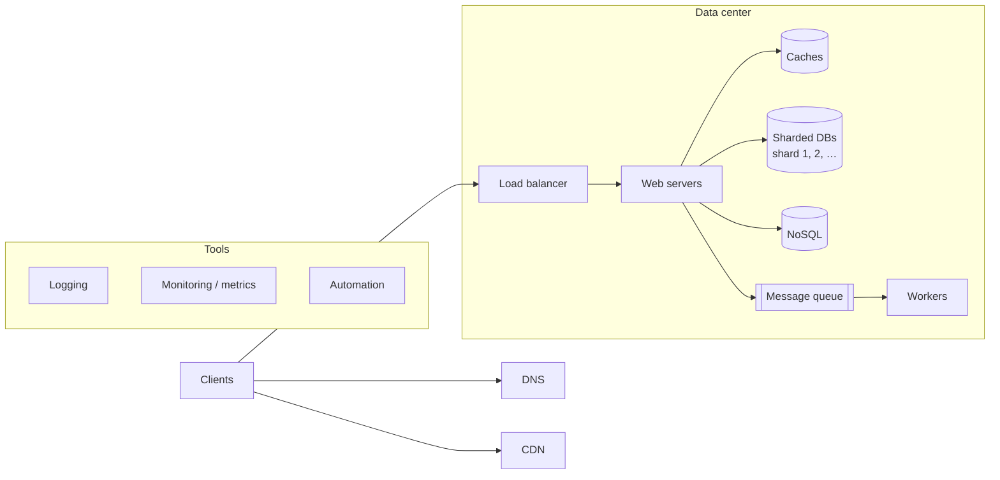

### Check: database scaling

<MultipleChoice
  id="sdi-ch1-sharding"
  title="Sharding trade-offs"
  questions={[
    {
      prompt: 'A social app shards its posts table by country code. Over 60% of users are in one country. What is wrong with this sharding key?',
      choices: [
        'Country codes are strings, and only integers can be sharding keys',
        'It distributes data unevenly, so one shard becomes a hotspot and fills up long before the others',
        'Sharding by country prevents replication',
        'Nothing — country is always the best key',
      ],
      answer: 1,
      why: 'The primary criterion for a sharding key is even distribution. A key with heavy skew concentrates both storage and traffic on a single shard.',
    },
    {
      prompt: 'After sharding by user_id, a report that joins users with orders (sharded by order_id) becomes very slow. What is the usual workaround?',
      choices: [
        'Add more CPU to every shard',
        'Denormalize so the needed fields live together and the query can run on a single shard',
        'Switch the sharding function from % to /',
        'Disable the cache tier',
      ],
      answer: 1,
      why: 'Cross-shard joins are expensive. Denormalizing (or co-locating related data with the same key) lets the query hit one shard.',
    },
    {
      type: 'order',
      prompt: 'Order these improvements the way the chapter introduces them, from a single server upward:',
      items: [
        'Separate the web tier and the data tier',
        'Add a load balancer and database replication',
        'Add a cache tier and a CDN',
        'Make the web tier stateless',
        'Expand to multiple data centers',
        'Shard the database',
      ],
      why: 'Each step fixes the bottleneck the previous design exposed: one box → split tiers → redundancy → speed → horizontal web scaling → geographic reach → data-tier scale. (Queues and monitoring, introduced between data centers and sharding, are omitted here.)',
      whyWrong: 'Ask what each step depends on: a stateless web tier only matters once there are many servers behind a load balancer, and sharding comes last because vertical scaling and replicas carry the data tier a long way first.',
    },
  ]}
/>

---

## Millions of Users and Beyond

Scaling is iterative. Repeating these steps takes you a long way; past millions of users you will need further tuning and finer decomposition, such as splitting the system into smaller services. The core recipe:

- Keep the web tier **stateless**.
- Build **redundancy** at every tier.
- **Cache** data as much as you can.
- Support **multiple data centers**.
- Host static assets on a **CDN**.
- Scale the data tier by **sharding**.
- Split tiers into **individual services**.
- **Monitor** the system and use **automation** tools.

Next lesson: [Back-of-the-Envelope Estimation](./back-of-the-envelope-estimation) — powers of two, latency numbers, availability nines, and estimating QPS and storage.
