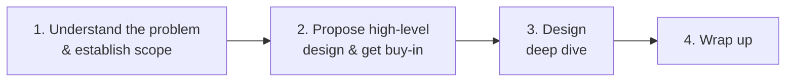
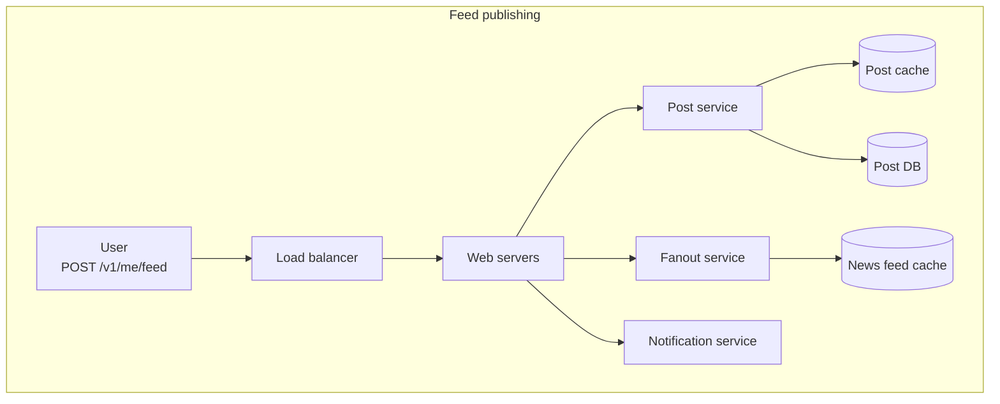
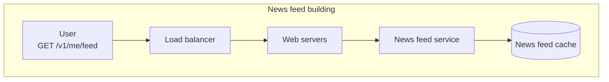
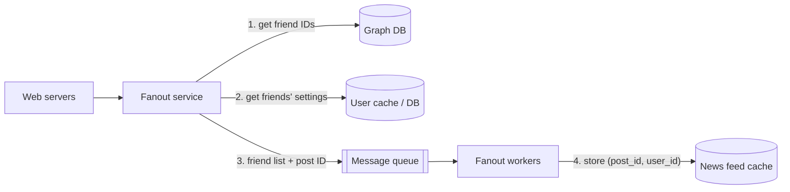
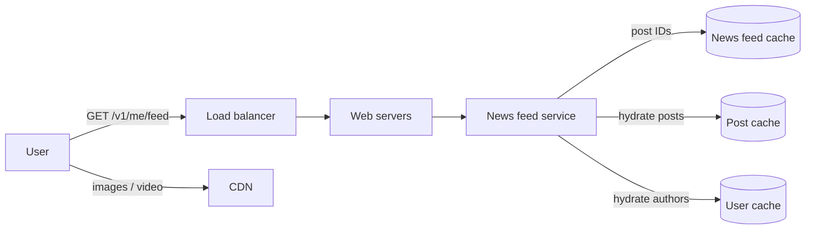

# A Framework for System Design Interviews

> **Adapted from:** Alex Xu, *System Design Interview – An Insider's Guide* (2020), Chapter 3 — rewritten and condensed for teaching.

"Design YouTube." "Design a news feed." Prompts like these can feel absurd. How can you design in one hour a product that took thousands of engineers years to build? You can't, and nobody expects you to. Lessons 1 and 2 gave you the building blocks and the estimation skills. This lesson gives you a **repeatable process** for using them under interview conditions.

**What you'll be able to do after this lesson:**

- Explain what interviewers are actually evaluating in a system design round.
- Run the four-step framework: scope, high-level design, deep dive, wrap-up.
- Ask clarifying questions that shape the design.
- Budget a 45-minute session and avoid the common red flags.

---

## What the Interview Is Really Testing

A system design interview simulates two coworkers working through a vague problem together. The problem is open-ended and has **no single correct answer**. The final diagram matters less than how you got there. Along the way you show that you can make design decisions, defend them, and take feedback well.

From the interviewer's side, the goal is to gather enough **signal** to evaluate you with confidence. Technical skill is only part of that signal. They are also watching whether you:

- **Collaborate**: treat them as a teammate, not an examiner.
- **Work under pressure** without freezing up or rushing.
- **Resolve ambiguity** by turning a vague prompt into concrete requirements.
- **Ask good questions**. Many interviewers look for this skill specifically.

They are also watching for **red flags**:

- **Over-engineering.** Chasing design purity while ignoring trade-offs and cost. In real companies, over-built systems pile up maintenance cost for years. Don't show this habit in the interview.
- **Narrow-mindedness**: considering only one approach.
- **Stubbornness**: refusing to adjust when the interviewer pushes back.

---

## The Four-Step Process

Every interview is different, but nearly all of them cover the same four steps:

### Step 1: Understand the problem and establish design scope

Picture the student who always has a hand up first, answering every question before the teacher finishes asking it. That student does well at trivia. **Don't bring that habit into a system design interview.** Answering quickly earns nothing here. Proposing a solution before you understand the requirements is a serious red flag, because you will probably design the wrong system.

So slow down. Ask questions that clarify the requirements and assumptions. The interviewer will either answer directly or tell you to choose an assumption yourself. If you choose one, **write it down** so you can refer back to it later.

Useful starting questions:

- **Features:** What exactly are we building?
- **Users:** How many users does the product have?
- **Growth:** How fast is the company expected to scale? What scale do we expect in 3 months, 6 months, and a year?
- **Existing stack:** What technology does the company use already? Which existing services can we reuse to simplify the design?

#### Example: clarifying "design a news feed"

Here is a short exchange. Notice that each answer rules out some designs and points toward others.

| Candidate asks | Interviewer answers | Why it matters |
|---|---|---|
| Mobile app, web app, or both? | Both | The API must serve both kinds of client |
| What are the most important features? | Making a post and viewing friends' news feed | Sets the scope; everything else is out of scope for now |
| Is the feed reverse-chronological, or ranked by weights (e.g. close friends first)? | Reverse-chronological, to keep it simple | Removes the need for a ranking system |
| How many friends can a user have? | 5,000 | Limits fan-out: one post may go to up to 5,000 feeds |
| What is the traffic volume? | 10 million DAU | Input for QPS and storage estimates ([Lesson 2](./back-of-the-envelope-estimation)) |
| Can the feed contain images and video, or only text? | Images and video too | Media storage and a CDN become part of the design ([Lesson 1](./scale-from-zero-to-millions-of-users#step-6-add-a-cdn)) |

### Check: scoping

<MultipleChoice
  id="sdi-ch3-scoping"
  title="Establishing scope"
  questions={[
    {
      prompt: 'Thirty seconds into "Design a URL shortener," a candidate starts drawing a sharded Cassandra cluster. What is the main problem?',
      choices: [
        'Cassandra cannot store URLs',
        'They are designing before clarifying requirements, such as traffic volume, URL lifetime, and custom aliases, so they may build the wrong system',
        'Sharding is never needed for URL shorteners',
        'Interviewers forbid naming specific databases',
      ],
      answer: 1,
      why: 'Jumping to a solution before establishing scope is one of the biggest red flags. The right storage choice depends on requirements the candidate has not asked about yet.',
    },
    {
      prompt: 'You ask how many users the system has and the interviewer says, "You decide." What should you do?',
      choices: [
        'Refuse to continue until they give a number',
        'Pick a reasonable figure, state it, and write it down so later estimates and decisions can refer to it',
        'Assume the largest possible scale so the design is future-proof',
        'Skip estimates entirely',
      ],
      answer: 1,
      why: 'Choosing an assumption is part of the exercise. Writing it down makes the rest of your reasoning traceable. Assuming maximum scale invites over-engineering.',
      whyWrong: 'Designing for the largest imaginable scale "just in case" is the over-engineering red flag.',
    },
    {
      prompt: 'In the news feed example, which answer most directly limits the fan-out cost of publishing a single post?',
      choices: [
        'Both web and mobile clients',
        'Feeds are reverse-chronological',
        'A user can have at most 5,000 friends',
        'Posts may include video',
      ],
      answer: 2,
      why: 'Fan-out means pushing a post into each friend\'s feed, so the friend limit bounds the work for each post. The other answers affect the API, ranking, and media storage.',
    },
  ]}
/>

### Step 2: Propose a high-level design and get buy-in

The goal here is a **blueprint the interviewer agrees with**. Treat this step as a collaboration.

- **Sketch an initial blueprint and ask for feedback.** Good interviewers like to get involved.
- **Draw box diagrams** of the key components: clients (web/mobile), APIs, web servers, data stores, cache, CDN, message queue, and so on.
- **Run back-of-the-envelope numbers** to check whether the blueprint fits the scale. Think out loud, and check with the interviewer before spending time on the math.
- **Walk through a few concrete use cases.** This keeps the design grounded and often reveals edge cases you missed.

Should you include **API endpoints and database schema** at this stage? It depends on the problem. For something huge like "design Google Search," they are too low-level. For "design the backend of a multiplayer poker game," they are fair game. Ask the interviewer.

#### Example: news feed, high level

The system splits into two flows (Chapter 11 of the book covers them in full):

- **Feed publishing**: when a user posts, the post is written to the cache and database, then pushed into their friends' news feeds.
- **News feed building**: a user's feed is assembled from friends' posts in reverse-chronological order.

### Step 3: Design deep dive

By now you and the interviewer should have:

- agreed on the overall goals and feature scope,
- sketched a high-level blueprint,
- gotten feedback on it, and
- some idea, based on that feedback, of where to dig deeper.

Now **identify and prioritize** the components to explore, together with the interviewer. Pay attention to what they seem interested in:

- Some interviewers want to stay at the high level.
- For senior candidates, the discussion may turn to **performance**: bottlenecks and resource estimates.
- Most often, they want detail on **a few specific components**. For example, the hashing scheme that turns a long URL into a short one, or how a chat system reduces latency and tracks online/offline status.

**Manage your time.** It is easy to sink minutes into details that show nothing about your design ability. Explaining a feed-ranking algorithm like Facebook's EdgeRank in depth, for instance, uses up time without showing that you can design a scalable system.

#### Example: news feed, deep dive

With the high-level design agreed on, the two most important use cases get more detail.

Notice how earlier material comes back: a **message queue** decouples slow fan-out work, **caches** absorb the heavy read load, and a **CDN** serves media, all from Lesson 1.

### Step 4: Wrap up

Near the end, the interviewer may ask follow-up questions or leave the floor open to you. Good directions:

- **Identify bottlenecks and possible improvements.** Never claim your design is perfect; there is always something to improve. This is a chance to show critical thinking and finish on a strong note.
- **Recap the design**, especially if you discussed several alternatives. After 40 minutes, a summary helps.
- **Error cases**: server failures, lost network connections, and similar.
- **Operations**: monitoring metrics and error logs, and rolling out the system.
- **The next scale curve**: if the design supports 1 million users, what has to change for 10 million?
- **Further refinements** you would make with more time.

### Check: the four steps

<MultipleChoice
  id="sdi-ch3-steps"
  title="Running the framework"
  questions={[
    {
      type: 'order',
      prompt: 'Order the four steps of the framework (top = first):',
      items: [
        'Understand the problem and establish design scope',
        'Propose a high-level design and get buy-in',
        'Design deep dive',
        'Wrap up',
      ],
      why: 'Each step depends on the one before: you cannot draw a blueprint for an unscoped problem, you deep dive into components of an agreed blueprint, and the wrap-up reviews what you built.',
      whyWrong: 'Ask what each step needs as input. A deep dive needs an agreed blueprint to dive into.',
    },
    {
      prompt: 'During the deep dive for a URL shortener, which topic is likely the best use of time?',
      choices: [
        'The full history of HTTP status codes',
        'How the hash or ID-generation scheme converts a long URL into a short, collision-free key',
        'Which IDE you prefer',
        'A detailed comparison of CSS frameworks for the landing page',
      ],
      answer: 1,
      why: 'The key-generation scheme is the core design problem of a URL shortener, and it shows real design skill. The others use time without showing scalable-system thinking.',
    },
    {
      prompt: 'At wrap-up the interviewer asks, "Any weaknesses in this design?" Which response is strongest?',
      choices: [
        '"No, I think it handles everything."',
        '"The fanout workers are a bottleneck for users with millions of followers. I would switch those users to a pull model at read time, and I would add monitoring on queue depth."',
        '"I would need to rewrite it from scratch."',
        '"That depends on the interviewer."',
      ],
      answer: 1,
      why: 'Naming a specific bottleneck, offering a concrete improvement, and mentioning operations shows critical thinking. Saying the design is perfect is a red flag.',
    },
  ]}
/>

---

## Dos and Don'ts

| Do | Don't |
|---|---|
| Ask for clarification, and don't assume your assumptions are right | Show up unprepared for common interview questions |
| Make sure you understand the requirements | Jump into a solution before clarifying requirements and assumptions |
| Remember there is no single right or best answer. A young startup and an established company with millions of users need different designs | Go deep on one component early. Give the high-level design first, then drill down |
| Think out loud, and keep the interviewer informed | Think in silence |
| Suggest multiple approaches where possible | Hesitate to ask for a hint when you're stuck |
| Once the blueprint is agreed, go into detail, **most critical components first** | Assume you're done once the design is drawn. You're done when the interviewer says so, so ask for feedback early and often |
| Bounce ideas off the interviewer as a teammate | |
| Never give up | |

---

## Time Allocation

Prompts are broad, and 45–60 minutes won't cover everything. Here is a rough split for a **45-minute** session. Adjust it to the problem and to what the interviewer emphasizes.

| Step | Suggested time |
|---|---|
| 1. Understand the problem and establish scope | 3–10 min |
| 2. Propose high-level design and get buy-in | 10–15 min |
| 3. Design deep dive | 10–25 min |
| 4. Wrap up | 3–5 min |

### Practice: check an interview plan

Implement `check_plan(minutes)`. It takes a list of four minute values, one for each step, and returns a list of four strings using the ranges above:

- `'ok'` if the value is within the range (inclusive),
- `'too short (min X)'` if it is below the minimum,
- `'too long (max Y)'` if it is above the maximum.

The wrapper prints each step's verdict and the total time. Input is one line with four integers.

<CodeExercise
  title="Interview time budget"
  heading="exercise-sdi-time-plan"
  lang="python"
  filename="main.py"
  prompt="Implement check_plan(minutes). Use the ranges (3, 10), (10, 15), (10, 25), (3, 5) for steps 1–4. Return a list of four verdict strings: 'ok', 'too short (min X)', or 'too long (max Y)'."
  sampleLog={`5 12 23 5
Step 1: ok
Step 2: ok
Step 3: ok
Step 4: ok
Total: 45 min`}
  starter={`RANGES = [(3, 10), (10, 15), (10, 25), (3, 5)]

def check_plan(minutes):
    # Compare each step's minutes against its (min, max) range.
    pass
`}
  wrapSuffix={`
import sys
mins = list(map(int, sys.stdin.read().split()))
for i, verdict in enumerate(check_plan(mins), start=1):
    print(f'Step {i}: {verdict}')
print(f'Total: {sum(mins)} min')
`}
  hint="zip(minutes, RANGES) pairs each value with its (lo, hi). Check value < lo first, then value > hi."
  solution={`RANGES = [(3, 10), (10, 15), (10, 25), (3, 5)]

def check_plan(minutes):
    verdicts = []
    for value, (lo, hi) in zip(minutes, RANGES):
        if value < lo:
            verdicts.append(f'too short (min {lo})')
        elif value > hi:
            verdicts.append(f'too long (max {hi})')
        else:
            verdicts.append('ok')
    return verdicts
`}
  tests={[
    { name: 'balanced 45-minute plan', stdin: '5 12 23 5', equals: 'Step 1: ok\nStep 2: ok\nStep 3: ok\nStep 4: ok\nTotal: 45 min' },
    { name: 'over-long scoping', stdin: '15 10 15 5', equals: 'Step 1: too long (max 10)\nStep 2: ok\nStep 3: ok\nStep 4: ok\nTotal: 45 min' },
    { name: 'rushed scope, bloated blueprint', stdin: '2 20 20 3', equals: 'Step 1: too short (min 3)\nStep 2: too long (max 15)\nStep 3: ok\nStep 4: ok\nTotal: 45 min' },
    { name: 'range boundaries are inclusive', stdin: '3 15 10 5', equals: 'Step 1: ok\nStep 2: ok\nStep 3: ok\nStep 4: ok\nTotal: 33 min' },
    { name: 'no wrap-up', stdin: '10 15 25 0', equals: 'Step 1: ok\nStep 2: ok\nStep 3: ok\nStep 4: too short (min 3)\nTotal: 50 min' },
  ]}
/>

### Check: dos, don'ts, and time

<MultipleChoice
  id="sdi-ch3-dos-donts"
  title="Interview habits"
  questions={[
    {
      prompt: 'You are 20 minutes in, still debating the exact columns of the users table, and haven\'t drawn the overall architecture. What went wrong?',
      choices: [
        'Nothing; schema detail is always the top priority',
        'You went deep on one component before establishing and agreeing on the high-level design',
        'You should have spent the time on back-of-the-envelope math instead',
        'You asked too many clarifying questions',
      ],
      answer: 1,
      why: 'Give the high-level design first, then drill down. Spending most of the Step 2 window on a single table leaves no agreed blueprint and little time for the deep dive.',
    },
    {
      prompt: 'You are stuck on how to keep online-presence status fresh in a chat system. What is the best move?',
      choices: [
        'Go quiet and think until you solve it',
        'Change the topic to something you know well',
        'Say what you are considering, explain where you\'re stuck, and ask the interviewer for a hint',
        'Declare the feature out of scope without discussion',
      ],
      answer: 2,
      why: 'Thinking out loud and asking for hints are both explicitly encouraged. Silence gives the interviewer no signal.',
    },
    {
      prompt: 'Why might the "right" design for the same prompt differ between a startup and a large company?',
      choices: [
        'It doesn\'t; there is always one best architecture',
        'Requirements such as scale, budget, team size, and existing infrastructure differ, so the trade-offs differ',
        'Startups are not allowed to use databases',
        'Large companies always use microservices',
      ],
      answer: 1,
      why: 'There is no single right answer. The design follows from the requirements, which is why clarifying them in Step 1 comes first.',
    },
  ]}
/>

---

## Key Takeaways

- The interview tests collaboration, handling ambiguity, and judgment about trade-offs, not just knowledge of components.
- **Scope first.** Ask questions, and write down assumptions you choose yourself.
- **Agree on a blueprint** before going deep, and check it against back-of-the-envelope numbers.
- **Deep dive where the interviewer points you.** Do the most critical components first and skip trivia.
- **Wrap up** with bottlenecks, failure cases, operations, and the next scale step. Never call your design perfect.
- For 45 minutes, plan roughly **3–10 / 10–15 / 10–25 / 3–5** minutes.

Previous lesson: [Back-of-the-Envelope Estimation](./back-of-the-envelope-estimation).

Next lesson: [Design a Rate Limiter](./design-a-rate-limiter) — the framework applied to a full design problem: rate-limiting algorithms, Redis-backed architecture, and distributed concerns.
