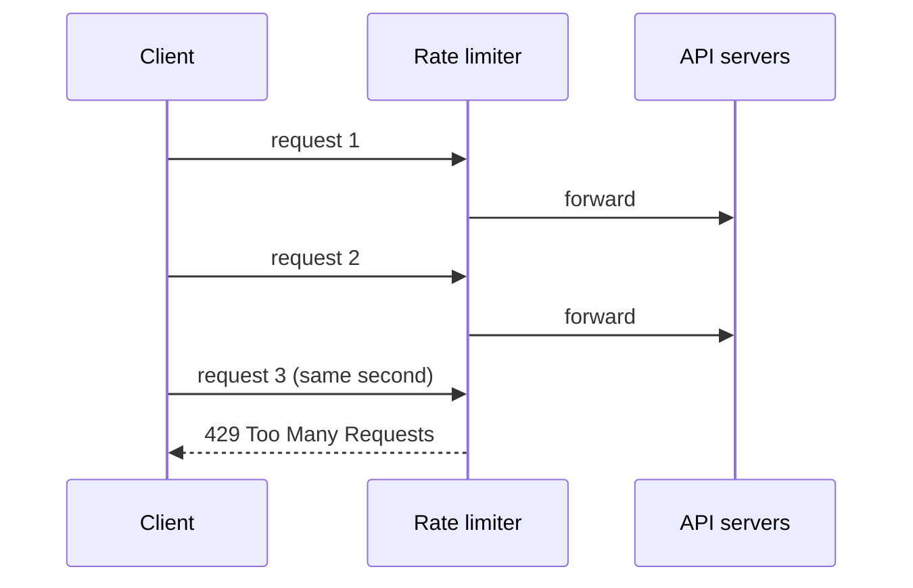
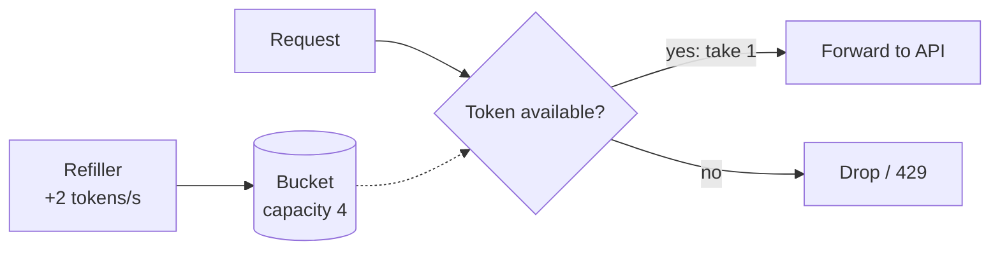
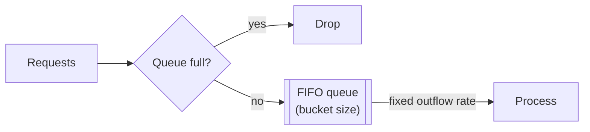
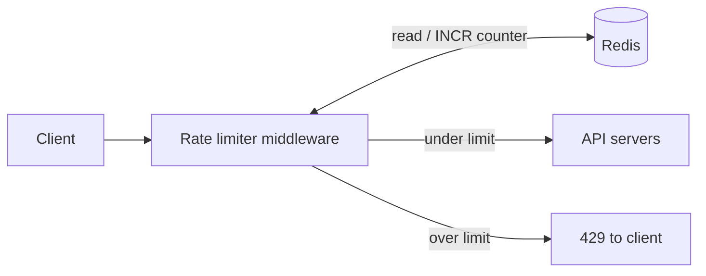
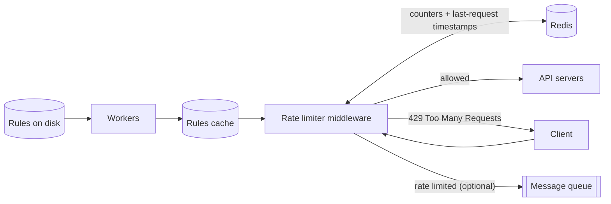
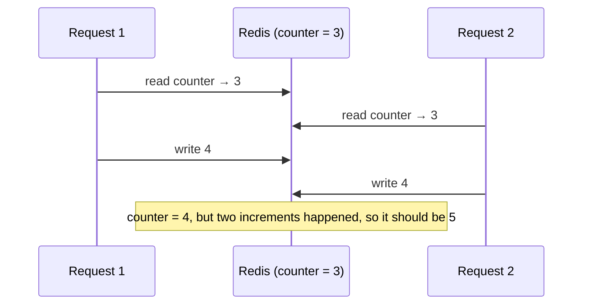
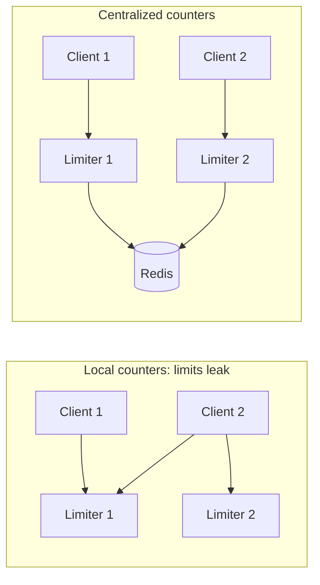

# Design a Rate Limiter

> **Adapted from:** Alex Xu, *System Design Interview – An Insider's Guide* (2020), Chapter 4 — rewritten and condensed for teaching.

This is the first full design problem in the series, and it follows the four-step framework from [Lesson 3](./a-framework-for-system-design-interviews).

A **rate limiter** controls how much traffic a client or service may send. For an HTTP API, that means capping the number of requests a client can make within a time period. Once the client goes over the limit, the extra calls are blocked. Some example rules:

- A user may write at most 2 posts per second.
- At most 10 accounts may be created per day from one IP address.
- A device may claim rewards at most 5 times per week.

**Why rate limit?**

- **Prevent resource starvation from denial-of-service (DoS).** Blocking excess calls protects the service from floods of traffic, whether malicious or accidental. Nearly every large public API enforces limits. When the book was written, Twitter allowed 300 tweets per 3 hours, and the Google Docs API defaulted to 300 read requests per user per 60 seconds.
- **Reduce cost.** Fewer excess requests means fewer servers, and capacity can go to high-priority APIs. This matters most when you pay a third party per call, for example for credit checks, payments, or health-record lookups.
- **Prevent overload.** Filtering out excess traffic from bots or misbehaving clients keeps servers healthy.

**What you'll be able to do after this lesson:**

- Decide where a rate limiter belongs: client, server, or gateway middleware.
- Implement and compare token bucket, leaking bucket, fixed window, sliding window log, and sliding window counter.
- Design a distributed rate limiter on Redis and handle race conditions and synchronization.
- Communicate throttling to clients with HTTP 429 and rate-limit headers.

---

## Step 1: Understand the Problem and Establish Scope

| Candidate asks | Interviewer answers |
|---|---|
| Client-side or server-side API rate limiter? | Server-side |
| Throttle by IP, user ID, or something else? | Flexible: support different sets of throttle rules |
| What scale? Startup or large company? | Must handle a large number of requests |
| Will it run in a distributed environment? | Yes |
| Separate service, or part of the application code? | Your design decision |
| Should throttled users be told? | Yes |

### Requirements

- **Accurately limit** excessive requests.
- **Low latency**: the limiter must not noticeably slow down HTTP responses.
- **Little memory** use.
- **Distributed**: one limit shared across many servers or processes.
- **Clear exceptions**: throttled users get a clear error.
- **High fault tolerance**: if part of the limiter fails (say, a cache server goes offline), the rest of the system keeps working.

---

## Step 2: High-Level Design

### Where should the rate limiter live?

- **Client side**: an unreliable place to enforce limits. Malicious clients can forge requests, and you often don't control the client code.
- **Server side**: inside the API servers.
- **Middleware**: a separate layer in front of the API servers that throttles requests before they reach them.


Suppose the API allows **2 requests per second** and a client sends 3 in one second. The first two pass through to the API servers. The middleware rejects the third with **HTTP 429 Too Many Requests**.



In microservice architectures, rate limiting usually lives in an **API gateway**. This is typically a managed service that also handles SSL termination, authentication, IP allow-listing, serving static content, and more. For our purposes, a gateway is simply middleware that can rate limit.

**Server or gateway?** There is no universal answer. Some guidelines:

- **Consider your stack.** Make sure your language and cache service can implement rate limiting efficiently on the server.
- **Pick the algorithm you need.** Building it yourself gives full control over the algorithm. A third-party gateway may limit your choices.
- **Already running a gateway** for auth or allow-listing? Adding rate limiting there is natural.
- **Building takes engineering time.** If you're short on people, a commercial gateway is the better option.

### Check: placement

<MultipleChoice
  id="sdi-ch4-placement"
  title="Where to rate limit"
  questions={[
    {
      prompt: 'Why is the client a poor place to enforce an API rate limit?',
      choices: [
        'Clients cannot measure time accurately',
        'Malicious clients can bypass or forge requests, and you may not control the client code',
        'HTTP does not allow clients to delay requests',
        'Client-side limits use too much server memory',
      ],
      answer: 1,
      why: 'Enforcement must happen somewhere you control. A client-side limit is a courtesy at best. Attackers simply skip it.',
    },
    {
      prompt: 'Your company already routes all traffic through an API gateway for authentication, and has two backend engineers. Where is rate limiting most sensible?',
      choices: [
        'Write a custom limiter into every microservice',
        'Enable rate limiting in the existing API gateway',
        'Rely on clients to limit themselves',
        'Put the limit in the database',
      ],
      answer: 1,
      why: 'You already have a gateway, and building a limiter yourself takes time you don\'t have. The guidelines point to the gateway.',
    },
  ]}
/>

---

## Rate-Limiting Algorithms

Each algorithm makes different trade-offs between burst tolerance, accuracy, and memory:

| Algorithm | Allows bursts? | Accuracy | Memory | Used by |
|---|---|---|---|---|
| Token bucket | Yes, up to bucket size | Good | Low | Amazon, Stripe |
| Leaking bucket | No, fixed outflow | Good | Low (bounded queue) | Shopify |
| Fixed window counter | Yes, up to 2× at window edges | Weak at edges | Very low | |
| Sliding window log | No | Exact | High (one timestamp per request) | |
| Sliding window counter | Smoothed | Approximate | Low | Cloudflare |

### Token bucket

The token bucket is simple, well understood, and widely used (Amazon and Stripe throttle APIs with it).

- A **bucket** holds up to a fixed number of **tokens** (its *capacity*).
- A **refiller** adds tokens at a fixed rate. When the bucket is full, extra tokens overflow and are lost.
- Each request **takes one token**. If a token is available, the request goes through. If not, it is dropped.



**Parameters:** bucket size (maximum tokens) and refill rate (tokens per second).

**How many buckets?** That depends on the rules:

- **One bucket per endpoint per user** is common. If a user may make 1 post per second, add 150 friends per day, and like 5 posts per second, each user needs **3 buckets**.
- To throttle **by IP**, each IP address gets its own bucket.
- For a **global** cap such as 10,000 requests per second, use one bucket shared by all requests.

| Pros | Cons |
|---|---|
| Easy to implement | Two parameters (size, rate) that can be hard to tune |
| Memory efficient (a count and a timestamp per bucket) | |
| Allows short **bursts** as long as tokens remain | |

#### Practice: implement a token bucket

Instead of running a separate refiller process, compute the refill **lazily** on each request: `tokens = min(capacity, tokens + elapsed × refill_rate)`. The bucket starts **full** at time 0.

Input: line 1 is `capacity refill_rate`, and line 2 is the request timestamps in seconds, in non-decreasing order. The wrapper prints `allow` or `reject` for each request.

<CodeExercise
  title="Token bucket"
  heading="exercise-sdi-token-bucket"
  lang="python"
  filename="main.py"
  prompt="Implement TokenBucket(capacity, refill_rate) with allow(t). The bucket starts full at t=0. On each call, add (t - last) * refill_rate tokens (capped at capacity), update last, then take one token if at least one is available and return True; otherwise return False."
  sampleLog={`4 2
0 0 0 0 0 0.5 1 1 1
allow allow allow allow reject allow allow reject reject`}
  starter={`class TokenBucket:
    def __init__(self, capacity, refill_rate):
        self.capacity = capacity
        self.refill_rate = refill_rate
        # The bucket starts full at time 0.

    def allow(self, t):
        # 1. Refill based on time elapsed since the last call (cap at capacity).
        # 2. Spend one token if available.
        pass
`}
  wrapSuffix={`
import sys
lines = sys.stdin.read().split('\\n')
cap, rate = map(float, lines[0].split())
bucket = TokenBucket(cap, rate)
print(' '.join('allow' if bucket.allow(float(t)) else 'reject' for t in lines[1].split()))
`}
  hint="Store self.tokens = capacity and self.last = 0.0 in __init__. In allow, refill with min(...), set self.last = t, then check self.tokens >= 1."
  solution={`class TokenBucket:
    def __init__(self, capacity, refill_rate):
        self.capacity = capacity
        self.refill_rate = refill_rate
        self.tokens = capacity
        self.last = 0.0

    def allow(self, t):
        elapsed = t - self.last
        self.tokens = min(self.capacity, self.tokens + elapsed * self.refill_rate)
        self.last = t
        if self.tokens >= 1:
            self.tokens -= 1
            return True
        return False
`}
  tests={[
    { name: 'burst of 4, then refill', stdin: '4 2\n0 0 0 0 0 0.5 1 1 1', equals: 'allow allow allow allow reject allow allow reject reject' },
    { name: 'refill caps at capacity', stdin: '4 2\n0 0 0 0 10 10 10 10 10', equals: 'allow allow allow allow allow allow allow allow reject' },
    { name: 'one request per second', stdin: '1 1\n0 0.5 1 1.5 2', equals: 'allow reject allow reject allow' },
    { name: 'slow refill', stdin: '3 0.5\n0 1 2 3 4 5 6', equals: 'allow allow allow allow allow reject allow' },
  ]}
/>

The second test is the key one. After 10 idle seconds the bucket holds only **4** tokens, not 20, because refill stops at capacity. That cap is what keeps bursts bounded.

### Leaking bucket

Like the token bucket, except requests leave at a **fixed rate**. It is usually built on a FIFO queue:

- When a request arrives, it joins the queue if the queue isn't full. Otherwise it is dropped.
- At regular intervals, requests are pulled off the queue and processed.



**Parameters:** bucket size (queue length) and outflow rate (requests processed per second). Shopify uses leaky buckets for its API.

| Pros | Cons |
|---|---|
| Memory efficient (bounded queue) | A burst fills the queue with old requests. If those aren't processed in time, newer requests get limited |
| Steady outflow, good when downstream needs a stable rate | Two parameters that are hard to tune |

### Fixed window counter

- Split the timeline into fixed-size windows, each with its own counter.
- Each request increments its window's counter.
- Once the counter hits the threshold, new requests are dropped until the next window starts.

With 1-second windows and a limit of 3, any fourth or later request within the same second is dropped.

**The edge problem.** Say the limit is **5 requests per minute**, resetting on the minute. Five requests arrive between 2:00:30 and 2:01:00, and five more between 2:01:00 and 2:01:30. Each fixed window sees only 5, so all 10 go through. Yet the rolling minute from 2:00:30 to 2:01:30 contains **10 requests**, twice the limit.

| Pros | Cons |
|---|---|
| Memory efficient | Bursts at window edges can let through up to 2× the quota |
| Easy to understand | |
| Resetting on a fixed boundary suits some use cases, such as "per calendar day" | |

### Sliding window log

The sliding window log fixes the edge problem by remembering **every request's timestamp**, often in a Redis sorted set:

1. When a request arrives, remove timestamps that fall outside the current rolling window.
2. Add the new request's timestamp to the log.
3. If the log size is within the limit, accept the request. Otherwise reject it, **but its timestamp stays in the log**.

**Example**, with a limit of 2 requests per minute:

| Arrival | Log after the update | Size | Result |
|---|---|---|---|
| 1:00:01 | 1:00:01 | 1 | Allowed |
| 1:00:30 | 1:00:01, 1:00:30 | 2 | Allowed |
| 1:00:50 | 1:00:01, 1:00:30, 1:00:50 | 3 | **Rejected** (timestamp kept) |
| 1:01:40 | 1:00:50, 1:01:40 (1:00:01 and 1:00:30 are older than 1:00:40, so they are removed) | 2 | Allowed |

| Pros | Cons |
|---|---|
| Very accurate: no rolling window ever exceeds the limit | Memory heavy. It stores a timestamp per request, **including rejected ones** |

### Practice: fixed window vs. sliding log

Implement both algorithms and run them on the same request stream. Use these definitions:

- `fixed_window(limit, window, timestamps)`: the window index is `t // window`. Allow the request if that window's count is below `limit`, then increment the count.
- `sliding_log(limit, window, timestamps)`: drop logged timestamps `x` where `x <= t - window`, append `t`, and allow the request if the log length is `<= limit`. Rejected timestamps stay in the log, as in the book's version.

Input: line 1 is `limit window`, and line 2 is the timestamps in seconds. The wrapper prints the fixed-window results, then the sliding-log results.

<CodeExercise
  title="Fixed window vs sliding window log"
  heading="exercise-sdi-windows"
  lang="python"
  filename="main.py"
  prompt="Implement fixed_window(limit, window, timestamps) and sliding_log(limit, window, timestamps). Each returns a list of booleans (True = allowed), one per timestamp."
  sampleLog={`5 60
30 40 45 50 55 60 65 70 75 80
fixed:   allow allow allow allow allow allow allow allow allow allow
sliding: allow allow allow allow allow reject reject reject reject reject`}
  starter={`def fixed_window(limit, window, timestamps):
    pass

def sliding_log(limit, window, timestamps):
    pass
`}
  wrapSuffix={`
import sys
lines = sys.stdin.read().split('\\n')
limit, window = map(float, lines[0].split())
ts = [float(x) for x in lines[1].split()]
fmt = lambda xs: ' '.join('allow' if x else 'reject' for x in xs)
print('fixed:  ', fmt(fixed_window(limit, window, ts)))
print('sliding:', fmt(sliding_log(limit, window, ts)))
`}
  hint="fixed_window: keep a dict from window index to count. sliding_log: rebuild the list as [x for x in log if x > t - window], append t, then compare len(log) with limit."
  solution={`def fixed_window(limit, window, timestamps):
    counts = {}
    result = []
    for t in timestamps:
        w = t // window
        if counts.get(w, 0) < limit:
            counts[w] = counts.get(w, 0) + 1
            result.append(True)
        else:
            result.append(False)
    return result

def sliding_log(limit, window, timestamps):
    log = []
    result = []
    for t in timestamps:
        log = [x for x in log if x > t - window]
        log.append(t)
        result.append(len(log) <= limit)
    return result
`}
  tests={[
    { name: 'edge burst: fixed lets 10 through, sliding caps at 5', stdin: '5 60\n30 40 45 50 55 60 65 70 75 80', equals: 'fixed:   allow allow allow allow allow allow allow allow allow allow\nsliding: allow allow allow allow allow reject reject reject reject reject' },
    { name: 'book example: 2 per minute', stdin: '2 60\n1 30 50 100', equals: 'fixed:   allow allow reject allow\nsliding: allow allow reject allow' },
    { name: 'rejected timestamps still count against the log', stdin: '3 1\n0 0.2 0.4 0.6 1.0 1.1', equals: 'fixed:   allow allow allow reject allow allow\nsliding: allow allow allow reject reject reject' },
    { name: 'quiet period resets both', stdin: '2 10\n0 1 2 3 20', equals: 'fixed:   allow allow reject reject allow\nsliding: allow allow reject reject allow' },
  ]}
/>

The third test shows the cost of keeping rejected timestamps. At t = 1.0 and t = 1.1 the fixed window has reset, but the log still holds the rejected request from t = 0.6, so the client stays blocked. A variant that logs only *accepted* requests avoids this and uses less memory.

### Sliding window counter

A hybrid of the fixed window counter and the sliding log. It keeps **just two counters**, for the current and previous fixed windows, and **estimates** the rolling count:

> rolling count ≈ requests in current window + requests in previous window × (fraction of the rolling window that overlaps the previous window)

**Example:** the limit is 7 requests per minute. The previous minute had 5 requests and the current minute has 3. A new request arrives **30% of the way** into the current minute, so the rolling window still overlaps **70%** of the previous minute:

3 + 5 × 0.7 = 6.5, rounded down to **6**.

Six is below 7, so the request goes through. After it, one more request would reach the limit. (Whether to round up or down is a policy choice.)

| Pros | Cons |
|---|---|
| Smooths spikes, because the estimate blends in the previous window's average rate | Approximate: assumes requests were spread evenly across the previous window |
| Memory efficient (two counters) | Not suitable when the look-back window must be strict |

In practice the approximation holds up well. In Cloudflare's measurements across 400 million requests, only **0.003%** were wrongly allowed or limited.

#### Practice: sliding window counter

Implement `sliding_counter(limit, prev_count, curr_count, position_pct)`. `position_pct` is how far into the current window the request arrives, as an integer from 0 to 100. Return a tuple `(estimate, allowed)`:

- `estimate` is the rolling count **before** this request, rounded down. Use integer arithmetic to avoid floating-point surprises: `(curr_count * 100 + prev_count * (100 - position_pct)) // 100`.
- `allowed` is `True` if `estimate + 1 <= limit`.

Input is one line: `limit prev_count curr_count position_pct`.

<CodeExercise
  title="Sliding window counter"
  heading="exercise-sdi-sliding-counter"
  lang="python"
  filename="main.py"
  prompt="Implement sliding_counter(limit, prev_count, curr_count, position_pct) returning (estimate, allowed). estimate = (curr_count * 100 + prev_count * (100 - position_pct)) // 100; allowed = estimate + 1 <= limit."
  sampleLog={`7 5 3 30
estimate=6 allowed=True`}
  starter={`def sliding_counter(limit, prev_count, curr_count, position_pct):
    # Weight the previous window by how much of it the rolling window
    # still overlaps, then decide whether one more request fits.
    pass
`}
  wrapSuffix={`
import sys
limit, prev, curr, pos = map(int, sys.stdin.read().split())
est, ok = sliding_counter(limit, prev, curr, pos)
print(f'estimate={est} allowed={ok}')
`}
  hint="The overlap with the previous window is (100 - position_pct) percent. Multiply before dividing so integer // gives the floor."
  solution={`def sliding_counter(limit, prev_count, curr_count, position_pct):
    estimate = (curr_count * 100 + prev_count * (100 - position_pct)) // 100
    return estimate, estimate + 1 <= limit
`}
  tests={[
    { name: 'book example', stdin: '7 5 3 30', equals: 'estimate=6 allowed=True' },
    { name: 'one more request hits the limit', stdin: '7 5 4 30', equals: 'estimate=7 allowed=False' },
    { name: 'empty previous window', stdin: '10 0 9 50', equals: 'estimate=9 allowed=True' },
    { name: 'window just started: previous counts fully', stdin: '10 20 0 0', equals: 'estimate=20 allowed=False' },
    { name: 'end of window: previous no longer counts', stdin: '10 20 0 100', equals: 'estimate=0 allowed=True' },
    { name: 'larger numbers', stdin: '100 80 30 75', equals: 'estimate=50 allowed=True' },
  ]}
/>

### Check: algorithms

<MultipleChoice
  id="sdi-ch4-algorithms"
  title="Choosing an algorithm"
  questions={[
    {
      prompt: 'A flash-sale API must let customers send short bursts of requests while still capping their average rate. Which algorithm fits best?',
      choices: ['Leaking bucket', 'Token bucket', 'Fixed window counter', 'None — bursts must always be rejected'],
      answer: 1,
      why: 'The token bucket stores unused capacity as tokens, up to the bucket size, so short bursts pass while the refill rate caps the long-run average.',
      whyWrong: 'The leaking bucket deliberately smooths output to a fixed rate, so bursts wait in the queue or are dropped.',
    },
    {
      prompt: 'Limit: 100 requests per hour, fixed windows on the hour. What is the most requests a client can get through in some 60-minute span?',
      choices: ['100', '150', '200', 'Unlimited'],
      answer: 2,
      why: '100 at the very end of one window plus 100 at the very start of the next all land inside one rolling hour. That is the fixed window\'s edge problem.',
    },
    {
      prompt: 'A downstream payment processor can accept exactly 50 requests per second, no more and no faster. Which algorithm matches this most naturally?',
      choices: ['Token bucket', 'Leaking bucket', 'Sliding window counter', 'Fixed window counter'],
      answer: 1,
      why: 'The leaking bucket drains its queue at a constant outflow rate, which is exactly what a rate-sensitive downstream system needs.',
    },
    {
      prompt: 'Why is the sliding window log memory-hungry compared with the sliding window counter?',
      choices: [
        'It stores one timestamp per request, including rejected ones, instead of two counters',
        'It stores a copy of every request body',
        'It needs one bucket per API endpoint',
        'It requires a relational database',
      ],
      answer: 0,
      why: 'Memory grows with traffic volume. The counter version keeps a fixed two integers per key.',
    },
  ]}
/>

---

## High-Level Architecture

Every algorithm boils down to **a counter per key** (user, IP, endpoint…). If the counter is over the limit, the request is refused.

**Where should the counters live?** Not in a database, because disk access is too slow for something checked on every request. An **in-memory cache** is fast and supports time-based expiry. **Redis** is the popular choice, and two commands do most of the work:

- `INCR`: increment a counter by 1.
- `EXPIRE`: set a timeout on the counter, after which Redis deletes it automatically.



1. The client sends a request to the rate-limiting middleware.
2. The middleware fetches the counter for the matching bucket from Redis and checks it against the limit.
3. If the limit is reached, the request is rejected.
4. Otherwise the request is forwarded to the API servers, and the counter is incremented in Redis.

A minimal fixed-window limiter in Redis, as pseudocode:

```python
key = f"rl:{user_id}:{now // 60}"   # one counter per user per minute
count = redis.incr(key)             # atomic; creates the key at 1 if missing
if count == 1:
    redis.expire(key, 60)           # clean up after the window
if count > LIMIT:
    return http_429()
forward_to_api()
```

---

## Step 3: Design Deep Dive

The high-level design leaves two questions open: **how are rules defined and stored**, and **what happens to throttled requests**? After those, we look at distributed concerns, performance, and monitoring.

### Rate-limiting rules

Lyft's open-source rate limiter expresses rules as YAML configuration. Five marketing messages per day:

```yaml
domain: messaging
descriptors:
  - key: message_type
    value: marketing
    rate_limit:
      unit: day
      requests_per_unit: 5
```

At most five login attempts per minute:

```yaml
domain: auth
descriptors:
  - key: auth_type
    value: login
    rate_limit:
      unit: minute
      requests_per_unit: 5
```

Rules usually live in configuration files on disk.

### Exceeding the limit

A throttled request gets **HTTP 429 Too Many Requests**. Depending on the use case, the request may also be **queued for later**. For example, orders limited during an overload can be kept and processed afterward instead of being thrown away.

### Rate-limiter headers

How does a client know it's being throttled, or how many requests it has left? The limiter tells it through response headers:

| Header | Meaning |
|---|---|
| `X-Ratelimit-Remaining` | Requests still allowed in the current window |
| `X-Ratelimit-Limit` | Requests allowed per window |
| `X-Ratelimit-Retry-After` | Seconds to wait before a request will succeed |

A throttled response carries `429` together with `X-Ratelimit-Retry-After`. (The IETF standard header is plain `Retry-After`, and many APIs send both.)

### Detailed design



- **Rules** are stored on disk. **Workers** pull them regularly into a **cache** so the middleware never reads from disk on the request path.
- A client request hits the **rate limiter middleware** first.
- The middleware loads the rules from the cache, and fetches counters and last-request timestamps from **Redis**. Then:
  - **Not limited**: forward to the API servers.
  - **Limited**: return 429 to the client, and either **drop** the request or **enqueue** it for later processing.

### Check: architecture and rules

<MultipleChoice
  id="sdi-ch4-architecture"
  title="Counters, rules, and responses"
  questions={[
    {
      prompt: 'Why store rate-limit counters in Redis rather than in the primary SQL database?',
      choices: [
        'SQL databases cannot store integers',
        'Counters are checked on every request, so they need in-memory speed, and Redis also supports automatic expiry',
        'Redis guarantees counters are never lost',
        'SQL databases do not support multiple servers',
      ],
      answer: 1,
      why: 'The limiter sits on the hot path of every request. Disk round trips would add latency, and EXPIRE handles window cleanup for free.',
      whyWrong: 'Redis is an in-memory store. Durability is not why it is chosen here, since losing a few counters in a restart is usually acceptable.',
    },
    {
      prompt: 'A client is throttled. Which response best meets the "clear exceptions" requirement?',
      choices: [
        'HTTP 500 with no body',
        'HTTP 200 with an empty result',
        'HTTP 429 with X-Ratelimit-Retry-After (and Remaining/Limit headers)',
        'Silently drop the TCP connection',
      ],
      answer: 2,
      why: '429 says exactly what happened, and the headers tell well-behaved clients when to retry.',
    },
  ]}
/>

---

## Rate Limiting in a Distributed Environment

A limiter on one server is easy. Many servers and concurrent threads bring two new problems.

### Race conditions

The naive flow is: read the counter from Redis, check whether `counter + 1` exceeds the limit, and if not, write back `counter + 1`. Under concurrency, that read-then-write is not atomic:



**Locks** would fix this but slow the system down considerably. The common solutions:

- **Lua scripts**: Redis runs a script atomically, so the check and the increment happen as one step.
- **Redis sorted sets**: for sliding-log limiters, add the timestamp, trim old ones, and count in one atomic `MULTI` transaction.

The `INCR`-first pseudocode above also avoids the race: `INCR` is atomic and returns the new value, so there is no separate read to go stale.

### Synchronization

At large scale you run **several rate-limiter servers**. Because the web tier is stateless, a client's requests can land on different limiters. If each limiter keeps its own counters, limiter 1 knows nothing about client 2's requests on limiter 2, and the limits leak.



**Sticky sessions** (always route a client to the same limiter) would work but are neither scalable nor flexible. This is the same argument as Lesson 1's [stateless web tier](./scale-from-zero-to-millions-of-users#step-7-make-the-web-tier-stateless). The better answer is a **centralized data store** such as Redis that every limiter shares.

### Performance optimization

1. **Multi-data-center or edge deployment.** Users far from the limiter see high latency. Providers run many edge locations (Cloudflare had 194 in May 2020) and route traffic to the nearest one.
2. **Eventual consistency.** Synchronize counters between locations with an eventual consistency model. A briefly stale count is acceptable for rate limiting. Strong consistency on every request would cost too much latency.

### Monitoring

After launch, collect analytics to confirm that both the **algorithm** and the **rules** are working:

- **Rules too strict**: many legitimate requests are dropped, so relax them.
- **Algorithm can't handle bursts**: for example, the limiter breaks down during a flash sale. Switch to one that tolerates bursts, such as a **token bucket**.

### Check: distributed concerns

<MultipleChoice
  id="sdi-ch4-distributed"
  title="Race conditions and synchronization"
  questions={[
    {
      prompt: 'Two limiter threads both read counter = 9 (limit 10) and both write 10. What happened, and what is a standard fix?',
      choices: [
        'Clock skew; fix by synchronizing NTP',
        'A read-modify-write race; fix by making check-and-increment atomic (INCR, or a Lua script)',
        'A cache miss; fix by adding more replicas',
        'Nothing is wrong; the counter is correct',
      ],
      answer: 1,
      why: 'Both requests passed the check against the same stale value, so 11 requests got through. Atomic operations remove the window between read and write.',
    },
    {
      prompt: 'Why is sticky routing a poor way to keep multiple rate limiters in sync?',
      choices: [
        'Load balancers cannot do sticky routing',
        'It ties each client to one server, which makes scaling and failover hard. A shared counter store is more flexible',
        'Sticky routing doubles the counter values',
        'It requires client-side rate limiting',
      ],
      answer: 1,
      why: 'This is the stateful-server problem from Lesson 1 again. Move the state into a shared store and keep the limiters stateless.',
    },
    {
      type: 'order',
      prompt: 'Order what the detailed design does for an incoming request (top = first):',
      items: [
        'Request arrives at the rate limiter middleware',
        'Middleware loads the applicable rules from the rules cache',
        'Middleware fetches counters and timestamps from Redis',
        'Middleware decides: forward to API servers, or return 429 (and drop or enqueue)',
      ],
      why: 'You need the request to know which rules apply, the rules to know which counters to read, and the counters to make the decision.',
      whyWrong: 'Ask what each step needs as input. The decision can\'t be made before the counter is known.',
    },
  ]}
/>

---

## Step 4: Wrap Up

We covered five algorithms (token bucket, leaking bucket, fixed window, sliding window log, sliding window counter), the architecture, distributed challenges, performance, and monitoring. If time allows, more talking points:

- **Hard vs. soft limits.** A *hard* limit never lets requests exceed the threshold. A *soft* limit lets them exceed it briefly.
- **Rate limiting at other layers.** This lesson limited at the **application layer** (HTTP, OSI layer 7). You can also limit by IP at the **network layer** (layer 3), for example with `iptables`. For reference, the OSI model's seven layers are: 1 Physical, 2 Data link, 3 Network, 4 Transport, 5 Session, 6 Presentation, 7 Application.
- **Designing clients that avoid being limited:**
  - Cache responses on the client to avoid repeated calls.
  - Know the limits and don't send many requests in a short span.
  - Catch errors and exceptions so the client recovers gracefully.
  - Add enough **backoff** to retry logic, such as exponential backoff with jitter.

---

## Key Takeaways

- Enforce limits on the **server side or in a gateway**, never only on the client.
- **Token bucket** allows bursts. **Leaking bucket** gives a steady outflow. **Fixed window** is simple but leaks up to 2× at window edges. **Sliding log** is exact but memory-hungry. **Sliding counter** is a cheap, accurate-enough approximation.
- Keep counters in **Redis**, not a database, and make check-and-increment **atomic**.
- Share counters across limiter instances through a **central store** instead of sticky sessions.
- Tell clients clearly: **429** plus rate-limit headers.

Previous lesson: [A Framework for System Design Interviews](./a-framework-for-system-design-interviews).

Next lesson: [Design Consistent Hashing](./design-consistent-hashing) — why hash % N breaks when servers change, the hash ring, virtual nodes, and finding affected keys.

---

## Reference Materials

1. [Rate-limiting strategies and techniques](https://cloud.google.com/solutions/rate-limiting-strategies-techniques) — Google Cloud
2. [Twitter rate limits](https://developer.twitter.com/en/docs/basics/rate-limits)
3. [Google Docs API usage limits](https://developers.google.com/docs/api/limits)
4. [IBM: Microservices](https://www.ibm.com/cloud/learn/microservices)
5. [Throttle API requests for better throughput](https://docs.aws.amazon.com/apigateway/latest/developerguide/api-gateway-request-throttling.html) — Amazon API Gateway
6. [Stripe: Scaling your API with rate limiters](https://stripe.com/blog/rate-limiters)
7. [Shopify REST Admin API rate limits](https://help.shopify.com/en/api/reference/rest-admin-api-rate-limits)
8. [Better Rate Limiting With Redis Sorted Sets](https://engineering.classdojo.com/blog/2015/02/06/rolling-rate-limiter/) — ClassDojo Engineering
9. [System Design — Rate limiter and Data modelling](https://medium.com/@saisandeepmopuri/system-design-rate-limiter-and-data-modelling-9304b0d18250)
10. [How we built rate limiting capable of scaling to millions of domains](https://blog.cloudflare.com/counting-things-a-lot-of-different-things/) — Cloudflare
11. [Redis](https://redis.io/)
12. [Lyft rate limiting service](https://github.com/lyft/ratelimit)
13. [Scaling your API with rate limiters (request rate limiter, Lua script)](https://gist.github.com/ptarjan/e38f45f2dfe601419ca3af937fff574d#request-rate-limiter)
14. [What is edge computing?](https://www.cloudflare.com/learning/serverless/glossary/what-is-edge-computing/) — Cloudflare
15. [Rate Limit Requests with Iptables](https://blog.programster.org/rate-limit-requests-with-iptables)
16. [OSI model: layer architecture](https://en.wikipedia.org/wiki/OSI_model#Layer_architecture) — Wikipedia
