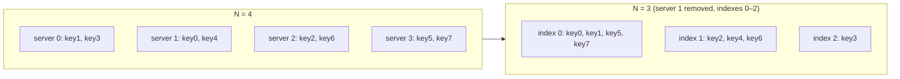
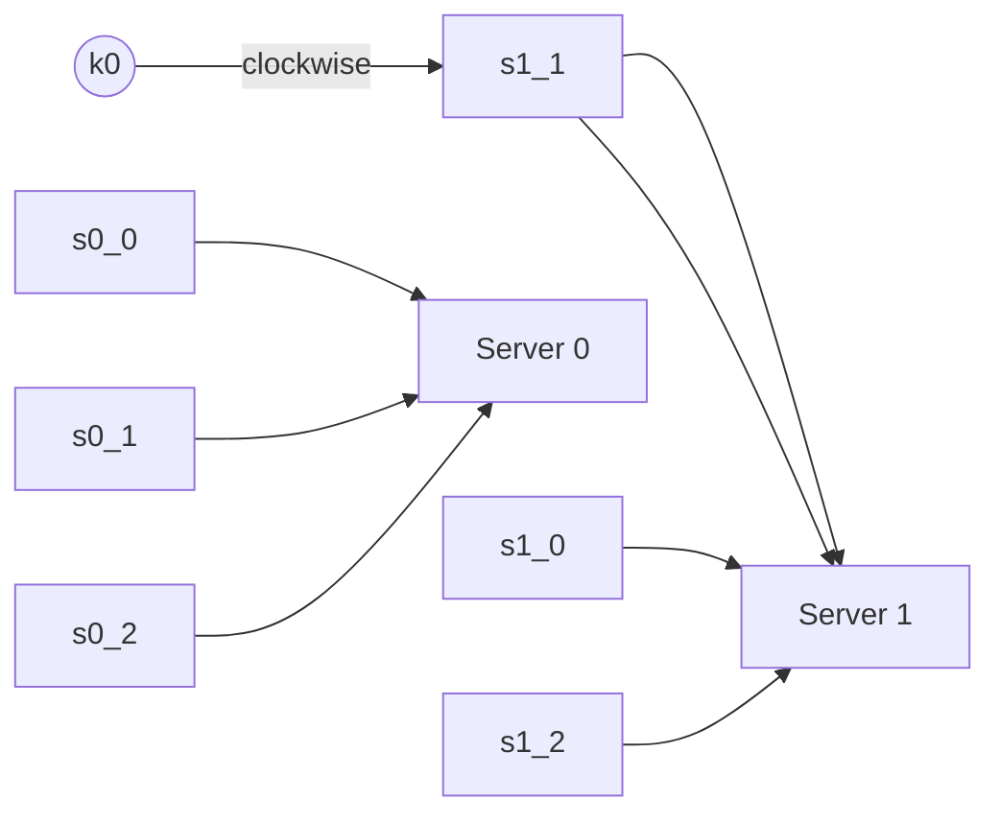

# Design Consistent Hashing

> **Adapted from:** Alex Xu, *System Design Interview – An Insider's Guide* (2020), Chapter 5 — rewritten and condensed for teaching.

Horizontal scaling only works if requests and data are spread **evenly** across servers, and if the spread doesn't fall apart when servers come and go. [Lesson 1](./scale-from-zero-to-millions-of-users#step-11-scale-the-database) sharded users with `user_id % 4` and promised that resharding would be handled by **consistent hashing**. This lesson delivers on that promise.

**What you'll be able to do after this lesson:**

- Explain why `hash(key) % N` causes a storm of cache misses when N changes.
- Place servers and keys on a hash ring and look up a key's server by walking clockwise.
- Use virtual nodes to fix uneven partitions and skewed load.
- Identify exactly which keys move when a server is added or removed.

---

## The Rehashing Problem

With N cache servers, the obvious way to balance load is:

```text
serverIndex = hash(key) % N
```

Take 4 servers and 8 keys:

| Key | hash(key) | hash % 4 | hash % 3 (after server 1 leaves) | Moved? |
|---|---|---|---|---|
| key0 | 18358617 | 1 | 0 | yes |
| key1 | 26143584 | 0 | 0 | |
| key2 | 18131146 | 2 | 1 | yes |
| key3 | 35863496 | 0 | 2 | yes |
| key4 | 34085809 | 1 | 1 | |
| key5 | 27581703 | 3 | 0 | yes |
| key6 | 38164978 | 2 | 1 | yes |
| key7 | 22530351 | 3 | 0 | yes |

With a fixed pool and evenly spread data, this works well: `key0` hashes to 18358617, `18358617 % 4 = 1`, so clients fetch it from server 1.

Now **server 1 goes offline** and N becomes 3. Every key keeps the same hash, but `% 3` gives a different index for most of them. **Six of eight keys move**, not just the two (`key0`, `key4`) that lived on the failed server. Most clients now look for their data on the wrong server, and the cache suffers a **storm of misses** that falls through to the database all at once.



In general, going from N to N + 1 servers with modulo hashing moves about **N/(N + 1)** of all keys. That is close to *all* of them. The [Rebalancing and Request Routing](../distributed-data/rebalancing-and-request-routing) lesson measures this churn in detail.

### Practice: measure modulo churn

Implement `moved_keys(hashes, old_n, new_n)`. It returns the indexes of keys whose server changes when the pool goes from `old_n` to `new_n` servers under `hash % N`.

Input: line 1 is `old_n new_n`, and line 2 is the key hashes. The wrapper prints the moved indexes and the count.

<CodeExercise
  title="Modulo rehash churn"
  heading="exercise-sdi-modulo-churn"
  lang="python"
  filename="main.py"
  prompt="Implement moved_keys(hashes, old_n, new_n). Return a list of indexes i where hashes[i] % old_n != hashes[i] % new_n, in increasing order."
  sampleLog={`4 3
18358617 26143584 18131146 35863496 34085809 27581703 38164978 22530351
moved: [0, 2, 3, 5, 6, 7]
count: 6 of 8`}
  starter={`def moved_keys(hashes, old_n, new_n):
    # Compare each key's server index before and after resizing.
    pass
`}
  wrapSuffix={`
import sys
lines = sys.stdin.read().split('\\n')
old_n, new_n = map(int, lines[0].split())
hashes = [int(x) for x in lines[1].split()]
moved = moved_keys(hashes, old_n, new_n)
print('moved:', moved)
print(f'count: {len(moved)} of {len(hashes)}')
`}
  hint="Loop with enumerate(hashes) and keep the indexes where h % old_n != h % new_n."
  solution={`def moved_keys(hashes, old_n, new_n):
    return [i for i, h in enumerate(hashes) if h % old_n != h % new_n]
`}
  tests={[
    { name: 'book table: 4 -> 3 servers', stdin: '4 3\n18358617 26143584 18131146 35863496 34085809 27581703 38164978 22530351', equals: 'moved: [0, 2, 3, 5, 6, 7]\ncount: 6 of 8' },
    { name: 'add a server: 4 -> 5', stdin: '4 5\n0 1 2 3 4 5 6 7 8 9 10 11 12 13 14 15 16 17 18 19', equals: 'moved: [4, 5, 6, 7, 8, 9, 10, 11, 12, 13, 14, 15, 16, 17, 18, 19]\ncount: 16 of 20' },
    { name: 'no change in pool size', stdin: '4 4\n5 6 7', equals: 'moved: []\ncount: 0 of 3' },
    { name: 'doubling keeps half in place', stdin: '2 4\n0 1 2 3 4 5 6 7', equals: 'moved: [2, 3, 6, 7]\ncount: 4 of 8' },
  ]}
/>

Adding just one server to four (the second test) moved **16 of 20** keys, which is 80%, exactly the N/(N + 1) = 4/5 predicted above. The goal of consistent hashing is to bring that down to about **1/N**.

---

## Consistent Hashing

Wikipedia's definition, paraphrased: with consistent hashing, resizing the table remaps only **k/n keys on average** (k keys, n slots). A traditional hash table remaps nearly all of them.

### The hash space and the ring

Take a hash function such as **SHA-1**, whose outputs range from 0 to 2¹⁶⁰ − 1. Lay that range out as a line, then join the two ends. The result is a **hash ring**: a value just past 2¹⁶⁰ − 1 wraps around to 0.

### Placing servers and keys

1. **Hash each server** (by IP address or name) with the same function. Each server lands at a position on the ring.
2. **Hash each key** onto the same ring. There is **no modulo step**. The key's position is simply its hash.
3. **Lookup:** starting from the key's position, walk **clockwise** until you reach a server. That server owns the key.

The figure below uses a toy ring with positions 0–99. Servers are squares and keys are circles:

<figure style={{textAlign: 'center'}}>
<svg viewBox="0 0 320 320" role="img" aria-label="Hash ring with servers s0 to s3 at positions 15, 40, 65, 90 and keys k0 to k3 at 5, 30, 55, 80; a dashed new server s4 at 10" style={{maxWidth: 360, width: '100%'}}>
  <circle cx="160" cy="160" r="110" fill="none" stroke="currentColor" strokeOpacity="0.4" strokeWidth="2" />
  <text x="160" y="160" textAnchor="middle" dominantBaseline="middle" fontSize="12" fill="currentColor" opacity="0.7">clockwise →</text>
  <rect x="242.0" y="88.3" width="14" height="14" rx="3" fill="var(--ifm-color-primary)" /><text x="266.8" y="82.4" textAnchor="middle" dominantBaseline="middle" fontSize="13" fill="currentColor">s0 (15)</text>
  <rect x="217.7" y="242.0" width="14" height="14" rx="3" fill="var(--ifm-color-primary)" /><text x="237.6" y="266.8" textAnchor="middle" dominantBaseline="middle" fontSize="13" fill="currentColor">s1 (40)</text>
  <rect x="64.0" y="217.7" width="14" height="14" rx="3" fill="var(--ifm-color-primary)" /><text x="53.2" y="237.6" textAnchor="middle" dominantBaseline="middle" fontSize="13" fill="currentColor">s2 (65)</text>
  <rect x="88.3" y="64.0" width="14" height="14" rx="3" fill="var(--ifm-color-primary)" /><text x="82.4" y="53.2" textAnchor="middle" dominantBaseline="middle" fontSize="13" fill="currentColor">s3 (90)</text>
  <rect x="217.7" y="64.0" width="14" height="14" rx="3" fill="none" stroke="var(--ifm-color-primary)" strokeWidth="2" strokeDasharray="3 2" /><text x="237.6" y="45.2" textAnchor="middle" dominantBaseline="middle" fontSize="13" fill="currentColor">s4 (10, new)</text>
  <circle cx="194.0" cy="55.4" r="6" fill="var(--ifm-color-warning)" /><text x="186.6" y="78.2" textAnchor="middle" dominantBaseline="middle" fontSize="12" fill="currentColor">k0 (5)</text>
  <circle cx="264.6" cy="194.0" r="6" fill="var(--ifm-color-warning)" /><text x="241.8" y="186.6" textAnchor="middle" dominantBaseline="middle" fontSize="12" fill="currentColor">k1 (30)</text>
  <circle cx="126.0" cy="264.6" r="6" fill="var(--ifm-color-warning)" /><text x="133.4" y="241.8" textAnchor="middle" dominantBaseline="middle" fontSize="12" fill="currentColor">k2 (55)</text>
  <circle cx="55.4" cy="126.0" r="6" fill="var(--ifm-color-warning)" /><text x="78.2" y="133.4" textAnchor="middle" dominantBaseline="middle" fontSize="12" fill="currentColor">k3 (80)</text>
</svg>
<figcaption>Toy hash ring (positions 0–99). Each key belongs to the first server clockwise from it.</figcaption>
</figure>

| Key (position) | Walk clockwise to… | Owner |
|---|---|---|
| k0 (5) | 15 | s0 |
| k1 (30) | 40 | s1 |
| k2 (55) | 65 | s2 |
| k3 (80) | 90 | s3 |

### Adding a server

Add **s4 at position 10**. Walking clockwise from k0 (5), the first server is now s4, so **only k0 moves** (s0 → s4). k1, k2, and k3 still reach the same servers as before.

### Removing a server

Remove **s1**. k1 (30) now walks past the empty spot at 40 and stops at s2 (65), so **only k1 moves** (s1 → s2). Every other key is unaffected.

### Practice: ring lookup

Implement `lookup(servers, key_pos)` on a ring of positions 0–99. `servers` maps names to positions. Return the server at the **smallest position ≥ `key_pos`**. If there is none, **wrap around** to the server with the smallest position overall.

Input: line 1 is `name:position` pairs, and line 2 is key positions. The wrapper prints the owner of each key.

<CodeExercise
  title="Hash ring lookup"
  heading="exercise-sdi-ring-lookup"
  lang="python"
  filename="main.py"
  prompt="Implement lookup(servers, key_pos). servers is a dict {name: position}. Return the name of the first server clockwise from key_pos (smallest position >= key_pos), wrapping to the lowest-position server if none is found."
  sampleLog={`s0:15 s1:40 s2:65 s3:90
5 30 55 80
s0 s1 s2 s3`}
  starter={`def lookup(servers, key_pos):
    # Sort servers by position; find the first at or after key_pos;
    # wrap around to the first one if you run off the end of the ring.
    pass
`}
  wrapSuffix={`
import sys
lines = sys.stdin.read().split('\\n')
servers = {}
for pair in lines[0].split():
    name, pos = pair.split(':')
    servers[name] = int(pos)
print(' '.join(lookup(servers, int(k)) for k in lines[1].split()))
`}
  hint="sorted(servers.items(), key=lambda kv: kv[1]) gives the ring in order. Return the first name whose position >= key_pos, else the first name in the sorted list. (For large rings, bisect makes this O(log n).)"
  solution={`def lookup(servers, key_pos):
    ring = sorted(servers.items(), key=lambda kv: kv[1])
    for name, pos in ring:
        if pos >= key_pos:
            return name
    return ring[0][0]
`}
  tests={[
    { name: 'basic ring', stdin: 's0:15 s1:40 s2:65 s3:90\n5 30 55 80', equals: 's0 s1 s2 s3' },
    { name: 'add s4 at 10: only k0 moves', stdin: 's0:15 s1:40 s2:65 s3:90 s4:10\n5 30 55 80', equals: 's4 s1 s2 s3' },
    { name: 'remove s1: only k1 moves', stdin: 's0:15 s2:65 s3:90\n5 30 55 80', equals: 's0 s2 s2 s3' },
    { name: 'wrap past the top of the ring', stdin: 's0:15 s1:40 s2:65 s3:90\n95 99 0', equals: 's0 s0 s0' },
    { name: 'key exactly on a server', stdin: 's0:15 s1:40\n15 40 41', equals: 's0 s1 s0' },
  ]}
/>

---

## Two Problems With the Basic Ring

The original algorithm, from Karger et al. at MIT, comes down to two steps: map servers and keys onto the ring with a uniformly distributed hash, and assign each key to the first server clockwise. That leaves two problems:

1. **Uneven partitions.** A **partition** is the stretch of ring between a server and the server before it, and its owner receives every key that hashes into it. As servers join and leave, partitions can't stay equal in size. In the toy ring, removing s1 doubles s2's partition, from 40–65 to 15–65, so s2 now covers twice as much ring as s0 or s3.
2. **Uneven key distribution.** Even with fixed servers, random placement can bunch them together. If s0, s1, and s3 happen to land close together, most of the ring belongs to s2. s2 then holds most of the data while some servers hold almost none.

The fix for both is **virtual nodes**.

### Check: rehashing and the ring

<MultipleChoice
  id="sdi-ch5-ring"
  title="Rehashing vs. the ring"
  questions={[
    {
      prompt: 'With hash % N, one of 4 cache servers fails. Why does the database suddenly get hammered?',
      choices: [
        'The failed server\'s keys are lost, and only those',
        'Changing N remaps most keys to different servers, so nearly every lookup misses at once and falls through to the database',
        'The load balancer stops working',
        'Hash functions produce different values when servers fail',
      ],
      answer: 1,
      why: 'Hashes don\'t change, but the modulus does, so most keys get a new index. A wave of cache misses lands on the database.',
      whyWrong: 'If only the failed server\'s keys were affected, the miss rate would rise by about 1/N. That small effect is what consistent hashing gives you.',
    },
    {
      prompt: 'On a ring with servers at 15, 40, 65, and 90, which server owns a key at position 92?',
      choices: ['The server at 90', 'The server at 15 (wrap around)', 'The server at 65', 'No server; the key is dropped'],
      answer: 1,
      why: 'Walk clockwise from 92: nothing between 92 and 99, so wrap to 0 and the first server is at 15.',
    },
    {
      prompt: 'Roughly what fraction of keys moves when adding one server to a consistent-hash ring that has N servers spread evenly?',
      choices: ['About N/(N+1), nearly all of them', 'About 1/(N+1)', 'Exactly half', 'None'],
      answer: 1,
      why: 'Only the keys in the slice the new server takes over move. With balanced servers that slice is about 1/(N+1) of the ring. Modulo hashing is the one that moves nearly all keys.',
    },
  ]}
/>

---

## Virtual Nodes

Instead of putting each physical server on the ring once, put it on many times. Each copy is a **virtual node** (or *replica*) that points back to the real server. For example, server 0 might appear as `s0_0`, `s0_1`, `s0_2`, and server 1 as `s1_0`, `s1_1`, `s1_2`. Real systems use far more than three each.

- Each server now owns **many small partitions** scattered around the ring, rather than one large one.
- **Lookup is unchanged:** walk clockwise from the key to the first *virtual* node, then map it to its physical server. A key that reaches `s1_1` lives on server 1.



**Why it works:** each server's share of the ring is now the sum of many random slices, and sums of many random pieces vary much less than a single piece does. The **standard deviation** of load shrinks as virtual nodes increase. One published experiment found it was about **10% of the mean with 100 virtual nodes** and about **5% with 200**.

**The trade-off:** more virtual nodes give better balance but need more memory for the ring's metadata. Tune the count to fit your system.

### Practice: a ring with virtual nodes

Build a `HashRing` with virtual nodes. Use the provided `h32` hash (MD5 reduced to 32 bits) and name each virtual node `f"{server}#{i}"` for `i` in `range(vnodes)`.

- `add(server)` inserts that server's virtual nodes.
- `remove(server)` deletes them.
- `get(key)` returns the physical server of the first virtual node clockwise from `h32(key)`, wrapping around at the end. A key hashing exactly onto a virtual node belongs to that node.

The wrapper builds a ring of 4 servers, assigns 1,000 keys, and prints how many each server holds. It then adds a 5th server and reports how many keys moved, and whether **every** moved key went to the new server.

Input is one line: the number of virtual nodes per server.

<CodeExercise
  title="Consistent hash ring with virtual nodes"
  heading="exercise-sdi-vnode-ring"
  lang="python"
  filename="main.py"
  prompt="Implement HashRing(vnodes) with add(server), remove(server), and get(key). Place virtual nodes at h32(f'{server}#{i}'). get(key) walks clockwise from h32(key) to the first virtual node (position >= key hash, wrapping) and returns its physical server."
  sampleLog={`100
counts: {'s0': 277, 's1': 249, 's2': 241, 's3': 233}
moved after adding s4: 214 of 1000
all moved keys went to s4: True`}
  starter={`import bisect
import hashlib

def h32(s):
    return int(hashlib.md5(s.encode()).hexdigest(), 16) % (2 ** 32)

class HashRing:
    def __init__(self, vnodes):
        self.vnodes = vnodes
        # Keep a sorted list of (position, server) pairs.

    def add(self, server):
        pass

    def remove(self, server):
        pass

    def get(self, key):
        pass
`}
  wrapSuffix={`
import sys
v = int(sys.stdin.read().strip())
ring = HashRing(v)
servers = ['s0', 's1', 's2', 's3']
for s in servers:
    ring.add(s)
keys = [f'key{i}' for i in range(1000)]
before = {k: ring.get(k) for k in keys}
counts = {s: 0 for s in servers}
for k in keys:
    counts[before[k]] += 1
print('counts:', counts)
ring.add('s4')
after = {k: ring.get(k) for k in keys}
moved = [k for k in keys if before[k] != after[k]]
print(f'moved after adding s4: {len(moved)} of {len(keys)}')
print('all moved keys went to s4:', all(after[k] == 's4' for k in moved))
`}
  hint="Store self.ring = [] of (h32(name), server) tuples kept sorted with bisect.insort. In get, i = bisect.bisect_left(self.ring, (h32(key), '')) and return self.ring[i % len(self.ring)][1]."
  solution={`import bisect
import hashlib

def h32(s):
    return int(hashlib.md5(s.encode()).hexdigest(), 16) % (2 ** 32)

class HashRing:
    def __init__(self, vnodes):
        self.vnodes = vnodes
        self.ring = []

    def add(self, server):
        for i in range(self.vnodes):
            bisect.insort(self.ring, (h32(f'{server}#{i}'), server))

    def remove(self, server):
        self.ring = [entry for entry in self.ring if entry[1] != server]

    def get(self, key):
        i = bisect.bisect_left(self.ring, (h32(key), ''))
        return self.ring[i % len(self.ring)][1]
`}
  tests={[
    { name: '1 virtual node: lopsided', stdin: '1', equals: "counts: {'s0': 290, 's1': 307, 's2': 156, 's3': 247}\nmoved after adding s4: 125 of 1000\nall moved keys went to s4: True" },
    { name: '10 virtual nodes', stdin: '10', equals: "counts: {'s0': 165, 's1': 339, 's2': 235, 's3': 261}\nmoved after adding s4: 251 of 1000\nall moved keys went to s4: True" },
    { name: '100 virtual nodes', stdin: '100', equals: "counts: {'s0': 277, 's1': 249, 's2': 241, 's3': 233}\nmoved after adding s4: 214 of 1000\nall moved keys went to s4: True" },
    { name: '200 virtual nodes: close to even', stdin: '200', equals: "counts: {'s0': 243, 's1': 268, 's2': 236, 's3': 253}\nmoved after adding s4: 189 of 1000\nall moved keys went to s4: True" },
  ]}
/>

Compare the outputs:

- **Balance.** With 1 virtual node, s2 holds just 156 keys while s1 holds 307. With 200, every server is within about 7% of the ideal 250.
- **Minimal movement.** The ideal share for a new 5th server is 1/5 of 1,000, or 200 keys, and the many-vnode rings move close to that. Modulo hashing would move about 4/5 of them, roughly 800 of 1,000, as the first exercise showed on a small scale. In every case, the *only* keys that move are the ones s4 takes over.

---

## Finding the Affected Keys

When a server joins or leaves, which keys need to move?

- **Server added (s4):** start at s4 and walk **counter-clockwise** until you hit the previous server (s3). Keys in **(s3, s4]** move to s4. Nothing else changes.
- **Server removed (s1):** start at s1 and walk **counter-clockwise** until you hit the previous server (s0). Keys in **(s0, s1]** move to the **next** server clockwise, s2.

In the toy ring: adding s4 at 10 affects positions 91–99 and 0–10 (the wrap from s3 at 90), which holds only k0. Removing s1 affects positions 16–40, which holds only k1, and those keys go to s2.

With virtual nodes the same rule applies **once per virtual node**, so a joining server takes small slices from *many* servers. The load of a rebalance is spread out instead of landing on one neighbor.

### Check: virtual nodes and affected ranges

<MultipleChoice
  id="sdi-ch5-vnodes"
  title="Virtual nodes and rebalancing"
  questions={[
    {
      prompt: 'Why does giving each server 200 virtual nodes balance load better than 1?',
      choices: [
        'Virtual nodes make the hash function faster',
        'Each server\'s share becomes the sum of many small random slices, which varies much less than a single random slice',
        'Virtual nodes store extra copies of the data',
        'With virtual nodes, keys no longer need hashing',
      ],
      answer: 1,
      why: 'Many slices average out. The standard deviation of load per server falls as the number of virtual nodes grows.',
      whyWrong: 'Virtual nodes are positions on the ring, not data replicas. Replication for durability is a separate mechanism.',
    },
    {
      prompt: 'On a basic ring (no virtual nodes) with servers at 15 (s0), 40 (s1), 65 (s2), and 90 (s3), s1 is removed. Which keys move, and where to?',
      choices: [
        'All keys; they are rehashed',
        'Keys in (15, 40] move to s2',
        'Keys in (40, 65] move to s0',
        'Keys in (65, 90] move to s1',
      ],
      answer: 1,
      why: 'Walk counter-clockwise from s1 to s0 to get the affected range (15, 40]. Those keys now walk clockwise past the removed s1 and land on s2.',
    },
    {
      prompt: 'What is the main cost of increasing the number of virtual nodes?',
      choices: [
        'Keys move more often',
        'More memory to store ring metadata, and slightly slower ring updates',
        'Lookups become O(n²)',
        'Load becomes less balanced',
      ],
      answer: 1,
      why: 'Each server contributes more entries to the sorted ring. Lookups stay O(log n) with binary search, but memory grows with the vnode count.',
    },
  ]}
/>

---

## Wrap Up

Benefits of consistent hashing:

- **Minimal key movement** when servers are added or removed.
- **Easier horizontal scaling**, because data spreads evenly.
- **Less hotspot pressure.** Recall Lesson 1's [celebrity problem](./scale-from-zero-to-millions-of-users#the-cost-of-sharding): if Katy Perry, Justin Bieber, and Lady Gaga all landed on one shard, it would be overwhelmed. A more even spread reduces the chance of hot keys piling up together. A *single* extremely hot key still needs extra measures such as replication or splitting that key.

Consistent hashing in production:

- The **partitioning** component of Amazon's **Dynamo**
- Data partitioning in **Apache Cassandra**
- **Discord**'s chat application
- The **Akamai** content delivery network
- Google's **Maglev** network load balancer

Related lessons: [Partitioning of Key-Value Data](../distributed-data/partitioning-of-key-value-data), [Rebalancing and Request Routing](../distributed-data/rebalancing-and-request-routing), and [Sharded Services](../distributed-systems/sharded-services).

---

## Key Takeaways

- `hash % N` remaps nearly every key when N changes, causing a cache-miss storm.
- A **hash ring** maps servers and keys into the same space. A key belongs to the **first server clockwise**, and a membership change moves only about **1/N** of the keys.
- The basic ring suffers from **uneven partitions** and **skewed load**. **Virtual nodes** fix both, at the cost of more metadata.
- The keys affected by a change are the range from the changed node **counter-clockwise to the previous node**.

Previous lesson: [Design a Rate Limiter](./design-a-rate-limiter).

Next lesson: [Design a Key-Value Store](./design-a-key-value-store) — consistent hashing put to work: replication, quorums, vector clocks, failure handling, and Cassandra-style read/write paths.

---

## Reference Materials

1. [Consistent hashing](https://en.wikipedia.org/wiki/Consistent_hashing) — Wikipedia
2. [Consistent Hashing](https://tom-e-white.com/2007/11/consistent-hashing.html) — Tom White
3. [Dynamo: Amazon's Highly Available Key-value Store](https://www.allthingsdistributed.com/files/amazon-dynamo-sosp2007.pdf)
4. [Cassandra — A Decentralized Structured Storage System](http://www.cs.cornell.edu/Projects/ladis2009/papers/Lakshman-ladis2009.PDF)
5. [How Discord Scaled Elixir to 5,000,000 Concurrent Users](https://blog.discord.com/scaling-elixir-f9b8e1e7c29b)
6. [CS168: The Modern Algorithmic Toolbox, Lecture #1: Introduction and Consistent Hashing](http://theory.stanford.edu/~tim/s16/l/l1.pdf) — Stanford
7. [Maglev: A Fast and Reliable Software Network Load Balancer](https://static.googleusercontent.com/media/research.google.com/en//pubs/archive/44824.pdf) — Google
