# Design a Key-Value Store

> **Adapted from:** Alex Xu, *System Design Interview – An Insider's Guide* (2020), Chapter 6 — rewritten and condensed for teaching.

A **key-value store** (or key-value database) is a non-relational database that stores each value under a **unique key**. You can only reach a value through its key. Keys can be plain text (`last_logged_in_at`) or hashed values (`253DDEC4`). Shorter keys perform better. Values can be strings, lists, objects, or anything else. Stores such as Amazon Dynamo, Memcached, and Redis usually treat the value as an **opaque blob**.

| Key | Value |
|---|---|
| 145 | john |
| 147 | bob |
| 160 | julia |

We'll design a store that supports two operations:

```text
put(key, value)   // store value under key
get(key)          // return the value stored under key
```

This lesson pulls together several earlier ones: [consistent hashing](./design-consistent-hashing) for partitioning, the CAP trade-off, quorums, and storage-engine internals. It is based mainly on three real systems: **Dynamo**, **Cassandra**, and **Bigtable**.

**What you'll be able to do after this lesson:**

- Explain CAP with concrete partition scenarios, and choose CP or AP for a use case.
- Partition and replicate data on a hash ring, and tune consistency with N, W, and R quorums.
- Detect and resolve conflicting writes with vector clocks.
- Handle failures with gossip, sloppy quorums, hinted handoff, and Merkle-tree anti-entropy.
- Trace the write path (commit log → memtable → SSTable) and the read path (memory → Bloom filter → SSTable).

---

## Step 1: Understand the Problem and Establish Scope

No design is perfect. Each one balances read speed, write speed, and memory, and it also has to choose between **consistency and availability**. Our store should have:

- **Small entries**: each key-value pair under 10 KB.
- **Big data**: the ability to store a very large data set.
- **High availability**: fast responses, even during failures.
- **High scalability**: support for a large data set.
- **Automatic scaling**: servers are added and removed automatically based on traffic.
- **Tunable consistency**.
- **Low latency**.

---

## Single-Server Key-Value Store

On one machine this is easy: keep all pairs in an in-memory **hash table**. Memory is fast but limited, so two optimizations stretch it further:

- **Compress** the data.
- Keep **frequently used** data in memory and the rest **on disk**.

Even so, one server fills up quickly. Big data needs a **distributed** key-value store, also called a **distributed hash table**, which spreads pairs across many servers.

---

## The CAP Theorem

The CAP theorem says a distributed system **cannot provide more than two** of these three guarantees at the same time:

- **Consistency (C)**: every client sees the same data at the same time, whichever node it connects to.
- **Availability (A)**: every client that requests data gets a response, even if some nodes are down.
- **Partition tolerance (P)**: the system keeps working despite a **partition**, meaning a communication break between nodes.

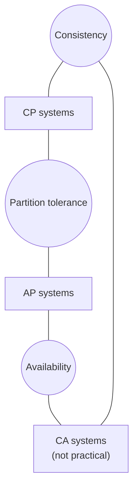

Key-value stores are classified by which two they keep:

- **CP**: consistent and partition-tolerant, at the cost of availability.
- **AP**: available and partition-tolerant, at the cost of consistency.
- **CA**: consistent and available, but *not* partition-tolerant. Networks do fail, so every real distributed system must tolerate partitions. **CA cannot exist in practice.**

### CAP in a concrete scenario

Suppose data is replicated on three nodes, **n1, n2, and n3**.

- **Ideal world (no partitions):** writes to n1 replicate to n2 and n3 automatically. You get both consistency and availability.
- **Real world:** n3 loses contact with n1 and n2. Writes to n1 or n2 can't reach n3. Writes that reached n3 but haven't propagated leave n1 and n2 stale.

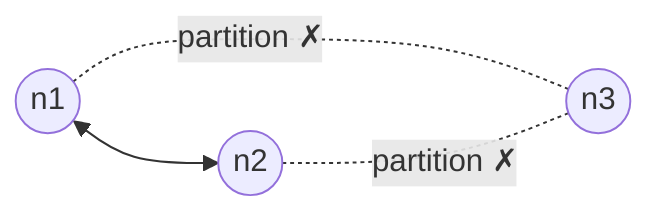

Now you must choose:

- **Choose consistency (CP):** block writes to n1 and n2 until the partition heals, so the three nodes can't diverge. The system becomes **unavailable** for those writes. Banks typically choose this, because showing a wrong balance is worse than returning an error.
- **Choose availability (AP):** keep accepting reads and writes, even though some reads may return stale data. When the partition heals, data syncs to n3.

Choosing the right CAP guarantees for your use case is a key early decision, and a good one to discuss with your interviewer. The [Linearizability](../distributed-data/linearizability) lesson goes further and explains why CAP's choice only arises *during* a partition.

### Check: CAP

<MultipleChoice
  id="sdi-ch6-cap"
  title="Consistency vs. availability"
  questions={[
    {
      prompt: 'Why can\'t a real distributed key-value store be a "CA" system?',
      choices: [
        'Consistency and availability are the same property',
        'Network partitions are unavoidable, so any distributed system must tolerate them. The real choice is between C and A when one happens',
        'CA systems need more than three replicas',
        'Only relational databases can be CA',
      ],
      answer: 1,
      why: 'Giving up P would mean assuming the network never fails, which isn\'t realistic. Once a partition happens, you can either refuse requests (CP) or serve possibly stale data (AP).',
    },
    {
      prompt: 'A shopping cart service must always accept "add to cart," even during network trouble. Merging carts later is fine. Which choice fits?',
      choices: ['CP', 'AP', 'CA', 'Neither, so the service should be single-node'],
      answer: 1,
      why: 'Accepting writes during a partition and reconciling afterward is the AP trade-off. This is the use case Dynamo was originally built for.',
    },
  ]}
/>

---

## System Components

We'll build the store from these pieces: **data partition**, **data replication**, **consistency**, **inconsistency resolution**, **handling failures**, the **architecture**, and the **write and read paths**.

### Data partition

The full data set can't fit on one server, so it is split into partitions. That raises two challenges:

1. Distribute data **evenly** across servers.
2. **Minimize data movement** when nodes join or leave.

[Consistent hashing](./design-consistent-hashing) solves both. Servers s0–s7 sit on a hash ring, and a key is stored on the first server clockwise from its hash. On top of that, it gives us:

- **Automatic scaling**: servers can be added and removed based on load, and only a small slice of keys moves.
- **Heterogeneity**: a server's number of **virtual nodes** can be proportional to its capacity, so bigger machines take more of the ring.

### Data replication

For availability and reliability, each key is replicated **asynchronously** to **N** servers, where N is configurable. To choose them, map the key onto the ring, then walk **clockwise** and pick the first **N** servers. With N = 3, a key landing just before s1 is stored on **s1, s2, and s3**.

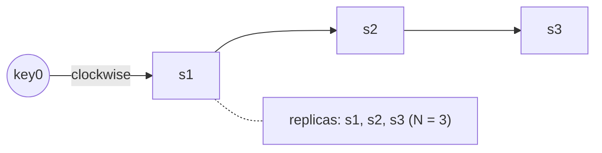

Two refinements:

- **Unique physical servers.** With virtual nodes, the next N positions might belong to fewer than N real machines. Skip any virtual node whose physical server has already been chosen.
- **Spread across data centers.** Nodes in the same data center often fail together (power, network, natural disaster), so place replicas in **different data centers** connected by fast links.

#### Practice: build the preference list

The list of servers responsible for a key is often called its **preference list**. Implement `preference_list(ring, key_pos, n)`:

- `ring` is a list of `(position, server)` virtual nodes in any order.
- Start at the first virtual node with `position >= key_pos`, wrapping to the lowest position if there is none.
- Walk clockwise and collect servers, **skipping any already chosen**, until you have `n`.

Input: line 1 is `position:server` pairs, and line 2 is `key_pos n`.

<CodeExercise
  title="Replica preference list"
  heading="exercise-sdi-preference-list"
  lang="python"
  filename="main.py"
  prompt="Implement preference_list(ring, key_pos, n). Sort the ring by position, start at the first virtual node with position >= key_pos (wrap to index 0 if none), walk clockwise, and return the first n distinct physical servers in order."
  sampleLog={`10:A 20:B 30:A 40:C 50:B 60:D 70:C 80:D
5 3
A B C`}
  starter={`def preference_list(ring, key_pos, n):
    # ring: list of (position, server). Walk clockwise from key_pos,
    # collecting distinct physical servers until you have n.
    pass
`}
  wrapSuffix={`
import sys
lines = sys.stdin.read().split('\\n')
ring = []
for pair in lines[0].split():
    pos, server = pair.split(':')
    ring.append((int(pos), server))
key_pos, n = map(int, lines[1].split())
print(' '.join(preference_list(ring, key_pos, n)))
`}
  hint="After sorting, find the start index. Then loop j over range(len(ring)) using ring[(start + j) % len(ring)], appending the server only if it's not already in the result."
  solution={`def preference_list(ring, key_pos, n):
    ring = sorted(ring)
    start = next((i for i, (pos, _) in enumerate(ring) if pos >= key_pos), 0)
    chosen = []
    for j in range(len(ring)):
        server = ring[(start + j) % len(ring)][1]
        if server not in chosen:
            chosen.append(server)
        if len(chosen) == n:
            break
    return chosen
`}
  tests={[
    { name: 'skip the repeated A', stdin: '10:A 20:B 30:A 40:C 50:B 60:D 70:C 80:D\n5 3', equals: 'A B C' },
    { name: 'start mid-ring', stdin: '10:A 20:B 30:A 40:C 50:B 60:D 70:C 80:D\n15 3', equals: 'B A C' },
    { name: 'wrap around the ring', stdin: '10:A 20:B 30:A 40:C 50:B 60:D 70:C 80:D\n85 3', equals: 'A B C' },
    { name: 'every server', stdin: '10:A 20:B 30:A 40:C 50:B 60:D 70:C 80:D\n45 4', equals: 'B D C A' },
    { name: 'unsorted input', stdin: '80:D 10:A 60:D 30:A 50:B 20:B 70:C 40:C\n55 2', equals: 'D C' },
  ]}
/>

### Consistency: quorum consensus

Replicas must stay in sync. **Quorum consensus** gives tunable guarantees for both reads and writes:

- **N**: the number of replicas.
- **W**: the write quorum. A write succeeds once **W replicas acknowledge** it.
- **R**: the read quorum. A read succeeds once it has responses from **R replicas**.

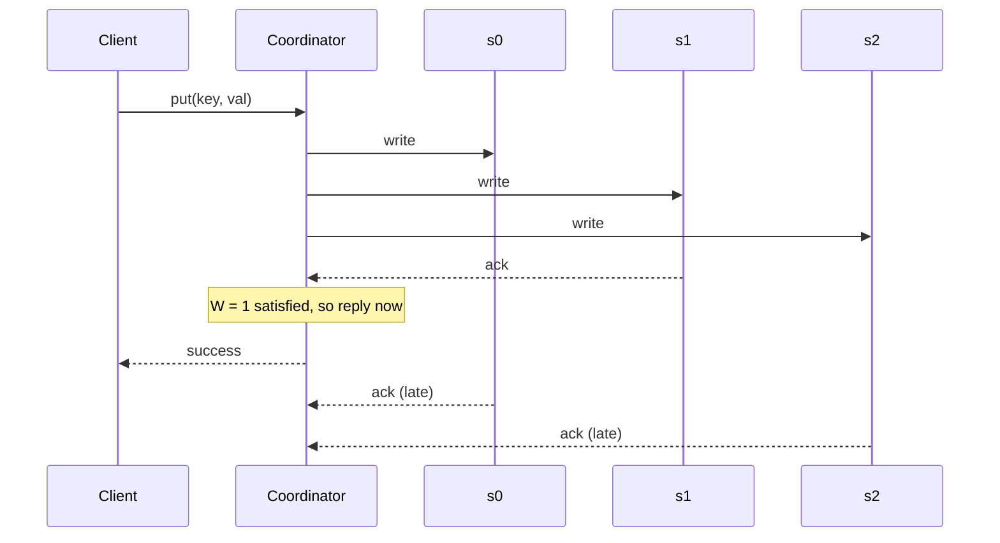

**W = 1 does not mean the data is written to only one server.** The data still goes to all N replicas (s0, s1, s2). W = 1 means the **coordinator**, the node that proxies between the client and the replicas, waits for just **one** acknowledgment before reporting success.

**The trade-off is latency vs. consistency.** Small W or R returns fast, because the coordinator only waits for the quickest replica. Larger values give stronger consistency but wait on slower replicas.

**The overlap rule:** if **W + R > N**, every read quorum overlaps every write quorum in at least one node. That node has the latest write, so reads are **strongly consistent**.

| Configuration | Effect |
|---|---|
| R = 1, W = N | Optimized for **fast reads** |
| W = 1, R = N | Optimized for **fast writes** |
| W + R > N (typically N = 3, W = R = 2) | **Strong consistency** guaranteed |
| W + R ≤ N | Strong consistency **not** guaranteed |

#### Practice: analyze a quorum configuration

Implement `analyze(n, w, r)` that returns a dict with:

- `strong`: whether W + R > N.
- `write_tolerates`: how many replicas can be down while writes still reach W acknowledgments.
- `read_tolerates`: the same for reads.

<CodeExercise
  title="Quorum analysis"
  heading="exercise-sdi-quorum"
  lang="python"
  filename="main.py"
  prompt="Implement analyze(n, w, r) returning {'strong': w + r > n, 'write_tolerates': n - w, 'read_tolerates': n - r}."
  sampleLog={`3 2 2
strong consistency: True
writes survive 1 down replica(s)
reads survive 1 down replica(s)`}
  starter={`def analyze(n, w, r):
    pass
`}
  wrapSuffix={`
import sys
n, w, r = map(int, sys.stdin.read().split())
a = analyze(n, w, r)
print(f"strong consistency: {a['strong']}")
print(f"writes survive {a['write_tolerates']} down replica(s)")
print(f"reads survive {a['read_tolerates']} down replica(s)")
`}
  hint="A write needs W live replicas out of N, so N - W of them may be down. The same logic applies to reads."
  solution={`def analyze(n, w, r):
    return {
        'strong': w + r > n,
        'write_tolerates': n - w,
        'read_tolerates': n - r,
    }
`}
  tests={[
    { name: 'classic N=3, W=R=2', stdin: '3 2 2', equals: 'strong consistency: True\nwrites survive 1 down replica(s)\nreads survive 1 down replica(s)' },
    { name: 'fast everything, weak', stdin: '3 1 1', equals: 'strong consistency: False\nwrites survive 2 down replica(s)\nreads survive 2 down replica(s)' },
    { name: 'read-optimized', stdin: '3 3 1', equals: 'strong consistency: True\nwrites survive 0 down replica(s)\nreads survive 2 down replica(s)' },
    { name: 'N=5 majority quorums', stdin: '5 3 3', equals: 'strong consistency: True\nwrites survive 2 down replica(s)\nreads survive 2 down replica(s)' },
    { name: 'W + R = N is not enough', stdin: '5 2 3', equals: 'strong consistency: False\nwrites survive 3 down replica(s)\nreads survive 2 down replica(s)' },
  ]}
/>

Look at the read-optimized case (N=3, W=3, R=1). Reads are fast and survive two failures, but a **single** down replica blocks every write. Tuning W and R is really deciding *which* operation gets to stay available.

### Consistency models

A **consistency model** defines how fresh the data a reader sees must be:

- **Strong consistency**: every read returns the result of the most recent write. Clients never see stale data.
- **Weak consistency**: later reads may not see the latest value.
- **Eventual consistency**: a form of weak consistency. Given enough time without new writes, every replica converges.

Strong consistency usually means a replica refuses new reads and writes until all replicas agree on the current write. That blocking is a bad fit for a highly available store. **Dynamo and Cassandra use eventual consistency, and so does our design.** With concurrent writes, eventual consistency lets conflicting values into the system, and clients reconcile them when they read. Versioning makes that possible.

### Check: quorums and consistency

<MultipleChoice
  id="sdi-ch6-quorum"
  title="Tuning N, W, R"
  questions={[
    {
      prompt: 'With N = 3 and W = 1, a write is acknowledged by s1 first. Where is the data stored?',
      choices: [
        'Only on s1',
        'On s1, s2, and s3 (all N replicas). The coordinator just stops waiting after the first ack',
        'On the coordinator only',
        'Nowhere until R replicas confirm',
      ],
      answer: 1,
      why: 'W controls how many acknowledgments the coordinator waits for, not how many replicas get the write.',
      whyWrong: 'This is the most common misreading of W = 1. Replication to all N still happens, and only the waiting is reduced.',
    },
    {
      prompt: 'Why does W + R > N guarantee a read sees the latest successful write?',
      choices: [
        'Because writes are synchronous to all replicas',
        'Because any W-node set and any R-node set out of N must share at least one node, and that node holds the latest write',
        'Because R is always larger than W',
        'Because the coordinator caches every write',
      ],
      answer: 1,
      why: 'By the pigeonhole principle, if W + R > N the two sets overlap. The reader then sees at least one up-to-date copy and can pick the newest version.',
    },
    {
      prompt: 'Which setting makes writes fastest while still guaranteeing strong consistency with N = 3?',
      choices: ['W = 1, R = 1', 'W = 1, R = 3', 'W = 3, R = 1', 'W = 2, R = 1'],
      answer: 1,
      why: 'W = 1 gives the fastest writes, and R = 3 keeps W + R = 4 > 3. The cost is slow reads, since every replica must answer.',
    },
  ]}
/>

---

## Inconsistency Resolution: Versioning and Vector Clocks

Replication buys availability but lets replicas **diverge**. **Versioning** treats every modification as a new **immutable version**. **Vector clocks** tell us how versions relate to each other.

**How conflicts arise.** Replicas n1 and n2 both hold `name = "john"`. Server 1 sets it to `"johnSanFrancisco"` while, at the same time, server 2 sets it to `"johnNewYork"`. Both versions descend from the original, so the original can be discarded, but nothing tells us which of the two new versions should win.

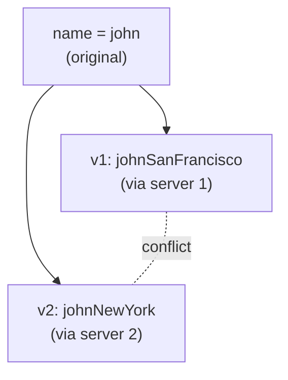

### Vector clocks

A **vector clock** is a set of **[server, counter]** pairs attached to a data item: D([S1, v1], [S2, v2], …, [Sn, vn]). When a server Si writes D, it:

- **increments** vi if an [Si, vi] entry exists, or
- **creates** [Si, 1] if it doesn't.

**Walk-through:**

| Step | What happens | Handled by | Vector clock |
|---|---|---|---|
| 1 | Client writes D1 | Sx | D1([Sx, 1]) |
| 2 | Client reads D1, writes D2 (overwrites D1) | Sx | D2([Sx, 2]) |
| 3 | Client reads D2, writes D3 | Sy | D3([Sx, 2], [Sy, 1]) |
| 4 | Another client reads **D2**, writes D4 | Sz | D4([Sx, 2], [Sz, 1]) |
| 5 | A client reads D3 and D4, sees a **conflict**, merges them, and writes D5 | Sx | D5([Sx, 3], [Sy, 1], [Sz, 1]) |

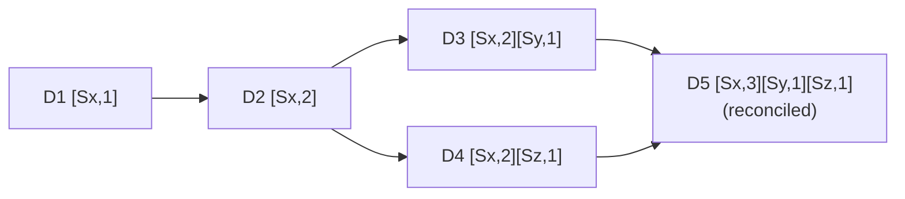

**Comparing clocks.** A missing entry counts as 0.

- X is an **ancestor** of Y (no conflict) if **every** counter in X is ≤ the matching counter in Y. Example: D([s0, 1], [s1, 1]) is an ancestor of D([s0, 1], [s1, 2]).
- X and Y are **siblings** (in conflict) if **each** has some counter greater than the other's. Example: D([s0, 1], [s1, 2]) and D([s0, 2], [s1, 1]).

(The book's wording, "Y has a counter less than X's," states only one direction. That alone could also mean X *descends from* Y. A real conflict needs it in both directions.)

**Downsides:**

1. **Client complexity.** Clients must implement conflict resolution.
2. **Clock growth.** The [server: version] list can get long. A common fix is to cap its length and drop the oldest pairs. That can make ancestry inaccurate, but the Dynamo paper reports Amazon never hit the problem in production, so it is an acceptable compromise for most systems.

#### Practice: vector clocks

Implement two functions. Clocks are dicts such as `{'Sx': 2, 'Sy': 1}`.

- `increment(clock, server)` returns a **new** clock with `server`'s counter incremented, or set to 1 if it is missing. Don't modify the input.
- `compare(a, b)` returns `'equal'`, `'ancestor'` (a happened before b), `'descendant'` (b happened before a), or `'conflict'`.

The wrapper first replays the walk-through and prints D5. Then it compares each pair of clocks from stdin. Each line has the form `Sx=2,Sy=1 | Sx=2,Sz=1`.

<CodeExercise
  title="Vector clocks"
  heading="exercise-sdi-vector-clocks"
  lang="python"
  filename="main.py"
  prompt="Implement increment(clock, server) (returns a new dict) and compare(a, b) returning 'equal', 'ancestor', 'descendant', or 'conflict'. Treat missing servers as counter 0."
  sampleLog={`Sx=2,Sy=1 | Sx=2,Sz=1
D5: Sx=3,Sy=1,Sz=1
conflict`}
  starter={`def increment(clock, server):
    pass

def compare(a, b):
    # Check whether every counter in a is <= b's, and whether every counter
    # in a is >= b's, over the union of servers.
    pass
`}
  wrapSuffix={`
import sys

def parse(text):
    text = text.strip()
    if not text:
        return {}
    return {k: int(v) for k, v in (p.split('=') for p in text.split(','))}

def show(clock):
    return ','.join(f'{k}={clock[k]}' for k in sorted(clock))

d1 = increment({}, 'Sx')
d2 = increment(d1, 'Sx')
d3 = increment(d2, 'Sy')
d4 = increment(d2, 'Sz')
merged = {k: max(d3.get(k, 0), d4.get(k, 0)) for k in set(d3) | set(d4)}
d5 = increment(merged, 'Sx')
assert d2 == {'Sx': 2}, 'increment must not modify its input'
print('D5:', show(d5))
for line in sys.stdin.read().strip().split('\\n'):
    left, right = line.split('|')
    print(compare(parse(left), parse(right)))
`}
  hint="increment: copy with dict(clock), then c[server] = c.get(server, 0) + 1. compare: over keys = set(a) | set(b), compute le = all(a.get(k, 0) <= b.get(k, 0)) and ge similarly; equal if both, ancestor if only le, descendant if only ge, else conflict."
  solution={`def increment(clock, server):
    c = dict(clock)
    c[server] = c.get(server, 0) + 1
    return c

def compare(a, b):
    keys = set(a) | set(b)
    le = all(a.get(k, 0) <= b.get(k, 0) for k in keys)
    ge = all(a.get(k, 0) >= b.get(k, 0) for k in keys)
    if le and ge:
        return 'equal'
    if le:
        return 'ancestor'
    if ge:
        return 'descendant'
    return 'conflict'
`}
  tests={[
    { name: 'D3 vs D4 conflict', stdin: 'Sx=2,Sy=1 | Sx=2,Sz=1', equals: 'D5: Sx=3,Sy=1,Sz=1\nconflict' },
    { name: 'book ancestor example', stdin: 's0=1,s1=1 | s0=1,s1=2', equals: 'D5: Sx=3,Sy=1,Sz=1\nancestor' },
    { name: 'book sibling example', stdin: 's0=1,s1=2 | s0=2,s1=1', equals: 'D5: Sx=3,Sy=1,Sz=1\nconflict' },
    { name: 'merged version descends from both', stdin: 'Sx=3,Sy=1,Sz=1 | Sx=2,Sy=1\nSx=3,Sy=1,Sz=1 | Sx=2,Sz=1', equals: 'D5: Sx=3,Sy=1,Sz=1\ndescendant\ndescendant' },
    { name: 'equal, and missing entries count as 0', stdin: 'Sx=2 | Sx=2\nSx=2 | Sx=2,Sy=1', equals: 'D5: Sx=3,Sy=1,Sz=1\nequal\nancestor' },
  ]}
/>

For more on detecting concurrent writes, see the version-vector section of [Leaderless Replication](../distributed-data/leaderless-replication).

---

## Handling Failures

At scale, failures are not just inevitable but **routine**. First you **detect** them, then you **resolve** them.

### Failure detection: gossip

One server saying another is down isn't enough evidence. It usually takes **at least two independent sources** to mark a server down.

**All-to-all multicasting**, where every node heartbeats every other node, is simple. But it costs O(n²) messages, which is inefficient for large clusters. A **decentralized gossip protocol** scales better:

- Each node keeps a **membership list** of member IDs and **heartbeat counters**.
- Each node periodically **increments its own** heartbeat.
- Each node periodically sends heartbeats to a few **random** nodes, which pass them on to others.
- Nodes update their membership lists as heartbeats arrive.
- A member whose heartbeat **hasn't increased** for a set period is considered **offline**.

| Member ID | Heartbeat counter | Last updated |
|---|---|---|
| 0 | 10232 | 12:00:01 |
| 1 | 10224 | 12:00:10 |
| 2 | **9908** | **11:58:02** ← stale |
| 3 | 10237 | 12:00:20 |
| 4 | 10234 | 12:00:34 |

In this example, s0 notices that **s2's** counter hasn't moved for a long time. s0 gossips s2's entry to random peers. Once others confirm that s2 has gone quiet, s2 is **marked down**, and that news spreads through the cluster.

### Temporary failures: sloppy quorum and hinted handoff

With a **strict quorum**, a down replica can block reads and writes. A **sloppy quorum** improves availability: the coordinator uses the **first W healthy servers** for writes and the **first R healthy servers** for reads, walking the ring and **skipping offline servers**.

The healthy stand-in keeps the data along with a **hint** about where it belongs. When the failed server comes back, the stand-in **pushes the data back** to it. This is called **hinted handoff**.

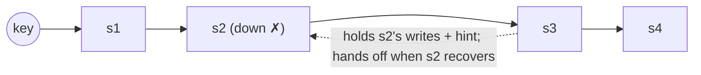

With s2 down, s3 handles its reads and writes temporarily, then hands the data back when s2 recovers.

### Permanent failures: anti-entropy with Merkle trees

If a replica is gone for good, or has drifted badly, an **anti-entropy** protocol compares replicas and brings each one up to the newest version. Comparing every key would move too much data. A **Merkle tree** narrows the comparison to just the parts that differ.

A **Merkle (hash) tree** is a tree in which each leaf holds the hash of a block of data, and each internal node holds the hash of its children. Building one over keys 1–12:

1. **Divide** the key space into **buckets**: 4 buckets of 3 keys, `[1–3] [4–6] [7–9] [10–12]`. Buckets keep the tree's depth bounded.
2. **Hash each key** in each bucket with a uniform hash function.
3. **Hash each bucket** into a single leaf node.
4. **Build upward**: each parent is the hash of its children, all the way to the **root**.

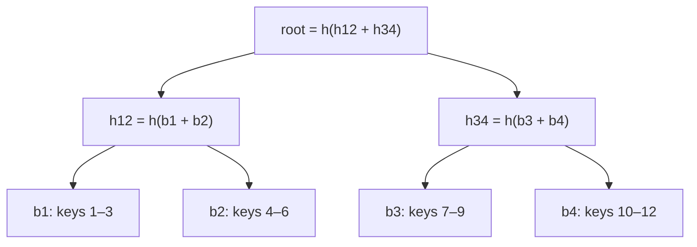

**Comparing two replicas:** compare their **root** hashes. If they match, the replicas are identical and you're done. If not, compare the children, and recurse **only into subtrees whose hashes differ**. You end up at exactly the buckets that are out of sync, and you sync only those.

The work is proportional to the **differences** between the replicas, not to their total size. Real systems use large buckets. For example, **one million buckets for one billion keys** gives about 1,000 keys per bucket.

#### Practice: find out-of-sync buckets

`build_tree` is provided. It returns the tree as a list of levels, **root first**, so `tree[0] == [root_hash]` and `tree[-1]` is the list of bucket hashes. The child indexes of node `i` on one level are `2i` and `2i + 1` on the next level.

Implement `diff_trees(t1, t2)`, which returns `(differing_bucket_indexes, comparisons)`:

- Start at the root and compare hashes, counting **every** comparison.
- If two nodes are equal, stop there.
- If they differ at a leaf, record its bucket index. Otherwise, recurse into the left child, then the right child.

Input: line 1 is `num_keys num_buckets`, and lines 2 and 3 are each replica's values as `key=value` pairs.

<CodeExercise
  title="Merkle tree diff"
  heading="exercise-sdi-merkle"
  lang="python"
  filename="main.py"
  prompt="Implement diff_trees(t1, t2). Both trees are lists of levels (root first). Recursively compare from the root; count each hash comparison; descend into children (2i, 2i+1) only where hashes differ; return (sorted list of differing leaf indexes, number of comparisons)."
  sampleLog={`12 4
1=v1 2=v2 3=v3 4=v4 5=v5 6=v6 7=v7 8=v8 9=v9 10=v10 11=v11 12=v12
1=v1 2=v2 3=v3 4=v4 5=v5 6=x 7=v7 8=v8 9=v9 10=v10 11=v11 12=v12
out-of-sync buckets: [1]
hash comparisons: 5`}
  starter={`import hashlib

def h(s):
    return hashlib.sha256(s.encode()).hexdigest()

def build_tree(data, num_keys, num_buckets):
    buckets = [[] for _ in range(num_buckets)]
    for k in range(1, num_keys + 1):
        if k in data:
            buckets[(k - 1) * num_buckets // num_keys].append(f'{k}={data[k]}')
    level = [h(','.join(b)) for b in buckets]
    levels = [level]
    while len(level) > 1:
        level = [h(level[i] + level[i + 1]) for i in range(0, len(level), 2)]
        levels.append(level)
    return levels[::-1]

def diff_trees(t1, t2):
    # Recurse from (depth 0, index 0). Count every comparison.
    pass
`}
  wrapSuffix={`
import sys
lines = sys.stdin.read().split('\\n')
num_keys, num_buckets = map(int, lines[0].split())
def parse(line):
    return {int(k): v for k, v in (p.split('=') for p in line.split())}
a = build_tree(parse(lines[1]), num_keys, num_buckets)
b = build_tree(parse(lines[2]), num_keys, num_buckets)
diffs, comparisons = diff_trees(a, b)
print('out-of-sync buckets:', sorted(diffs))
print('hash comparisons:', comparisons)
`}
  hint="Write a nested go(depth, i): increment a counter, return if t1[depth][i] == t2[depth][i], record i if depth == len(t1) - 1, else call go(depth + 1, 2*i) and go(depth + 1, 2*i + 1)."
  solution={`import hashlib

def h(s):
    return hashlib.sha256(s.encode()).hexdigest()

def build_tree(data, num_keys, num_buckets):
    buckets = [[] for _ in range(num_buckets)]
    for k in range(1, num_keys + 1):
        if k in data:
            buckets[(k - 1) * num_buckets // num_keys].append(f'{k}={data[k]}')
    level = [h(','.join(b)) for b in buckets]
    levels = [level]
    while len(level) > 1:
        level = [h(level[i] + level[i + 1]) for i in range(0, len(level), 2)]
        levels.append(level)
    return levels[::-1]

def diff_trees(t1, t2):
    diffs = []
    comparisons = 0

    def go(depth, i):
        nonlocal comparisons
        comparisons += 1
        if t1[depth][i] == t2[depth][i]:
            return
        if depth == len(t1) - 1:
            diffs.append(i)
            return
        go(depth + 1, 2 * i)
        go(depth + 1, 2 * i + 1)

    go(0, 0)
    return diffs, comparisons
`}
  tests={[
    { name: 'identical replicas: one comparison', stdin: '12 4\n1=v1 2=v2 3=v3 4=v4 5=v5 6=v6 7=v7 8=v8 9=v9 10=v10 11=v11 12=v12\n1=v1 2=v2 3=v3 4=v4 5=v5 6=v6 7=v7 8=v8 9=v9 10=v10 11=v11 12=v12', equals: 'out-of-sync buckets: []\nhash comparisons: 1' },
    { name: 'one key differs', stdin: '12 4\n1=v1 2=v2 3=v3 4=v4 5=v5 6=v6 7=v7 8=v8 9=v9 10=v10 11=v11 12=v12\n1=v1 2=v2 3=v3 4=v4 5=v5 6=x 7=v7 8=v8 9=v9 10=v10 11=v11 12=v12', equals: 'out-of-sync buckets: [1]\nhash comparisons: 5' },
    { name: 'two buckets differ', stdin: '12 4\n1=v1 2=v2 3=v3 4=v4 5=v5 6=v6 7=v7 8=v8 9=v9 10=v10 11=v11 12=v12\n1=v1 2=x 3=v3 4=v4 5=v5 6=v6 7=v7 8=v8 9=v9 10=v10 11=y 12=v12', equals: 'out-of-sync buckets: [0, 3]\nhash comparisons: 7' },
    { name: 'everything differs', stdin: '12 4\n1=v1 2=v2 3=v3 4=v4 5=v5 6=v6 7=v7 8=v8 9=v9 10=v10 11=v11 12=v12\n1=a 2=v2 3=v3 4=b 5=v5 6=v6 7=c 8=v8 9=v9 10=d 11=v11 12=v12', equals: 'out-of-sync buckets: [0, 1, 2, 3]\nhash comparisons: 7' },
    { name: 'deeper tree: 8 buckets', stdin: '12 8\n1=v1 2=v2 3=v3 4=v4 5=v5 6=v6 7=v7 8=v8 9=v9 10=v10 11=v11 12=v12\n1=v1 2=v2 3=v3 4=v4 5=v5 6=x 7=v7 8=v8 9=v9 10=v10 11=v11 12=v12', equals: 'out-of-sync buckets: [3]\nhash comparisons: 7' },
  ]}
/>

Notice the comparison counts. Identical replicas cost one comparison. A single bad key costs about 2 × depth + 1 comparisons, whether the replicas hold 12 keys or 12 billion.

### Data center outages

Power failures, network outages, and natural disasters can take out a **whole data center**. Replicate data **across data centers**, so that users can still reach their data through the others when one goes dark.

### Check: failure handling

<MultipleChoice
  id="sdi-ch6-failures"
  title="Detect, tolerate, repair"
  questions={[
    {
      prompt: 'Why does gossip scale better than all-to-all heartbeats for failure detection?',
      choices: [
        'Gossip uses UDP instead of TCP',
        'Each node contacts only a few random peers per round, yet information still spreads cluster-wide, avoiding O(n²) messages',
        'Gossip never produces false positives',
        'Gossip requires a central coordinator',
      ],
      answer: 1,
      why: 'Random peer-to-peer propagation reaches every node in a small number of rounds with much less traffic than everyone pinging everyone.',
    },
    {
      prompt: 'Replica s2 is down for 10 minutes for a reboot. What keeps writes for its keys available, and how does s2 catch up?',
      choices: [
        'A Merkle tree rebuilds s2 from scratch',
        'A sloppy quorum lets a healthy node (e.g. s3) accept the writes with a hint, and hinted handoff pushes them to s2 when it returns',
        'Writes are rejected until s2 is back',
        'The client retries forever',
      ],
      answer: 1,
      why: 'Sloppy quorum plus hinted handoff is the tool for temporary failures. Merkle-tree anti-entropy is for permanent or long-lived divergence.',
    },
    {
      prompt: 'Two replicas each hold a billion keys, and 50 keys differ. Roughly how much work does a Merkle-tree comparison do?',
      choices: [
        'Compare all one billion keys',
        'Work proportional to the 50 differences (times tree depth), then sync only the affected buckets',
        'Exactly one comparison',
        'Rebuild both replicas',
      ],
      answer: 1,
      why: 'Matching subtrees are skipped entirely. Only the paths down to differing buckets are explored.',
    },
  ]}
/>

---

## System Architecture

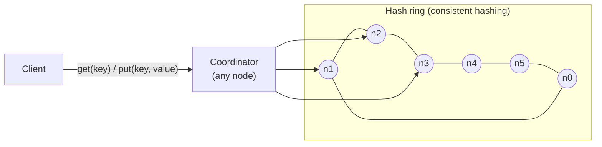

- Clients use a simple API: `get(key)` and `put(key, value)`.
- A **coordinator** node proxies between the client and the store.
- Nodes sit on a **consistent-hashing ring**.
- The system is **fully decentralized**, so adding and removing nodes can be automatic.
- Data is **replicated** on multiple nodes.
- There is **no single point of failure**. Every node has the same responsibilities.

Because the design is decentralized, **every node** runs the full set of functions: the client API, failure detection, conflict resolution, failure repair, replication, and the storage engine.

---

## Write Path

The write and read paths follow **Cassandra**'s architecture.

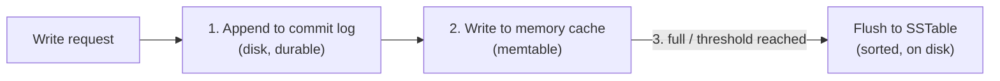

1. **Persist** the write to a **commit log** file, so that a crash doesn't lose it.
2. **Save** it in the **memory cache**.
3. When the memory cache is full or reaches a threshold, **flush** it to an **SSTable** on disk. A sorted-string table is a sorted list of `<key, value>` pairs.

---

## Read Path

**If the key is in memory,** return it straight from the memory cache.

**If not,** it must come from disk, but which SSTable holds it? A **Bloom filter** answers this quickly. It is a compact probabilistic structure that can say "**definitely not here**" or "**maybe here**".

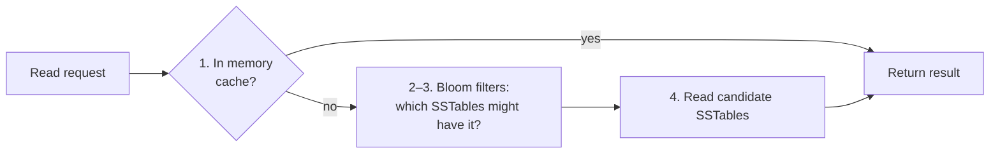

1. Check whether the data is in **memory**. If not, go to step 2.
2. Check the **Bloom filter**.
3. The Bloom filter identifies which **SSTables might** contain the key.
4. Those SSTables return the data.
5. The result goes back to the client.

The [Hash Indexes and LSM-Trees](../designing-data-intensive-applications/hash-indexes-and-lsm-trees) lesson covers memtables, SSTables, compaction, and Bloom filters in depth.

### Check: architecture and storage paths

<MultipleChoice
  id="sdi-ch6-paths"
  title="Write and read paths"
  questions={[
    {
      type: 'order',
      prompt: 'Order the write path (top = first):',
      items: [
        'Append the write to the commit log',
        'Insert it into the in-memory cache (memtable)',
        'When the memtable reaches its threshold, flush it to an SSTable on disk',
      ],
      why: 'The commit log comes first so that an acknowledged write survives a crash before it reaches an SSTable. The memtable buffers writes in sorted order, and flushing makes them permanent on disk.',
      whyWrong: 'If the memtable were written first and the node crashed, the write would be lost. The log exists to prevent exactly that.',
    },
    {
      prompt: 'A Bloom filter for an SSTable says "maybe present." What can you conclude?',
      choices: [
        'The key is definitely in that SSTable',
        'The key might be in that SSTable. False positives are possible, so you must read it to know',
        'The key is definitely not anywhere',
        'The SSTable is corrupt',
      ],
      answer: 1,
      why: 'Bloom filters have no false negatives but can have false positives. "No" lets you skip the SSTable safely, while "maybe" means you check.',
    },
    {
      prompt: 'Why does this design have no single point of failure?',
      choices: [
        'It runs on one very reliable server',
        'Every node has the same responsibilities, data is replicated, and any node can act as coordinator',
        'It uses a dedicated master node with a hot standby',
        'Clients cache everything',
      ],
      answer: 1,
      why: 'In a fully decentralized, symmetric design, losing any one node just shifts its work to its peers.',
    },
  ]}
/>

---

## Summary

| Goal / problem | Technique |
|---|---|
| Ability to store big data | Consistent hashing to spread load across servers |
| High availability reads | Data replication; multi-data-center setup |
| Highly available writes | Versioning and conflict resolution with vector clocks |
| Data set partition | Consistent hashing |
| Incremental scalability | Consistent hashing |
| Heterogeneity | Consistent hashing (virtual nodes proportional to capacity) |
| Tunable consistency | Quorum consensus (N, W, R) |
| Handling temporary failures | Sloppy quorum and hinted handoff |
| Handling permanent failures | Merkle trees (anti-entropy) |
| Handling data center outages | Cross-data-center replication |

Previous lesson: [Design Consistent Hashing](./design-consistent-hashing).

Next lesson: [Design a Unique ID Generator](./design-a-unique-id-generator) — multi-master auto-increment, UUIDs, ticket servers, and Twitter's Snowflake 64-bit layout.

---

## Reference Materials

1. [Amazon DynamoDB](https://aws.amazon.com/dynamodb/)
2. [memcached](https://memcached.org/)
3. [Redis](https://redis.io/)
4. [Dynamo: Amazon's Highly Available Key-value Store](https://www.allthingsdistributed.com/files/amazon-dynamo-sosp2007.pdf)
5. [Apache Cassandra](https://cassandra.apache.org/)
6. [Bigtable: A Distributed Storage System for Structured Data](https://static.googleusercontent.com/media/research.google.com/en//archive/bigtable-osdi06.pdf)
7. [Merkle tree](https://en.wikipedia.org/wiki/Merkle_tree) — Wikipedia
8. [Cassandra architecture](https://cassandra.apache.org/doc/latest/architecture/)
9. [SSTable and Log Structured Storage: LevelDB](https://www.igvita.com/2012/02/06/sstable-and-log-structured-storage-leveldb/)
10. [Bloom filter](https://en.wikipedia.org/wiki/Bloom_filter) — Wikipedia
