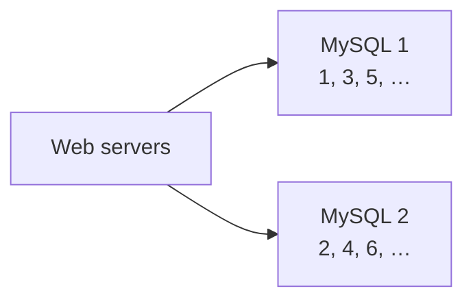
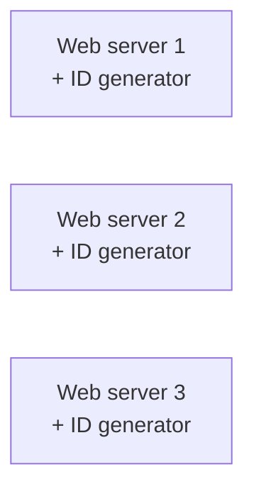
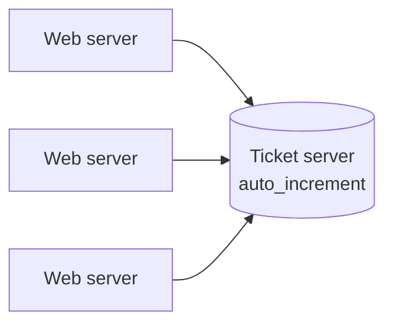

# Design a Unique ID Generator in Distributed Systems

> **Adapted from:** Alex Xu, *System Design Interview – An Insider's Guide* (2020), Chapter 7 — rewritten and condensed for teaching.

The obvious way to get unique IDs is an `AUTO_INCREMENT` primary key in a relational database. That stops working once the system is distributed. One database server can't keep up, and handing out IDs from several databases that are unique, ordered, and fast takes coordination. This lesson compares four approaches and builds the one that meets every requirement: **Twitter's Snowflake**.

Unique IDs come in many shapes. For example:

| Style | Example |
|---|---|
| Auto-increment integer | `1`, `2`, `3`, … |
| UUID (128-bit, hex) | `09c93e62-50b4-468d-bf8a-c07e1040bfb2` |
| Snowflake-style (64-bit, numeric, time-ordered) | `1724551110456668202` |

**What you'll be able to do after this lesson:**

- Compare multi-master auto-increment, UUIDs, ticket servers, and Snowflake against a set of requirements.
- Lay out a 64-bit Snowflake ID and compose and decompose IDs with bit shifts.
- Build a generator that handles several IDs in the same millisecond, sequence overflow, and a clock that moves backwards.
- Calculate how long a timestamp field lasts and how many IDs per second a machine can produce.

---

## Step 1: Understand the Problem and Establish Scope

| Candidate asks | Interviewer answers |
|---|---|
| What characteristics must IDs have? | Unique and sortable |
| Does each new ID increment by 1? | IDs increase with time, but not necessarily by 1. An ID created in the evening is larger than one created that morning |
| Numeric only? | Yes |
| Length requirement? | Must fit in **64 bits** |
| Scale? | **10,000 IDs per second** |

### Requirements

- IDs are **unique**.
- IDs are **numeric** only.
- IDs fit in **64 bits**.
- IDs are **ordered by date**.
- The system can generate **more than 10,000 IDs per second**.

---

## Step 2: High-Level Design — Four Options

### Option 1: Multi-master replication

Use each database's `auto_increment`, but step by **k**, the number of database servers, instead of 1. With 2 servers, server 1 issues 1, 3, 5, … and server 2 issues 2, 4, 6, … Each server's next ID is its previous ID plus 2.



Capacity grows with the number of servers, but the approach has serious drawbacks:

- **Hard to scale across multiple data centers.**
- **IDs don't increase with time across servers.** A busy server races ahead while a quiet one lags behind.
- **Adding or removing a server is painful**, because k changes and every server's step must be reconfigured without collisions.

#### Practice: multi-master IDs aren't time-ordered

Implement `assign_ids(k, events)`. `events` lists which server (0-based) handles each request, **in arrival order**. Server `i` starts at `i + 1` and steps by `k`. Return the list of IDs in arrival order. The wrapper then reports whether the IDs came out increasing.

<CodeExercise
  title="Multi-master auto-increment"
  heading="exercise-sdi-multi-master"
  lang="python"
  filename="main.py"
  prompt="Implement assign_ids(k, events). Server i issues i + 1, i + 1 + k, i + 1 + 2k, ... Return the ID assigned to each event in order."
  sampleLog={`2
0 1 0 1
ids: [1, 2, 3, 4]
time-ordered: True`}
  starter={`def assign_ids(k, events):
    # Track each server's next ID; it starts at i + 1 and steps by k.
    pass
`}
  wrapSuffix={`
import sys
lines = sys.stdin.read().split('\\n')
k = int(lines[0])
events = [int(x) for x in lines[1].split()]
ids = assign_ids(k, events)
print('ids:', ids)
print('time-ordered:', all(a < b for a, b in zip(ids, ids[1:])))
`}
  hint="Keep next_id = [i + 1 for i in range(k)]. For each event e, append next_id[e] and then add k to it."
  solution={`def assign_ids(k, events):
    next_id = [i + 1 for i in range(k)]
    ids = []
    for server in events:
        ids.append(next_id[server])
        next_id[server] += k
    return ids
`}
  tests={[
    { name: 'perfectly alternating traffic', stdin: '2\n0 1 0 1', equals: 'ids: [1, 2, 3, 4]\ntime-ordered: True' },
    { name: 'busy server races ahead', stdin: '2\n0 0 0 1', equals: 'ids: [1, 3, 5, 2]\ntime-ordered: False' },
    { name: 'three servers, uneven load', stdin: '3\n2 2 0 1 2', equals: 'ids: [3, 6, 1, 2, 9]\ntime-ordered: False' },
    { name: 'single server is plain auto-increment', stdin: '1\n0 0 0', equals: 'ids: [1, 2, 3]\ntime-ordered: True' },
  ]}
/>

In the "busy server" test, the request that arrives **last** gets ID 2, which is smaller than three IDs issued before it. Sorting by ID no longer means sorting by time.

### Option 2: UUID

A **UUID** is a 128-bit identifier designed to be unique without any coordination. Collisions are astronomically unlikely: you would have to generate about a billion per second for roughly a century before the chance of a single duplicate reached 50%. Each web server simply runs its own generator.



| Pros | Cons |
|---|---|
| Simple, with no coordination and so no synchronization issues | **128 bits**, but we need 64 |
| Scales trivially: each web server generates the IDs it uses | **Not ordered by time** (random v4 UUIDs) |
| | Usually **non-numeric** (hex string form) |

Newer variants such as UUIDv7 put a timestamp first so they sort by time, but they are still 128 bits.

### Option 3: Ticket server

Flickr built **ticket servers** to hand out distributed primary keys. The idea is a **single, centralized** database whose only job is `auto_increment`. Every web server asks it for the next ID.



| Pros | Cons |
|---|---|
| Numeric IDs | **Single point of failure**: if it goes down, everything that needs IDs stalls |
| Easy to implement; fine for small and medium scale | Several ticket servers remove the SPOF but bring back the synchronization problems of Option 1 (Flickr ran two, one issuing odd numbers and one even) |

### Option 4: Twitter Snowflake

None of the above meets every requirement. Snowflake does, by **divide and conquer**: instead of one counter, split the 64-bit ID into sections that each solve one part of the problem.

```text
 0 | 41 bits: timestamp (ms) | 5 bits: datacenter | 5 bits: machine | 12 bits: sequence
 ^
 sign bit (always 0)
```

| Section | Bits | Purpose |
|---|---|---|
| Sign | 1 | Always 0. Reserved, and keeps IDs positive as signed 64-bit integers |
| Timestamp | 41 | Milliseconds since a **custom epoch**. Twitter's default is `1288834974657` (Nov 04, 2010, 01:42:54 UTC) |
| Datacenter ID | 5 | 2⁵ = **32 datacenters** |
| Machine ID | 5 | 2⁵ = **32 machines per datacenter** |
| Sequence | 12 | Counts IDs generated in the same millisecond on this machine. Resets to 0 each millisecond |

How Snowflake meets the requirements:

- **Unique**: no two machines share a (datacenter, machine) pair, and a single machine never repeats a (timestamp, sequence) pair.
- **Numeric and 64-bit**: by construction.
- **Time-ordered**: the timestamp occupies the most significant bits.
- **Fast**: generation is local, with no coordination on the request path.

### Check: choosing an approach

<MultipleChoice
  id="sdi-ch7-approaches"
  title="Comparing ID schemes"
  questions={[
    {
      prompt: 'Which requirement rules out standard UUIDs most directly?',
      choices: [
        'Uniqueness',
        'The 64-bit size limit (UUIDs are 128 bits), plus they aren\'t time-ordered or purely numeric',
        'Generating 10,000 per second',
        'They need a central server',
      ],
      answer: 1,
      why: 'UUIDs are unique and fast to generate locally, but they fail the size, ordering, and numeric requirements.',
    },
    {
      prompt: 'What is the main weakness of a single ticket server?',
      choices: [
        'It produces non-numeric IDs',
        'It is a single point of failure, and adding more ticket servers brings back synchronization problems',
        'It cannot generate more than 100 IDs ever',
        'It requires 128-bit IDs',
      ],
      answer: 1,
      why: 'Centralizing auto-increment is simple but makes one database critical to every write in the system.',
    },
    {
      prompt: 'Why does multi-master auto-increment (step by k) fail the "ordered by date" requirement?',
      choices: [
        'Auto-increment values are random',
        'Each server counts independently, so a busy server\'s IDs run ahead of a quiet server\'s, and a later ID can be smaller than an earlier one',
        'The step k must be prime',
        'It only works with UUIDs',
      ],
      answer: 1,
      why: 'Each server\'s IDs increase, but there is no ordering between servers.',
    },
  ]}
/>

---

## Step 3: Design Deep Dive

**Datacenter and machine IDs** are assigned **at startup** and rarely change. Change them only with care: if two live machines end up with the same pair, they can mint duplicate IDs. The **timestamp** and **sequence** are computed while the generator runs.

### Composing and decomposing an ID

Each section is placed with a **left shift** and combined with **bitwise OR**:

```text
id = (timestamp - epoch) << 22    # 22 = 5 + 5 + 12 bits below the timestamp
   | datacenter_id       << 17    # 17 = 5 + 12
   | machine_id          << 12
   | sequence
```

To read an ID back, shift right and **mask** with `(1 << bits) - 1`. For example, `(id >> 12) & 0b11111` extracts the machine ID. To recover the time, compute `(id >> 22) + epoch`, giving milliseconds since the Unix epoch, which converts directly to UTC.

#### Practice: Snowflake bit layout

Implement `make_id(timestamp_ms, datacenter, machine, sequence)` and `parse_id(id)`. `parse_id` returns a dict with keys `timestamp`, `datacenter`, `machine`, and `sequence`, where `timestamp` is the absolute Unix milliseconds. Use the Twitter epoch `1288834974657`.

Input is one line: `timestamp_ms datacenter machine sequence`. The wrapper builds the ID, prints it with its bit length, and then parses it back.

<CodeExercise
  title="Compose and parse a Snowflake ID"
  heading="exercise-sdi-snowflake-bits"
  lang="python"
  filename="main.py"
  prompt="Implement make_id(timestamp_ms, datacenter, machine, sequence) = ((timestamp_ms - EPOCH) << 22) | (datacenter << 17) | (machine << 12) | sequence, and parse_id(id) that reverses it with right shifts and masks."
  sampleLog={`1700000000000 3 7 42
id: 1724551110456668202 (61 bits)
timestamp=1700000000000 datacenter=3 machine=7 sequence=42`}
  starter={`EPOCH = 1288834974657  # Twitter's default epoch (Nov 04 2010 UTC)

def make_id(timestamp_ms, datacenter, machine, sequence):
    pass

def parse_id(id_):
    # Shift each field down, then mask with (1 << bits) - 1.
    pass
`}
  wrapSuffix={`
import sys
ts, dc, m, seq = map(int, sys.stdin.read().split())
i = make_id(ts, dc, m, seq)
print(f'id: {i} ({i.bit_length()} bits)')
p = parse_id(i)
print(f"timestamp={p['timestamp']} datacenter={p['datacenter']} machine={p['machine']} sequence={p['sequence']}")
`}
  hint="Masks: 5 bits → 0x1F (31), 12 bits → 0xFFF (4095). parse: timestamp = (id_ >> 22) + EPOCH, datacenter = (id_ >> 17) & 0x1F, machine = (id_ >> 12) & 0x1F, sequence = id_ & 0xFFF."
  solution={`EPOCH = 1288834974657  # Twitter's default epoch (Nov 04 2010 UTC)

def make_id(timestamp_ms, datacenter, machine, sequence):
    return ((timestamp_ms - EPOCH) << 22) | (datacenter << 17) | (machine << 12) | sequence

def parse_id(id_):
    return {
        'timestamp': (id_ >> 22) + EPOCH,
        'datacenter': (id_ >> 17) & 0x1F,
        'machine': (id_ >> 12) & 0x1F,
        'sequence': id_ & 0xFFF,
    }
`}
  tests={[
    { name: 'typical ID', stdin: '1700000000000 3 7 42', equals: 'id: 1724551110456668202 (61 bits)\ntimestamp=1700000000000 datacenter=3 machine=7 sequence=42' },
    { name: 'all low fields at max', stdin: '1700000000000 31 31 4095', equals: 'id: 1724551110460440575 (61 bits)\ntimestamp=1700000000000 datacenter=31 machine=31 sequence=4095' },
    { name: 'exactly at the epoch', stdin: '1288834974657 0 0 0', equals: 'id: 0 (0 bits)\ntimestamp=1288834974657 datacenter=0 machine=0 sequence=0' },
    { name: 'one ms after the epoch', stdin: '1288834974658 0 0 0', equals: 'id: 4194304 (23 bits)\ntimestamp=1288834974658 datacenter=0 machine=0 sequence=0' },
    { name: 'largest possible ID fits in signed 64-bit', stdin: '3487858230208 31 31 4095', equals: 'id: 9223372036854775807 (63 bits)\ntimestamp=3487858230208 datacenter=31 machine=31 sequence=4095' },
  ]}
/>

The last test is the largest possible Snowflake ID, 2⁶³ − 1. It fills all 63 bits below the sign bit and fits exactly in a signed 64-bit integer.

### Timestamp

The 41 timestamp bits are the **most significant** part of the ID, so sorting IDs numerically sorts them by creation time.

How long does 41 bits last?

2⁴¹ − 1 = 2,199,023,255,551 ms. Dividing by 1,000 ms/s, 3,600 s/h, 24 h/day, and 365 days/year gives about **69.7 years**.

Starting from Twitter's 2010 epoch, IDs overflow in **July 2080**. Choosing a **custom epoch close to launch day** postpones the overflow as long as possible. When the time runs out, you'll need a new epoch or a migration plan.

### Sequence number

12 bits give 2¹² = **4,096** values. The sequence stays 0 unless the same machine generates more than one ID **within one millisecond**. At most a machine can mint 4,096 IDs per ms, about **4 million per second**. That is far more than the 10,000 per second the system needs, and that's for a single machine.

**What if a machine needs a 4,097th ID in the same millisecond?** The sequence wraps to 0, which would repeat an ID already issued. The generator must instead **wait until the next millisecond**.

**What if the clock moves backwards**, for example after an NTP correction? Issuing IDs with an older timestamp could duplicate IDs already issued. The safe choice is to **refuse** to generate IDs, by raising an error or waiting until the clock catches up.

#### Practice: a Snowflake generator

Implement `SnowflakeGenerator.next_id()`, which returns `(timestamp, sequence)`. The clock is injected as a function, so tests can control time exactly. `seq_bits` is adjustable so tests can trigger overflow without making 4,096 calls.

Rules:

1. Read `ts = self.clock()`.
2. If `ts < self.last`, raise `ValueError('clock moved backwards')`.
3. If `ts == self.last`, increment the sequence modulo `2 ** seq_bits`. If it wraps to 0, call `self.clock()` repeatedly until it returns a value greater than `self.last`, and use that as `ts`.
4. If `ts > self.last`, reset the sequence to 0.
5. Set `self.last = ts` and return `(ts, self.sequence)`.

Input: line 1 is `seq_bits num_ids`, and line 2 is the clock readings in order.

<CodeExercise
  title="Snowflake generator"
  heading="exercise-sdi-snowflake-gen"
  lang="python"
  filename="main.py"
  prompt="Implement next_id() following the five rules: detect a backwards clock, increment the sequence within the same ms, wait for the next ms on sequence overflow, reset the sequence on a new ms, and return (timestamp, sequence)."
  sampleLog={`12 6
100 100 100 101 101 102
(100, 0) (100, 1) (100, 2) (101, 0) (101, 1) (102, 0)`}
  starter={`class SnowflakeGenerator:
    def __init__(self, clock, seq_bits=12):
        self.clock = clock
        self.seq_bits = seq_bits
        self.last = -1
        self.sequence = 0

    def next_id(self):
        pass
`}
  wrapSuffix={`
import sys
lines = sys.stdin.read().split('\\n')
seq_bits, n = map(int, lines[0].split())
readings = iter(int(x) for x in lines[1].split())
gen = SnowflakeGenerator(lambda: next(readings), seq_bits)
out = []
try:
    for _ in range(n):
        out.append(str(gen.next_id()))
except ValueError as e:
    out.append(f'error: {e}')
print(' '.join(out))
`}
  hint="mask = (1 << self.seq_bits) - 1. On the same ms: self.sequence = (self.sequence + 1) & mask; if it became 0, loop 'while ts <= self.last: ts = self.clock()'."
  solution={`class SnowflakeGenerator:
    def __init__(self, clock, seq_bits=12):
        self.clock = clock
        self.seq_bits = seq_bits
        self.last = -1
        self.sequence = 0

    def next_id(self):
        ts = self.clock()
        if ts < self.last:
            raise ValueError('clock moved backwards')
        if ts == self.last:
            self.sequence = (self.sequence + 1) & ((1 << self.seq_bits) - 1)
            if self.sequence == 0:
                while ts <= self.last:
                    ts = self.clock()
        else:
            self.sequence = 0
        self.last = ts
        return (ts, self.sequence)
`}
  tests={[
    { name: 'sequence counts within a millisecond', stdin: '12 6\n100 100 100 101 101 102', equals: '(100, 0) (100, 1) (100, 2) (101, 0) (101, 1) (102, 0)' },
    { name: 'overflow waits for the next ms (2-bit sequence)', stdin: '2 6\n100 100 100 100 100 100 101 101', equals: '(100, 0) (100, 1) (100, 2) (100, 3) (101, 0) (101, 1)' },
    { name: 'clock moves backwards', stdin: '12 3\n100 101 99', equals: '(100, 0) (101, 0) error: clock moved backwards' },
    { name: 'gap in time resets the sequence', stdin: '2 5\n5 5 5 5 5 7', equals: '(5, 0) (5, 1) (5, 2) (5, 3) (7, 0)' },
  ]}
/>

In the overflow test, all four sequence values for ms 100 are used. The 5th call reads 100 again, so the generator **spins**: it reads 100 once more, then 101, and only then issues `(101, 0)`. It never reuses `(100, 0)`.

### Check: Snowflake internals

<MultipleChoice
  id="sdi-ch7-snowflake"
  title="Bits, time, and sequences"
  questions={[
    {
      prompt: 'Why is the timestamp placed in the most significant bits?',
      choices: [
        'It is the largest field',
        'Numeric order is decided by the high bits first, so a later millisecond always gives a larger ID, whatever the lower fields hold',
        'It makes the ID shorter',
        'Datacenter IDs must be at the bottom',
      ],
      answer: 1,
      why: 'With the timestamp on top, sorting IDs as numbers sorts them by creation time.',
    },
    {
      prompt: 'A custom epoch of Jan 1, 2025 is used with 41 timestamp bits. Roughly when do IDs overflow?',
      choices: ['Around 2039', 'Around 2094', 'Around 2156', 'Never'],
      answer: 1,
      why: '2⁴¹ ms ≈ 69.7 years, and 2025 + 69.7 ≈ 2094. Starting the epoch later pushes overflow later.',
    },
    {
      prompt: 'A product needs IDs for 500 years but never more than about 100 IDs per millisecond per machine. Which change to the bit layout is sensible?',
      choices: [
        'Remove the sign bit and the timestamp',
        'Take bits from the sequence (e.g. 12 → 7, still 128 per ms) and give them to the timestamp (41 → 46, about 2,200 years)',
        'Increase the machine ID to 20 bits',
        'Switch to UUIDs',
      ],
      answer: 1,
      why: 'This is section-length tuning: low concurrency doesn\'t need 4,096 sequence values, and each bit moved to the timestamp doubles its lifetime.',
    },
    {
      prompt: 'An NTP correction moves a generator\'s clock back by 5 ms. What should the generator do?',
      choices: [
        'Keep generating with the new, earlier time',
        'Refuse to issue IDs (error or wait) until the clock passes the last timestamp used, to avoid duplicates',
        'Reset the sequence and carry on',
        'Change its machine ID',
      ],
      answer: 1,
      why: 'Reusing earlier timestamps could recreate IDs that were already issued. Correctness beats a few milliseconds of availability.',
    },
  ]}
/>

---

## Step 4: Wrap Up

We compared **multi-master replication**, **UUIDs**, **ticket servers**, and a **Snowflake-like** generator, and chose Snowflake because it meets every requirement and scales without coordination. Extra talking points if time allows:

- **Clock synchronization.** The design assumes all ID generators share the same clock, which isn't guaranteed across machines, or even across cores. **NTP** is the usual answer. The [Unreliable Clocks](../distributed-data/unreliable-clocks) lesson explains why clock drift and jumps are a real hazard.
- **Section length tuning.** For low-concurrency, long-lived systems, use fewer sequence bits and more timestamp bits, as in the quiz above.
- **High availability.** The ID generator is **mission-critical**: if it stops, nothing can be created. Run generators on many machines (Snowflake needs no coordination, which makes this easy), and monitor clock health.

---

## Key Takeaways

- `AUTO_INCREMENT` doesn't scale out. **Multi-master** IDs aren't time-ordered, **UUIDs** are 128-bit and unordered, and a **ticket server** is a single point of failure.
- **Snowflake** splits 64 bits into **sign | 41-bit timestamp | 5-bit datacenter | 5-bit machine | 12-bit sequence**.
- Timestamp-first layout makes IDs **sortable by time**. 41 bits of milliseconds last about **69.7 years** from the chosen epoch.
- The sequence allows **4,096 IDs per ms per machine**. On overflow, **wait for the next ms**. If the clock moves backwards, **refuse** to issue IDs.

Previous lesson: [Design a Key-Value Store](./design-a-key-value-store).

Next lesson: [Design a URL Shortener](./design-a-url-shortener) — unique IDs put to work: 301 vs. 302 redirects, 7-character base-62 codes, hash + collision resolution, and cached redirects.

---

## Reference Materials

1. [Universally unique identifier](https://en.wikipedia.org/wiki/Universally_unique_identifier) — Wikipedia
2. [Ticket Servers: Distributed Unique Primary Keys on the Cheap](https://code.flickr.net/2010/02/08/ticket-servers-distributed-unique-primary-keys-on-the-cheap/) — Flickr Engineering
3. [Announcing Snowflake](https://blog.twitter.com/engineering/en_us/a/2010/announcing-snowflake.html) — Twitter Engineering
4. [Network Time Protocol](https://en.wikipedia.org/wiki/Network_Time_Protocol) — Wikipedia
