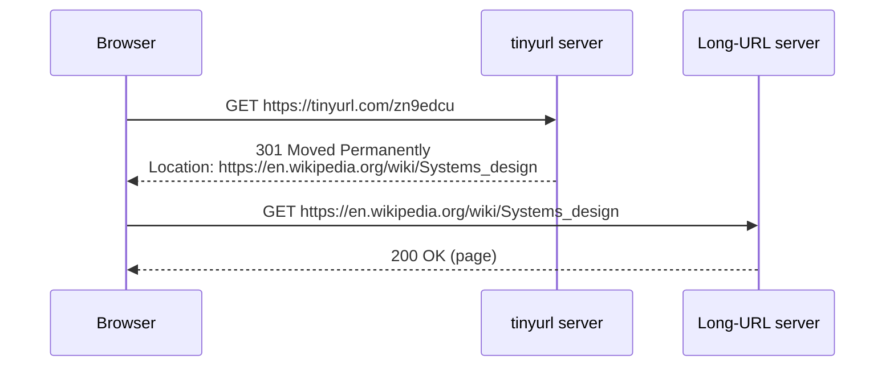
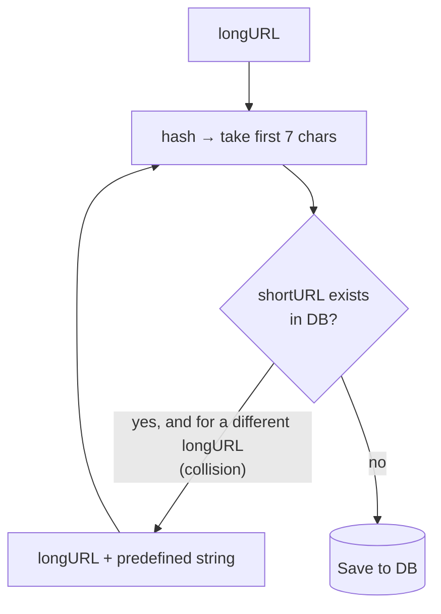
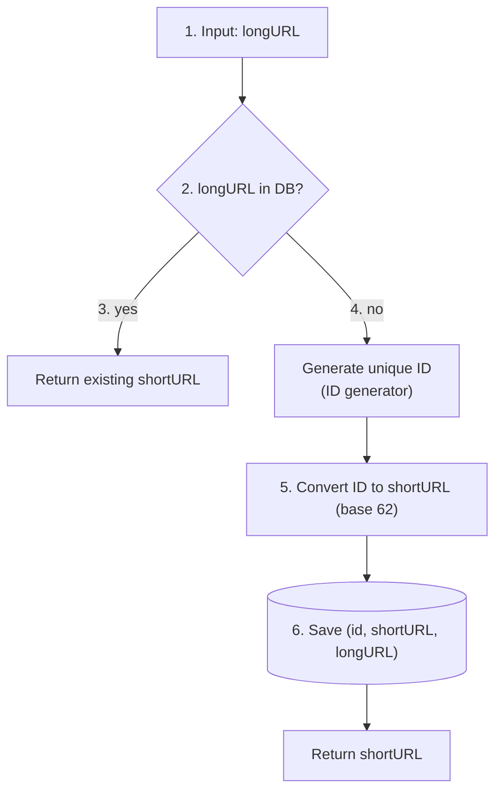
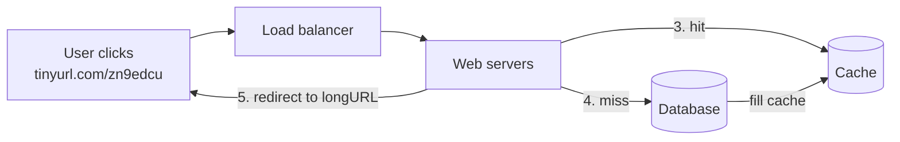

# Design a URL Shortener

> **Adapted from:** Alex Xu, *System Design Interview – An Insider's Guide* (2020), Chapter 8 — rewritten and condensed for teaching.

Designing a URL shortener like **TinyURL** is a classic interview question. It's small enough to cover end to end in one session, and it draws on almost everything so far: [estimation](./back-of-the-envelope-estimation), [caching](./scale-from-zero-to-millions-of-users#step-5-add-a-cache), [unique ID generation](./design-a-unique-id-generator), and [rate limiting](./design-a-rate-limiter).

**What you'll be able to do after this lesson:**

- Estimate QPS and storage for a URL shortener, and catch a classic estimation mistake.
- Design the two REST endpoints and choose between **301** and **302** redirects.
- Work out the shortest code length that fits the expected number of URLs.
- Compare **hash + collision resolution** with **base-62 conversion** and implement both.
- Build the full shorten and redirect flows with a database and a cache.

---

## Step 1: Understand the Problem and Establish Scope

| Candidate asks | Interviewer answers |
|---|---|
| How does it work? | `https://www.systeminterview.com/q=chatsystem&c=loggedin&v=v3&l=long` becomes an alias like `https://tinyurl.com/y7keocwj`. Clicking the alias redirects to the original |
| Traffic volume? | **100 million** URLs generated per day |
| How short? | As short as possible |
| Allowed characters? | `0-9`, `a-z`, `A-Z` |
| Can short URLs be deleted or updated? | No, to keep things simple |

**Use cases:**

1. **URL shortening**: given a long URL, return a much shorter one.
2. **URL redirecting**: given a short URL, redirect to the original.
3. **High availability, scalability, and fault tolerance.**

### Back-of-the-envelope estimation

| Quantity | Calculation | Result |
|---|---|---|
| Writes per second | 100 M ÷ 86,400 s | ≈ **1,160** |
| Reads per second | Assume a 10:1 read-to-write ratio: 1,160 × 10 | ≈ **11,600** |
| Records over 10 years | 100 M × 365 × 10 | **365 billion** |
| Average URL length | Assumption | 100 bytes |
| Storage over 10 years | 365 B records × 100 bytes | **36.5 TB** |

:::caution A classic estimation slip
The book's version of this calculation reads "365 billion × 100 bytes × 10 years = 365 TB." But the **365 billion** already includes the 10 years (100 M/day × 365 days × 10 years), so multiplying by 10 again counts the time twice. The right answer is **36.5 TB**. This is exactly why [Lesson 2](./back-of-the-envelope-estimation#tips-for-the-interview) says to label units at every step: "records" × "bytes/record" gives bytes, and no "years" factor is left to multiply by.
:::

Walk through these numbers with the interviewer so you agree on them before designing.

---

## Step 2: High-Level Design

### API endpoints

Two REST-style endpoints are enough:

**1. Shorten a URL**

```text
POST api/v1/data/shorten
  request body: { "longUrl": "<longURLString>" }
  returns:      shortURL
```

**2. Redirect**

```text
GET api/v1/{shortUrl}
  returns: longURL, sent as an HTTP redirect
```

### URL redirecting

When a browser requests a short URL, the server looks up the long URL and replies with a **redirect status code** and a `Location` header pointing at it:



### 301 vs. 302

| | 301 Moved Permanently | 302 Found (temporary) |
|---|---|---|
| Browser caches the redirect? | **Yes**: repeat visits go straight to the long URL | **No**: every visit goes through the shortener first |
| Load on the shortener | Lower: only the first request per browser | Higher: every click |
| Analytics (click counts, sources) | Hard: repeat clicks aren't seen | **Easy**: every click is observed |
| Pick it when… | Reducing server load matters most | **Analytics** matter |

The simplest redirect implementation is a **hash table** of `<shortURL, longURL>` pairs:

```text
longURL = hashTable.get(shortURL)
return redirect(longURL)
```

### URL shortening

Short URLs look like `www.tinyurl.com/{hashValue}`. We need a function **fx** that maps each long URL to a `hashValue` with two properties:

- Each long URL maps to **one** hash value.
- Each hash value maps **back** to its long URL.

The deep dive designs fx.

### Check: API and redirects

<MultipleChoice
  id="sdi-ch8-redirects"
  title="301 or 302?"
  questions={[
    {
      prompt: 'Marketing wants a dashboard showing every click on each short link, by time and referrer. Which redirect should the service return?',
      choices: ['301 Moved Permanently', '302 Found', '200 OK with the long URL in the body', '404 Not Found'],
      answer: 1,
      why: 'A 302 isn\'t cached by browsers, so every click passes through the shortener, where it can be logged.',
      whyWrong: 'With a 301, browsers cache the redirect and later clicks never reach your servers, so the dashboard would undercount.',
    },
    {
      prompt: 'Why is shortening a POST while redirecting is a GET?',
      choices: [
        'GET requests cannot have parameters',
        'Shortening creates a new resource (a mapping), while redirecting only reads an existing one and is safe to repeat',
        'POST is faster than GET',
        'Browsers can only follow redirects from POST',
      ],
      answer: 1,
      why: 'REST convention: POST creates, GET reads. Redirect lookups have no side effects (analytics aside), so GET fits.',
    },
  ]}
/>

---

## Step 3: Design Deep Dive

### Data model

A hash table in memory is a good starting point, but memory is limited and expensive, and 36.5 TB won't fit. Store the mapping in a **relational database** instead:

| Column | Type | Notes |
|---|---|---|
| `id` | bigint, primary key | Unique ID from the ID generator |
| `shortURL` | varchar(7) | The hash value (indexed) |
| `longURL` | varchar | The original URL (indexed, for de-duplication) |

### Hash value length

The code uses `[0-9a-zA-Z]`: 10 + 26 + 26 = **62 characters**. We need the **smallest n** with 62ⁿ ≥ 365 billion.

| n | Maximum number of URLs (62ⁿ) |
|---|---|
| 1 | 62 |
| 2 | 3,844 |
| 3 | 238,328 |
| 4 | 14,776,336 |
| 5 | 916,132,832 |
| 6 | 56,800,235,584 |
| **7** | **3,521,614,606,208 ≈ 3.5 trillion** |
| 8 | 218,340,105,584,896 |

n = 6 gives about 56.8 billion, which is too few. **n = 7 gives about 3.5 trillion**, comfortably above 365 billion. So the hash value is **7 characters**.

There are two ways to produce it.

### Approach 1: Hash + collision resolution

Use a standard hash function and keep the first 7 characters. Even the shortest common hash is too long to use whole. For `https://en.wikipedia.org/wiki/Systems_design`:

| Hash function | Hash value (hex) |
|---|---|
| CRC32 | `5cb54054` |
| MD5 | `5a62509a84df9ee03fe1230b9df8b84e` |
| SHA-1 | `0eeae7916c06853901d9ccbefbfcaf4de57ed85b` |

**Truncating to 7 characters causes collisions**: two different URLs can share a prefix. The fix is to **append a predefined string** to the URL and hash again, repeating until the code is free:



This removes collisions, but it means a **database lookup for every attempt**. A **Bloom filter** in front of the database can answer "definitely not taken" without touching the database. (See [Lesson 6's read path](./design-a-key-value-store#read-path) for how Bloom filters behave.)

#### Practice: hash + collision resolution

Implement `shorten(long_url, db)`. `db` maps codes to long URLs.

1. Hash a **candidate** string (initially the long URL) with MD5 and take the first 7 hex characters.
2. If that code is **not in `db`**, store `db[code] = long_url` (the original URL, not the candidate) and return the code.
3. If it's **already mapped to the same `long_url`**, return it (the URL was shortened before).
4. Otherwise it's a **collision**: append `"!"` to the candidate and repeat.

Input: line 1 lists existing `code=url` pairs (it may be empty), and line 2 lists the URLs to shorten.

<CodeExercise
  title="Hash + collision resolution"
  heading="exercise-sdi-hash-collision"
  lang="python"
  filename="main.py"
  prompt="Implement shorten(long_url, db) using md5(candidate).hexdigest()[:7]. On a collision with a different URL, append '!' to the candidate and rehash. Store and return the first free code; return the existing code if the same long_url is already stored under it."
  sampleLog={`66ccb49=https://other.com
https://a.com
https://a.com -> eb63972`}
  starter={`import hashlib

SALT = '!'

def shorten(long_url, db):
    pass
`}
  wrapSuffix={`
import sys
lines = sys.stdin.read().split('\\n')
db = {}
for pair in lines[0].split():
    code, url = pair.split('=', 1)
    db[code] = url
for url in lines[1].split():
    print(url, '->', shorten(url, db))
`}
  hint="Loop: code = hashlib.md5(candidate.encode()).hexdigest()[:7]. If code not in db, store and return. If db[code] == long_url, return code. Else candidate += SALT."
  solution={`import hashlib

SALT = '!'

def shorten(long_url, db):
    candidate = long_url
    while True:
        code = hashlib.md5(candidate.encode()).hexdigest()[:7]
        if code not in db:
            db[code] = long_url
            return code
        if db[code] == long_url:
            return code
        candidate += SALT
`}
  tests={[
    { name: 'no collision', stdin: '\nhttps://a.com https://b.com', equals: 'https://a.com -> 66ccb49\nhttps://b.com -> dda3424' },
    { name: 'one collision', stdin: '66ccb49=https://other.com\nhttps://a.com', equals: 'https://a.com -> eb63972' },
    { name: 'two collisions in a row', stdin: '66ccb49=https://x.com eb63972=https://y.com\nhttps://a.com', equals: 'https://a.com -> 18f0721' },
    { name: 'same URL twice returns the same code', stdin: '\nhttps://a.com https://a.com', equals: 'https://a.com -> 66ccb49\nhttps://a.com -> 66ccb49' },
  ]}
/>

### Approach 2: Base-62 conversion

Give each URL a **unique integer ID** and write that number in **base 62**, the same way you'd write it in base 10 or base 16, but with 62 digits:

```text
0–9 → '0'–'9'     10–35 → 'a'–'z'     36–61 → 'A'–'Z'
```

**Example:** convert 11157 (base 10) to base 62 by repeated division:

| Step | Division | Quotient | Remainder → digit |
|---|---|---|---|
| 1 | 11157 ÷ 62 | 179 | 59 → `X` |
| 2 | 179 ÷ 62 | 2 | 55 → `T` |
| 3 | 2 ÷ 62 | 0 | 2 → `2` |

Read the remainders from bottom to top: **`2TX`**. As a check, 2 × 62² + 55 × 62¹ + 59 × 62⁰ = 7,688 + 3,410 + 59 = 11,157. The short URL is `https://tinyurl.com/2TX`.

#### Practice: base-62 encode and decode

Implement `encode(n)` and `decode(s)` with the alphabet above. `encode(0)` returns `'0'`.

<CodeExercise
  title="Base-62 conversion"
  heading="exercise-sdi-base62"
  lang="python"
  filename="main.py"
  prompt="Implement encode(n) (non-negative int → base-62 string; encode(0) == '0') and decode(s) (base-62 string → int) using ALPHABET = 0-9, a-z, A-Z."
  sampleLog={`11157
2TX 11157`}
  starter={`ALPHABET = '0123456789abcdefghijklmnopqrstuvwxyzABCDEFGHIJKLMNOPQRSTUVWXYZ'

def encode(n):
    # Repeatedly divmod by 62; remainders are digits from least significant.
    pass

def decode(s):
    pass
`}
  wrapSuffix={`
import sys
for line in sys.stdin.read().split():
    code = encode(int(line))
    print(code, decode(code))
`}
  hint="encode: while n > 0: n, r = divmod(n, 62); prepend ALPHABET[r]. decode: n = n * 62 + ALPHABET.index(ch) for each ch."
  solution={`ALPHABET = '0123456789abcdefghijklmnopqrstuvwxyzABCDEFGHIJKLMNOPQRSTUVWXYZ'

def encode(n):
    if n == 0:
        return '0'
    digits = []
    while n > 0:
        n, r = divmod(n, 62)
        digits.append(ALPHABET[r])
    return ''.join(reversed(digits))

def decode(s):
    n = 0
    for ch in s:
        n = n * 62 + ALPHABET.index(ch)
    return n
`}
  tests={[
    { name: 'book example', stdin: '11157', equals: '2TX 11157' },
    { name: 'deep-dive example ID', stdin: '2009215674938', equals: 'zn9edcu 2009215674938' },
    { name: 'zero and single digits', stdin: '0\n9\n10\n61', equals: '0 0\n9 9\na 10\nZ 61' },
    { name: 'digit rollover', stdin: '62\n3843\n3844', equals: '10 62\nZZ 3843\n100 3844' },
    { name: 'largest 7-character code', stdin: '3521614606207', equals: 'ZZZZZZZ 3521614606207' },
  ]}
/>

### Comparing the two approaches

| Hash + collision resolution | Base-62 conversion |
|---|---|
| **Fixed** code length (always 7) | Length **grows** with the ID (`2TX` is 3 characters, and IDs above 62⁷ − 1 need 8) |
| **No** unique ID generator needed | **Depends on** a unique ID generator |
| Collisions possible and must be resolved | **No collisions**, because IDs are unique |
| Can't predict the next code (it's a hash) | If IDs increase by 1, the next code is **easy to guess**, which is a security and privacy concern |

### Check: code length and approach

<MultipleChoice
  id="sdi-ch8-hashing"
  title="Choosing a code scheme"
  questions={[
    {
      prompt: 'A service expects 50 billion URLs ever. Using 62 characters, what is the shortest code length that fits?',
      choices: ['5', '6', '7', '8'],
      answer: 1,
      why: '62⁵ ≈ 0.92 billion is too small, while 62⁶ ≈ 56.8 billion ≥ 50 billion. Six characters suffice.',
    },
    {
      prompt: 'A competitor scrapes every short link by requesting /1, /2, /3, …. Which design choice made this possible?',
      choices: [
        'Using a 302 redirect',
        'Base-62 encoding of sequential IDs, which makes codes predictable',
        'Storing mappings in a cache',
        'Using MD5',
      ],
      answer: 1,
      why: 'Sequential IDs produce sequential codes. Using non-sequential IDs (such as Snowflake) or a hashing scheme avoids enumeration.',
    },
    {
      prompt: 'Why does "hash + collision resolution" usually put a Bloom filter in front of the database?',
      choices: [
        'To encrypt the URLs',
        'To answer "this code is definitely unused" from memory, skipping most database lookups during collision checks',
        'To make hash values shorter',
        'To store the long URLs',
      ],
      answer: 1,
      why: 'Every candidate code needs an existence check. A Bloom filter turns most of those checks into fast in-memory "no" answers, with no false negatives.',
    },
  ]}
/>

---

### URL shortening deep dive

Our design uses **base-62 conversion**:



1. A long URL comes in.
2. Check whether it's already in the database.
3. If it is, return the existing short URL. Don't create duplicates.
4. Otherwise, get a new unique ID from the **unique ID generator**.
5. Convert the ID to a short URL with base 62.
6. Save a new row with the ID, short URL, and long URL.

**Worked example:**

| id | shortURL | longURL |
|---|---|---|
| 2009215674938 | zn9edcu | https://en.wikipedia.org/wiki/Systems_design |

The ID generator returns `2009215674938`, which base 62 converts to `zn9edcu`. Generating globally unique IDs in a distributed system is exactly the problem [Lesson 7](./design-a-unique-id-generator) solved.

### URL redirecting deep dive

Reads outnumber writes about **10 to 1**, so the `<shortURL, longURL>` mapping is **cached**:



1. A user clicks `https://tinyurl.com/zn9edcu`.
2. The load balancer forwards the request to a web server.
3. If the short URL is in the **cache**, return the long URL immediately.
4. Otherwise, fetch it from the **database** and fill the cache. If it isn't in the database either, the code is invalid, so return 404.
5. Return the long URL to the user as a redirect.

#### Practice: the full service

Build a `URLShortener` that combines both flows. The `encode` function is provided.

- `shorten(long_url)`: if the long URL was already shortened, return its existing code. Otherwise take `self.next_id`, increment it, encode it in base 62, and store the mapping in `self.db`.
- `resolve(code)`: return `(long_url, 'cache')` on a cache hit. On a cache miss with a database hit, fill the cache and return `(long_url, 'db')`. Otherwise return `(None, 'missing')`.

Input: line 1 is the starting ID, and each following line is `shorten <url>` or `get <code>`.

<CodeExercise
  title="URL shortener service"
  heading="exercise-sdi-url-service"
  lang="python"
  filename="main.py"
  prompt="Implement URLShortener.shorten (de-duplicate by long URL; otherwise allocate next_id, base-62 encode, store) and URLShortener.resolve (cache → db with cache fill → missing)."
  sampleLog={`2009215674938
shorten https://en.wikipedia.org/wiki/Systems_design
get zn9edcu
get zn9edcu
shorten https://en.wikipedia.org/wiki/Systems_design -> zn9edcu
get zn9edcu -> https://en.wikipedia.org/wiki/Systems_design (db)
get zn9edcu -> https://en.wikipedia.org/wiki/Systems_design (cache)`}
  starter={`ALPHABET = '0123456789abcdefghijklmnopqrstuvwxyzABCDEFGHIJKLMNOPQRSTUVWXYZ'

def encode(n):
    if n == 0:
        return '0'
    digits = []
    while n > 0:
        n, r = divmod(n, 62)
        digits.append(ALPHABET[r])
    return ''.join(reversed(digits))

class URLShortener:
    def __init__(self, start_id):
        self.next_id = start_id
        self.db = {}        # shortURL -> longURL
        self.by_long = {}   # longURL -> shortURL (index for de-duplication)
        self.cache = {}     # shortURL -> longURL

    def shorten(self, long_url):
        pass

    def resolve(self, code):
        pass
`}
  wrapSuffix={`
import sys
lines = sys.stdin.read().split('\\n')
svc = URLShortener(int(lines[0]))
for line in lines[1:]:
    cmd, arg = line.split(' ', 1)
    if cmd == 'shorten':
        print(f'shorten {arg} -> {svc.shorten(arg)}')
    else:
        url, source = svc.resolve(arg)
        print(f'get {arg} -> 404' if url is None else f'get {arg} -> {url} ({source})')
`}
  hint="shorten: check self.by_long first. resolve: check self.cache, then self.db (copy into self.cache on a hit), else return (None, 'missing')."
  solution={`ALPHABET = '0123456789abcdefghijklmnopqrstuvwxyzABCDEFGHIJKLMNOPQRSTUVWXYZ'

def encode(n):
    if n == 0:
        return '0'
    digits = []
    while n > 0:
        n, r = divmod(n, 62)
        digits.append(ALPHABET[r])
    return ''.join(reversed(digits))

class URLShortener:
    def __init__(self, start_id):
        self.next_id = start_id
        self.db = {}        # shortURL -> longURL
        self.by_long = {}   # longURL -> shortURL (index for de-duplication)
        self.cache = {}     # shortURL -> longURL

    def shorten(self, long_url):
        if long_url in self.by_long:
            return self.by_long[long_url]
        code = encode(self.next_id)
        self.next_id += 1
        self.db[code] = long_url
        self.by_long[long_url] = code
        return code

    def resolve(self, code):
        if code in self.cache:
            return self.cache[code], 'cache'
        if code in self.db:
            self.cache[code] = self.db[code]
            return self.db[code], 'db'
        return None, 'missing'
`}
  tests={[
    { name: 'worked example: db then cache', stdin: '2009215674938\nshorten https://en.wikipedia.org/wiki/Systems_design\nget zn9edcu\nget zn9edcu', equals: 'shorten https://en.wikipedia.org/wiki/Systems_design -> zn9edcu\nget zn9edcu -> https://en.wikipedia.org/wiki/Systems_design (db)\nget zn9edcu -> https://en.wikipedia.org/wiki/Systems_design (cache)' },
    { name: 'de-duplicate repeated long URLs', stdin: '61\nshorten https://a.com\nshorten https://b.com\nshorten https://a.com\nget 10\nget Z\nget Z', equals: 'shorten https://a.com -> Z\nshorten https://b.com -> 10\nshorten https://a.com -> Z\nget 10 -> https://b.com (db)\nget Z -> https://a.com (db)\nget Z -> https://a.com (cache)' },
    { name: 'unknown and case-sensitive codes are 404', stdin: '100\nget abc\nshorten https://x.io\nget 1C\nget 1c', equals: 'get abc -> 404\nshorten https://x.io -> 1C\nget 1C -> https://x.io (db)\nget 1c -> 404' },
  ]}
/>

Notice the last test: `1C` and `1c` are **different codes**. Base 62 depends on case, so any layer that lower-cases paths (some proxies and CDNs do) would break links.

### Check: flows

<MultipleChoice
  id="sdi-ch8-flows"
  title="Shorten and redirect flows"
  questions={[
    {
      type: 'order',
      prompt: 'Order the URL shortening flow for a new long URL (top = first):',
      items: [
        'Receive the long URL',
        'Check whether the long URL is already in the database',
        'Get a new unique ID from the ID generator',
        'Convert the ID to a short URL with base 62',
        'Save (id, shortURL, longURL) and return the short URL',
      ],
      why: 'The de-duplication check must come before allocating an ID, so you don\'t waste IDs or create two codes for one URL. Base 62 needs the ID, and the row needs the code.',
      whyWrong: 'Ask what each step needs: you can\'t encode an ID you haven\'t generated, and the dedupe check should run before you generate one.',
    },
    {
      prompt: 'Why is a cache especially effective for redirects?',
      choices: [
        'Redirects are writes',
        'Mappings never change (no updates or deletes) and reads outnumber writes about 10:1, so cached entries never go stale and get reused often',
        'Caches are required for 301 responses',
        'The database cannot store short URLs',
      ],
      answer: 1,
      why: 'Immutable data with a high read ratio is the ideal case for caching. There is no invalidation problem at all.',
    },
  ]}
/>

---

## Step 4: Wrap Up

We covered the API design, data model, hash function choices, and the shortening and redirecting flows. Extra talking points:

- **Rate limiter.** Malicious users could flood the shortening endpoint. Throttle by IP or other rules, as in [Lesson 4](./design-a-rate-limiter).
- **Web server scaling.** The web tier is **stateless**, so add or remove servers freely.
- **Database scaling.** Use **replication** for read throughput and **sharding** for size. Sharding by short URL keeps redirect lookups on a single shard.
- **Analytics.** How many people click each link, and when? Pair this with **302** redirects so clicks are visible.
- **Availability, consistency, and reliability**: the foundations from [Lesson 1](./scale-from-zero-to-millions-of-users).

---

## Key Takeaways

- About 1,160 writes/s and 11,600 reads/s. 365 billion URLs over 10 years at 100 bytes each is **36.5 TB**, not 365 TB.
- **301** reduces load but hides repeat clicks. **302** costs more requests but enables analytics.
- 62ⁿ ≥ 365 billion gives **n = 7** (about 3.5 trillion codes).
- **Hash + collision resolution** gives fixed-length codes but needs existence checks, ideally behind a Bloom filter. **Base 62 of a unique ID** never collides but can be guessable if IDs are sequential.
- Shortening: **dedupe → ID → base 62 → save**. Redirecting: **cache → DB → 404**.

Previous lesson: [Design a Unique ID Generator](./design-a-unique-id-generator).

Next lesson: [Design a Web Crawler](./design-a-web-crawler) — the crawl pipeline, a polite and prioritized URL frontier, robots.txt, and defending against duplicates and spider traps.

---

## Reference Materials

1. [A RESTful Tutorial](https://www.restapitutorial.com/index.html)
2. [Bloom filter](https://en.wikipedia.org/wiki/Bloom_filter) — Wikipedia
