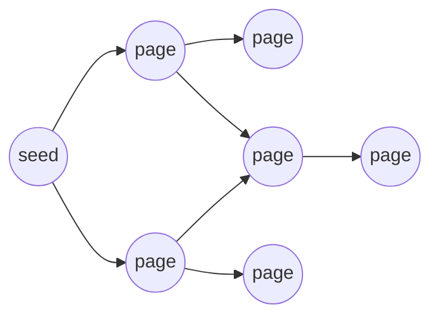
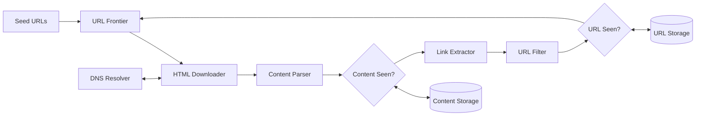
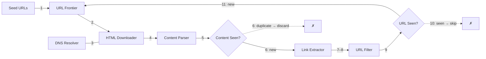
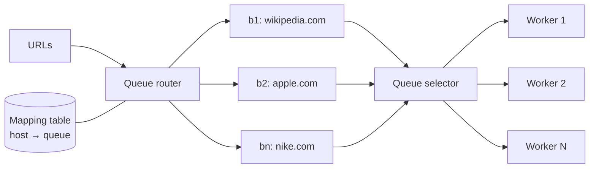
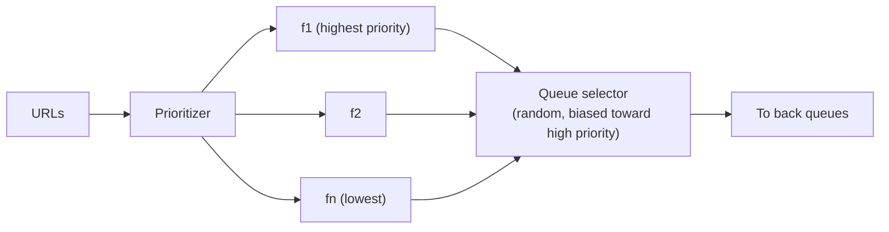
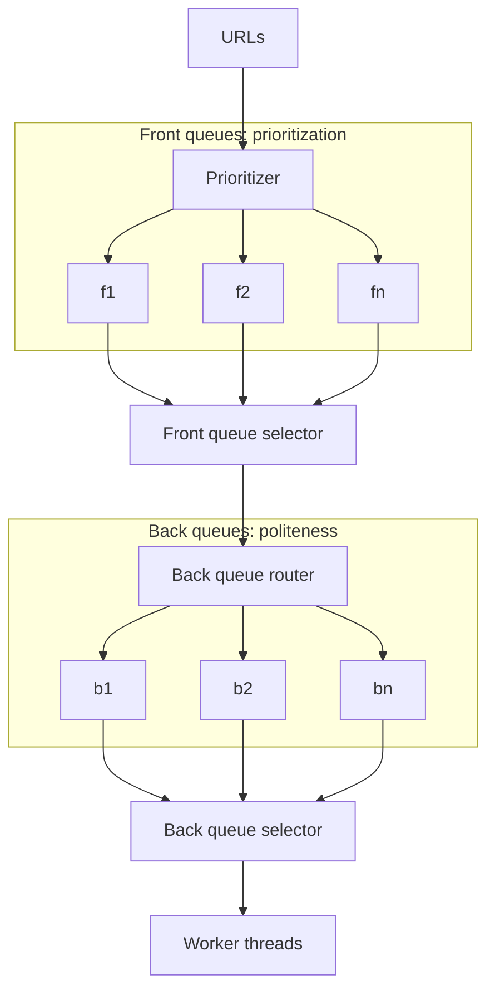
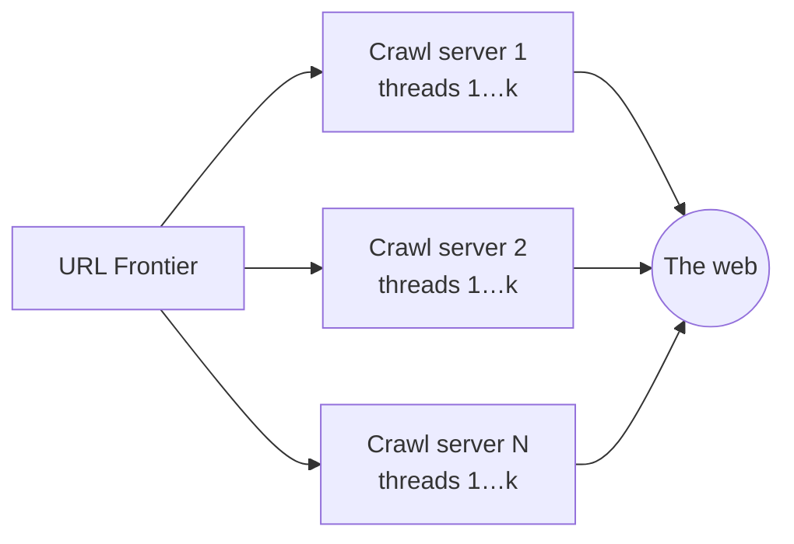
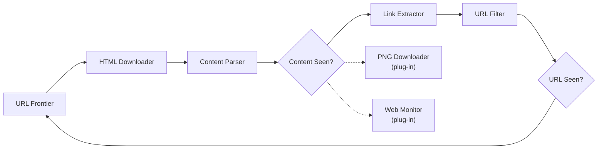

# Design a Web Crawler

> **Adapted from:** Alex Xu, *System Design Interview – An Insider's Guide* (2020), Chapter 9 — rewritten and condensed for teaching.

A **web crawler**, also called a robot or spider, discovers new and updated content on the web: pages, images, videos, PDFs. It starts from a few pages, follows their links to more pages, follows *those* links, and so on.



**What crawlers are used for:**

- **Search engine indexing.** The most common use: collect pages to build a search index. Googlebot crawls for Google Search.
- **Web archiving.** Preserve the web for the future. National libraries, such as the US Library of Congress and the EU web archive, run crawlers.
- **Web mining.** Extract knowledge from the web. For example, financial firms crawl shareholder-meeting transcripts and annual reports.
- **Web monitoring.** Find copyright and trademark infringement. Digimarc, for example, crawls to discover pirated works.

How hard this is depends on scale. A school-project crawler takes an afternoon, while a search-engine crawler keeps a dedicated team busy indefinitely.

**What you'll be able to do after this lesson:**

- Size a crawler and name the qualities a good one needs: scalable, robust, polite, and extensible.
- Trace a URL through the full pipeline, from frontier to downloader to parser to "seen?" checks and back to the frontier.
- Design a URL frontier that enforces **politeness** (back queues), **priority** (front queues), and **freshness**.
- Implement link extraction, robots.txt checks, a polite frontier, and a de-duplicating BFS crawl.

---

## Step 1: Understand the Problem and Establish Scope

The core algorithm fits in three lines:

1. Given a set of URLs, download all their pages.
2. Extract URLs from those pages.
3. Add the new URLs to the to-download list, and repeat.

Doing that at web scale is another matter. Clarify first:

| Candidate asks | Interviewer answers |
|---|---|
| Purpose: search indexing, data mining, something else? | Search engine indexing |
| How many pages per month? | **1 billion** |
| Content types? | **HTML only** |
| Handle new and edited pages? | **Yes** |
| Store the crawled HTML? | **Yes, for up to 5 years** |
| Duplicate content? | **Ignore** pages with duplicate content |

Even for a "simple" product, you and the interviewer can start with different assumptions. That's why you ask.

### Qualities of a good crawler

- **Scalability.** The web has billions of pages, so crawling must be massively **parallel**.
- **Robustness.** The web is full of traps: bad HTML, unresponsive servers, crashes, malicious links. Handle them all without falling over.
- **Politeness.** Don't send a website too many requests in a short time.
- **Extensibility.** Supporting a new content type, such as images, should take a new module, not a redesign.

### Back-of-the-envelope estimation

| Quantity | Calculation | Result |
|---|---|---|
| Pages per second | 1,000,000,000 ÷ 30 days ÷ 86,400 s | ≈ 386, round to **~400** |
| Peak QPS | 2 × 400 | **~800** |
| Average page size | Assumption | 500 KB |
| Storage per month | 1 B pages × 500 KB | **500 TB** |
| Storage over 5 years | 500 TB × 12 months × 5 years | **30 PB** |

(Here the "× 12 × 5" is correct, because the 500 TB is a *monthly* figure. Compare the double-counting slip in [Lesson 8](./design-a-url-shortener#back-of-the-envelope-estimation).)

---

## Step 2: High-Level Design



### The components

- **Seed URLs.** Where the crawl starts. For one university's site, the seed is just its domain. For the whole web, pick seeds that reach as many links as possible by **dividing the URL space**: by **locality** (different countries have different popular sites) or by **topic** (shopping, sports, healthcare, …). There's no perfect answer, so think out loud.
- **URL Frontier.** Crawl state splits into *to be downloaded* and *already downloaded*. The frontier holds the first group. For now, think of it as a **FIFO queue**. The deep dive refines it.
- **HTML Downloader.** Fetches the pages at the URLs the frontier hands it.
- **DNS Resolver.** Turns a hostname into an IP address before download. For example, `www.wikipedia.org` resolved to `198.35.26.96` in March 2019.
- **Content Parser.** Parses and validates pages, because malformed HTML causes problems and wastes storage. It is a **separate component** so parsing doesn't slow the crawl servers down.
- **Content Seen?** About **29%** of web pages are duplicate content. Comparing pages character by character is far too slow at billions of pages, so compare **hashes** of the pages instead, and discard content that has already been stored.
- **Content Storage.** Mostly **on disk**, because the data set is enormous, with **popular content in memory** to cut latency.
- **URL Extractor.** Pulls links out of HTML and turns **relative** paths into **absolute** URLs. For example, `/wiki/Cong_Weixi` on a Wikipedia page becomes `https://en.wikipedia.org/wiki/Cong_Weixi`.
- **URL Filter.** Drops unwanted content types, file extensions, error links, and URLs on blocklisted sites.
- **URL Seen?** Tracks URLs already visited **or already in the frontier**, so the same URL isn't added twice. That avoids wasted load and **infinite loops**. It is typically a **Bloom filter** or a hash table.
- **URL Storage.** Stores the URLs already visited.

#### Practice: extract and filter links

Implement `extract_links(base_url, html, max_len)`:

1. Collect the `href` of every `<a>` tag. Python's `html.parser.HTMLParser` is in the standard library.
2. Resolve each one against `base_url` with `urllib.parse.urljoin`, then strip any `#fragment` with `urldefrag`.
3. **Filter**: keep only `http`/`https`, drop paths ending in `.jpg .jpeg .png .gif .pdf .zip` (case-insensitive), and drop URLs longer than `max_len`. The length cap is a cheap guard against spider traps.
4. **De-duplicate**, keeping first-seen order.

Input: line 1 is `base_url max_len`, and the remaining lines are HTML.

<CodeExercise
  title="Link extractor + URL filter"
  heading="exercise-sdi-extract-links"
  lang="python"
  filename="main.py"
  prompt="Implement extract_links(base_url, html, max_len): collect <a href> values, make them absolute with urljoin, strip fragments, keep only http/https, drop blocked extensions and URLs longer than max_len, and de-duplicate in order."
  sampleLog={`https://en.wikipedia.org/wiki/Main_Page 200
<p><a href="/wiki/Cong_Weixi">Cong</a> <a href="/wiki/Kay_Hagan#Career">K</a></p>
https://en.wikipedia.org/wiki/Cong_Weixi
https://en.wikipedia.org/wiki/Kay_Hagan`}
  starter={`from html.parser import HTMLParser
from urllib.parse import urljoin, urldefrag, urlparse

BLOCKED = ('.jpg', '.jpeg', '.png', '.gif', '.pdf', '.zip')

def extract_links(base_url, html, max_len):
    pass
`}
  wrapSuffix={`
import sys
lines = sys.stdin.read().split('\\n')
base, max_len = lines[0].split()
for url in extract_links(base, '\\n'.join(lines[1:]), int(max_len)):
    print(url)
`}
  hint="Subclass HTMLParser with handle_starttag(self, tag, attrs) that appends dict(attrs).get('href') for 'a' tags. Then for each href: url, _ = urldefrag(urljoin(base_url, href)) and apply the filters with urlparse(url).scheme / .path.lower()."
  solution={`from html.parser import HTMLParser
from urllib.parse import urljoin, urldefrag, urlparse

BLOCKED = ('.jpg', '.jpeg', '.png', '.gif', '.pdf', '.zip')

class _LinkParser(HTMLParser):
    def __init__(self):
        super().__init__()
        self.hrefs = []

    def handle_starttag(self, tag, attrs):
        if tag == 'a':
            href = dict(attrs).get('href')
            if href:
                self.hrefs.append(href)

def extract_links(base_url, html, max_len):
    parser = _LinkParser()
    parser.feed(html)
    result = []
    for href in parser.hrefs:
        url, _ = urldefrag(urljoin(base_url, href))
        parts = urlparse(url)
        if parts.scheme not in ('http', 'https'):
            continue
        if parts.path.lower().endswith(BLOCKED):
            continue
        if len(url) > max_len:
            continue
        if url not in result:
            result.append(url)
    return result
`}
  tests={[
    { name: 'relative links and fragments', stdin: 'https://en.wikipedia.org/wiki/Main_Page 200\n<p><a href="/wiki/Cong_Weixi">Cong</a> <a href="/wiki/Kay_Hagan#Career">K</a></p>', equals: 'https://en.wikipedia.org/wiki/Cong_Weixi\nhttps://en.wikipedia.org/wiki/Kay_Hagan' },
    { name: 'filters: mailto, images, duplicates; external kept', stdin: 'https://en.wikipedia.org/wiki/Main_Page 200\n<a href="/wiki/Cong_Weixi">a</a> <a href="https://example.org/x">b</a> <a href="mailto:a@b.c">c</a> <a href="/img/logo.PNG">d</a> <a href="/wiki/Cong_Weixi">e</a>', equals: 'https://en.wikipedia.org/wiki/Cong_Weixi\nhttps://example.org/x' },
    { name: 'relative paths and the spider-trap length cap', stdin: 'https://site.com/a/b/ 40\n<a href="c">c</a><a href="../d">d</a><a href="/foo/bar/foo/bar/foo/bar/foo/bar/">trap</a>', equals: 'https://site.com/a/b/c\nhttps://site.com/a/d' },
  ]}
/>

### The crawl workflow



1. Add the **seed URLs** to the frontier.
2. The downloader takes a batch of URLs from the **frontier**.
3. It resolves their IPs with the **DNS resolver** and downloads the pages.
4. The **content parser** parses each page and rejects malformed ones.
5. Valid content goes to **Content Seen?**
6. If the same content is already stored (under a different URL), **discard** the page. Otherwise pass it to the link extractor.
7. The **link extractor** pulls out the links.
8. They go to the **URL filter**.
9. Surviving links go to **URL Seen?**
10. If a URL has been seen before, do nothing.
11. Otherwise, **add it to the frontier**.

### Check: components and workflow

<MultipleChoice
  id="sdi-ch9-components"
  title="Crawler components"
  questions={[
    {
      prompt: 'Two different URLs return byte-for-byte identical HTML. Which component stops the second copy from being stored and re-processed?',
      choices: ['URL Seen?', 'Content Seen?', 'URL Filter', 'DNS Resolver'],
      answer: 1,
      why: 'The URLs differ, so URL Seen? lets both through. Content Seen? compares content hashes and discards the duplicate.',
      whyWrong: 'URL Seen? de-duplicates URLs, not content. Mirrors and URL aliases get past it.',
    },
    {
      prompt: 'Why does URL Seen? record URLs that are already in the frontier, not just those already downloaded?',
      choices: [
        'To save disk space in Content Storage',
        'Otherwise a popular URL linked from many pages would be queued many times before its first download, wasting work and risking loops',
        'Because the frontier cannot store strings',
        'To speed up DNS resolution',
      ],
      answer: 1,
      why: 'Marking a URL as "seen" when it is enqueued, not when it is fetched, is what keeps each URL in the queue once.',
    },
    {
      prompt: 'Why compare page hashes instead of comparing pages character by character?',
      choices: [
        'Hashes are more accurate',
        'Comparing each new page against billions of stored pages character by character is far too slow. A fixed-size hash can be looked up in a set instantly',
        'HTML cannot be compared as text',
        'Hashes compress the pages for storage',
      ],
      answer: 1,
      why: 'Hashing turns "have we seen this content?" into a set lookup.',
    },
  ]}
/>

---

## Step 3: Design Deep Dive

### DFS vs. BFS

The web is a **directed graph**: pages are nodes and links are edges. Crawling is a graph traversal.

- **DFS** is usually a poor choice, because the depth can be enormous and the crawler disappears down one site's rabbit hole.
- **BFS**, with a **FIFO queue**, is the standard choice, but plain BFS has two problems:
  1. **It's impolite.** Most links on a page point to the **same host**. BFS of Wikipedia fills the queue with Wikipedia URLs, and parallel downloaders then flood Wikipedia's servers.
  2. **It ignores priority.** Pages differ hugely in quality and importance. We'd like to rank URLs by PageRank, traffic, update frequency, and so on.

The **URL frontier** fixes both.

### URL frontier

The frontier stores the URLs waiting to be downloaded, and it is where **politeness**, **priority**, and **freshness** are enforced.

#### Politeness: back queues

Sending a host too many requests at once is rude, and can look like a **DoS attack**. The rule is to **download one page at a time per host**, optionally with a **delay** between downloads.



- **Queue router**: ensures each queue (b1 … bn) holds URLs from **one host** only.
- **Mapping table**: maps each host to its queue.
- **FIFO queues b1 … bn**: one per host.
- **Queue selector**: assigns each worker thread to a queue. A worker downloads only from its own queue.
- **Workers 1 … N**: download one page at a time from their host, with an optional delay between downloads.

#### Practice: a polite frontier

Implement `PoliteFrontier` with:

- `add(url)`: route the URL to its **host's FIFO queue** (the host is `urlparse(url).netloc`). Queues are created in first-seen order.
- `next_batch()`: take **one URL from each non-empty host queue**, in queue creation order, and remove queues that become empty. Each batch is one "round" of parallel downloads that never hits the same host twice.

<CodeExercise
  title="Polite URL frontier"
  heading="exercise-sdi-polite-frontier"
  lang="python"
  filename="main.py"
  prompt="Implement PoliteFrontier.add(url) (route to a per-host FIFO queue, hosts in first-seen order) and next_batch() (pop one URL from each non-empty host queue, drop emptied queues, return the list)."
  sampleLog={`https://wiki.org/a https://wiki.org/b https://news.com/1
round 1: https://wiki.org/a https://news.com/1
round 2: https://wiki.org/b`}
  starter={`from collections import deque, OrderedDict
from urllib.parse import urlparse

class PoliteFrontier:
    def __init__(self):
        self.queues = OrderedDict()   # host -> deque of URLs

    def add(self, url):
        pass

    def next_batch(self):
        pass
`}
  wrapSuffix={`
import sys
frontier = PoliteFrontier()
for url in sys.stdin.read().split():
    frontier.add(url)
n = 0
while True:
    batch = frontier.next_batch()
    if not batch:
        break
    n += 1
    print(f'round {n}:', ' '.join(batch))
`}
  hint="add: self.queues.setdefault(host, deque()).append(url). next_batch: loop over list(self.queues), popleft from each, and del the host if its deque is now empty."
  solution={`from collections import deque, OrderedDict
from urllib.parse import urlparse

class PoliteFrontier:
    def __init__(self):
        self.queues = OrderedDict()   # host -> deque of URLs

    def add(self, url):
        host = urlparse(url).netloc
        self.queues.setdefault(host, deque()).append(url)

    def next_batch(self):
        batch = []
        for host in list(self.queues):
            batch.append(self.queues[host].popleft())
            if not self.queues[host]:
                del self.queues[host]
        return batch
`}
  tests={[
    { name: 'BFS-style burst on one host is spread out', stdin: 'https://wiki.org/a https://wiki.org/b https://wiki.org/c https://news.com/1 https://wiki.org/d https://shop.io/x https://news.com/2', equals: 'round 1: https://wiki.org/a https://news.com/1 https://shop.io/x\nround 2: https://wiki.org/b https://news.com/2\nround 3: https://wiki.org/c\nround 4: https://wiki.org/d' },
    { name: 'all different hosts: one round', stdin: 'https://a.com/1 https://b.com/1 https://c.com/1', equals: 'round 1: https://a.com/1 https://b.com/1 https://c.com/1' },
    { name: 'single host: strictly one at a time', stdin: 'https://a.com/1 https://a.com/2 https://a.com/3', equals: 'round 1: https://a.com/1\nround 2: https://a.com/2\nround 3: https://a.com/3' },
  ]}
/>

In the first test, plain BFS would have downloaded `wiki.org/a`, `b`, and `c` at the same time. The polite frontier never touches one host twice in a round, and the long single-host tail at the end (rounds 3–4) is the price of being polite.

#### Priority: front queues

A random forum post that mentions Apple matters far less than Apple's home page, even though both contain the word "Apple." Rank URLs by **usefulness**: **PageRank**, website traffic, update frequency, and so on.



- **Prioritizer**: computes each URL's priority.
- **Queues f1 … fn**: one per priority level.
- **Queue selector**: picks a queue **at random, biased toward high priority**, so important pages come first but low-priority pages are never starved.

#### The complete frontier



**Front queues** decide *what's important*. **Back queues** decide *what's allowed right now*, given politeness.

#### Freshness

Pages are constantly added, changed, and deleted, so the crawler must **recrawl**. Recrawling everything is too expensive, so:

- Recrawl based on each page's **update history**: pages that change often get revisited often.
- Recrawl **important** pages first and more frequently.

#### Storage for the frontier

A search-engine frontier can hold **hundreds of millions** of URLs. Keeping them all in memory isn't durable or scalable, and keeping them all on disk makes the disk a bottleneck. Use a **hybrid**: store most URLs **on disk**, with **in-memory buffers** for enqueue and dequeue that are flushed to disk periodically.

### Check: frontier design

<MultipleChoice
  id="sdi-ch9-frontier"
  title="Politeness, priority, freshness"
  questions={[
    {
      prompt: 'Why is plain BFS considered impolite for a parallel crawler?',
      choices: [
        'BFS downloads pages in random order',
        'Most links point back to the same host, so the queue fills with one site\'s URLs and parallel workers hammer that site at once',
        'BFS ignores robots.txt',
        'BFS requires DNS lookups',
      ],
      answer: 1,
      why: 'Same-host links cluster together in the FIFO queue, and parallelism turns that cluster into a flood.',
    },
    {
      prompt: 'In the complete frontier, which part enforces politeness and which part enforces priority?',
      choices: [
        'Front queues → politeness, back queues → priority',
        'Front queues → priority, back queues → politeness',
        'Both are handled by the prioritizer',
        'Neither; workers decide on their own',
      ],
      answer: 1,
      why: 'The prioritizer feeds per-priority front queues. The back-queue router splits by host, so each worker downloads from one host at a time.',
    },
    {
      prompt: 'Why should the front queue selector be random-but-biased rather than always picking the highest-priority queue?',
      choices: [
        'Randomness makes downloads faster',
        'Strict priority could starve lower-priority queues forever. A biased choice favors important URLs while still making progress on the rest',
        'The selector cannot see priorities',
        'It reduces DNS traffic',
      ],
      answer: 1,
      why: 'It is the classic fix for starvation: weight the choice toward high priority without excluding anything.',
    },
  ]}
/>

---

### HTML Downloader

#### robots.txt

The **Robots Exclusion Protocol**, in the form of a site's `robots.txt` file, tells crawlers which paths they may fetch. **Check it before crawling a site, and follow it.** To avoid downloading it again and again, **cache** it and refresh it periodically. An excerpt in the style of Amazon's file:

```text
User-agent: Googlebot
Disallow: /creatorhub/*
Disallow: /rss/people/*/reviews
Disallow: /gp/pdp/rss/*/reviews
Disallow: /gp/cdp/member-reviews/
Disallow: /gp/aw/cr/
```

`Disallow` rules are **path prefixes**. `*` matches any run of characters, and a trailing `$` anchors the rule to the end of the path. A crawler uses the group that matches its own `User-agent`, falling back to the `User-agent: *` group.

#### Practice: honor robots.txt

Implement `is_allowed(robots, agent, path)`:

- Parse `User-agent:` lines to start groups, keyed by the agent name **lower-cased**. Add each `Disallow:` value to the current group. Ignore comments (`#…`) and blank lines.
- Use the group whose name equals the lower-cased agent, or else the `*` group, or else no rules.
- A non-empty rule matches if it matches the **start** of the path, with `*` matching any characters and an optional trailing `$` meaning end of path. An empty `Disallow:` blocks nothing.
- Return `False` if any rule matches.

The wrapper uses a fixed `ROBOTS` file. Each stdin line is `agent path`.

<CodeExercise
  title="robots.txt checker"
  heading="exercise-sdi-robots"
  lang="python"
  filename="main.py"
  prompt="Implement is_allowed(robots, agent, path). Group Disallow rules by lower-cased User-agent; pick the agent's group or fall back to '*'; treat rules as prefixes where '*' matches anything and a trailing '$' anchors to the end. Return False if any non-empty rule matches."
  sampleLog={`Googlebot /creatorhub/foo
Googlebot /creatorhub/foo -> blocked`}
  starter={`import re

def is_allowed(robots, agent, path):
    # 1. Parse groups: {agent_lower: [disallow rules]}.
    # 2. Pick the agent's group, else '*', else [].
    # 3. Convert each rule to a regex anchored at the start of the path.
    pass
`}
  wrapSuffix={`
import sys
ROBOTS = """User-agent: Googlebot
Disallow: /creatorhub/*
Disallow: /rss/people/*/reviews
Disallow: /gp/pdp/rss/*/reviews
Disallow: /gp/cdp/member-reviews/
Disallow: /gp/aw/cr/

# Everyone else
User-agent: *
Disallow: /private
Disallow: /*.pdf$
"""
for line in sys.stdin.read().strip().split('\\n'):
    agent, path = line.split()
    print(agent, path, '->', 'allowed' if is_allowed(ROBOTS, agent, path) else 'blocked')
`}
  hint="Rule to regex: strip a trailing '$' (remember it), split on '*', re.escape each piece, join with '.*', prefix '^', and append '$' if it was anchored. Then use re.match(regex, path)."
  solution={`import re

def _rule_regex(rule):
    anchored = rule.endswith('$')
    if anchored:
        rule = rule[:-1]
    body = '.*'.join(re.escape(part) for part in rule.split('*'))
    return re.compile('^' + body + ('$' if anchored else ''))

def is_allowed(robots, agent, path):
    groups = {}
    current = []
    for raw in robots.split('\\n'):
        line = raw.split('#')[0].strip()
        if not line or ':' not in line:
            continue
        key, value = (part.strip() for part in line.split(':', 1))
        key = key.lower()
        if key == 'user-agent':
            current = groups.setdefault(value.lower(), [])
        elif key == 'disallow':
            current.append(value)
    rules = groups.get(agent.lower(), groups.get('*', []))
    return not any(rule and _rule_regex(rule).match(path) for rule in rules)
`}
  tests={[
    { name: 'Googlebot: wildcard rules', stdin: 'Googlebot /creatorhub/foo\nGooglebot /rss/people/123/reviews\nGooglebot /rss/people/123/likes\nGooglebot /gp/aw/cr/x', equals: 'Googlebot /creatorhub/foo -> blocked\nGooglebot /rss/people/123/reviews -> blocked\nGooglebot /rss/people/123/likes -> allowed\nGooglebot /gp/aw/cr/x -> blocked' },
    { name: 'Googlebot ignores the * group', stdin: 'Googlebot /private', equals: 'Googlebot /private -> allowed' },
    { name: 'other bots fall back to *', stdin: 'MyBot /private/x\nmybot /creatorhub/foo', equals: 'MyBot /private/x -> blocked\nmybot /creatorhub/foo -> allowed' },
    { name: 'end anchor $', stdin: 'MyBot /docs/a.pdf\nMyBot /docs/a.pdf?x=1', equals: 'MyBot /docs/a.pdf -> blocked\nMyBot /docs/a.pdf?x=1 -> allowed' },
  ]}
/>

#### Performance optimization

1. **Distributed crawl.** Split the URL space across **many servers**, each running **many threads**, so that each downloader owns a subset of URLs.
2. **Cache the DNS resolver.** DNS lookups take **10–200 ms**, and many DNS interfaces are synchronous, so one thread's lookup can block others. Keep a local **hostname → IP cache**, refreshed periodically by cron jobs.
3. **Locality.** Place crawl servers **geographically close** to the sites they crawl, which makes downloads faster. The same idea applies to caches, queues, and storage.
4. **Short timeouts.** Some servers respond slowly or never. Set a **maximum wait time** and move on to other pages when it expires.



### Robustness

- **Consistent hashing** spreads load across downloaders and lets you add or remove downloader servers with minimal reshuffling. See [Lesson 5](./design-consistent-hashing).
- **Save crawl state and data** to storage, so a crashed crawl can **resume** instead of starting over.
- **Exception handling.** Errors are routine at scale. Handle them without crashing the system.
- **Data validation** prevents bad data from causing system errors.

### Extensibility

Design the pipeline so that new capabilities **plug in as modules**:



- A **PNG Downloader** module adds image crawling.
- A **Web Monitor** module watches for copyright and trademark infringement.

### Detect and avoid problematic content

1. **Redundant content.** Nearly 30% of pages are duplicates. Detect them with **hashes or checksums**, as Content Seen? does.
2. **Spider traps.** Some pages send a crawler into an **infinite loop**, for example an endlessly deep directory structure such as `spidertrapexample.com/foo/bar/foo/bar/foo/bar/…`. A **maximum URL length** catches many traps. No single rule catches them all, but trap sites stand out by producing an abnormally large number of pages. People can verify suspects and **exclude** the site or add **custom URL filters**.
3. **Data noise.** Advertisements, code snippets, and spam URLs have little value. Exclude them where you can.

#### Practice: a de-duplicating BFS crawl

Put the pieces together. Implement `crawl(seeds, web, max_pages)` over a **simulated web**: `web` maps each URL to `(content, links)`, and URLs missing from `web` fail to download.

- Use a **FIFO frontier** and a **URL Seen?** set. Mark a URL as seen when it's **enqueued**, and enqueue seeds in order, skipping repeats.
- Pop URLs until the frontier is empty or `max_pages` downloads have happened. Successful downloads count toward the limit; failed ones don't.
- If the URL is missing from `web`, log `error <url>` and move on. Don't crash.
- Otherwise, hash the content with SHA-256. If it's in **Content Seen?**, log `duplicate <url>` and **discard** the page without extracting its links. Otherwise record the hash, log `fetch <url>`, and enqueue its unseen links.

Input: line 1 is the seed URLs, line 2 is `max_pages`, and each remaining line is `url content link1,link2` (use `-` for no links).

<CodeExercise
  title="BFS crawler with URL Seen? and Content Seen?"
  heading="exercise-sdi-bfs-crawl"
  lang="python"
  filename="main.py"
  prompt="Implement crawl(seeds, web, max_pages) returning a list of log lines ('fetch u', 'duplicate u', 'error u') following the rules above: FIFO frontier, mark-seen-on-enqueue, SHA-256 content de-duplication, failed downloads logged and skipped."
  sampleLog={`a
10
a A b,c
b B d,a
c A e
d D a,x
fetch a
fetch b
duplicate c
fetch d
error x`}
  starter={`import hashlib
from collections import deque

def crawl(seeds, web, max_pages):
    pass
`}
  wrapSuffix={`
import sys
lines = sys.stdin.read().strip().split('\\n')
seeds = lines[0].split()
max_pages = int(lines[1])
web = {}
for line in lines[2:]:
    url, content, links = line.split()
    web[url] = (content, [] if links == '-' else links.split(','))
for entry in crawl(seeds, web, max_pages):
    print(entry)
`}
  hint="Keep frontier = deque(), seen = set(), content_seen = set(), fetched = 0. In the loop: popleft; if url not in web → log error and continue; fetched += 1; hash the content; duplicate → log and continue; else log fetch and enqueue each link not in seen (adding it to seen)."
  solution={`import hashlib
from collections import deque

def crawl(seeds, web, max_pages):
    frontier = deque()
    seen = set()
    content_seen = set()
    log = []
    fetched = 0
    for url in seeds:
        if url not in seen:
            seen.add(url)
            frontier.append(url)
    while frontier and fetched < max_pages:
        url = frontier.popleft()
        if url not in web:
            log.append(f'error {url}')
            continue
        content, links = web[url]
        fetched += 1
        digest = hashlib.sha256(content.encode()).hexdigest()
        if digest in content_seen:
            log.append(f'duplicate {url}')
            continue
        content_seen.add(digest)
        log.append(f'fetch {url}')
        for link in links:
            if link not in seen:
                seen.add(link)
                frontier.append(link)
    return log
`}
  tests={[
    { name: 'BFS order, duplicate content, broken link', stdin: 'a\n10\na A b,c\nb B d,a\nc A e\nd D a,x', equals: 'fetch a\nfetch b\nduplicate c\nfetch d\nerror x' },
    { name: 'max_pages stops the crawl', stdin: 'a\n2\na A b,c\nb B d,a\nc A e\nd D a,x', equals: 'fetch a\nfetch b' },
    { name: 'multiple seeds, no URL fetched twice', stdin: 'd b\n10\na A b,c\nb B d,a\nc A e\nd D a,x', equals: 'fetch d\nfetch b\nfetch a\nerror x\nduplicate c' },
    { name: 'cycle does not loop forever', stdin: 'p\n100\np P q\nq Q p', equals: 'fetch p\nfetch q' },
  ]}
/>

Look at the first test. Page `c` duplicates `a`, so it's discarded **before link extraction**, and its link to `e` is never followed. The cycle test shows URL Seen? doing its other job: `p → q → p` terminates.

### Check: downloader, robustness, problem content

<MultipleChoice
  id="sdi-ch9-deep-dive"
  title="Downloader and robustness"
  questions={[
    {
      prompt: 'Profiling shows crawler threads spending much of their time blocked before downloads even start. What is the likely fix?',
      choices: [
        'Switch from BFS to DFS',
        'Add a local DNS cache, since synchronous DNS lookups of 10–200 ms block threads',
        'Disable robots.txt checks',
        'Increase page-size limits',
      ],
      answer: 1,
      why: 'DNS resolution is a well-known crawler bottleneck. Caching hostname → IP mappings removes most lookups from the critical path.',
    },
    {
      prompt: 'A site generates URLs like /foo/bar/foo/bar/foo/bar/… without end. Which defense is simplest?',
      choices: [
        'Content Seen?',
        'A maximum URL length in the URL filter, plus manual exclusion of sites that produce abnormal page counts',
        'A shorter DNS TTL',
        'Switching to 302 redirects',
      ],
      answer: 1,
      why: 'Spider traps often generate ever-longer URLs. A length cap catches many of them, and the rest show up as sites with suspiciously huge page counts.',
    },
    {
      prompt: 'A crawl server crashes halfway through a multi-day crawl. Which robustness measure saves the most work?',
      choices: [
        'Short timeouts',
        'Persisting crawl state (frontier, seen sets) and data, so the crawl resumes instead of restarting',
        'Locality',
        'Bloom filters',
      ],
      answer: 1,
      why: 'Checkpointed state turns a crash into a resume. Without it, days of crawling are lost.',
    },
  ]}
/>

---

## Step 4: Wrap Up

We covered the qualities of a good crawler (scalability, politeness, extensibility, robustness), the pipeline, and the key components in depth. Further talking points:

- **Server-side (dynamic) rendering.** Many sites build links with JavaScript or AJAX. Parsing raw HTML misses them, so **render the page first**, then parse it.
- **Filtering unwanted pages.** Storage and crawl capacity are finite, so an **anti-spam** component filters out low-quality pages.
- **Database replication and sharding** for availability, scalability, and reliability of the data layer.
- **Horizontal scaling.** Large crawls use hundreds or thousands of download servers. Keep them **stateless**.
- **Availability, consistency, and reliability**: see [Lesson 1](./scale-from-zero-to-millions-of-users).
- **Analytics.** Collect and analyze crawl data to fine-tune the system.

---

## Key Takeaways

- About 400 pages/s (800 at peak), with 500 TB per month and **30 PB** over 5 years.
- Pipeline: **frontier → downloader (+ DNS) → parser → Content Seen? → link extractor → URL filter → URL Seen? → frontier**.
- Use **BFS**, but through a **URL frontier**: **front queues** for priority (biased random selection) and **back queues** for politeness (one host per worker).
- Respect **robots.txt** and cache it. Speed up with a **distributed crawl**, a **DNS cache**, **locality**, and **short timeouts**.
- Defend against **duplicates** (hashes), **spider traps** (URL length cap plus manual review), and **noise**.

Previous lesson: [Design a URL Shortener](./design-a-url-shortener).

Next lesson: [Design a Notification System](./design-a-notification-system) — push, SMS, and email through per-channel queues, with retries, dedupe, opt-in settings, and rate limiting.

---

## Reference Materials

1. [US Library of Congress: Web Archiving](https://www.loc.gov/websites/)
2. [EU Web Archive](http://data.europa.eu/webarchive)
3. [Digimarc: Piracy Intelligence](https://www.digimarc.com/products/digimarc-services/piracy-intelligence)
4. Heydon A., Najork M. "Mercator: A scalable, extensible web crawler." *World Wide Web*, 2(4) (1999), pp. 219–229.
5. Christopher Olston, Marc Najork. [Web Crawling](http://infolab.stanford.edu/~olston/publications/crawling_survey.pdf).
6. [29% Of Sites Face Duplicate Content Issues](https://tinyurl.com/y6tmh55y)
7. Rabin M.O., et al. "Fingerprinting by random polynomials." Center for Research in Computing Techn., Aiken Computation Laboratory, Univ. (1981).
8. B. H. Bloom. "Space/time trade-offs in hash coding with allowable errors." *Communications of the ACM*, 13(7), pp. 422–426, 1970.
9. Donald J. Patterson. [Web Crawling](https://www.ics.uci.edu/~lopes/teaching/cs221W12/slides/Lecture05.pdf) (lecture slides).
10. L. Page, S. Brin, R. Motwani, T. Winograd. "The PageRank citation ranking: Bringing order to the web." Technical Report, Stanford University, 1998.
11. Burton Bloom. "Space/time trade-offs in hash coding with allowable errors." *Communications of the ACM*, 13(7), pp. 422–426, July 1970.
12. [Google: Dynamic Rendering](https://developers.google.com/search/docs/guides/dynamic-rendering)
13. T. Urvoy, T. Lavergne, P. Filoche. "Tracking web spam with hidden style similarity." *Proc. 2nd International Workshop on Adversarial Information Retrieval on the Web*, 2006.
14. H.-T. Lee, D. Leonard, X. Wang, D. Loguinov. "IRLbot: Scaling to 6 billion pages and beyond." *Proc. 17th International World Wide Web Conference*, 2008.
