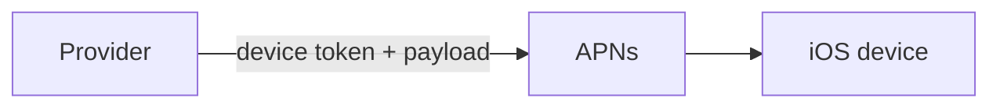
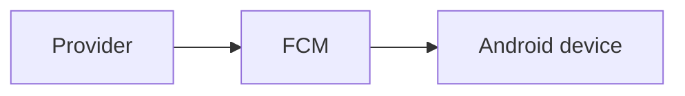
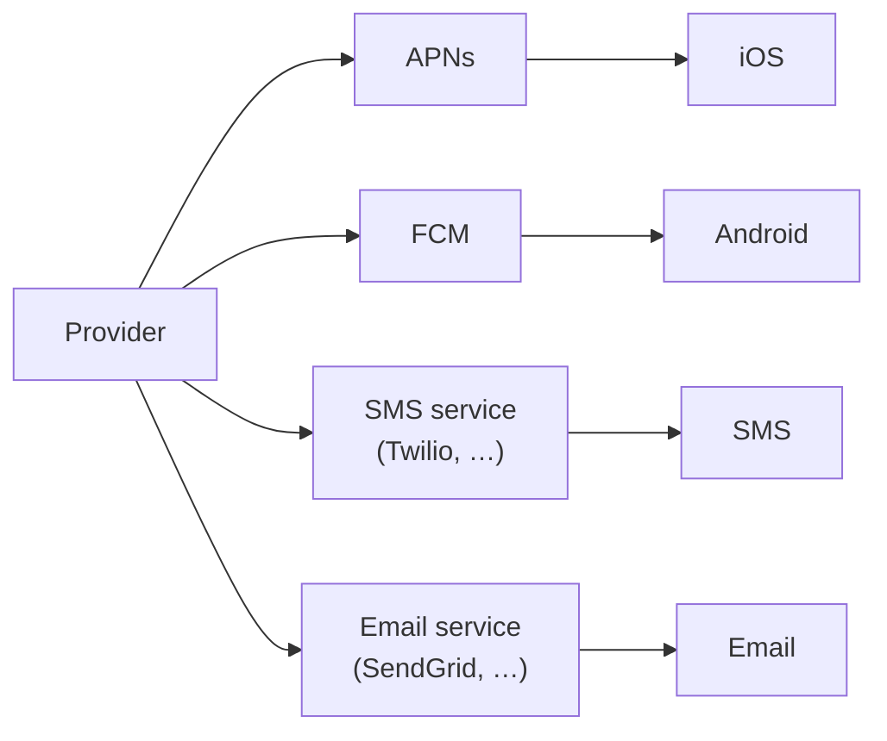
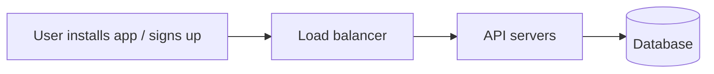
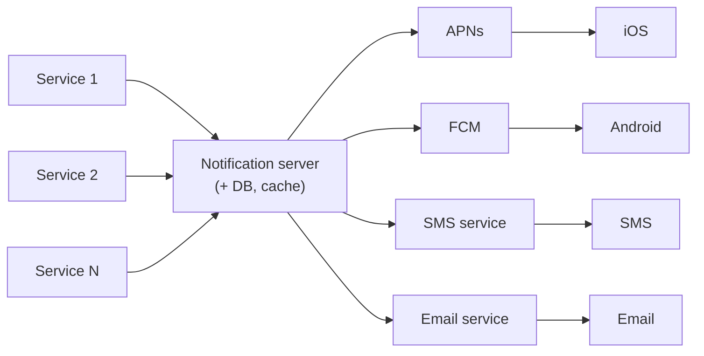
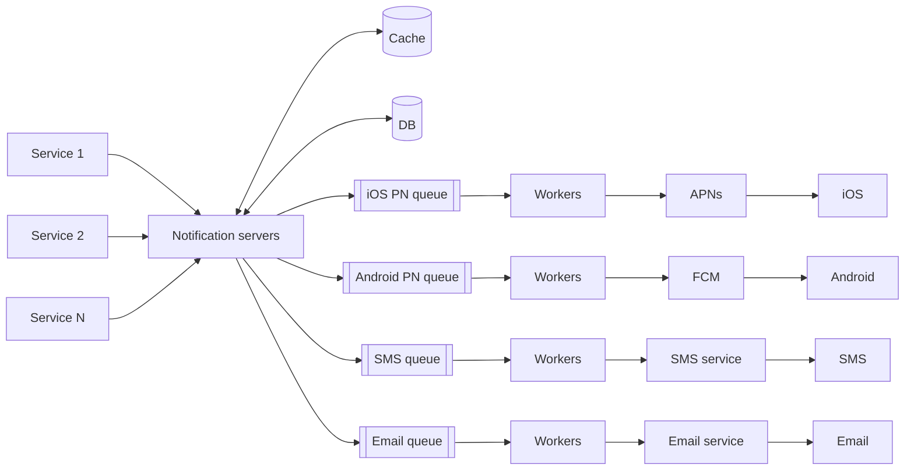
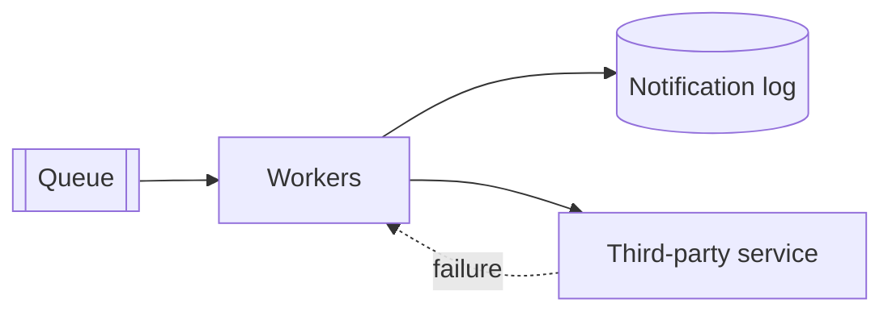
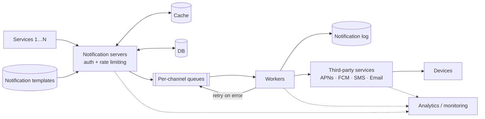

# Design a Notification System

> **Adapted from:** Alex Xu, *System Design Interview – An Insider's Guide* (2020), Chapter 10 — rewritten and condensed for teaching.

Notifications deliver breaking news, product updates, events, offers, and payment confirmations, and almost every app has them. A notification is more than a phone buzz. This lesson covers three **formats**:

- **Mobile push notifications** (iOS and Android)
- **SMS messages**
- **Email**

The design leans heavily on two earlier ideas: [message queues](./scale-from-zero-to-millions-of-users#step-9-add-a-message-queue) to decouple the system, and [rate limiting](./design-a-rate-limiter) to protect users from being overwhelmed.

**What you'll be able to do after this lesson:**

- Explain how APNs, FCM, SMS gateways, and email services fit into the delivery path.
- Evolve a single-server design into a queue-based, horizontally scalable one.
- Reason about reliability: no data loss, retries, and why **exactly-once delivery isn't possible**.
- Implement templates, a dispatcher that checks settings, deduplicates, and rate-limits, and retrying workers.

---

## Step 1: Understand the Problem and Establish Scope

| Candidate asks | Interviewer answers |
|---|---|
| Which notification types? | Push, SMS, and email |
| Real-time? | **Soft** real-time: deliver as soon as possible, but a slight delay under heavy load is acceptable |
| Supported devices? | iOS, Android, and laptop/desktop |
| What triggers notifications? | Client applications, or **server-side schedules** |
| Can users opt out? | **Yes**. Opted-out users receive nothing |
| Daily volume? | **10 M** push, **1 M** SMS, **5 M** email |

A quick estimate (assuming an even spread over the day):

| Channel | Per day | Average per second |
|---|---|---|
| Push | 10 M | ≈ 116 |
| SMS | 1 M | ≈ 12 |
| Email | 5 M | ≈ 58 |
| **Total** | **16 M** | **≈ 185** |

Notification traffic is bursty: a marketing campaign or breaking news can send millions at once. That burstiness is why **queues as buffers** will matter.

---

## Step 2: High-Level Design

### How each notification type works

#### iOS push



- **Provider**: our server. It builds the notification request and sends it to **APNs** (Apple Push Notification service). It needs:
  - a **device token**, the unique identifier of the target app install, and
  - a **payload**, a JSON dictionary such as:

```json
{
  "aps": {
    "alert": {
      "title": "Game Request",
      "body": "Bob wants to play chess",
      "action-loc-key": "PLAY"
    },
    "badge": 5
  }
}
```

- **APNs**: Apple's remote service that delivers push notifications to iOS devices.
- **iOS device**: the client that receives the notification.

#### Android push

The flow is the same, except **Firebase Cloud Messaging (FCM)** replaces APNs.



#### SMS

Use a commercial **SMS gateway** such as **Twilio** or **Nexmo** (now Vonage).

#### Email

Companies can run their own mail servers, but most use commercial services such as **SendGrid** or **Mailchimp**, which offer better deliverability and analytics.



### Contact info gathering

To notify anyone, we need their **device tokens, phone numbers, or email addresses**. When a user installs the app or signs up, the API servers collect this information and store it:



| `user` | | `device` | |
|---|---|---|---|
| `user_id` | bigint | `id` | bigint |
| `email` | varchar | `device_token` | varchar |
| `country_code` | integer | `user_id` | bigint |
| `phone_number` | integer | `last_logged_in_at` | timestamp |
| `created_at` | timestamp | | |

Email and phone number live on the **user** table. Device tokens live on a separate **device** table, because **one user can have many devices**, and a push notification can go to all of them.

### First design: a single notification server



- **Services 1…N**: anything that triggers a notification, such as a microservice, a cron job, or another distributed system. For example, a billing service emails payment reminders, and a shopping site texts "your package arrives tomorrow."
- **Notification system**: here, a single server. It exposes APIs to the services and builds payloads for the third parties.
- **Third-party services**: deliver the notifications. Design for **extensibility**, so providers are easy to plug in or remove. A provider may also be **unavailable in some markets**: FCM doesn't work in China, where alternatives such as **JPush** or **Pushy** are used.

**Three problems:**

1. **Single point of failure.** One server.
2. **Hard to scale.** Database, cache, and processing all share one box, so none can scale independently.
3. **Performance bottleneck.** Rendering HTML and waiting on slow third-party APIs ties up the server, which overloads at peak times.

### Improved design

Fixes:

- Move the **database and cache** out of the notification server.
- Add **more notification servers** with automatic horizontal scaling.
- Add **message queues** to decouple components.



Reading left to right:

- **Services 1…N** call the notification servers' APIs.
- **Notification servers**:
  - expose send APIs, **internal or verified clients only**, to prevent spam;
  - **validate** basics such as email and phone formats;
  - fetch the data needed to render the notification from the **cache or database**;
  - put the notification on the right **message queue** for parallel processing.
- **Cache** holds user info, device info, and **templates**. The **database** holds users, notifications, and settings.
- **Message queues** remove dependencies between components and **buffer bursts**. There is **one queue per notification type**, so an outage at one provider (say, the SMS gateway) doesn't block email or push.
- **Workers** pull events from the queues and call the third-party services.

An example send API (the book labels its email example with an `sms` path; the request shape is what matters):

```text
POST https://api.example.com/v/email/send
```

```json
{
  "to": [{ "user_id": 123456 }],
  "from": { "email": "from_address@example.com" },
  "subject": "Hello, World!",
  "content": [{ "type": "text/plain", "value": "Hello, World!" }]
}
```

**End-to-end flow:**

1. A service calls the notification servers' API.
2. The notification servers fetch metadata (user info, device token, notification settings) from the **cache or database**.
3. The event goes onto the matching queue. For example, an iOS push goes to the **iOS PN queue**.
4. **Workers** pull events from the queue.
5. Workers send them to the **third-party service**.
6. The third party delivers to the **user's device**.

### Check: high-level design

<MultipleChoice
  id="sdi-ch10-high-level"
  title="Queues and providers"
  questions={[
    {
      prompt: 'The SMS provider has a two-hour outage. Why do push and email notifications keep flowing in the improved design?',
      choices: [
        'Workers automatically switch SMS to email',
        'Each notification type has its own queue and workers, so the SMS backlog only builds up in the SMS queue',
        'Notification servers stop accepting SMS requests',
        'APNs and FCM relay SMS messages',
      ],
      answer: 1,
      why: 'Separate queues isolate failures: the SMS queue buffers until the provider recovers, while other channels are unaffected.',
    },
    {
      prompt: 'Why store device tokens in a separate device table instead of a column on the user table?',
      choices: [
        'Device tokens are secret',
        'A user can have many devices, and each needs its own token so a push can reach all of them',
        'APNs requires a separate table',
        'Email addresses are too long',
      ],
      answer: 1,
      why: 'It is a one-to-many relationship. A single column could hold only one device.',
    },
    {
      prompt: 'You launch in a market where FCM is unavailable. What property of the design makes this manageable?',
      choices: [
        'Using 301 redirects',
        'Extensibility: third-party providers plug in behind workers, so you add an alternative (e.g. JPush) without redesigning',
        'Sharding the user table',
        'Making notifications synchronous',
      ],
      answer: 1,
      why: 'Treat providers as swappable adapters. Market availability is a real, recurring reason to swap them.',
    },
  ]}
/>

---

## Step 3: Design Deep Dive

### Reliability

#### Preventing data loss

A notification system can **delay** or **reorder** notifications, but it must **never lose** them. To guarantee that:

- **Persist** every notification in a **notification log** database before attempting delivery.
- **Retry** failed sends.



#### Will recipients get exactly one copy?

**No.** Delivery is exactly-once most of the time, but in a distributed system duplicates can happen. A worker might send successfully and then crash before recording that it did, so the retry sends the notification again. Exactly-once delivery isn't achievable in general. What you *can* do is **reduce duplicates**:

- Give every notification event an **event ID**.
- When an event arrives, check whether its ID has been **seen before**. If so, **discard** it. Otherwise send it and record the ID.

This is the same end-to-end idempotency idea covered in [Correctness and Integrity in Dataflow Systems](../derived-data/correctness-and-integrity-in-dataflow-systems).

### Additional components

#### Notification templates

Millions of notifications a day mostly follow a few shapes, so don't build each one from scratch. A **template** is a preformatted notification with parameters to fill in:

```text
BODY: You dreamed of it. We dared it. [ITEM NAME] is back — only until [DATE].
CTA:  Order Now. Or, Save My [ITEM NAME]
```

Templates give a **consistent format**, **fewer mistakes**, and **faster** authoring.

#### Practice: render a template

Implement `render(template, params)`:

- Replace each `[PLACEHOLDER]` (uppercase letters and spaces inside square brackets) with `params[PLACEHOLDER]`.
- If any placeholder has **no value**, raise `KeyError` with the missing names joined by `", "`, in first-seen order and without repeats. Never send a notification that says "[DATE]".

Input: line 1 is the template, and each following line is `KEY=value`.

<CodeExercise
  title="Notification template"
  heading="exercise-sdi-template"
  lang="python"
  filename="main.py"
  prompt="Implement render(template, params). Replace [UPPERCASE NAME] placeholders using params. If any are missing, raise KeyError('A, B') listing missing names in first-seen order without duplicates."
  sampleLog={`You dreamed of it. We dared it. [ITEM NAME] is back — only until [DATE].
ITEM NAME=Air Max 1
DATE=Oct 31
You dreamed of it. We dared it. Air Max 1 is back — only until Oct 31.`}
  starter={`import re

PLACEHOLDER = re.compile(r'\\[([A-Z][A-Z ]*)\\]')

def render(template, params):
    pass
`}
  wrapSuffix={`
import sys
lines = sys.stdin.read().split('\\n')
template = lines[0]
params = {}
for line in lines[1:]:
    if '=' in line:
        key, value = line.split('=', 1)
        params[key] = value
try:
    print(render(template, params))
except KeyError as e:
    print('error: missing', e.args[0])
`}
  hint="Use PLACEHOLDER.sub with a function: look up m.group(1) in params; if absent, remember the name and return m.group(0). After substitution, raise KeyError(', '.join(dict.fromkeys(missing))) if anything was missing."
  solution={`import re

PLACEHOLDER = re.compile(r'\\[([A-Z][A-Z ]*)\\]')

def render(template, params):
    missing = []

    def fill(match):
        name = match.group(1)
        if name in params:
            return params[name]
        missing.append(name)
        return match.group(0)

    result = PLACEHOLDER.sub(fill, template)
    if missing:
        raise KeyError(', '.join(dict.fromkeys(missing)))
    return result
`}
  tests={[
    { name: 'body template', stdin: 'You dreamed of it. We dared it. [ITEM NAME] is back — only until [DATE].\nITEM NAME=Air Max 1\nDATE=Oct 31', equals: 'You dreamed of it. We dared it. Air Max 1 is back — only until Oct 31.' },
    { name: 'repeated placeholder in CTA', stdin: 'Order Now. Or, Save My [ITEM NAME]. [ITEM NAME] sells out fast!\nITEM NAME=Air Max 1', equals: 'Order Now. Or, Save My Air Max 1. Air Max 1 sells out fast!' },
    { name: 'missing parameter is an error', stdin: 'Hi [NAME], your order ships [DATE].\nNAME=Ana', equals: 'error: missing DATE' },
    { name: 'several missing, reported once each', stdin: '[A] [B] [A]', equals: 'error: missing A, B' },
  ]}
/>

#### Notification settings

People get far too many notifications, so apps offer fine-grained control. A **notification setting** table records it:

```text
user_id   bigint
channel   varchar   # push notification, email, or SMS
opt_in    boolean   # opted in to receive this channel?
```

**Before sending anything, check that the user has opted in to that channel.**

#### Rate limiting

Cap how many notifications a single user can receive. Bombard people and they'll turn notifications off entirely. This is per-user frequency capping, built from the same algorithms as [Lesson 4](./design-a-rate-limiter).

#### Practice: the notification server's dispatcher

Implement `dispatch(events, opted_out, limit)`. Process events in order, and for each `(event_id, user, channel)`, apply the checks **in this order**:

1. **Dedupe**: if `event_id` has been seen, log `"<id>: duplicate"`. Otherwise mark it seen.
2. **Settings**: if `(user, channel)` is in `opted_out`, log `"<id>: opted out"`.
3. **Rate limit**: if the user has already had `limit` notifications queued, log `"<id>: rate limited"`.
4. Otherwise **route** it to its channel's queue (`ios_queue`, `android_queue`, `sms_queue`, `email_queue`), count it against the user's limit, and log `"<id>: -> <queue>"`.

Return `(log, queues)`, where `queues` maps each queue name to its list of event IDs.

Input: line 1 is `limit`, line 2 is the opted-out pairs `user:channel` (or `-` for none), and each remaining line is `event_id user channel`.

<CodeExercise
  title="Dispatcher: dedupe, settings, rate limit, route"
  heading="exercise-sdi-dispatch"
  lang="python"
  filename="main.py"
  prompt="Implement dispatch(events, opted_out, limit) applying dedupe → opt-out → per-user rate limit → route to a per-channel queue, returning (log_lines, queues)."
  sampleLog={`2
u2:sms
e1 u1 ios
e2 u1 email
e1 u1 ios
e3 u2 sms
e4 u1 sms
e1: -> ios_queue
e2: -> email_queue
e1: duplicate
e3: opted out
e4: rate limited
email_queue: e2
ios_queue: e1`}
  starter={`QUEUE_FOR = {
    'ios': 'ios_queue',
    'android': 'android_queue',
    'sms': 'sms_queue',
    'email': 'email_queue',
}

def dispatch(events, opted_out, limit):
    pass
`}
  wrapSuffix={`
import sys
lines = sys.stdin.read().strip().split('\\n')
limit = int(lines[0])
opted_out = set() if lines[1].strip() == '-' else {tuple(p.split(':')) for p in lines[1].split()}
events = [tuple(line.split()) for line in lines[2:]]
log, queues = dispatch(events, opted_out, limit)
for line in log:
    print(line)
for name in sorted(queues):
    print(f'{name}:', ' '.join(queues[name]))
`}
  hint="Keep seen = set(), sent_count = {}, queues = {}, log = []. Check each condition with 'continue' after logging; only successful routes increment sent_count[user]."
  solution={`QUEUE_FOR = {
    'ios': 'ios_queue',
    'android': 'android_queue',
    'sms': 'sms_queue',
    'email': 'email_queue',
}

def dispatch(events, opted_out, limit):
    seen = set()
    sent_count = {}
    queues = {}
    log = []
    for event_id, user, channel in events:
        if event_id in seen:
            log.append(f'{event_id}: duplicate')
            continue
        seen.add(event_id)
        if (user, channel) in opted_out:
            log.append(f'{event_id}: opted out')
            continue
        if sent_count.get(user, 0) >= limit:
            log.append(f'{event_id}: rate limited')
            continue
        sent_count[user] = sent_count.get(user, 0) + 1
        queue = QUEUE_FOR[channel]
        queues.setdefault(queue, []).append(event_id)
        log.append(f'{event_id}: -> {queue}')
    return log, queues
`}
  tests={[
    { name: 'all four outcomes', stdin: '2\nu2:sms\ne1 u1 ios\ne2 u1 email\ne1 u1 ios\ne3 u2 sms\ne4 u1 sms', equals: 'e1: -> ios_queue\ne2: -> email_queue\ne1: duplicate\ne3: opted out\ne4: rate limited\nemail_queue: e2\nios_queue: e1' },
    { name: 'opted-out events do not use up the limit', stdin: '1\nu1:email\ne1 u1 email\ne2 u1 sms\ne3 u1 ios', equals: 'e1: opted out\ne2: -> sms_queue\ne3: rate limited\nsms_queue: e2' },
    { name: 'opt-out is per channel', stdin: '5\nu1:sms\ne1 u1 sms\ne2 u1 android\ne3 u1 android', equals: 'e1: opted out\ne2: -> android_queue\ne3: -> android_queue\nandroid_queue: e2 e3' },
    { name: 'no opt-outs, limits are per user', stdin: '1\n-\ne1 u1 email\ne2 u2 email\ne3 u1 email', equals: 'e1: -> email_queue\ne2: -> email_queue\ne3: rate limited\nemail_queue: e1 e2' },
  ]}
/>

#### Retry mechanism

When a third-party service fails to deliver, **put the notification back on its queue** and try again. If it **keeps failing** after a set number of attempts, **alert the developers**.

#### Practice: workers with retries

Implement `run_workers(jobs, results, max_attempts)`. Jobs start in a FIFO queue at attempt 1. Pop a job and take its **next** scripted provider result from `results[job]`:

- `ok`: log `"<job> attempt <n>: sent"`.
- `fail` with `n < max_attempts`: log `"<job> attempt <n>: failed, requeue"` and **append** the job back to the queue with attempt `n + 1`.
- `fail` on the last attempt: log `"<job> attempt <n>: failed, ALERT"`.

Input: line 1 is `max_attempts`, and each following line is `job result1,result2,…`.

<CodeExercise
  title="Retrying workers"
  heading="exercise-sdi-retry"
  lang="python"
  filename="main.py"
  prompt="Implement run_workers(jobs, results, max_attempts). Process a FIFO queue of (job, attempt); consume each job's scripted results in order; requeue failures at the back until max_attempts, then log an ALERT. Return the log lines."
  sampleLog={`3
n1 ok
n2 fail,ok
n1 attempt 1: sent
n2 attempt 1: failed, requeue
n2 attempt 2: sent`}
  starter={`from collections import deque

def run_workers(jobs, results, max_attempts):
    pass
`}
  wrapSuffix={`
import sys
lines = sys.stdin.read().strip().split('\\n')
max_attempts = int(lines[0])
jobs, results = [], {}
for line in lines[1:]:
    job, outcomes = line.split()
    jobs.append(job)
    results[job] = outcomes.split(',')
for entry in run_workers(jobs, results, max_attempts):
    print(entry)
`}
  hint="Use queue = deque((job, 1) for job in jobs) and outcome iterators: it = {j: iter(results[j]) for j in jobs}. Each pop takes next(it[job])."
  solution={`from collections import deque

def run_workers(jobs, results, max_attempts):
    queue = deque((job, 1) for job in jobs)
    outcomes = {job: iter(results[job]) for job in jobs}
    log = []
    while queue:
        job, attempt = queue.popleft()
        if next(outcomes[job]) == 'ok':
            log.append(f'{job} attempt {attempt}: sent')
        elif attempt < max_attempts:
            log.append(f'{job} attempt {attempt}: failed, requeue')
            queue.append((job, attempt + 1))
        else:
            log.append(f'{job} attempt {attempt}: failed, ALERT')
    return log
`}
  tests={[
    { name: 'success, retry-then-success, give up', stdin: '3\nn1 ok\nn2 fail,ok\nn3 fail,fail,fail', equals: 'n1 attempt 1: sent\nn2 attempt 1: failed, requeue\nn3 attempt 1: failed, requeue\nn2 attempt 2: sent\nn3 attempt 2: failed, requeue\nn3 attempt 3: failed, ALERT' },
    { name: 'single attempt allowed', stdin: '1\nn1 fail\nn2 ok', equals: 'n1 attempt 1: failed, ALERT\nn2 attempt 1: sent' },
    { name: 'succeeds on the last try', stdin: '2\nn1 fail,ok', equals: 'n1 attempt 1: failed, requeue\nn1 attempt 2: sent' },
  ]}
/>

Requeueing at the **back** keeps one flaky notification from blocking everything behind it. Real systems also add **backoff** between attempts, so they don't hammer a provider that is already struggling.

#### Security in push notifications

Push APIs are protected with an **appKey/appSecret** pair. Only **authenticated, verified clients** can send notifications through our APIs.

#### Monitor queued notifications

The key health metric is the **number of notifications waiting in the queues**. If the backlog keeps growing, workers aren't keeping up, so **add workers** before users notice the delay.

#### Events tracking

Open rate, click rate, and engagement show how users respond. The notification system reports events to an **analytics service**:

```mermaid
stateDiagram-v2
  [*] --> start
  start --> pending
  pending --> sent
  pending --> error
  sent --> delivered
  delivered --> click
  delivered --> unsubscribe
  error --> pending: retry
```

### Updated design



What's new compared with the improved design:

- Notification servers gain **authentication** and **rate limiting**.
- A **retry mechanism**: failed notifications go back on the queue and are retried a set number of times.
- **Templates** make notification creation consistent and efficient.
- **Monitoring and tracking** for health checks and future improvements.

### Check: reliability and extras

<MultipleChoice
  id="sdi-ch10-reliability"
  title="Delivery guarantees"
  questions={[
    {
      prompt: 'A worker sends a push successfully but crashes before marking it done. On restart, the notification is retried. What does the user experience, and what limits it?',
      choices: [
        'Nothing; exactly-once delivery is guaranteed',
        'Possibly a duplicate. Dedupe by event ID reduces this, but exactly-once delivery can\'t be guaranteed in general',
        'The notification is lost',
        'The provider rejects all retries',
      ],
      answer: 1,
      why: 'Send-then-crash-before-record is the classic case where at-least-once delivery creates duplicates. Deduping makes them rare but can\'t rule them out.',
    },
    {
      prompt: 'Which requirement does the notification log database mainly serve?',
      choices: [
        'Faster template rendering',
        'Never losing notifications. Persisted events can be retried after a failure',
        'Rate limiting',
        'Storing device tokens',
      ],
      answer: 1,
      why: 'Delay and reordering are acceptable, loss is not. Persistence plus retry is what turns "maybe sent" into "eventually sent."',
    },
    {
      prompt: 'Queue depth for the email channel has grown steadily for an hour while other channels look normal. What is the first action?',
      choices: [
        'Disable rate limiting',
        'Add email workers, and check the email provider\'s health and latency',
        'Delete the queued emails',
        'Switch emails to SMS',
      ],
      answer: 1,
      why: 'A growing backlog means consumption is slower than production. Either there are too few workers or the provider is slow, and you need to know which.',
    },
    {
      type: 'order',
      prompt: 'Order the end-to-end send flow (top = first):',
      items: [
        'A service calls the notification server API',
        'The notification server fetches user info, device tokens, and settings from the cache or DB',
        'The event is placed on the channel\'s message queue',
        'A worker pulls the event and calls the third-party service',
        'The third-party service delivers the notification to the device',
      ],
      why: 'Metadata is needed before the event can be routed, the queue sits between the servers and the workers, and only workers talk to providers.',
      whyWrong: 'Ask what each step needs: routing needs the device token and settings, and the worker needs an event on the queue.',
    },
  ]}
/>

---

## Step 4: Wrap Up

We designed a scalable system for **push, SMS, and email**, using **message queues** to decouple components. Beyond the high-level design:

- **Reliability**: persistence plus a robust **retry** mechanism to minimize failures.
- **Security**: an **appKey/appSecret** pair, so only verified clients can send.
- **Tracking and monitoring** at every stage of the flow.
- **Respect user settings**: check opt-in before sending.
- **Rate limiting**: users appreciate a cap on how often they're notified.

---

## Key Takeaways

- Push goes through **APNs** (iOS) or **FCM** (Android). SMS and email go through commercial gateways. Treat all of them as **pluggable** providers.
- Evolve from one server to **stateless notification servers → per-channel queues → workers → providers**, with the database and cache separated out.
- **Never lose, may delay or duplicate**: a notification log plus retries, and **event-ID dedupe** to make duplicates rare. Exactly-once delivery isn't achievable.
- Check **opt-in**, apply **per-user rate limits**, and render from **templates** before queueing.
- Watch **queue depth**, and track **delivery and engagement events**.

Previous lesson: [Design a Web Crawler](./design-a-web-crawler).

Next lesson: [Design a News Feed System](./design-a-news-feed-system) — fanout on write vs. read, the hybrid model for celebrities, ID-only feed caches, and hydration.

---

## Reference Materials

1. [Twilio SMS](https://www.twilio.com/sms)
2. [Nexmo SMS](https://www.nexmo.com/products/sms)
3. [SendGrid](https://sendgrid.com/)
4. [Mailchimp](https://mailchimp.com/)
5. [You Cannot Have Exactly-Once Delivery](https://bravenewgeek.com/you-cannot-have-exactly-once-delivery/)
6. [Security in Push Notifications](https://cloud.ibm.com/docs/services/mobilepush?topic=mobile-pushnotification-security-in-push-notifications) — IBM Cloud
7. [RabbitMQ queue monitoring example](https://bit.ly/2sotIa6)
