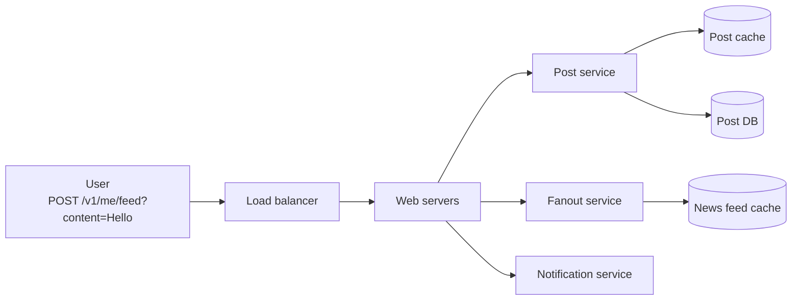
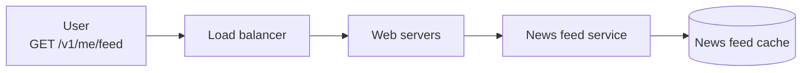
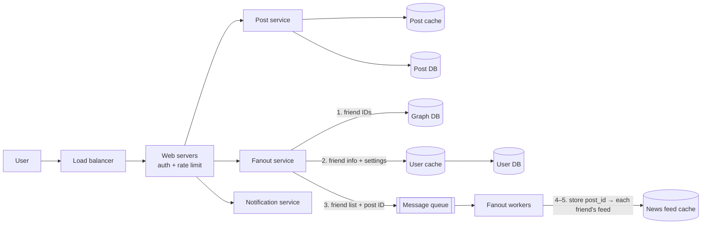
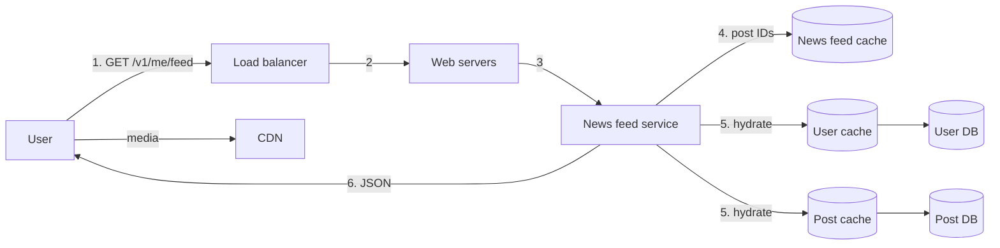
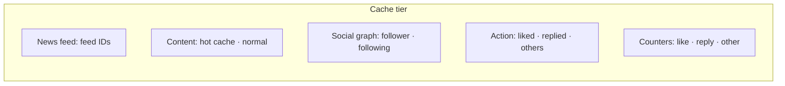

# Design a News Feed System

> **Adapted from:** Alex Xu, *System Design Interview – An Insider's Guide* (2020), Chapter 11 — rewritten and condensed for teaching.

A **news feed** is the constantly updating list of stories in the middle of your home page: status updates, photos, videos, links, app activity, and likes from the people, pages, and groups you follow. Facebook's feed, Instagram's feed, and Twitter's timeline are all versions of the same interview question.

[Lesson 3](./a-framework-for-system-design-interviews#example-clarifying-design-a-news-feed) used this problem to walk through the interview framework. This lesson works through the full design, with the central trade-off: **fanout on write vs. fanout on read**.

**What you'll be able to do after this lesson:**

- Design the publish and retrieve APIs and the two main flows.
- Compare **push** (fanout on write) and **pull** (fanout on read), quantify the **celebrity/hotkey** problem, and justify a **hybrid**.
- Build a fanout service that respects mutes, keeps the feed cache small by storing only IDs, and merges celebrity posts at read time.
- **Hydrate** feed IDs into full posts, and lay out a five-layer cache architecture.

---

## Step 1: Understand the Problem and Establish Scope

| Candidate asks | Interviewer answers |
|---|---|
| Mobile, web, or both? | Both |
| Important features? | A user can **publish a post** and **see friends' posts** on their feed |
| Feed order: reverse chronological, or ranked (e.g. close friends first)? | **Reverse chronological**, to keep it simple |
| Max friends per user? | **5,000** |
| Traffic? | **10 million DAU** |
| Media? | **Images and videos** as well as text |

---

## Step 2: High-Level Design

There are two flows:

- **Feed publishing**: a user posts. The post is written to the cache and the database, then **fanned out** to friends' feeds.
- **News feed building**: a user loads their feed, which is assembled from friends' posts in reverse-chronological order.

### APIs

Both are HTTP APIs, authenticated with an `auth_token`.

```text
POST /v1/me/feed
  content:    text of the post
  auth_token: authenticates the request

GET /v1/me/feed
  auth_token: authenticates the request
```

### Feed publishing (high level)



- **Load balancer** distributes traffic across web servers.
- **Web servers** route requests to internal services.
- **Post service** persists the post in the database and cache.
- **Fanout service** pushes the new post into friends' news feeds, which are kept in a **cache** for fast reads.
- **Notification service** tells friends there's new content and sends push notifications (the system from [Lesson 10](./design-a-notification-system)).

### News feed building (high level)



- The **news feed service** reads the user's feed from the **news feed cache**, which holds the **post IDs** needed to render it.

---

## Step 3: Design Deep Dive

### Feed publishing deep dive



#### Web servers

Besides talking to clients, web servers enforce:

- **Authentication**: only signed-in users with a valid `auth_token` can post.
- **Rate limiting**: cap posts per user per period to prevent spam and abuse (see [Lesson 4](./design-a-rate-limiter)).

#### Fanout service

**Fanout** is the process of delivering a post to all of the author's friends. There are two models.

**Fanout on write (push model).** The feed is **precomputed when the post is written**. As soon as a post is published, it's delivered to every friend's feed cache.

| Pros | Cons |
|---|---|
| Feeds are generated in real time and pushed to friends immediately | An author with **many friends or followers** makes publishing slow: fetching them all and writing every feed. This is the **hotkey problem** |
| **Reading is fast**, because the feed is already built | **Wasted work** for inactive users who rarely log in |

**Fanout on read (pull model).** The feed is **built on demand when the user reads it**. Recent posts are pulled when the user opens the home page.

| Pros | Cons |
|---|---|
| No wasted work for inactive users | **Reading is slow**, because the feed isn't precomputed |
| No hotkey problem, since nothing is pushed | |

**Hybrid (our choice).** Fast feed reads matter most, so use **push for most users**. For **celebrities**, users with huge follower counts, let followers **pull** their posts at read time, so one post doesn't trigger millions of writes. **Consistent hashing** ([Lesson 5](./design-consistent-hashing)) further spreads hot keys and requests across servers.

#### Practice: how bad is the hotkey problem?

Implement `fanout_cost(authors, threshold)`. Each author is a `(followers, posts_per_day)` pair. Return a tuple:

- `push_writes`: feed-cache writes per day if **every** author uses push (followers × posts).
- `hybrid_writes`: writes per day if only authors with `followers <= threshold` push.
- `pulled_posts`: posts per day from authors **above** the threshold. These are left for readers to pull.

Input: line 1 is `threshold`, and each following line is `followers posts_per_day`.

<CodeExercise
  title="Fanout cost: push vs hybrid"
  heading="exercise-sdi-fanout-cost"
  lang="python"
  filename="main.py"
  prompt="Implement fanout_cost(authors, threshold) returning (push_writes, hybrid_writes, pulled_posts) as defined above."
  sampleLog={`10000
200 2
5000 1
30000000 3
push writes/day:   90005400
hybrid writes/day: 5400
celebrity posts left for pull: 3`}
  starter={`def fanout_cost(authors, threshold):
    pass
`}
  wrapSuffix={`
import sys
lines = sys.stdin.read().strip().split('\\n')
threshold = int(lines[0])
authors = [tuple(map(int, line.split())) for line in lines[1:]]
push, hybrid, pulled = fanout_cost(authors, threshold)
print(f'push writes/day:   {push}')
print(f'hybrid writes/day: {hybrid}')
print(f'celebrity posts left for pull: {pulled}')
`}
  hint="Three sums over authors: sum(f * p), the same filtered to f <= threshold, and sum(p) filtered to f > threshold."
  solution={`def fanout_cost(authors, threshold):
    push_writes = sum(f * p for f, p in authors)
    hybrid_writes = sum(f * p for f, p in authors if f <= threshold)
    pulled_posts = sum(p for f, p in authors if f > threshold)
    return push_writes, hybrid_writes, pulled_posts
`}
  tests={[
    { name: 'one celebrity dominates', stdin: '10000\n200 2\n5000 1\n30000000 3', equals: 'push writes/day:   90005400\nhybrid writes/day: 5400\ncelebrity posts left for pull: 3' },
    { name: 'threshold below everyone: all pull', stdin: '50\n100 1\n100 1', equals: 'push writes/day:   200\nhybrid writes/day: 0\ncelebrity posts left for pull: 2' },
    { name: 'threshold is inclusive', stdin: '10\n10 5', equals: 'push writes/day:   50\nhybrid writes/day: 50\ncelebrity posts left for pull: 0' },
  ]}
/>

In the first test, one celebrity posting **3 times a day** accounts for **90 million** of the ~90 million writes. Under the hybrid model the system does just **5,400** writes, and followers pull 3 posts at read time.

#### How the fanout service works

1. **Fetch friend IDs** from the **graph database**. Graph databases suit friend relationships and friend recommendations.
2. **Get friend info** from the **user cache** and **filter by settings**. If you've **muted** someone, their posts stay out of your feed even though you're still friends. Authors can also share a post with only some friends.
3. **Send the friend list and the new post ID** to a **message queue**.
4. **Fanout workers** pull from the queue and write to the **news feed cache**.
5. The cache is essentially a `<post_id, user_id>` mapping: each new post is **appended** to each friend's list.

**Store only IDs, and cap the list.** Storing whole user and post objects for every feed entry would explode memory. Keep just the IDs, with a **configurable limit** per feed. Few users scroll back through thousands of posts, so the **cache miss rate stays low**.

For example, after Alice (followed by Bob and Dave) publishes post 105:

| post_id | user_id (feed owner) |
|---|---|
| 105 | bob |
| 105 | dave |
| 103 | bob |
| … | … |

### Newsfeed retrieval deep dive



1. The user requests `GET /v1/me/feed`.
2. The load balancer forwards it to a web server.
3. The web server calls the **news feed service**.
4. The service gets the list of **post IDs** from the news feed cache.
5. A feed is more than IDs: it needs usernames, profile pictures, post text, and images. So the service **hydrates** each ID by fetching the full user and post objects from the **user cache** and **post cache**.
6. The fully hydrated feed goes back to the client as **JSON**.

**Media** (images and video) is served from a **CDN**.

#### Practice: a hybrid fanout feed

Build `FeedSystem`:

- `publish(author, post_id)`:
  - If the author has **more than `threshold` followers**, they're a celebrity. Append the post to the author's **outbox** and return `'pull'`.
  - Otherwise, **push**: for each follower who hasn't muted the author (`(follower, author)` not in `muted`), insert `post_id` at the **front** of that follower's feed list and **trim** the list to `limit`. Return `'push to N'`, where N is the number of feeds written.
- `get_feed(user, k)`: take the user's pushed feed, **add posts from the outboxes of celebrities they follow** (unless muted), and return the **top `k` post IDs in descending order**. Post IDs are time-ordered, as with Snowflake IDs from [Lesson 7](./design-a-unique-id-generator), so higher means newer.

Input: line 1 is `threshold limit`, line 2 is the followers as `author:f1,f2,…` pairs, and line 3 is the mutes as `viewer:author` pairs (or `-`). Each remaining line is `post <author> <id>` or `feed <user> <k>`.

<CodeExercise
  title="Hybrid fanout feed"
  heading="exercise-sdi-hybrid-feed"
  lang="python"
  filename="main.py"
  prompt="Implement FeedSystem.publish (pull for authors over threshold; otherwise push to non-muting followers, newest first, trimmed to limit) and FeedSystem.get_feed (merge pushed feed with followed celebrities' outboxes, unless muted; return top k IDs descending)."
  sampleLog={`2 3
alice:bob,carol star:bob,carol,erin
-
post alice 101
post star 102
feed bob 10
post alice 101 -> push to 2
post star 102 -> pull
feed bob -> [102, 101]`}
  starter={`class FeedSystem:
    def __init__(self, followers, muted, threshold, limit):
        self.followers = followers   # author -> list of follower IDs
        self.muted = muted           # set of (viewer, author)
        self.threshold = threshold
        self.limit = limit
        self.feed = {}               # user -> list of post IDs (newest first)
        self.outbox = {}             # celebrity -> list of post IDs

    def publish(self, author, post_id):
        pass

    def get_feed(self, user, k):
        pass
`}
  wrapSuffix={`
import sys
lines = sys.stdin.read().strip().split('\\n')
threshold, limit = map(int, lines[0].split())
followers = {}
for pair in lines[1].split():
    author, fs = pair.split(':')
    followers[author] = fs.split(',')
muted = set() if lines[2].strip() == '-' else {tuple(p.split(':')) for p in lines[2].split()}
system = FeedSystem(followers, muted, threshold, limit)
for line in lines[3:]:
    cmd, who, n = line.split()
    if cmd == 'post':
        print(f'post {who} {n} -> {system.publish(who, int(n))}')
    else:
        print(f'feed {who} -> {system.get_feed(who, int(n))}')
`}
  hint="publish: fs = self.followers.get(author, []). Push with lst = self.feed.setdefault(f, []); lst.insert(0, post_id); del lst[self.limit:]. get_feed: start from list(self.feed.get(user, [])), extend with outboxes of authors whose follower list has more than threshold entries and includes user, then sorted(set(...), reverse=True)[:k]."
  solution={`class FeedSystem:
    def __init__(self, followers, muted, threshold, limit):
        self.followers = followers   # author -> list of follower IDs
        self.muted = muted           # set of (viewer, author)
        self.threshold = threshold
        self.limit = limit
        self.feed = {}               # user -> list of post IDs (newest first)
        self.outbox = {}             # celebrity -> list of post IDs

    def publish(self, author, post_id):
        fs = self.followers.get(author, [])
        if len(fs) > self.threshold:
            self.outbox.setdefault(author, []).append(post_id)
            return 'pull'
        written = 0
        for follower in fs:
            if (follower, author) in self.muted:
                continue
            lst = self.feed.setdefault(follower, [])
            lst.insert(0, post_id)
            del lst[self.limit:]
            written += 1
        return f'push to {written}'

    def get_feed(self, user, k):
        posts = list(self.feed.get(user, []))
        for author, fs in self.followers.items():
            if len(fs) > self.threshold and user in fs and (user, author) not in self.muted:
                posts.extend(self.outbox.get(author, []))
        return sorted(set(posts), reverse=True)[:k]
`}
  tests={[
    { name: 'push + pull merged at read time', stdin: '2 3\nalice:bob,carol star:bob,carol,erin\n-\npost alice 101\npost star 102\nfeed bob 10', equals: 'post alice 101 -> push to 2\npost star 102 -> pull\nfeed bob -> [102, 101]' },
    { name: 'mutes, cache limit, and k', stdin: '2 3\nalice:bob,carol dave:bob star:bob,carol,erin\ncarol:alice\npost alice 101\npost star 102\npost dave 103\npost alice 104\npost alice 105\nfeed bob 10\nfeed bob 2\nfeed carol 10\nfeed erin 10\nfeed zed 10', equals: 'post alice 101 -> push to 1\npost star 102 -> pull\npost dave 103 -> push to 1\npost alice 104 -> push to 1\npost alice 105 -> push to 1\nfeed bob -> [105, 104, 103, 102]\nfeed bob -> [105, 104]\nfeed carol -> [102]\nfeed erin -> [102]\nfeed zed -> []' },
    { name: 'muting a celebrity hides pulled posts too', stdin: '1 5\nstar:a,b\na:star\npost star 7\nfeed a 5\nfeed b 5', equals: 'post star 7 -> pull\nfeed a -> []\nfeed b -> [7]' },
  ]}
/>

In the second test, Bob's cached feed holds only the newest **3** pushed posts (105, 104, 103), so post 101 has been trimmed away. That's the configurable limit at work: a user scrolling that far back would trigger a cache miss and a database read. Carol muted Alice, so none of Alice's posts reach her.

#### Practice: hydrate the feed

Implement `hydrate(post_ids, posts, users)`. It turns feed IDs into display rows:

- `posts[post_id]` is `(author_id, text)`, and `users[author_id]` is the author's display name.
- **Skip** IDs missing from `posts`. A post may have been deleted after it was fanned out.
- Return lines formatted as `"<post_id> | <name> (@<author_id>): <text>"`, in the given order.

Input: line 1 is the feed's post IDs, each line `user <id> <Name>` adds a user, and each line `post <id> <author_id> <text…>` adds a post.

<CodeExercise
  title="Hydrate feed IDs"
  heading="exercise-sdi-hydrate"
  lang="python"
  filename="main.py"
  prompt="Implement hydrate(post_ids, posts, users) returning display lines '<post_id> | <name> (@<author_id>): <text>' for each ID present in posts, in order."
  sampleLog={`105 103
user alice Alice
user dave Dave
post 105 alice Hello world
post 103 dave Lunch?
105 | Alice (@alice): Hello world
103 | Dave (@dave): Lunch?`}
  starter={`def hydrate(post_ids, posts, users):
    pass
`}
  wrapSuffix={`
import sys
lines = sys.stdin.read().strip().split('\\n')
post_ids = [int(x) for x in lines[0].split()]
posts, users = {}, {}
for line in lines[1:]:
    kind, rest = line.split(' ', 1)
    if kind == 'user':
        uid, name = rest.split(' ', 1)
        users[uid] = name
    else:
        pid, author, text = rest.split(' ', 2)
        posts[int(pid)] = (author, text)
for row in hydrate(post_ids, posts, users):
    print(row)
`}
  hint="Loop over post_ids; continue if the ID isn't in posts; otherwise unpack (author, text) and look up users[author]."
  solution={`def hydrate(post_ids, posts, users):
    rows = []
    for pid in post_ids:
        if pid not in posts:
            continue
        author, text = posts[pid]
        rows.append(f'{pid} | {users[author]} (@{author}): {text}')
    return rows
`}
  tests={[
    { name: 'basic hydration', stdin: '105 103\nuser alice Alice\nuser dave Dave\npost 105 alice Hello world\npost 103 dave Lunch?', equals: '105 | Alice (@alice): Hello world\n103 | Dave (@dave): Lunch?' },
    { name: 'deleted post is skipped', stdin: '9 8 7\nuser a Ann\npost 9 a first\npost 7 a third', equals: '9 | Ann (@a): first\n7 | Ann (@a): third' },
    { name: 'many posts, one author lookup each', stdin: '3 2 1\nuser s Star Person\npost 3 s c\npost 2 s b\npost 1 s a', equals: '3 | Star Person (@s): c\n2 | Star Person (@s): b\n1 | Star Person (@s): a' },
  ]}
/>

### Cache architecture

Caching is critical for a news feed. The book splits the cache tier into **five layers**:

| Layer | Holds |
|---|---|
| **News feed** | Feed **IDs** per user |
| **Content** | Post data. **Popular** posts live in a **hot cache** |
| **Social graph** | Followers and following relationships |
| **Action** | Whether a user liked, replied to, or took another action on a post |
| **Counters** | Like, reply, follower, and following counts |



Splitting by kind of data lets each layer use its own eviction policy, size, and scaling. Hot celebrity posts in the content layer get far more traffic than a normal post, for example.

### Check: fanout and retrieval

<MultipleChoice
  id="sdi-ch11-fanout"
  title="Push, pull, and hybrid"
  questions={[
    {
      prompt: 'A user with 5,000 friends posts once. Under pure fanout on write, how many news-feed cache writes happen?',
      choices: ['1', 'About 5,000, one per friend\'s feed', '5,000²', 'None until friends log in'],
      answer: 1,
      why: 'Push writes the post ID into every friend\'s feed list, so the work scales linearly with the friend count.',
    },
    {
      prompt: 'Why does the hybrid model use pull specifically for celebrities?',
      choices: [
        'Celebrities post more often than everyone else',
        'A celebrity post would require millions of writes under push (the hotkey problem). Letting followers pull at read time avoids that burst',
        'Pull is always faster to read',
        'Celebrities cannot be cached',
      ],
      answer: 1,
      why: 'Push cost is proportional to follower count. For the few accounts with huge audiences, a small extra merge at read time costs far less than millions of writes.',
    },
    {
      prompt: 'Why store only post IDs (not full posts) in each user\'s feed cache?',
      choices: [
        'IDs are easier to encrypt',
        'One post appears in thousands of feeds. Duplicating the full object everywhere would explode memory, while IDs are tiny and hydration fetches each object once from the post cache',
        'Full posts cannot be serialized',
        'The CDN requires IDs',
      ],
      answer: 1,
      why: 'Normalize: feeds hold references, and the content layer holds each post once.',
    },
    {
      prompt: 'An inactive user who logs in twice a year has 4,000 active friends. Which model wastes the most work on them?',
      choices: ['Fanout on write (push)', 'Fanout on read (pull)', 'Both equally', 'Neither'],
      answer: 0,
      why: 'Push keeps writing into their feed every time a friend posts, even though they almost never read it. Pull would only do the work on their two visits.',
    },
    {
      type: 'order',
      prompt: 'Order the news feed retrieval flow (top = first):',
      items: [
        'Client sends GET /v1/me/feed',
        'Load balancer forwards the request to a web server',
        'Web server calls the news feed service',
        'News feed service reads post IDs from the news feed cache',
        'News feed service hydrates IDs from the user and post caches',
        'Fully hydrated feed is returned as JSON',
      ],
      why: 'IDs come first because they say which posts to fetch, hydration turns them into displayable content, and the response comes last.',
      whyWrong: 'Hydration needs the list of IDs, so the news feed cache read must come before it.',
    },
  ]}
/>

---

## Step 4: Wrap Up

We designed the two flows: **feed publishing** and **news feed retrieval**. There is no perfect design. Every company has its own constraints, so understand the **trade-offs** of each choice. With time left, discuss scaling:

**Scaling the database**:

- Vertical vs. horizontal scaling
- SQL vs. NoSQL
- Primary–replica replication and read replicas
- Consistency models
- Sharding

**Other talking points**:

- Keep the web tier **stateless**.
- **Cache** as much as you can.
- Support **multiple data centers**.
- **Loosely couple** components with message queues.
- **Monitor** key metrics, such as QPS at peak hours and latency when users refresh their feeds.

These are all covered in [Lesson 1](./scale-from-zero-to-millions-of-users).

---

## Key Takeaways

- Two flows: **publish** (post service + fanout service + notifications) and **retrieve** (news feed service + hydration).
- **Push** gives fast reads but expensive writes for big audiences and waste for inactive users. **Pull** gives cheap writes but slow reads. The **hybrid** pushes for most users and pulls for celebrities.
- The fanout pipeline: **graph DB → user cache and settings filter (mutes) → message queue → fanout workers → news feed cache**.
- Feed caches hold **IDs only**, capped to a limit. **Hydrate** from the user and post caches at read time, and serve media from a **CDN**.
- Split the cache into **news feed, content, social graph, action, and counters** layers.

Previous lesson: [Design a Notification System](./design-a-notification-system).

Next lesson: [Design a Chat System](./design-a-chat-system) — WebSocket, stateful chat servers, KV-store chat history, multi-device sync, and presence.

---

## Reference Materials

1. [How News Feed Works](https://www.facebook.com/help/327131014036297/) — Facebook Help Center
2. [Friend of Friend recommendations with Neo4j and SQL Server](http://geekswithblogs.net/brendonpage/archive/2015/10/26/friend-of-friend-recommendations-with-neo4j.aspx)
