# Design a Chat System

> **Adapted from:** Alex Xu, *System Design Interview – An Insider's Guide* (2020), Chapter 12 — rewritten and condensed for teaching.

Almost everyone uses a chat app, but "chat" means different things. **One-on-one** apps include Facebook Messenger, WeChat, and WhatsApp. **Group-focused** office chat means Slack. **Game chat** such as Discord adds large groups and low-latency voice. Pinning down which one the interviewer means is the first job. You don't want to design Slack when they had WhatsApp in mind.

**What you'll be able to do after this lesson:**

- Compare **polling, long polling, and WebSocket** for server-to-client delivery.
- Split a chat system into **stateless**, **stateful**, and **third-party** parts.
- Choose storage and message IDs for chat history, and explain why a key-value store fits.
- Trace 1:1, multi-device, and group message flows, and build **presence** with heartbeats and pub/sub.

---

## Step 1: Understand the Problem and Establish Scope

| Candidate asks | Interviewer answers |
|---|---|
| 1:1 or group? | **Both** |
| Mobile, web, or both? | Both |
| Scale? | **50 million DAU** |
| Group size limit? | **100** people |
| Key features? Attachments? | 1:1 chat, group chat, **online indicator**. **Text only** |
| Message size limit? | Under **100,000 characters** |
| End-to-end encryption? | Not required now. Discuss if time allows |
| How long to keep history? | **Forever** |

We'll design something like Facebook Messenger, with:

- **1:1 chat** with low delivery latency
- **Small group chat** (up to 100 members)
- **Online presence**
- **Multiple devices** logged in to the same account at once
- **Push notifications**

---

## Step 2: High-Level Design

Clients never talk to each other directly. Each one connects to a **chat service**, which must:

- **receive** messages from clients,
- **find the recipients** of each message and **relay** it to them, and
- **hold messages for offline recipients** until they come back online.

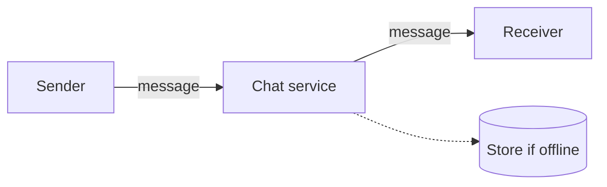

### Choosing a network protocol

**The sender side is easy.** The client initiates the request, so plain **HTTP** works. With the **keep-alive** header the connection stays open, which avoids repeated TCP handshakes. Facebook originally sent messages over HTTP.

**The receiver side is harder.** HTTP is client-initiated, so the server can't simply push a message whenever one arrives. There are three ways around this.

#### Polling

The client asks every few seconds whether there are new messages. Most of the time the answer is "no," so the server spends resources on useless requests.

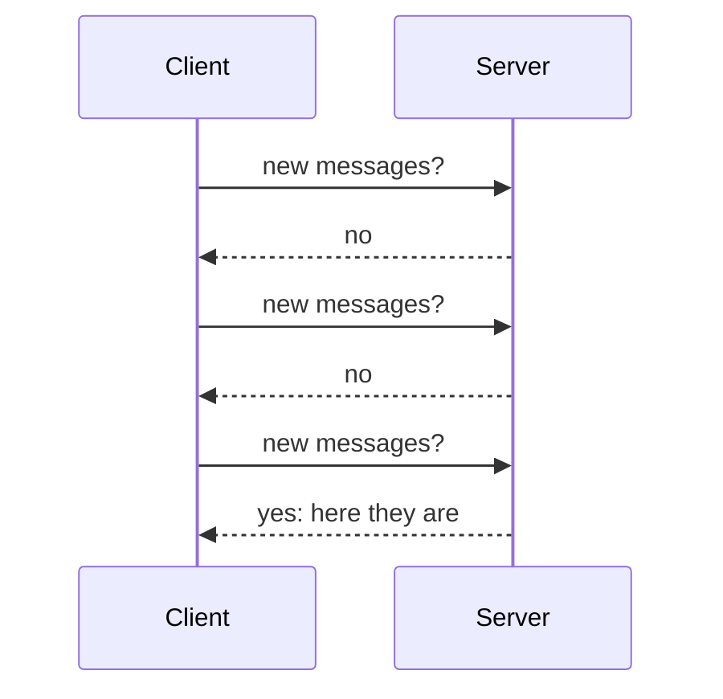

#### Long polling

The client sends a request and the server **holds it open** until there's a message or a timeout. Then the client immediately reconnects.

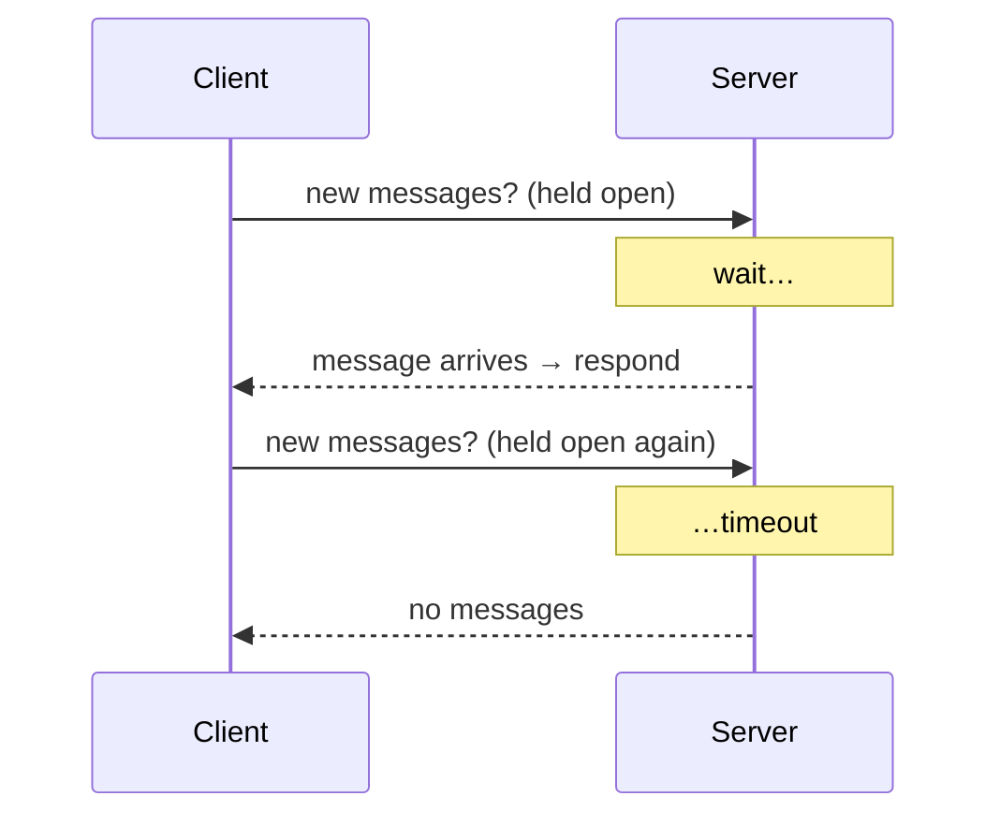

Drawbacks of long polling:

- **The sender and receiver may be on different servers.** HTTP servers are usually stateless, so with round-robin load balancing, the server that receives a message may not be the one holding the receiver's long-poll connection.
- **The server can't easily tell when a client has disconnected.**
- **It's still wasteful.** Users who rarely chat keep reconnecting after every timeout.

#### WebSocket

**WebSocket** is the standard answer for pushing data from server to client:

- The **client initiates** it as an HTTP connection, which is then **upgraded** with a handshake.
- It is **bidirectional and persistent**, so the server can push whenever it likes.
- It runs on ports **80 and 443**, like HTTP and HTTPS, so it usually works through firewalls.

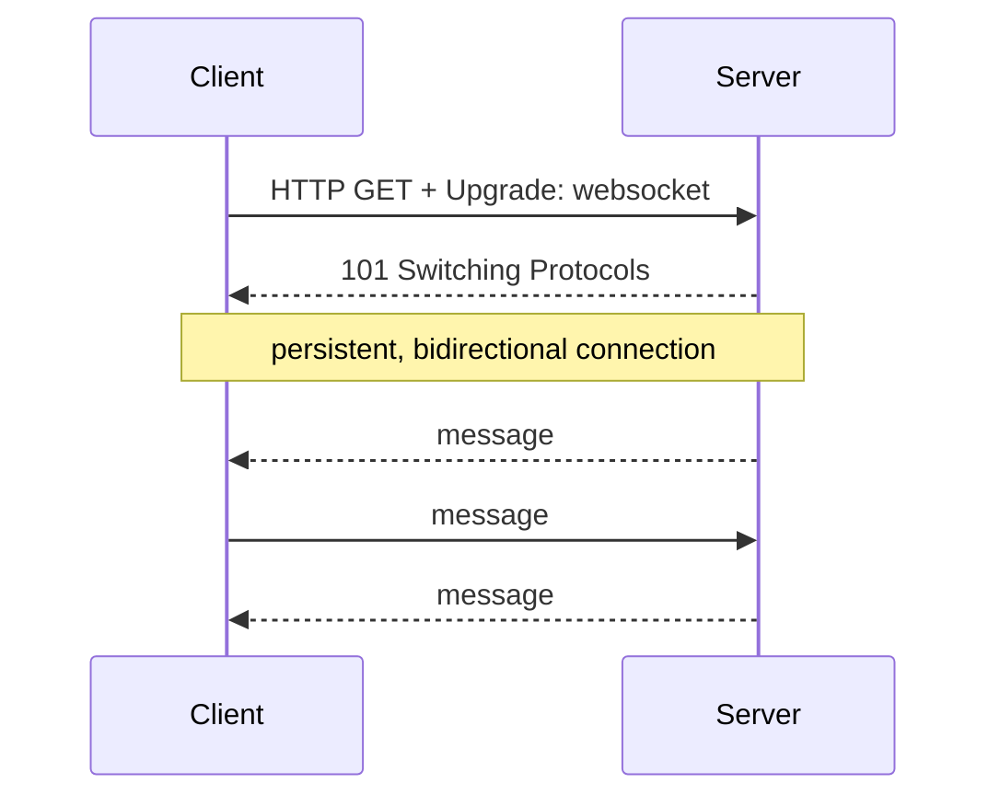

Because WebSocket is bidirectional, there's no strong reason to keep HTTP for sending. **Use WebSocket for both directions.** That simplifies both client and server. The cost is that persistent connections must be **managed carefully** on the server.

### High-level components

Only chat needs WebSocket. Sign-up, login, profiles, and similar features can use ordinary **HTTP request/response**. The system splits into three groups:

- **Stateless services**: login, sign-up, user profiles, and so on, behind a load balancer that routes by path. They can be a monolith or microservices, and many can be bought rather than built. One matters for chat: **service discovery**, which gives each client the hostname of a chat server to connect to.
- **Stateful service**: the **chat service** is the only stateful part. Each client keeps a **persistent connection** to one chat server and normally stays on it while the server is healthy. Service discovery works with the chat service so that no server gets overloaded.
- **Third-party integration**: **push notifications** tell users about new messages while the app isn't running. See [Lesson 10](./design-a-notification-system).

### Scalability: why not one server?

Could it all fit on one machine? At **1 M concurrent users**, if each connection needs about **10 KB** of server memory (a rough figure that depends heavily on the language), that's only about **10 GB**. A single modern server could hold every connection.

**Don't propose that as the final design.** A single server is a **single point of failure**, among other problems, and an interviewer will see it as a red flag. Starting from one server is fine, as long as you say it's a starting point.

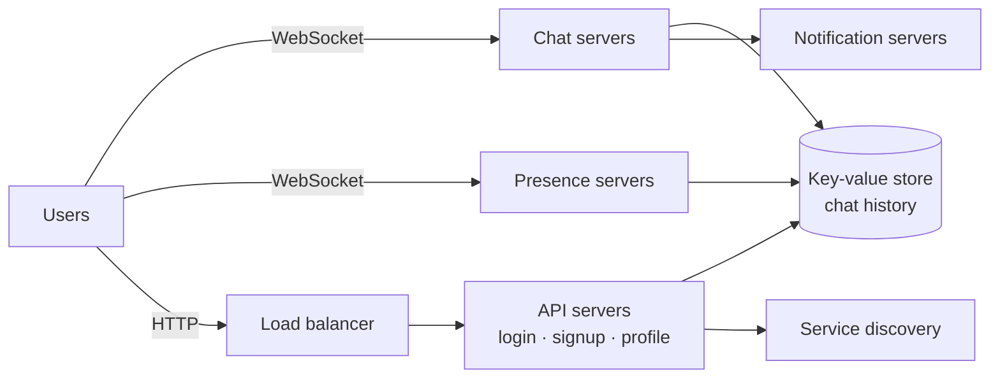

- **Chat servers**: send and receive messages.
- **Presence servers**: manage online/offline status.
- **API servers**: everything else (login, sign-up, profile changes).
- **Notification servers**: push notifications.
- **Key-value store**: chat history, so returning users see past messages.

### Check: protocols

<MultipleChoice
  id="sdi-ch12-protocols"
  title="Polling, long polling, WebSocket"
  questions={[
    {
      prompt: 'Why does plain HTTP make the receiver side of chat hard?',
      choices: [
        'HTTP cannot carry text',
        'HTTP is client-initiated: the server cannot push a message until the client asks',
        'HTTP connections are always encrypted',
        'HTTP has a 100-character limit',
      ],
      answer: 1,
      why: 'Polling, long polling, and WebSocket are all ways to let the server get messages to a client that isn\'t currently asking.',
    },
    {
      prompt: 'With round-robin load balancing over stateless HTTP servers, what goes wrong with long polling?',
      choices: [
        'Messages get encrypted twice',
        'The server that receives a sender\'s message may not hold the recipient\'s open long-poll request, so it can\'t deliver the message directly',
        'Clients can only send one message per day',
        'The load balancer drops all WebSocket traffic',
      ],
      answer: 1,
      why: 'Delivery needs to know which server holds each recipient\'s connection. Stateless round-robin routing ignores that.',
    },
    {
      prompt: 'Why do WebSocket connections usually get through corporate firewalls?',
      choices: [
        'They use UDP',
        'They start as HTTP on ports 80/443 and are upgraded, so they look like ordinary web traffic to most firewalls',
        'Firewalls cannot inspect WebSockets',
        'They bypass TCP',
      ],
      answer: 1,
      why: 'Reusing the standard web ports is a deliberate part of the WebSocket design.',
    },
  ]}
/>

### Storage

Two kinds of data:

1. **Generic data**: profiles, settings, friend lists. Store it in a reliable **relational database**, with replication and sharding for availability and scale.
2. **Chat history**, which has an unusual access pattern:
   - The **volume is enormous**. In 2016, Messenger and WhatsApp together handled **60 billion messages a day**.
   - Mostly **recent** chats are read, but **random access** still matters for search, mentions, and jumping to a specific message.
   - Reads and writes are about **1:1** in 1:1 chat apps.

**Use a key-value store** for chat history:

- It **scales horizontally** easily.
- It gives **very low latency**.
- Relational databases handle the **long tail** of data poorly: once indexes grow large, random access gets expensive.
- It is proven at scale. **Facebook Messenger uses HBase**, and **Discord uses Cassandra**. Lesson 6's [key-value store](./design-a-key-value-store) is exactly this kind of system.

### Data models

**1:1 messages:**

| Column | Type |
|---|---|
| `message_id` | bigint (primary key) |
| `message_from` | bigint |
| `message_to` | bigint |
| `content` | text |
| `created_at` | timestamp |

The **primary key `message_id` determines message order**. `created_at` can't, because two messages can share a timestamp.

**Group messages:**

| Column | Type |
|---|---|
| `channel_id` | bigint (partition key) |
| `message_id` | bigint |
| `user_id` | bigint |
| `content` | text |
| `created_at` | timestamp |

The primary key is **(channel_id, message_id)**, and `channel_id` is the **partition key**, because every group-chat query works within one channel (a channel is the same thing as a group here).

### Message IDs

`message_id` must be **unique** and **sortable by time** (newer means larger). Options:

1. **`AUTO_INCREMENT`**: NoSQL stores usually don't offer it.
2. **A global 64-bit generator** such as **Snowflake**, from [Lesson 7](./design-a-unique-id-generator).
3. **A local sequence number generator**: IDs only need to be unique **within a channel**, since ordering only matters inside a 1:1 conversation or group. This is **simpler** than a global generator.

---

## Step 3: Design Deep Dive

### Service discovery

Service discovery **recommends the best chat server** for a client, based on criteria such as **location** and **server capacity**. **Apache ZooKeeper** is a popular choice. Chat servers register with it, and it picks one for each client.

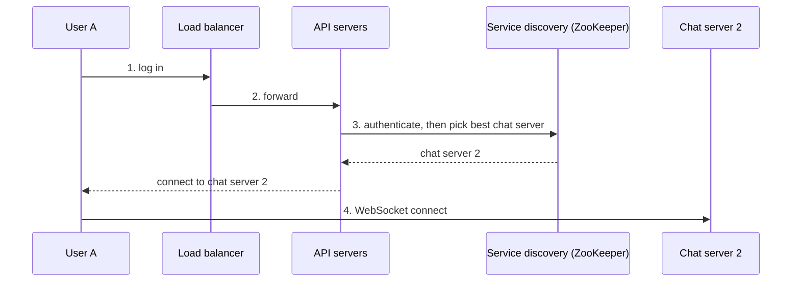

### 1:1 message flow

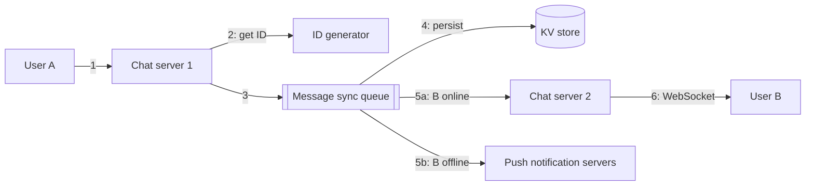

1. User A sends a message to **chat server 1**.
2. Chat server 1 gets a **message ID** from the ID generator.
3. It puts the message on the **message sync queue**.
4. The message is **stored** in the key-value store.
5. If **User B is online**, the message is forwarded to **chat server 2**, where B is connected (5a). If **B is offline**, a **push notification** goes out instead (5b).
6. Chat server 2 delivers it to User B over their persistent WebSocket.

### Syncing messages across devices

User A has a **phone and a laptop**, each with its own WebSocket connection. Each device keeps a **`cur_max_message_id`**, the newest message ID it has. A message is **new to a device** if:

- its **recipient** is the logged-in user, and
- its **`message_id` > the device's `cur_max_message_id`**.

Each device tracks its own cursor, so each one pulls exactly what it is missing from the key-value store.

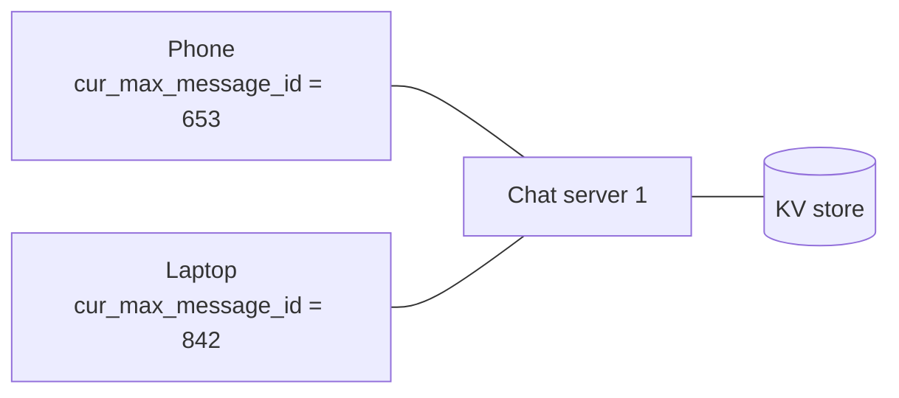

#### Practice: multi-device sync

Implement `sync(store, user, cursor)`. `store` is a list of `(message_id, recipient, text)` tuples. Return `(new_messages, new_cursor)`, where:

- `new_messages` holds the messages whose recipient is `user` and whose `message_id > cursor`, sorted by `message_id`, and
- `new_cursor` is the largest returned ID, or the old cursor if nothing is new.

The wrapper syncs each device listed for one user. Input: line 1 is the user, line 2 is `device=cursor` pairs, and each remaining line is `message_id recipient text…`.

<CodeExercise
  title="Multi-device message sync"
  heading="exercise-sdi-device-sync"
  lang="python"
  filename="main.py"
  prompt="Implement sync(store, user, cursor) returning (messages for user with message_id > cursor sorted by id, new cursor = max returned id or the old cursor)."
  sampleLog={`a
phone=0 laptop=3
1 a hi
2 b yo
3 a sup
5 a ok
phone: [1, 3, 5] -> cursor 5
laptop: [5] -> cursor 5`}
  starter={`def sync(store, user, cursor):
    pass
`}
  wrapSuffix={`
import sys
lines = sys.stdin.read().strip().split('\\n')
user = lines[0].strip()
devices = [tuple(p.split('=')) for p in lines[1].split()]
store = []
for line in lines[2:]:
    mid, recipient, text = line.split(' ', 2)
    store.append((int(mid), recipient, text))
for name, cursor in devices:
    msgs, new_cursor = sync(store, user, int(cursor))
    print(f'{name}: {[m[0] for m in msgs]} -> cursor {new_cursor}')
`}
  hint="Filter with m[1] == user and m[0] > cursor, sort by m[0], and use new[-1][0] as the new cursor when the list is non-empty."
  solution={`def sync(store, user, cursor):
    new = sorted((m for m in store if m[1] == user and m[0] > cursor), key=lambda m: m[0])
    return new, (new[-1][0] if new else cursor)
`}
  tests={[
    { name: 'two devices at different cursors', stdin: 'a\nphone=0 laptop=3\n1 a hi\n2 b yo\n3 a sup\n5 a ok', equals: 'phone: [1, 3, 5] -> cursor 5\nlaptop: [5] -> cursor 5' },
    { name: 'up-to-date device gets nothing', stdin: 'a\ntablet=5\n1 a hi\n5 a ok', equals: 'tablet: [] -> cursor 5' },
    { name: 'unsorted store, other recipients ignored', stdin: 'b\nphone=1\n9 b late\n2 b early\n4 a not-mine', equals: 'phone: [2, 9] -> cursor 9' },
  ]}
/>

### Small group chat flow

When User A posts in a group with B and C, the message is **copied into each other member's message sync queue**, one for B and one for C. Think of each queue as the recipient's **inbox**.

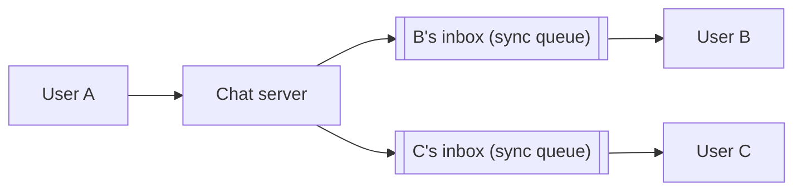

This suits small groups:

- **Sync is simple.** Each client only checks **its own inbox**.
- **Copies are cheap** when groups are small. WeChat does the same and caps groups at **500**.

For very large groups, storing a copy per member costs too much.

On the receiving side, a user's single inbox collects messages from **many senders and groups**:

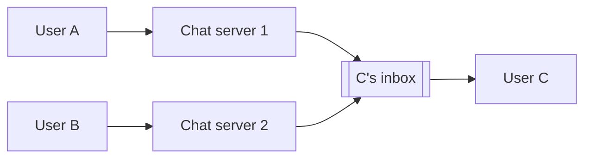

#### Practice: group inbox fanout with local IDs

Implement `Chat.send(channel, sender, text)`:

- Assign the next **local** message ID for that channel. Each channel counts **1, 2, 3, …** on its own.
- Append `(channel, message_id, sender, text)` to the **inbox of every member except the sender**.
- Return `(message_id, copies_written)`.

Input: line 1 is the groups as `channel:member,member,…` pairs, and each remaining line is `send <channel> <sender> <text…>`. The wrapper then prints every inbox.

<CodeExercise
  title="Group chat inbox fanout"
  heading="exercise-sdi-group-inbox"
  lang="python"
  filename="main.py"
  prompt="Implement Chat.send(channel, sender, text): allocate the channel's next local message ID (starting at 1), copy (channel, id, sender, text) into every other member's inbox, and return (id, copies_written)."
  sampleLog={`g1:a,b,c
send g1 a hello
send g1 a hello -> id 1, 2 copies
a: []
b: [('g1', 1, 'a', 'hello')]
c: [('g1', 1, 'a', 'hello')]`}
  starter={`class Chat:
    def __init__(self, groups):
        self.groups = groups   # channel -> list of members
        self.seq = {}          # channel -> last local message ID
        self.inbox = {}        # user -> list of (channel, id, sender, text)

    def send(self, channel, sender, text):
        pass
`}
  wrapSuffix={`
import sys
lines = sys.stdin.read().strip().split('\\n')
groups = {}
for pair in lines[0].split():
    ch, members = pair.split(':')
    groups[ch] = members.split(',')
chat = Chat(groups)
for line in lines[1:]:
    _, ch, sender, text = line.split(' ', 3)
    mid, copies = chat.send(ch, sender, text)
    print(f'send {ch} {sender} {text} -> id {mid}, {copies} copies')
for user in sorted({m for ms in groups.values() for m in ms}):
    print(f'{user}: {chat.inbox.get(user, [])}')
`}
  hint="self.seq[channel] = self.seq.get(channel, 0) + 1 gives the local ID. Loop over self.groups[channel], skip the sender, and append to self.inbox.setdefault(member, [])."
  solution={`class Chat:
    def __init__(self, groups):
        self.groups = groups   # channel -> list of members
        self.seq = {}          # channel -> last local message ID
        self.inbox = {}        # user -> list of (channel, id, sender, text)

    def send(self, channel, sender, text):
        self.seq[channel] = self.seq.get(channel, 0) + 1
        mid = self.seq[channel]
        copies = 0
        for member in self.groups[channel]:
            if member == sender:
                continue
            self.inbox.setdefault(member, []).append((channel, mid, sender, text))
            copies += 1
        return mid, copies
`}
  tests={[
    { name: 'single message', stdin: 'g1:a,b,c\nsend g1 a hello', equals: "send g1 a hello -> id 1, 2 copies\na: []\nb: [('g1', 1, 'a', 'hello')]\nc: [('g1', 1, 'a', 'hello')]" },
    { name: 'IDs are local per channel', stdin: 'g1:a,b,c g2:a,b\nsend g1 a hello\nsend g1 b hey\nsend g2 a x\nsend g1 c yo', equals: "send g1 a hello -> id 1, 2 copies\nsend g1 b hey -> id 2, 2 copies\nsend g2 a x -> id 1, 1 copies\nsend g1 c yo -> id 3, 2 copies\na: [('g1', 2, 'b', 'hey'), ('g1', 3, 'c', 'yo')]\nb: [('g1', 1, 'a', 'hello'), ('g2', 1, 'a', 'x'), ('g1', 3, 'c', 'yo')]\nc: [('g1', 1, 'a', 'hello'), ('g1', 2, 'b', 'hey')]" },
  ]}
/>

Notice that `g1` and `g2` **both** have a message with ID 1. That's fine, because ordering only has to hold **within** a channel, and the key is `(channel_id, message_id)`.

### Online presence

Presence servers manage the green "online" dot and talk to clients over WebSocket.

- **Login**: once the WebSocket connection is up, store the user's status as `online` with a `last_active_at` timestamp in the key-value store.
- **Logout**: set the status to `offline`.
- **Disconnection** is the tricky case. Marking a user offline the moment their connection drops, and online again when it returns, makes the dot **flicker** constantly, for example as someone's phone goes through a tunnel. That's a poor experience.

**Use a heartbeat instead.** An online client sends a heartbeat every few seconds. If the server **hasn't received one within x seconds**, the user is marked offline. In the book's example, the client sends a heartbeat every **5 seconds**, sends 3, then disconnects. With **x = 30 seconds**, the user goes offline only after 30 seconds without a heartbeat.

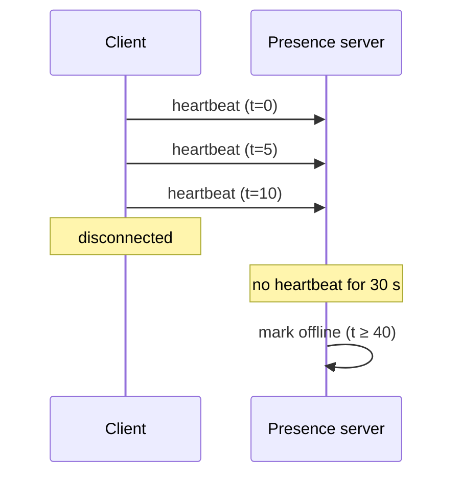

#### Practice: heartbeat presence

Implement `presence(heartbeats, queries, timeout)`. `heartbeats` maps each user to a list of heartbeat times. For each `(user, t)` query, the user is `online` if they have a heartbeat at or before `t` **and** `t - last_heartbeat < timeout`. Otherwise they're `offline`.

Input: line 1 is `timeout`, line 2 is `user:t1,t2,…` pairs, and each remaining line is `user t`.

<CodeExercise
  title="Heartbeat-based presence"
  heading="exercise-sdi-presence"
  lang="python"
  filename="main.py"
  prompt="Implement presence(heartbeats, queries, timeout) returning 'online' or 'offline' per (user, t) query: online iff the latest heartbeat at or before t exists and t - latest < timeout."
  sampleLog={`30
a:0,5,10
a 35
a 40
a@35: online
a@40: offline`}
  starter={`def presence(heartbeats, queries, timeout):
    pass
`}
  wrapSuffix={`
import sys
lines = sys.stdin.read().strip().split('\\n')
timeout = int(lines[0])
heartbeats = {}
for pair in lines[1].split():
    user, times = pair.split(':')
    heartbeats[user] = [int(t) for t in times.split(',')]
queries = [(u, int(t)) for u, t in (line.split() for line in lines[2:])]
for (user, t), status in zip(queries, presence(heartbeats, queries, timeout)):
    print(f'{user}@{t}: {status}')
`}
  hint="For each query, take [h for h in heartbeats.get(user, []) if h <= t]; if it's non-empty and t - max(...) < timeout the user is online."
  solution={`def presence(heartbeats, queries, timeout):
    result = []
    for user, t in queries:
        past = [h for h in heartbeats.get(user, []) if h <= t]
        online = bool(past) and t - max(past) < timeout
        result.append('online' if online else 'offline')
    return result
`}
  tests={[
    { name: 'book example: 3 heartbeats, x = 30', stdin: '30\na:0,5,10\na 10\na 35\na 40\na 41', equals: 'a@10: online\na@35: online\na@40: offline\na@41: offline' },
    { name: 'a 20-second gap (tunnel) does not flicker', stdin: '30\nb:0,5,10,30,35\nb 25\nb 40', equals: 'b@25: online\nb@40: online' },
    { name: 'unknown user and before first heartbeat', stdin: '30\na:100\nc 0\na 50\na 100', equals: 'c@0: offline\na@50: offline\na@100: online' },
  ]}
/>

#### Online status fanout

How do friends learn that a user's status changed? Presence servers use **publish-subscribe** with **one channel per friend pair**. When User A's status changes, it's published to channels **A-B**, **A-C**, and **A-D**, which friends B, C, and D subscribe to. Updates reach clients over WebSocket.

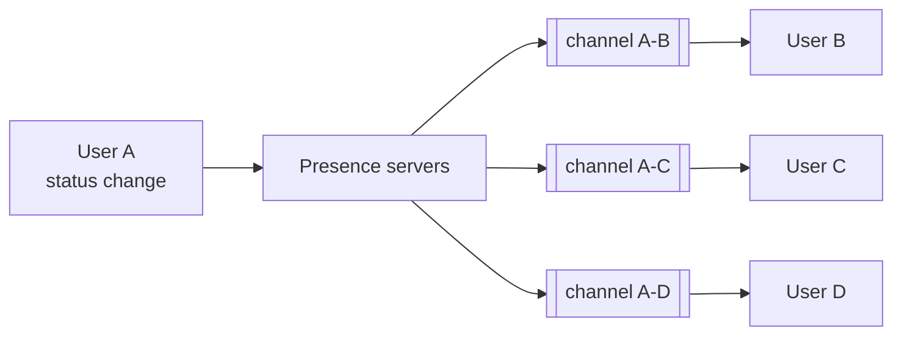

This works for **small groups**, and WeChat uses a similar approach with its 500-member cap. For a **100,000-member** group, though, each status change would create **100,000 events**. For large groups, fetch presence **only when a user opens the group** or manually refreshes the friend list.

### Check: deep dive

<MultipleChoice
  id="sdi-ch12-deep-dive"
  title="Flows, sync, and presence"
  questions={[
    {
      prompt: 'In the 1:1 flow, User B is offline when User A sends a message. What happens?',
      choices: [
        'The message is dropped',
        'The message is still stored in the KV store, and a push notification is sent. B fetches the message when they reconnect',
        'Chat server 1 retries until B comes online',
        'User A gets an error',
      ],
      answer: 1,
      why: 'Persisting first means nothing is lost. The push notification brings B back, and sync delivers the message.',
    },
    {
      prompt: 'Why can each device sync independently using cur_max_message_id?',
      choices: [
        'Because devices share one cursor',
        'Because message IDs increase with time, so "everything for me with an ID above my cursor" is exactly what that device is missing',
        'Because the server pushes every message to every device twice',
        'Because messages are never stored',
      ],
      answer: 1,
      why: 'Time-sortable IDs turn sync into a simple range query per device.',
    },
    {
      prompt: 'Why use a heartbeat timeout instead of marking users offline the moment their socket drops?',
      choices: [
        'Heartbeats are encrypted',
        'Mobile connections drop and reconnect often. A timeout keeps the indicator from flickering during brief outages',
        'Sockets never drop',
        'It reduces message latency',
      ],
      answer: 1,
      why: 'It trades a little staleness (up to x seconds) for a stable, meaningful status.',
    },
    {
      prompt: 'Why is per-member inbox copying acceptable for this design but not for a 100,000-member community?',
      choices: [
        'Inboxes can\'t hold text',
        'With groups capped at 100, one message means at most 99 copies. At 100,000 members, each message multiplies storage and write load enormously',
        'Large groups don\'t need ordering',
        'Copying is always free',
      ],
      answer: 1,
      why: 'It is the same fanout trade-off as the news feed\'s push model: fine for small audiences, too costly for huge ones.',
    },
  ]}
/>

---

## Step 4: Wrap Up

The design supports **1:1 and small group chat**, using **WebSocket** for real time. It has **chat servers** (messaging), **presence servers** (online status), **push notification servers**, a **key-value store** (history), and **API servers** (everything else). Extra talking points:

- **Media** (photos and videos): far larger than text, so discuss **compression**, **cloud storage**, and **thumbnails**.
- **End-to-end encryption**: as in WhatsApp, only the sender and recipient can read messages.
- **Client-side message caching** to cut data transfer.
- **Faster load times**: Slack built a geographically distributed edge cache (Flannel) for users, channels, and more.
- **Error handling**:
  - **Chat server failure**: a server may hold hundreds of thousands of connections. If it dies, **service discovery** hands clients a new server to reconnect to.
  - **Message resend**: **retries and queueing**.

---

## Key Takeaways

- Polling wastes requests, and long polling struggles with routing and detecting disconnects. **WebSocket** gives a persistent, bidirectional channel, so use it for both sending and receiving.
- **Stateless** API services sit behind a load balancer. The **stateful** chat service holds connections, with **service discovery** (ZooKeeper) choosing servers. **Push notifications** are a third-party integration.
- Chat history lives in a **key-value store** (HBase at Messenger, Cassandra at Discord), keyed by **message_id** for 1:1 chat or **(channel_id, message_id)** for groups. **Local per-channel IDs** are enough for ordering.
- Multi-device sync uses a **per-device cursor**. Small groups use **per-member inboxes**.
- Presence uses **heartbeats with a timeout**, plus **pub/sub per friend pair**, fetched on demand for large groups.

Previous lesson: [Design a News Feed System](./design-a-news-feed-system).

Next lesson: [Design a Search Autocomplete System](./design-a-search-autocomplete-system) — tries with cached top-k, offline data gathering, and prefix sharding.

---

## Reference Materials

1. [Erlang at Facebook](https://www.erlang-factory.com/upload/presentations/31/EugeneLetuchy-ErlangatFacebook.pdf)
2. [Messenger and WhatsApp process 60 billion messages a day](https://www.theverge.com/2016/4/12/11415198/facebook-messenger-whatsapp-number-messages-vs-sms-f8-2016) — The Verge
3. [Long tail](https://en.wikipedia.org/wiki/Long_tail) — Wikipedia
4. [The Underlying Technology of Messages](https://www.facebook.com/notes/facebook-engineering/the-underlying-technology-of-messages/454991608919/) — Facebook Engineering
5. [How Discord Stores Billions of Messages](https://blog.discordapp.com/how-discord-stores-billions-of-messages-7fa6ec7ee4c7)
6. [Announcing Snowflake](https://blog.twitter.com/engineering/en_us/a/2010/announcing-snowflake.html) — Twitter Engineering
7. [Apache ZooKeeper](https://zookeeper.apache.org/)
8. [From nothing: the evolution of WeChat background system](https://www.infoq.cn/article/the-road-of-the-growth-weixin-background) (in Chinese)
9. [End-to-end encryption](https://faq.whatsapp.com/en/android/28030015/) — WhatsApp FAQ
10. [Flannel: An Application-Level Edge Cache to Make Slack Scale](https://slack.engineering/flannel-an-application-level-edge-cache-to-make-slack-scale-b8a6400e2f6b)
