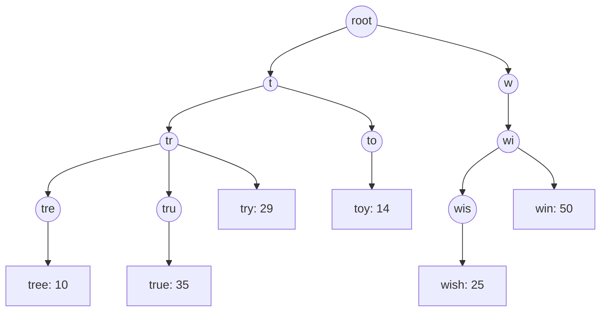
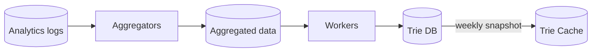
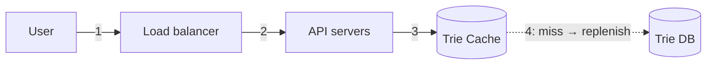
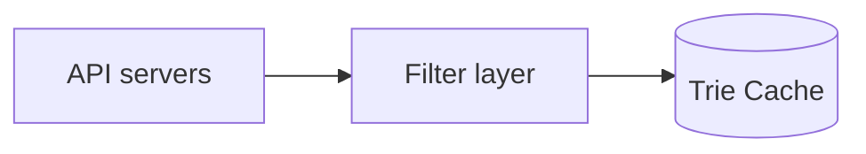
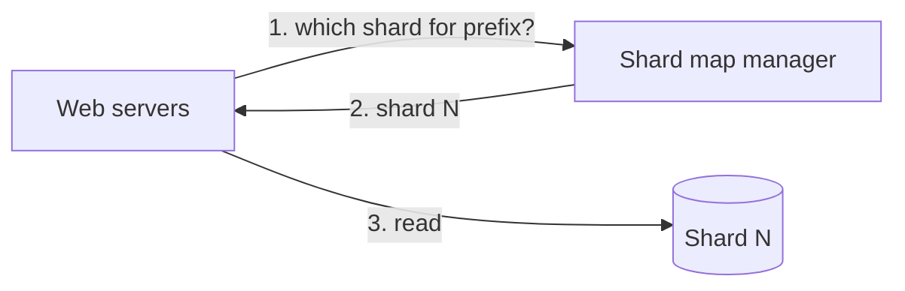

# Design a Search Autocomplete System

> **Adapted from:** Alex Xu, *System Design Interview – An Insider's Guide* (2020), Chapter 13 — rewritten and condensed for teaching.

When you type "dinner" into Google or Amazon, a list of suggestions appears below the box. This feature goes by **autocomplete**, **typeahead**, **search-as-you-type**, or **incremental search**. As an interview question, it's also called "design top k" or "design the top k most searched queries."

**What you'll be able to do after this lesson:**

- Estimate the request rate for typeahead, which sends a request on every keystroke.
- Build a **trie** that caches the **top k** results at every node, so lookups take O(1).
- Separate **query serving** from **data gathering**: logs, aggregators, workers, Trie DB, and Trie Cache.
- Update and filter the trie correctly, and **shard** it by prefix based on real traffic distribution.

---

## Step 1: Understand the Problem and Establish Scope

| Candidate asks | Interviewer answers |
|---|---|
| Match only at the beginning of a query, or in the middle too? | **Only at the beginning** |
| How many suggestions? | **5** |
| How do we choose which 5? | **Popularity**, meaning historical query frequency |
| Spell check? | **No** |
| Language? | **English** (multi-language if time allows) |
| Capitals or special characters? | **No**, lowercase letters only |
| Users? | **10 million DAU** |

### Requirements

- **Fast**: suggestions must appear while the user types. Facebook's typeahead targets under **100 ms**, and anything slower stutters.
- **Relevant** to the prefix typed.
- **Sorted** by popularity (or another ranking model).
- **Scalable** to high traffic.
- **Highly available** even when parts of the system are offline, slow, or seeing network errors.

### Back-of-the-envelope estimation

- 10 M DAU, each making **10 searches per day**.
- About **20 bytes per query**: ASCII (1 byte per character), 4 words × 5 characters.
- Each **keystroke** sends a request, so typing "dinner" sends six:

```text
search?q=d
search?q=di
search?q=din
search?q=dinn
search?q=dinne
search?q=dinner
```

| Quantity | Calculation | Result |
|---|---|---|
| QPS | 10 M users × 10 queries × 20 characters ÷ 86,400 s | ≈ 23,000, call it **~24,000** |
| Peak QPS | 2 × QPS | **~48,000** |
| New data per day | 10 M × 10 × 20 bytes × 20% new queries | **0.4 GB/day** |

---

## Step 2: High-Level Design

Two services:

- **Data gathering service**: collects user queries and aggregates them. Real-time aggregation is a starting point, though not practical at scale.
- **Query service**: given a prefix, returns the **5 most frequently searched** queries.

### Data gathering (naive)

Keep a **frequency table**. As users search "twitch", "twitter", "twitter", and "twillo", the table updates:

| query | frequency |
|---|---|
| twitch | 1 |
| twitter | 2 |
| twillo | 1 |

### Query service (naive)

Given a frequency table like this one:

| query | frequency |
|---|---|
| twitter | 35 |
| twitch | 29 |
| twilight | 25 |
| twin peak | 21 |
| twitch prime | 18 |
| twitter search | 14 |
| twillo | 10 |
| twin peak sf | 8 |

typing "tw" shows the top 5. In SQL:

```sql
SELECT * FROM frequency_table
WHERE query LIKE 'tw%'
ORDER BY frequency DESC
LIMIT 5;
```

This works for small data, but at scale the database becomes the bottleneck. The deep dive fixes that.

---

## Step 3: Design Deep Dive

### The trie data structure

A **trie** (pronounced "try," from re*trie*val) is a tree that stores strings compactly:

- The **root** is the empty string.
- Each node holds one **character**, and in principle has 26 children (empty links aren't drawn).
- Each node represents a **prefix**. Some nodes are also complete **queries**.

Here's a trie holding "tree", "try", "true", "toy", "wish", and "win", with frequencies:



**Basic top-k lookup.** Let p be the prefix length, n the number of nodes, and c the number of nodes in the prefix's subtree.

1. **Find the prefix node**: O(p).
2. **Traverse its subtree** to collect every valid query: O(c).
3. **Sort and take the top k**: O(c log c).

For example, with k = 2 and the prefix "tr": find node "tr", collect `[tree: 10], [true: 35], [try: 29]`, and return **true: 35, try: 29**.

The total is O(p) + O(c) + O(c log c). In the worst case that means traversing **the whole trie**, which is too slow. Two optimizations fix it.

#### Optimization 1: limit the prefix length

Users rarely type long queries. Capping p at, say, **50** turns "find the prefix" into **O(1)**.

#### Optimization 2: cache the top k at every node

Store the **top k queries** for each prefix **on its node**. With k = 5, the "be" node might hold `[best: 35, bet: 29, bee: 20, be: 15, beer: 10]`.

This **trades space for time**: every node now carries a small list. But fast responses are the top requirement, so the trade is worth it.

After both optimizations:

1. Find the prefix node: **O(1)**.
2. Return its cached top k: **O(1)**.

The whole lookup is **O(1)**.

#### Practice: a trie with cached top-k

Implement `Trie.set(query, freq)` and `Trie.suggest(prefix)`:

- Each node has `children`, `freq` (set only if the node is a complete query), and `top`, a list of up to `k` `(query, freq)` pairs sorted by **frequency descending, then query ascending**.
- `set` creates or updates the query's node, then **recomputes `top` bottom-up** along the path from that node to the root. Each node's `top` is the best `k` among its own query (if it has one) and **the union of its children's `top` lists**.
- `suggest(prefix)` walks to the prefix node and returns its `top`, or `[]` if the prefix doesn't exist.

Rebuilding from the children's cached lists is what keeps this correct when a frequency **decreases**: a query that wasn't cached before can move up into the list.

Input: line 1 is `k`, and each remaining line is `set <query> <freq>` or `get <prefix>` (use `get -` for the empty prefix).

<CodeExercise
  title="Trie with top-k cached at each node"
  heading="exercise-sdi-topk-trie"
  lang="python"
  filename="main.py"
  prompt="Implement Trie.set(query, freq) (create/update the node, then recompute top-k bottom-up from each node's own query plus its children's top lists) and Trie.suggest(prefix) (return the prefix node's cached top list or [])."
  sampleLog={`2
set tree 10
set try 29
set true 35
get tr
tr -> true:35, try:29`}
  starter={`class Node:
    def __init__(self):
        self.children = {}
        self.freq = None   # set if this node is a complete query
        self.top = []      # up to k (query, freq), sorted by (-freq, query)

class Trie:
    def __init__(self, k):
        self.root = Node()
        self.k = k

    def set(self, query, freq):
        pass

    def suggest(self, prefix):
        pass
`}
  wrapSuffix={`
import sys
lines = sys.stdin.read().strip().split('\\n')
trie = Trie(int(lines[0]))
for line in lines[1:]:
    parts = line.split()
    if parts[0] == 'set':
        trie.set(parts[1], int(parts[2]))
    else:
        prefix = '' if parts[1] == '-' else parts[1]
        top = trie.suggest(prefix)
        shown = ', '.join(f'{q}:{f}' for q, f in top) or '(none)'
        print(f"{parts[1]} -> {shown}")
`}
  hint="In set, record the path of nodes from root to the query's node, plus each node's prefix (query[:i]). Walk that path in reverse: candidates = [(prefix, node.freq)] if node.freq is not None, plus every child's top; node.top = sorted(candidates, key=lambda kv: (-kv[1], kv[0]))[:self.k]."
  solution={`class Node:
    def __init__(self):
        self.children = {}
        self.freq = None   # set if this node is a complete query
        self.top = []      # up to k (query, freq), sorted by (-freq, query)

class Trie:
    def __init__(self, k):
        self.root = Node()
        self.k = k

    def set(self, query, freq):
        path = [self.root]
        node = self.root
        for ch in query:
            node = node.children.setdefault(ch, Node())
            path.append(node)
        node.freq = freq
        prefixes = [query[:i] for i in range(len(query) + 1)]
        for node, prefix in zip(reversed(path), reversed(prefixes)):
            candidates = []
            if node.freq is not None:
                candidates.append((prefix, node.freq))
            for child in node.children.values():
                candidates.extend(child.top)
            node.top = sorted(candidates, key=lambda kv: (-kv[1], kv[0]))[:self.k]

    def suggest(self, prefix):
        node = self.root
        for ch in prefix:
            if ch not in node.children:
                return []
            node = node.children[ch]
        return node.top
`}
  tests={[
    { name: 'book trie, k = 2', stdin: '2\nset tree 10\nset try 29\nset true 35\nset toy 14\nset wish 25\nset win 50\nget tr\nget t\nget w\nget tre\nget x\nget -', equals: 'tr -> true:35, try:29\nt -> true:35, try:29\nw -> win:50, wish:25\ntre -> tree:10\nx -> (none)\n- -> win:50, true:35' },
    { name: '"be" node, k = 5', stdin: '5\nset be 15\nset bee 20\nset beer 10\nset best 35\nset bet 29\nget be', equals: 'be -> best:35, bet:29, bee:20, be:15, beer:10' },
    { name: 'update beer 10 -> 30 propagates to ancestors', stdin: '5\nset be 15\nset bee 20\nset beer 10\nset best 35\nset bet 29\nset buy 14\nset beer 30\nget be\nget b', equals: 'be -> best:35, beer:30, bet:29, bee:20, be:15\nb -> best:35, beer:30, bet:29, bee:20, be:15' },
    { name: 'decrease lets an uncached query in', stdin: '5\nset be 15\nset bee 20\nset beer 30\nset best 35\nset bet 29\nset buy 14\nset best 5\nget b\nget be', equals: 'b -> beer:30, bet:29, bee:20, be:15, buy:14\nbe -> beer:30, bet:29, bee:20, be:15, best:5' },
  ]}
/>

The last test is the subtle one. When `best` drops from 35 to 5, the "b" node must pick up `buy: 14`, which **wasn't in any cached list on that path** before. A naive update that only re-sorts the existing cache would miss it. Rebuilding each ancestor from its **children's** lists finds it.

### Data gathering service

Updating the trie on **every query** is impractical:

- Users enter **billions** of queries a day, and constant trie updates would slow the query service down.
- Top suggestions **don't change much** from minute to minute once the trie is built.

How fresh the data must be depends on the product. Twitter needs near-real-time suggestions, while many Google queries barely change from day to day. In both cases, though, the trie is built from **analytics and logging data**.



- **Analytics logs**: raw, **append-only**, unindexed records of queries.

  | query | time |
  |---|---|
  | tree | 2019-10-01 22:01:01 |
  | try | 2019-10-01 22:01:05 |
  | tree | 2019-10-01 22:01:30 |
  | toy | 2019-10-01 22:02:22 |
  | tree | 2019-10-02 22:02:42 |
  | try | 2019-10-03 22:03:03 |

- **Aggregators**: logs are huge and in the wrong shape, so aggregate them. Real-time products aggregate over **short windows**. Many others are fine **weekly**. We assume the trie is **rebuilt weekly**.
- **Aggregated data**: one row per query per week, where `time` is the week's start and `frequency` is that week's count.

  | query | time | frequency |
  |---|---|---|
  | tree | 2019-10-01 | 12000 |
  | tree | 2019-10-08 | 15000 |
  | tree | 2019-10-15 | 9000 |
  | toy | 2019-10-01 | 8500 |
  | toy | 2019-10-08 | 6256 |
  | toy | 2019-10-15 | 8866 |

- **Workers**: servers that run asynchronous jobs on a schedule, **build the trie**, and store it in the Trie DB.
- **Trie Cache**: a **distributed in-memory cache** holding the trie for fast reads, refreshed from a weekly snapshot of the DB.
- **Trie DB**: persistent storage, with two options:
  1. A **document store** such as MongoDB: serialize each week's trie snapshot and store it.
  2. A **key-value store**: map **each prefix to a key** and **each node's data to the value**. For example, `"be" → [best: 35, bet: 29, bee: 20, be: 15, beer: 10]`. This is the store from [Lesson 6](./design-a-key-value-store).

#### Practice: weekly aggregation

Implement `aggregate(logs)`. Each log is a `(query, 'YYYY-MM-DD')` pair. Group the logs by **week start**, the **Monday** on or before the date (`date - timedelta(days=date.weekday())`), and by query, and count them. Return `(week_start, query, frequency)` tuples sorted by week, then frequency descending, then query.

<CodeExercise
  title="Weekly log aggregator"
  heading="exercise-sdi-aggregate"
  lang="python"
  filename="main.py"
  prompt="Implement aggregate(logs) → sorted list of (week_start_iso, query, frequency), where week_start is the Monday on or before each log date. Sort by week, then -frequency, then query."
  sampleLog={`tree 2019-10-01
try 2019-10-02
tree 2019-10-06
2019-09-30 tree 2
2019-09-30 try 1`}
  starter={`import datetime as dt

def aggregate(logs):
    pass
`}
  wrapSuffix={`
import sys
logs = [tuple(line.split()) for line in sys.stdin.read().strip().split('\\n')]
for week, query, freq in aggregate(logs):
    print(week, query, freq)
`}
  hint="day = dt.date.fromisoformat(d); week = (day - dt.timedelta(days=day.weekday())).isoformat(). Count into a dict keyed by (week, query), then sort with key=lambda r: (r[0], -r[2], r[1])."
  solution={`import datetime as dt

def aggregate(logs):
    counts = {}
    for query, date_str in logs:
        day = dt.date.fromisoformat(date_str)
        week = (day - dt.timedelta(days=day.weekday())).isoformat()
        counts[(week, query)] = counts.get((week, query), 0) + 1
    rows = [(week, query, freq) for (week, query), freq in counts.items()]
    return sorted(rows, key=lambda r: (r[0], -r[2], r[1]))
`}
  tests={[
    { name: 'same week, Sunday still counts', stdin: 'tree 2019-10-01\ntry 2019-10-02\ntree 2019-10-06', equals: '2019-09-30 tree 2\n2019-09-30 try 1' },
    { name: 'Monday starts a new week', stdin: 'tree 2019-10-01\ntree 2019-10-07\ntoy 2019-10-07\ntoy 2019-10-08', equals: '2019-09-30 tree 1\n2019-10-07 toy 2\n2019-10-07 tree 1' },
    { name: 'ties sorted by query', stdin: 'b 2024-01-03\na 2024-01-04', equals: '2024-01-01 a 1\n2024-01-01 b 1' },
  ]}
/>

### Query service



1. The query reaches the **load balancer**.
2. It's routed to an **API server**.
3. The API server reads trie data from the **Trie Cache** and builds the suggestions.
4. On a **cache miss**, for example when a cache server ran out of memory or went offline, the data is **replenished** from the Trie DB, so later requests for that prefix hit the cache.

More optimizations, because typeahead has to be very fast:

- **AJAX requests.** Fetch suggestions in the background without reloading the page.
- **Browser caching.** Suggestions rarely change within minutes, so let the browser cache them. Google caches typeahead results for an hour:

  ```text
  cache-control: private, max-age=3600
  ```

  `private` means for **one user only**, so shared caches must not store it. `max-age=3600` means **3,600 seconds**, one hour.
- **Data sampling.** Logging every query at this scale is expensive, so log **1 out of every N** requests.

### Trie operations

- **Create**: workers build the trie from aggregated data (from the analytics log or DB).
- **Update**, in one of two ways:
  1. **Rebuild weekly** and swap the new trie in. This is the preferred approach.
  2. **Update individual nodes** in place. It's slow, but acceptable for small tries. Because ancestors cache their descendants' top queries, **every ancestor up to the root must be updated** as well. That's exactly what the exercise's bottom-up recomputation does. For example, setting "beer" from 10 to 30 changes the cached lists at "beer", "bee", "be", "b", and the root.
- **Delete**: hateful, violent, sexually explicit, or dangerous suggestions must go. Put a **filter layer** in front of the Trie Cache, so rules can remove results immediately, and delete the data from the database **asynchronously**, so the next weekly build is clean.



### Scaling the storage

When the trie no longer fits on one server, **shard by prefix**.

- **First-level sharding** by first letter: with 2 servers, `a–m` and `n–z`. With 3, `a–i`, `j–r`, `s–z`. That goes up to **26** shards.
- **Deeper sharding** by second or third letter. For example, `a` splits into `aa–ag`, `ah–an`, `ao–au`, `av–az`.

**The catch:** far more words start with `c` than with `x`, so letter-based shards are **uneven**. The fix is to analyze the **historical distribution** and let a **shard map manager** keep a lookup table of which prefixes live where. If `s` gets about as much traffic as `u`–`z` combined, give `s` its own shard and put `u`–`z` together on another.



#### Practice: build a balanced shard map

Implement `build_shards(counts, n)`. `counts` maps first letters to historical query counts (missing letters count 0). Walk `a` through `z` in order, adding each letter's count to the current shard. **Close the current shard** right after a letter that brings its total to at least `total / n`, as long as fewer than `n - 1` shards have been closed. The last shard runs to `z`. Return a list of `(first_letter, last_letter)` ranges.

`shard_for(query, shards)` returns the index of the range containing the query's first letter.

Input: line 1 is `n`, line 2 is `letter:count` pairs, and line 3 lists queries to look up.

<CodeExercise
  title="Traffic-aware shard map"
  heading="exercise-sdi-shard-map"
  lang="python"
  filename="main.py"
  prompt="Implement build_shards(counts, n) (greedy contiguous ranges over a–z, closing a shard when its running total reaches total/n, at most n-1 early closes, last shard ends at 'z') and shard_for(query, shards) (index of the range containing query[0])."
  sampleLog={`3
a:10 c:30 s:40 u:10 w:10
apple sun zoo
shards: a-c d-s t-z
apple -> 0
sun -> 1
zoo -> 2`}
  starter={`LETTERS = 'abcdefghijklmnopqrstuvwxyz'

def build_shards(counts, n):
    pass

def shard_for(query, shards):
    pass
`}
  wrapSuffix={`
import sys
lines = sys.stdin.read().strip().split('\\n')
n = int(lines[0])
counts = {k: int(v) for k, v in (p.split(':') for p in lines[1].split())}
shards = build_shards(counts, n)
print('shards:', ' '.join(f'{a}-{b}' for a, b in shards))
for q in lines[2].split():
    print(q, '->', shard_for(q, shards))
`}
  hint="Track start (first letter of the open shard) and running sum. After adding a letter: if running >= total / n and len(shards) < n - 1, append (start, letter) and reset. After the loop, close the remaining shard as (start, 'z'). shard_for: find i with a <= query[0] <= b."
  solution={`LETTERS = 'abcdefghijklmnopqrstuvwxyz'

def build_shards(counts, n):
    total = sum(counts.values())
    target = total / n
    shards = []
    start = None
    running = 0
    for ch in LETTERS:
        if start is None:
            start = ch
        running += counts.get(ch, 0)
        if running >= target and len(shards) < n - 1:
            shards.append((start, ch))
            start = None
            running = 0
    if start is not None:
        shards.append((start, 'z'))
    return shards

def shard_for(query, shards):
    first = query[0]
    for i, (a, b) in enumerate(shards):
        if a <= first <= b:
            return i
    raise ValueError(query)
`}
  tests={[
    { name: 'skewed traffic', stdin: '3\na:10 c:30 s:40 u:10 w:10\napple sun zoo', equals: 'shards: a-c d-s t-z\napple -> 0\nsun -> 1\nzoo -> 2' },
    { name: 'uniform traffic splits a–m / n–z', stdin: '2\na:1 b:1 c:1 d:1 e:1 f:1 g:1 h:1 i:1 j:1 k:1 l:1 m:1 n:1 o:1 p:1 q:1 r:1 s:1 t:1 u:1 v:1 w:1 x:1 y:1 z:1\nmango nut', equals: 'shards: a-m n-z\nmango -> 0\nnut -> 1' },
    { name: '"s" as heavy as u–z combined', stdin: '2\ns:50 u:20 v:10 w:10 z:10\nsearch tea zebra', equals: 'shards: a-s t-z\nsearch -> 0\ntea -> 1\nzebra -> 1' },
  ]}
/>

### Check: autocomplete design

<MultipleChoice
  id="sdi-ch13-trie"
  title="Tries, gathering, and scaling"
  questions={[
    {
      prompt: 'Why cache the top k queries at every trie node instead of computing them per request?',
      choices: [
        'It reduces memory use',
        'Computing per request means traversing the prefix\'s whole subtree, which can be most of the trie. Caching makes the lookup O(1) at the cost of extra space',
        'Tries cannot be traversed',
        'Browsers require it',
      ],
      answer: 1,
      why: 'Typeahead has to answer in under 100 ms. Trading memory for constant-time reads is the right call.',
    },
    {
      prompt: 'Why not update the trie on every search query?',
      choices: [
        'Tries are read-only',
        'There are billions of queries a day, and constant updates would slow serving. Top results also change slowly, so periodic rebuilds from aggregated logs are enough',
        'Updates require a SQL database',
        'Users don\'t want fresh suggestions',
      ],
      answer: 1,
      why: 'Separate the write-heavy gathering pipeline from the read-optimized serving structure, and rebuild on a schedule.',
    },
    {
      prompt: 'A response carries "cache-control: private, max-age=3600". What does this allow?',
      choices: [
        'Any CDN may cache it for an hour',
        'Only the user\'s own browser may cache it, for 3,600 seconds',
        'It must never be cached',
        'Cache it forever',
      ],
      answer: 1,
      why: '"private" excludes shared caches such as proxies and CDNs, and max-age is in seconds.',
    },
    {
      prompt: 'Sharding a–m / n–z leaves one server overloaded. What is the better approach?',
      choices: [
        'Add more letters to the alphabet',
        'Use historical query distribution to choose shard boundaries, recorded in a shard map manager',
        'Store everything in the browser',
        'Shard by query length',
      ],
      answer: 1,
      why: 'First letters are not evenly distributed, so boundaries should follow measured traffic, not the alphabet.',
    },
    {
      prompt: 'A breaking-news query spikes, but the trie is rebuilt weekly. Which change best supports trending suggestions?',
      choices: [
        'Rebuild the entire trie every second',
        'Process the query stream in near real time (e.g. Kafka plus a stream processor) and weight recent queries more heavily, over a smaller sharded working set',
        'Turn off browser caching only',
        'Increase k from 5 to 50',
      ],
      answer: 1,
      why: 'Real-time trends need streaming aggregation and ranking that favors recency. Batch rebuilds are too slow.',
    },
  ]}
/>

---

## Step 4: Wrap Up

Follow-up questions an interviewer might ask:

**How would you support multiple languages?** Store **Unicode** characters in the trie nodes. Unicode covers every writing system, modern and ancient.

**What if top queries differ by country?** Build **separate tries per country**, and serve them from **CDNs** for speed.

**How would you support trending (real-time) queries?** The weekly batch can't react to breaking news: the workers aren't scheduled yet, and a full rebuild takes too long anyway. Some ideas:

- **Reduce the working set** by sharding.
- **Change the ranking model** to give recent queries more weight.
- Handle **streaming data** with stream-processing systems such as Hadoop MapReduce, Spark Streaming, Storm, and Kafka. The [Derived Data](../derived-data/transmitting-event-streams) lessons cover these.

---

## Key Takeaways

- A request goes out on every keystroke, which gives about 24,000 QPS (48,000 at peak) at 10 M DAU, plus about 0.4 GB of new query data per day.
- **Trie + capped prefix length + top k cached per node** means **O(1)** lookups, at the cost of memory.
- Keep **gathering** (logs → aggregators → workers → Trie DB) separate from **serving** (API → Trie Cache, with replenish on miss), and **rebuild weekly**.
- In-place updates must recompute **every ancestor**, from the children's caches. Deletes go through a **filter layer** first, then are purged asynchronously.
- **Shard by prefix** using the **historical distribution**, not plain letter ranges. AJAX, **browser caching** (`private, max-age`), and **sampling** cut load further.

Previous lesson: [Design a Chat System](./design-a-chat-system).

Next lesson: [Design YouTube](./design-youtube) — upload and streaming flows, DAG-based transcoding, pre-signed URLs, and long-tail CDN cost savings.

---

## Reference Materials

1. [The Life of a Typeahead Query](https://www.facebook.com/notes/facebook-engineering/the-life-of-a-typeahead-query/389105248919/) — Facebook Engineering
2. [How We Built Prefixy: A Scalable Prefix Search Service for Powering Autocomplete](https://medium.com/@prefixyteam/how-we-built-prefixy-a-scalable-prefix-search-service-for-powering-autocomplete-c20f98e2eff1)
3. [Prefix Hash Tree: An Indexing Data Structure over Distributed Hash Tables](https://people.eecs.berkeley.edu/~sylvia/papers/pht.pdf)
4. [MongoDB](https://en.wikipedia.org/wiki/MongoDB) — Wikipedia
5. [Unicode frequently asked questions](https://www.unicode.org/faq/basic_q.html)
6. [Apache Hadoop](https://hadoop.apache.org/)
7. [Spark Streaming](https://spark.apache.org/streaming/)
8. [Apache Storm](https://storm.apache.org/)
9. [Apache Kafka](https://kafka.apache.org/documentation/)
