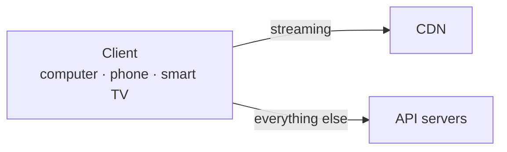
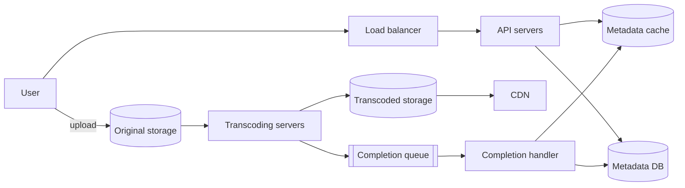
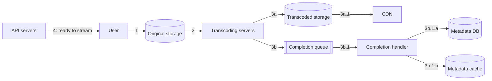
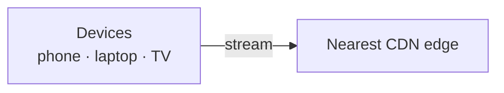
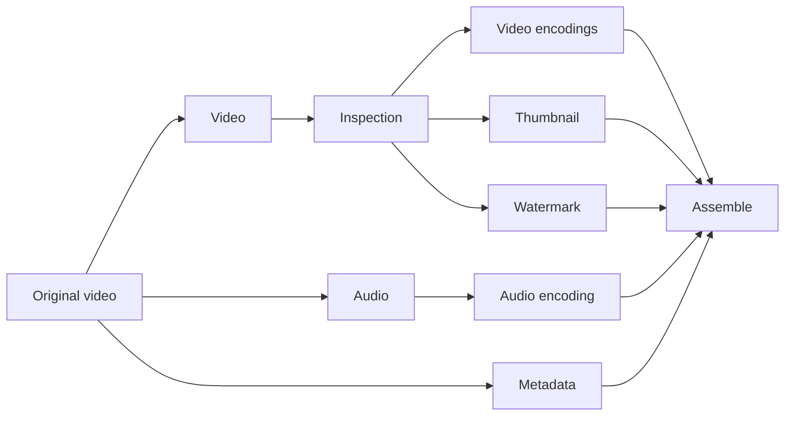
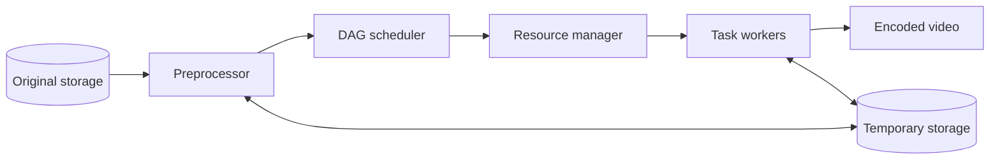
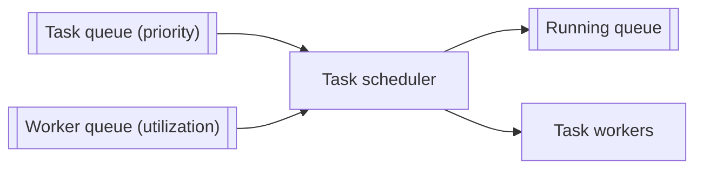
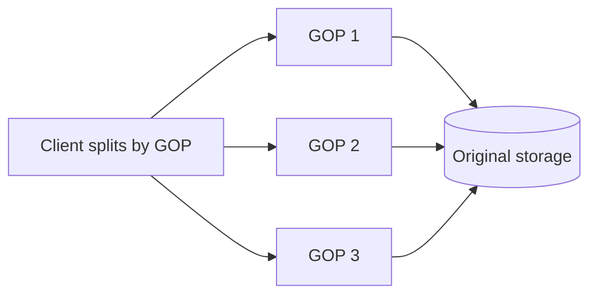
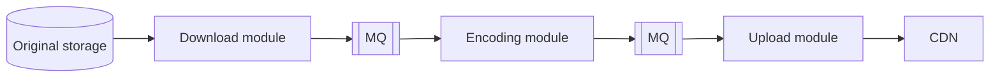
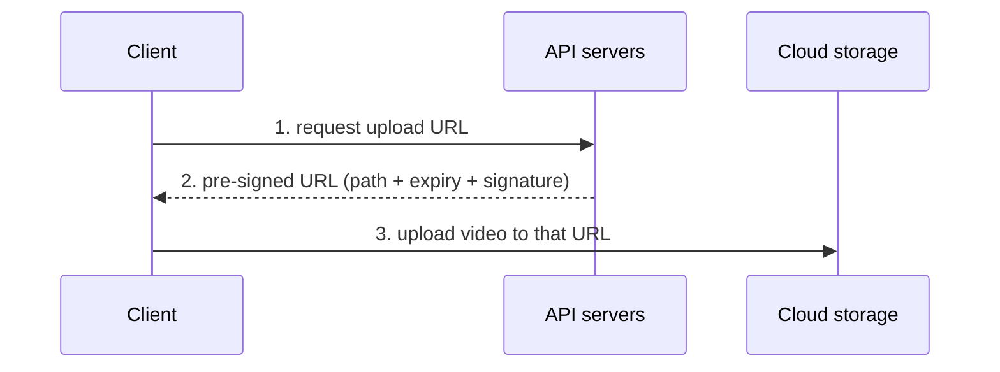

# Design YouTube

> **Adapted from:** Alex Xu, *System Design Interview – An Insider's Guide* (2020), Chapter 14 — rewritten and condensed for teaching.

YouTube looks simple: creators upload, viewers press play. Underneath is a lot of complex technology. The same design applies to other video platforms such as **Netflix** and **Hulu**.

Some 2020 numbers show the scale:

- **2 billion** monthly active users, and **5 billion** videos watched per day
- **73%** of US adults use it, and there are **50 million** creators
- **$15.1 billion** in ad revenue in 2019, up 36%
- **37%** of all mobile internet traffic
- Available in **80 languages**

It's enormous, global, and very profitable.

**What you'll be able to do after this lesson:**

- Estimate storage and **CDN cost**, and see why CDN cost drives the design.
- Design the **upload** flow (blob storage, transcoding, completion queue) and the **streaming** flow (CDN with streaming protocols).
- Explain transcoding (containers vs. codecs) and build a **DAG-based** transcoding pipeline with a resource manager.
- Apply speed, safety (**pre-signed URLs**, DRM), and cost optimizations, and plan error handling.

---

## Step 1: Understand the Problem and Establish Scope

| Candidate asks | Interviewer answers |
|---|---|
| Important features? | **Upload** a video and **watch** a video |
| Clients? | Mobile apps, web browsers, and **smart TVs** |
| DAU? | **5 million** |
| Average daily time spent? | **30 minutes** |
| International users? | **Yes**, a large share |
| Video resolutions? | Accept **most resolutions and formats** |
| Encryption? | **Yes** |
| File size limit? | Small to medium videos, **max 1 GB** |
| Can we use existing cloud infrastructure? | **Yes**, and it's recommended |

Target features:

- **Fast uploads**
- **Smooth streaming**
- **Switchable video quality**
- **Low infrastructure cost**
- **High availability, scalability, and reliability**
- Clients: **mobile, web, and smart TV**

### Back-of-the-envelope estimation

| Quantity | Calculation | Result |
|---|---|---|
| DAU | Assumption | 5 M |
| Views | 5 videos per user per day | 25 M views/day |
| Uploads | 10% of users upload 1 video per day | 500 K uploads/day |
| Average video size | Assumption | 300 MB |
| **Storage per day** | 5 M × 10% × 300 MB | **150 TB/day** |
| **CDN cost per day** | 5 M × 5 videos × 0.3 GB × $0.02/GB (CloudFront, US traffic) | **$150,000/day** |

That's about **$55 million a year** just to stream (counting only streaming traffic). Even with large-customer discounts, **CDN cost is the dominant expense**, and the deep dive returns to it.

---

## Step 2: High-Level Design

**Don't build everything yourself.** Use the cloud's **CDN** and **blob storage**:

- The interview is about **picking the right technology**, not re-deriving how blob storage works. Saying "blob storage for source videos" is enough.
- Building scalable blob storage or a CDN is **very hard and very expensive**. Even Netflix runs on **AWS**, and Facebook uses **Akamai**'s CDN.



- **Client**: computer, phone, or smart TV.
- **CDN**: stores videos and **streams** them when you press play.
- **API servers**: **everything except streaming**, including feed recommendations, generating upload URLs, updating the metadata database and cache, and user sign-up.

The interviewer is interested in two flows: **uploading** and **streaming**.

### Video uploading flow



- **Load balancer**: spreads requests across API servers.
- **API servers**: handle all user requests except streaming.
- **Metadata DB**: video metadata, **sharded and replicated**.
- **Metadata cache**: video metadata and user objects, cached for speed.
- **Original storage**: **blob storage** for uploaded originals. A BLOB is a *binary large object*, binary data stored as a single entity.
- **Transcoding servers**: **transcoding** (also called encoding) converts a video into other formats (MPEG, HLS, …) so that every device and bandwidth gets a suitable stream.
- **Transcoded storage**: blob storage for the transcoded files.
- **CDN**: caches the videos and streams them on play.
- **Completion queue**: a message queue of "transcoding finished" events.
- **Completion handler**: workers that pull from the completion queue and update the metadata cache and DB.

The upload runs as **two parallel processes**.

**Flow a: upload the actual video**



1. The video is uploaded to **original storage**.
2. **Transcoding servers** fetch it and transcode it.
3. When transcoding finishes, two things happen **in parallel**:
   - 3a. The transcoded files go to **transcoded storage**, and from there (3a.1) to the **CDN**.
   - 3b. A completion event goes to the **completion queue**. The **completion handler** (3b.1) picks it up and updates the **metadata DB and cache** (3b.1.a, 3b.1.b).
4. The API servers tell the client the video is **uploaded and ready to stream**.

**Flow b: update the metadata.** While the file uploads, the client **in parallel** sends the video's metadata (file name, size, format, …) to the API servers, which update the metadata cache and DB.

### Video streaming flow

**Downloading** copies the whole file to your device. **Streaming** delivers it a little at a time, so playback starts immediately and continues smoothly.

A **streaming protocol** standardizes that transfer. The common ones:

- **MPEG-DASH** (Dynamic Adaptive Streaming over HTTP)
- **Apple HLS** (HTTP Live Streaming)
- **Microsoft Smooth Streaming**
- **Adobe HTTP Dynamic Streaming (HDS)**

You don't need to memorize them. What matters is that **different protocols support different encodings and players**, so you pick the ones your clients need.

Videos stream **directly from the CDN edge server closest to the viewer**, which keeps latency low.



### Check: high-level design

<MultipleChoice
  id="sdi-ch14-high-level"
  title="Upload, stream, and cost"
  questions={[
    {
      prompt: 'Using the lesson\'s assumptions, why is the CDN the cost item to worry about?',
      choices: [
        'Storage of 150 TB/day is free',
        'At 25 M views/day × 0.3 GB × $0.02/GB it costs about $150,000 per day, far more than other line items',
        'CDNs charge per upload',
        'API servers are more expensive than CDNs',
      ],
      answer: 1,
      why: 'Egress is billed per GB served, and video is heavy, so streaming cost scales directly with views × size.',
    },
    {
      prompt: 'Why is a completion queue placed between the transcoding servers and the metadata updates?',
      choices: [
        'To encrypt videos',
        'To decouple transcoding from metadata updates. Completion events are buffered and processed by handler workers, so neither side blocks the other',
        'Because the CDN requires it',
        'To store original videos',
      ],
      answer: 1,
      why: 'It is the same message-queue decoupling as Lesson 1, so slow or failed metadata writes don\'t stall transcoding.',
    },
    {
      prompt: 'What is the key difference between streaming and downloading?',
      choices: [
        'Streaming uses UDP and downloading uses TCP',
        'Streaming delivers the video a piece at a time so playback starts immediately. Downloading copies the whole file first',
        'Downloading is always faster',
        'Streaming requires a smart TV',
      ],
      answer: 1,
      why: 'Chunked, continuous delivery is what makes playback start instantly.',
    },
  ]}
/>

---

## Step 3: Design Deep Dive

### Video transcoding

Cameras and phones record in one particular format. To play smoothly everywhere, a video must be re-encoded to compatible **formats** and **bitrates**. **Bitrate** is the number of bits processed per second. Higher bitrate generally means better quality, but needs more processing power and bandwidth.

Why transcode:

- **Raw video is huge.** An hour of 60 fps HD can take **hundreds of GB**.
- **Compatibility.** Devices and browsers each support only some formats.
- **Quality for each user's bandwidth.** Serve high resolution to fast connections and lower resolution to slow ones.
- **Changing networks**, especially on mobile. Switching quality automatically or manually keeps playback continuous.

Most encoding formats have two parts:

- **Container**: the "basket" holding video, audio, and metadata. You can tell it from the extension: `.avi`, `.mov`, `.mp4`.
- **Codec**: the compression and decompression algorithm that shrinks the video while preserving quality, such as **H.264**, **VP9**, or **HEVC**.

### The DAG model

Transcoding is **expensive and slow**, and creators need different processing: some want **watermarks**, some supply their own **thumbnails**, some upload HD and others don't. To support many pipelines with high parallelism, let programmers **define tasks as a DAG** (directed acyclic graph). Facebook's streaming video engine does this. Tasks run in **stages**, sequentially or in parallel.



Tasks applied to the video:

- **Inspection**: check quality and detect malformed files.
- **Video encodings**: produce multiple resolutions, codecs, and bitrates, such as `funny_360p.mp4`, `funny_480p.mp4`, `funny_720p.mp4`, and `funny_1080p.mp4`.
- **Thumbnail**: uploaded by the user or generated automatically.
- **Watermark**: an image overlay with identifying information.

### Video transcoding architecture



There are six components: **preprocessor**, **DAG scheduler**, **resource manager**, **task workers**, **temporary storage**, and the **encoded video** output.

#### Preprocessor

1. **Video splitting**: cut the stream into **GOP** (Group of Pictures) chunks. A GOP is a group of frames in a set order, and each GOP is **independently playable**, typically a few seconds long.
2. **Splitting for old clients**: some older devices and browsers can't split by GOP, so the preprocessor does it for them on the server.
3. **DAG generation**: build the DAG from **configuration files** written by client programmers. A two-task config such as "download → transcode" becomes 2 nodes and 1 edge.
4. **Cache data**: store GOPs and metadata in **temporary storage**, so a failed encode can be **retried** from the persisted pieces.

#### DAG scheduler

The DAG scheduler splits the graph into **stages** of tasks and puts them in the resource manager's task queue. For the original video, for example:

- **Stage 1**: split into video, audio, and metadata.
- **Stage 2**: video encoding and thumbnail (from the video), and audio encoding (from the audio).

Each stage contains tasks whose dependencies are **all finished**, so tasks within a stage run **in parallel**.

#### Practice: DAG stages

Implement `dag_stages(deps)`. `deps` maps each task to the tasks it depends on. Tasks that appear only as dependencies have no dependencies themselves. Return a list of stages: each stage holds every not-yet-scheduled task whose dependencies were **all scheduled in earlier stages**, sorted by name. If no task is ready but some remain, raise `ValueError('cycle detected')`.

Input: each line is `task: dep1,dep2` (or `task:` for no dependencies).

<CodeExercise
  title="DAG scheduler: split into stages"
  heading="exercise-sdi-dag-stages"
  lang="python"
  filename="main.py"
  prompt="Implement dag_stages(deps) returning a list of stages (sorted task names), where each stage contains all remaining tasks whose dependencies are all in earlier stages. Raise ValueError('cycle detected') if progress stops."
  sampleLog={`b: a
c: a
d: b,c
stage 1: a
stage 2: b, c
stage 3: d`}
  starter={`def dag_stages(deps):
    pass
`}
  wrapSuffix={`
import sys
deps = {}
for line in sys.stdin.read().strip().split('\\n'):
    task, rest = line.split(':')
    deps[task.strip()] = [d.strip() for d in rest.split(',') if d.strip()]
try:
    for i, stage in enumerate(dag_stages(deps), start=1):
        print(f'stage {i}:', ', '.join(stage))
except ValueError as e:
    print('error:', e)
`}
  hint="Collect every task (keys plus all dependencies). Keep remaining = {task: set(deps.get(task, []))} and done = set(). Each round: ready = sorted(t for t, d in remaining.items() if d <= done); if empty, raise; else add ready to done and remove them from remaining."
  solution={`def dag_stages(deps):
    tasks = set(deps) | {d for ds in deps.values() for d in ds}
    remaining = {t: set(deps.get(t, [])) for t in tasks}
    done = set()
    stages = []
    while remaining:
        ready = sorted(t for t, d in remaining.items() if d <= done)
        if not ready:
            raise ValueError('cycle detected')
        stages.append(ready)
        done |= set(ready)
        for t in ready:
            del remaining[t]
    return stages
`}
  tests={[
    { name: 'diamond', stdin: 'b: a\nc: a\nd: b,c', equals: 'stage 1: a\nstage 2: b, c\nstage 3: d' },
    { name: 'transcoding DAG', stdin: 'video: original\naudio: original\nmetadata: original\nvideo_encoding: video\nthumbnail: video\naudio_encoding: audio\nassemble: video_encoding,thumbnail,audio_encoding,metadata', equals: 'stage 1: original\nstage 2: audio, metadata, video\nstage 3: audio_encoding, thumbnail, video_encoding\nstage 4: assemble' },
    { name: 'cycle is rejected', stdin: 'a: b\nb: a', equals: 'error: cycle detected' },
  ]}
/>

#### Resource manager

The resource manager decides **which worker runs which task**. It has **three queues and a task scheduler**:

- **Task queue**: a **priority queue** of tasks to run.
- **Worker queue**: a **priority queue** of workers, ordered by **utilization**.
- **Running queue**: the tasks currently running, and which worker is running each one.
- **Task scheduler**: picks the best task–worker pair and starts the job.



The scheduling loop:

1. Take the **highest-priority task** from the task queue.
2. Take the **best worker**, the least utilized, from the worker queue.
3. Tell that worker to run the task.
4. Record the task–worker pair in the **running queue**.
5. Remove it from the running queue when the job finishes.

#### Practice: the task scheduler

Implement `schedule(tasks, workers)`:

- `tasks` is a list of `(name, priority, cost)`. Higher priority goes first, and **ties go to the task listed first**.
- `workers` is a list of `(name, load)`. Each task goes to the worker with the **lowest current load**, with ties broken by worker name. That worker's load then increases by the task's cost.
- Return `(task, worker, worker_load_after)` for each assignment, in order.

Use `heapq` for both queues. Input: line 1 is `worker=load` pairs, and each remaining line is `task priority cost`.

<CodeExercise
  title="Resource manager scheduler"
  heading="exercise-sdi-resource-manager"
  lang="python"
  filename="main.py"
  prompt="Implement schedule(tasks, workers): repeatedly pop the highest-priority task (ties: earlier in input) and the least-loaded worker (ties: name), assign, add cost to that worker's load, and record (task, worker, new_load)."
  sampleLog={`w1=0 w2=2
enc_720p 5 3
enc_1080p 9 5
enc_1080p -> w1 (load 5)
enc_720p -> w2 (load 5)`}
  starter={`import heapq

def schedule(tasks, workers):
    pass
`}
  wrapSuffix={`
import sys
lines = sys.stdin.read().strip().split('\\n')
workers = [(name, int(load)) for name, load in (p.split('=') for p in lines[0].split())]
tasks = [(n, int(p), int(c)) for n, p, c in (line.split() for line in lines[1:])]
for task, worker, load in schedule(tasks, workers):
    print(f'{task} -> {worker} (load {load})')
`}
  hint="Task heap entries: (-priority, index, name, cost). Worker heap entries: (load, name). Pop one of each, then push (load + cost, name) back."
  solution={`import heapq

def schedule(tasks, workers):
    task_q = [(-p, i, name, cost) for i, (name, p, cost) in enumerate(tasks)]
    heapq.heapify(task_q)
    worker_q = [(load, name) for name, load in workers]
    heapq.heapify(worker_q)
    assignments = []
    while task_q:
        _, _, name, cost = heapq.heappop(task_q)
        load, worker = heapq.heappop(worker_q)
        assignments.append((name, worker, load + cost))
        heapq.heappush(worker_q, (load + cost, worker))
    return assignments
`}
  tests={[
    { name: 'two tasks, two workers', stdin: 'w1=0 w2=2\nenc_720p 5 3\nenc_1080p 9 5', equals: 'enc_1080p -> w1 (load 5)\nenc_720p -> w2 (load 5)' },
    { name: 'priority ties keep input order', stdin: 'w1=0 w2=2\nenc_720p 5 3\nthumb 2 1\nenc_1080p 9 5\naudio 5 2', equals: 'enc_1080p -> w1 (load 5)\nenc_720p -> w2 (load 5)\naudio -> w1 (load 7)\nthumb -> w2 (load 6)' },
    { name: 'single worker runs everything', stdin: 'solo=0\na 1 1\nb 2 1\nc 3 1', equals: 'c -> solo (load 1)\nb -> solo (load 2)\na -> solo (load 3)' },
  ]}
/>

#### Task workers, temporary storage, and output

- **Task workers** run the tasks defined in the DAG. Different workers can specialize: watermark, encoder, thumbnail, merger, and so on.
- **Temporary storage** uses several systems chosen by data type, size, access frequency, and lifespan. **Metadata** is small and read often, so it goes in **memory**. **Video and audio** go in **blob storage**. Everything is freed once processing finishes.
- **Encoded video** is the pipeline's final output, for example `funny_720p.mp4`.

### Check: transcoding

<MultipleChoice
  id="sdi-ch14-transcoding"
  title="Codecs, DAGs, and scheduling"
  questions={[
    {
      prompt: 'What is the difference between a container and a codec?',
      choices: [
        'They are the same thing',
        'The container (.mp4, .mov) packages video, audio, and metadata. The codec (H.264, VP9, HEVC) is the compression algorithm for the streams inside',
        'The codec is the file extension',
        'Containers compress audio only',
      ],
      answer: 1,
      why: 'You can put an H.264 stream in different containers, and one container can hold different codecs.',
    },
    {
      prompt: 'Why model transcoding as a DAG instead of one fixed script?',
      choices: [
        'DAGs use less storage',
        'Creators need different pipelines (watermarks, custom thumbnails, …). A DAG lets each be configured, and independent tasks in the same stage run in parallel',
        'Scripts cannot transcode video',
        'DAGs remove the need for workers',
      ],
      answer: 1,
      why: 'You get flexibility from configuration and speed from parallelism within stages.',
    },
    {
      prompt: 'Why does the preprocessor store GOP chunks in temporary storage?',
      choices: [
        'To serve them from the CDN',
        'So a failed encoding task can be retried from the persisted chunks, without re-uploading or re-splitting',
        'Because workers cannot read blob storage',
        'To compress them',
      ],
      answer: 1,
      why: 'Persisted intermediate state makes the pipeline resilient to failures.',
    },
  ]}
/>

---

### System optimizations

#### Speed: parallelize uploading

Uploading a video **as one unit** is slow and fragile. Instead, split it into **GOP-aligned chunks** **on the client**. Chunks upload in parallel, and a failed upload **resumes** from the last good chunk.



#### Speed: upload centers close to users

Run **upload centers around the world**, so US users upload to North America and users in China upload to Asia. Use the **CDN as the upload centers**.

#### Speed: parallelism everywhere

In a strict pipeline, **download → encode → upload**, each step waits for the previous one. Put **message queues** between the modules. Then the encoder no longer waits on the downloader: it processes whatever events are in its queue, **in parallel**.



#### Safety: pre-signed upload URLs

Only **authorized users** should upload, and only to **the right location**.



1. The client asks the API servers for a **pre-signed URL**, which grants permission for **one specific object**.
2. The API servers return it.
3. The client uploads directly to storage using that URL.

"Pre-signed URL" is the Amazon S3 term. **Azure** calls the same idea a **Shared Access Signature**. The URL carries an **expiry** and a **signature** (an HMAC over the path and expiry, computed with a server secret). Storage can verify it without calling the API servers, and any change to the path or expiry breaks the signature.

#### Practice: sign and verify upload URLs

Implement:

- `sign(path, expires, secret)`: `hmac.new(secret.encode(), f"{path}:{expires}".encode(), hashlib.sha256).hexdigest()[:16]`.
- `make_url(path, expires, secret)`: `f"{path}?expires={expires}&sig={signature}"`.
- `verify(url, now, secret)`: parse `path`, `expires`, and `sig`. Return `'invalid signature'` if the recomputed signature doesn't match (compare with `hmac.compare_digest`). Otherwise return `'expired'` if `now > expires`, and `'ok'` if neither applies.

The wrapper uses the secret `s3cr3t`. Each input line is either `sign <path> <expires>` or `verify <url> <now>`.

<CodeExercise
  title="Pre-signed upload URLs"
  heading="exercise-sdi-presigned"
  lang="python"
  filename="main.py"
  prompt="Implement sign, make_url, and verify as specified. verify checks the HMAC first ('invalid signature'), then expiry ('expired'), else 'ok'."
  sampleLog={`sign /uploads/v123.mp4 1000
/uploads/v123.mp4?expires=1000&sig=cf3a6ca83cb8b9c7`}
  starter={`import hashlib
import hmac

def sign(path, expires, secret):
    pass

def make_url(path, expires, secret):
    pass

def verify(url, now, secret):
    pass
`}
  wrapSuffix={`
import sys
SECRET = 's3cr3t'
for line in sys.stdin.read().strip().split('\\n'):
    cmd, a, b = line.split()
    if cmd == 'sign':
        print(make_url(a, int(b), SECRET))
    else:
        print(verify(a, int(b), SECRET))
`}
  hint="In verify: path, query = url.split('?', 1); params = dict(p.split('=', 1) for p in query.split('&')). Recompute sign(path, int(params['expires']), secret) and compare it to params['sig'] with hmac.compare_digest."
  solution={`import hashlib
import hmac

def sign(path, expires, secret):
    msg = f'{path}:{expires}'.encode()
    return hmac.new(secret.encode(), msg, hashlib.sha256).hexdigest()[:16]

def make_url(path, expires, secret):
    return f'{path}?expires={expires}&sig={sign(path, expires, secret)}'

def verify(url, now, secret):
    path, query = url.split('?', 1)
    params = dict(p.split('=', 1) for p in query.split('&'))
    expires = int(params['expires'])
    if not hmac.compare_digest(sign(path, expires, secret), params['sig']):
        return 'invalid signature'
    if now > expires:
        return 'expired'
    return 'ok'
`}
  tests={[
    { name: 'sign', stdin: 'sign /uploads/v123.mp4 1000', equals: '/uploads/v123.mp4?expires=1000&sig=cf3a6ca83cb8b9c7' },
    { name: 'valid until the expiry instant', stdin: 'verify /uploads/v123.mp4?expires=1000&sig=cf3a6ca83cb8b9c7 999\nverify /uploads/v123.mp4?expires=1000&sig=cf3a6ca83cb8b9c7 1000\nverify /uploads/v123.mp4?expires=1000&sig=cf3a6ca83cb8b9c7 1001', equals: 'ok\nok\nexpired' },
    { name: 'tampered path or expiry', stdin: 'verify /uploads/v999.mp4?expires=1000&sig=cf3a6ca83cb8b9c7 10\nverify /uploads/v123.mp4?expires=9999&sig=cf3a6ca83cb8b9c7 10', equals: 'invalid signature\ninvalid signature' },
  ]}
/>

The second tampering test is the important one. Pushing the expiry out to 9999 to extend access **invalidates the signature**, because the expiry is part of the signed message.

#### Safety: protect your videos

Creators worry about their videos being stolen. Three protections:

- **Digital rights management (DRM)**: Apple **FairPlay**, Google **Widevine**, and Microsoft **PlayReady**.
- **AES encryption**: encrypt the video and attach an authorization policy. It is decrypted at playback, so only authorized users can watch.
- **Visual watermarking**: an image overlay, such as a logo or company name.

#### Cost-saving optimizations

The CDN is essential but expensive. Fortunately, YouTube views follow a **long-tail distribution**: a **few popular videos** get most of the views, while **most videos get few or none**. That suggests:

1. **Serve only popular videos from the CDN**. Serve the rest from **high-capacity video servers**.

   ```mermaid
   flowchart LR
     U[User] -- "popular" --> CDN[CDN]
     U -- "long tail" --> VS[Video servers]
   ```

2. **Store fewer encoded versions** of unpopular videos, and **encode short videos on demand**.
3. **Distribute regionally popular videos only to that region.**
4. **Build your own CDN and partner with ISPs** (Comcast, AT&T, Verizon, …), as Netflix does with Open Connect. It's a huge project, but at very large scale it improves the viewing experience and cuts bandwidth costs.

All of these depend on **content popularity, access patterns, and video size**, so **analyze historical viewing data** before optimizing.

### Error handling

There are two kinds of error:

- **Recoverable**, such as a segment that fails to transcode: **retry** a few times. If it keeps failing, return an appropriate error code.
- **Non-recoverable**, such as a malformed video: **stop** the video's tasks and return an appropriate error code.

A playbook by component:

| Failure | Response |
|---|---|
| Upload error | Retry a few times |
| Split video error | Old clients can't split by GOP: upload the whole video and **split on the server** |
| Transcoding error | Retry |
| Preprocessor error | Regenerate the DAG |
| DAG scheduler error | Reschedule the task |
| Resource manager queue down | Use a **replica** |
| Task worker down | Retry the task on a **new worker** |
| API server down | Stateless, so route requests to **another API server** |
| Metadata cache server down | Data is replicated, so read other nodes and bring up a replacement |
| Metadata DB primary down | **Promote a replica** to primary |
| Metadata DB replica down | Read from another replica, and replace the dead one |

### Check: optimizations and errors

<MultipleChoice
  id="sdi-ch14-optimizations"
  title="Speed, safety, cost, failures"
  questions={[
    {
      prompt: 'Why have the client split videos into GOP chunks before uploading?',
      choices: [
        'GOPs are encrypted',
        'Chunks can upload in parallel and a failed upload resumes from the last good chunk instead of restarting a 1 GB file',
        'Servers cannot accept files over 1 MB',
        'It removes the need for transcoding',
      ],
      answer: 1,
      why: 'Parallel, resumable uploads improve both speed and resilience on flaky networks.',
    },
    {
      prompt: 'An attacker edits a pre-signed URL\'s expires parameter from 1000 to 9999. What happens?',
      choices: [
        'They get upload access until 9999',
        'Verification fails, because the signature covers the expiry, so the altered URL is rejected',
        'The server resets the expiry to 1000',
        'Nothing; expiry is ignored',
      ],
      answer: 1,
      why: 'Every field that controls access must be inside the signed message. Otherwise it could be tampered with.',
    },
    {
      prompt: 'Views follow a long-tail distribution. Which cost optimization follows directly?',
      choices: [
        'Put every video on the CDN in every region',
        'Serve the few popular videos from the CDN and the long tail from cheaper video servers, and keep fewer encodings of rarely watched videos',
        'Delete unpopular videos',
        'Disable transcoding',
      ],
      answer: 1,
      why: 'The CDN pays off where traffic is concentrated. For rarely watched videos, edge caching is mostly wasted money.',
    },
    {
      prompt: 'A video file is malformed and can\'t be decoded. How should the system respond?',
      choices: [
        'Retry forever',
        'Treat it as non-recoverable: stop that video\'s tasks and return a proper error code to the client',
        'Silently skip it and mark the upload successful',
        'Restart all transcoding servers',
      ],
      answer: 1,
      why: 'Retries only help with transient errors. A corrupt input will fail every time.',
    },
  ]}
/>

---

## Step 4: Wrap Up

Extra talking points:

- **Scale the API tier**: it's stateless, so scale it horizontally.
- **Scale the database**: replication and sharding.
- **Live streaming**: it also needs uploading, encoding, and streaming, but differs in three ways:
  - **Tighter latency**, which may require a different streaming protocol.
  - **Less need for parallelism**, because small chunks are already processed in real time.
  - **Different error handling**, since anything slow is unacceptable.
- **Video takedowns**: remove copyright violations, pornography, and illegal content. Some are caught **during upload**, others through **user flagging**.

---

## Key Takeaways

- About **150 TB/day** of new storage and about **$150 K/day** of CDN streaming, so **CDN cost shapes the design**.
- Use **managed cloud services**: **blob storage** for originals and transcoded files, and a **CDN** for streaming. API servers handle everything else.
- Upload: **original storage → transcoding → transcoded storage → CDN**, with a **completion queue** feeding the metadata updates, all in parallel with the metadata upload.
- Transcoding is a **DAG**: preprocessor (GOP split, DAG generation, temporary cache) → **DAG scheduler** (stages) → **resource manager** (task, worker, and running queues) → workers.
- Optimize for **speed** (chunked parallel uploads, nearby upload centers, queues between modules), **safety** (**pre-signed URLs**, DRM, AES, watermarks), and **cost** (follow the **long tail**: CDN only for popular videos).
- Classify errors as **recoverable** (retry) or **non-recoverable** (stop and report), and keep a per-component playbook.

Previous lesson: [Design a Search Autocomplete System](./design-a-search-autocomplete-system).

Next lesson: [Design Google Drive](./design-google-drive) — block servers and delta sync, strongly consistent metadata, sync conflicts, and long-polling notifications.

---

## Reference Materials

1. [YouTube by the numbers](https://www.omnicoreagency.com/youtube-statistics/)
2. [2019 YouTube Demographics](https://blog.hubspot.com/marketing/youtube-demographics) — HubSpot
3. [CloudFront Pricing](https://aws.amazon.com/cloudfront/pricing/)
4. [Netflix on AWS](https://aws.amazon.com/solutions/case-studies/netflix/)
5. [Akamai](https://www.akamai.com/)
6. [Binary large object](https://en.wikipedia.org/wiki/Binary_large_object) — Wikipedia
7. [Here's What You Need to Know About Streaming Protocols](https://www.dacast.com/blog/streaming-protocols/) — Dacast
8. [SVE: Distributed Video Processing at Facebook Scale](https://www.cs.princeton.edu/~wlloyd/papers/sve-sosp17.pdf)
9. [Weibo video processing architecture](https://www.upyun.com/opentalk/399.html) (in Chinese)
10. [Delegate access with a shared access signature](https://docs.microsoft.com/en-us/rest/api/storageservices/delegate-access-with-shared-access-signature) — Microsoft Azure
11. [YouTube scalability talk by an early YouTube employee](https://www.youtube.com/watch?v=w5WVu624fY8)
12. [Understanding the characteristics of internet short video sharing: a YouTube-based measurement study](https://arxiv.org/pdf/0707.3670.pdf)
13. [Content Popularity for Open Connect](https://netflixtechblog.com/content-popularity-for-open-connect-b86d56f613b) — Netflix Tech Blog
