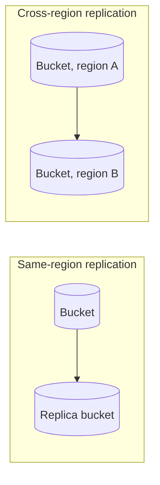
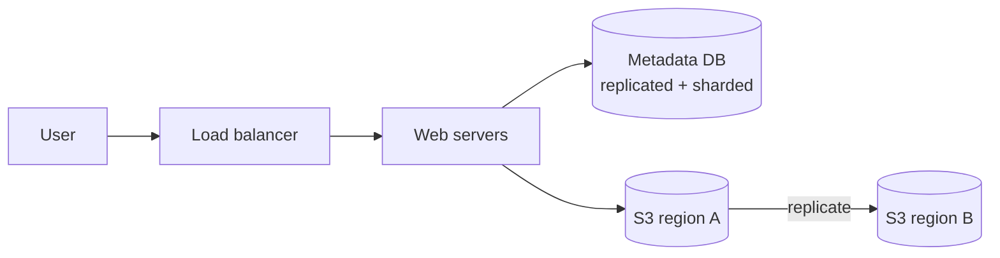
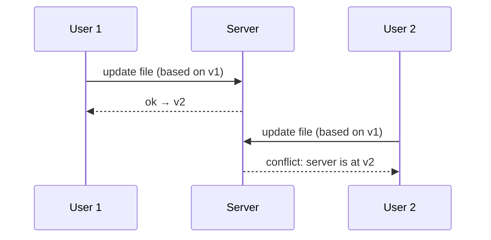
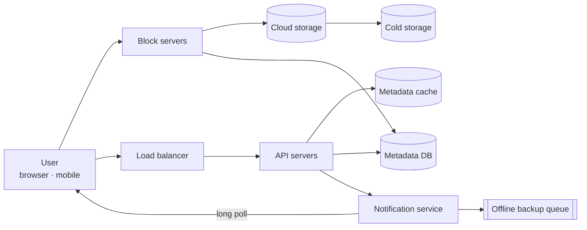
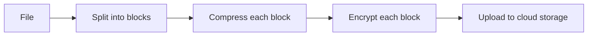
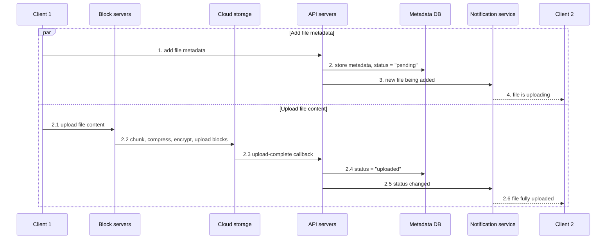
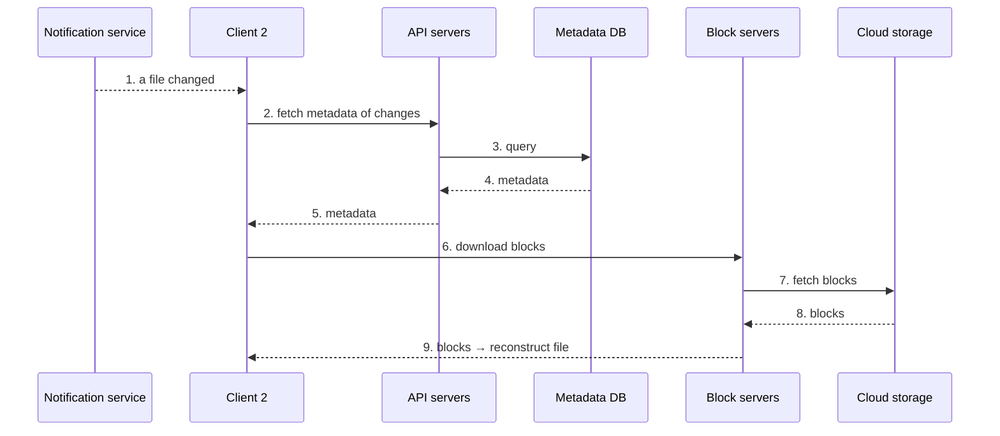

# Design Google Drive

> **Adapted from:** Alex Xu, *System Design Interview – An Insider's Guide* (2020), Chapter 15 — rewritten and condensed for teaching.

Google Drive, Dropbox, Microsoft OneDrive, and Apple iCloud are **file storage and synchronization** services. You store documents, photos, and videos in the cloud, reach them from any computer, phone, or tablet, and share them with others.

This final design ties the series together. It needs a **strongly consistent metadata store**, **blob storage** with cross-region replication, **delta sync** to save bandwidth, and a **notification service** to keep every device up to date.

**What you'll be able to do after this lesson:**

- Grow a single-server file store into a scalable design built on S3, step by step.
- Explain **block servers**: chunking, compression, encryption, and **delta sync**.
- Design the metadata schema and the **upload** and **download** flows, and justify **strong consistency** and a **relational** metadata DB.
- Resolve **sync conflicts**, choose **long polling** for notifications, save storage space, and handle failures.

---

## Step 1: Understand the Problem and Establish Scope

| Candidate asks | Interviewer answers |
|---|---|
| Most important features? | **Upload/download**, **file sync**, and **notifications** |
| Mobile, web, or both? | Both |
| Supported file types? | **Any** |
| Encryption? | **Yes**, files must be encrypted in storage |
| File size limit? | **10 GB** or smaller |
| Users? | **10 M DAU** |

**In scope:**

- **Add files**, for example by drag and drop
- **Download files**
- **Sync across devices**: a file added on one device appears on the others
- **See file revisions**
- **Share files** with friends, family, and coworkers
- **Notifications** when a file is edited, deleted, or shared with you

**Out of scope:** Google Docs-style **real-time collaborative editing**.

**Non-functional requirements:**

- **Reliability.** **Data loss is unacceptable.**
- **Fast sync.** Slow sync makes users give up on the product.
- **Low bandwidth use.** This matters especially on mobile data plans.
- **Scalability** to high traffic.
- **High availability** despite offline or slow servers and network errors.

### Back-of-the-envelope estimation

| Quantity | Calculation | Result |
|---|---|---|
| Users | Assumption | 50 M signed up, 10 M DAU |
| Free space | Assumption | 10 GB per user |
| Uploads | 2 files per user per day, 500 KB average | |
| Read:write ratio | Assumption | 1:1 |
| **Total space allocated** | 50 M × 10 GB | **500 PB** |
| **Upload QPS** | 10 M × 2 ÷ 86,400 s | ≈ 231, call it **~240** |
| **Peak upload QPS** | 2 × QPS | **~480** |

---

## Step 2: High-Level Design

Rather than presenting the final diagram up front, we'll start with **one server** and grow it. This is the same approach as [Lesson 1](./scale-from-zero-to-millions-of-users).

### A single server

- A **web server** (Apache) for uploads and downloads.
- A **database** (MySQL) for metadata: users, login info, file info.
- A **storage directory**, `drive/`, with **1 TB** of space.

Under `drive/`, each user has a **namespace** directory that holds all of their files, stored under their original names. A file or folder is identified uniquely by **namespace + relative path**:

```text
drive/
├── user1/
│   └── recipes/
│       └── chicken_soup.txt
├── user2/
│   ├── football.mov
│   └── sports.txt
└── user3/
    └── best_pic_ever.png
```

### APIs

All APIs require **authentication** and use **HTTPS**, so SSL/TLS protects data in transit.

**1. Upload a file.** There are two types:

- **Simple upload** for small files.
- **Resumable upload** for large files or unreliable networks.

```text
POST https://api.example.com/files/upload?uploadType=resumable
  data: local file to upload
```

A resumable upload takes three steps:

1. Send an initial request to get a **resumable URL**.
2. Upload the data and **track its progress**.
3. If the upload is interrupted, **resume** from where it stopped.

**2. Download a file.**

```text
GET https://api.example.com/files/download
  { "path": "/recipes/soup/best_soup.txt" }
```

**3. List file revisions.**

```text
GET https://api.example.com/files/list_revisions
  { "path": "/recipes/soup/best_soup.txt", "limit": 20 }
```

### Moving off the single server

Eventually a **"space full"** alert arrives: only **10 MB** left, and uploads start failing.

**First fix: sharding.** Spread files across several storage servers by `user_id`. That works, but losing a storage server would still lose data.

**Better fix: Amazon S3.** S3 is object storage built for scalability, availability, security, and performance, and it is used by companies such as Netflix and Airbnb. It supports **same-region** and **cross-region replication**. A **region** is a geographic area where AWS runs data centers, and a **bucket** is roughly a top-level folder. Keeping copies in several regions protects against data loss and keeps files available.



**Further improvements:**

- **Load balancer**: spreads traffic evenly and routes around failed web servers.
- **Web servers**: with a load balancer in place, add or remove them as traffic changes.
- **Metadata database**: move it off the web server to remove a single point of failure, and add **replication and sharding**.
- **File storage**: S3, with files replicated in **two geographic regions**.



### Sync conflicts

When two users change **the same file at the same time**, the rule is: **the first version processed wins**. The later one gets a **conflict**.



For User 2, the system **shows both copies**: their **local** version and the **latest server** version. They can **merge** the two or **overwrite** one with the other. (Keeping a document synchronized while many people edit it at once is a much harder problem. See *Differential Synchronization* in the references.)

#### Practice: first-processed-wins conflicts

Implement `Server.commit(path, base_version, content, user)`, using **optimistic concurrency**:

- Each path has a current version. A path that doesn't exist yet is at **v0**.
- If `base_version` equals the current version, store the content as **current + 1** and return `"<user>: ok -> v<new>"`.
- Otherwise return `"<user>: conflict (server at v<current>, you based on v<base>)"`, and **change nothing**.

Each input line is `path base_version user content…`.

<CodeExercise
  title="Optimistic concurrency for sync conflicts"
  heading="exercise-sdi-sync-conflict"
  lang="python"
  filename="main.py"
  prompt="Implement Server.commit(path, base_version, content, user). Accept only if base_version equals the path's current version (new paths are at v0); otherwise report a conflict without changing state."
  sampleLog={`/a.txt 0 u1 hello
/a.txt 0 u2 hi
u1: ok -> v1
u2: conflict (server at v1, you based on v0)`}
  starter={`class Server:
    def __init__(self):
        self.files = {}   # path -> (version, content)

    def commit(self, path, base_version, content, user):
        pass
`}
  wrapSuffix={`
import sys
server = Server()
for line in sys.stdin.read().strip().split('\\n'):
    path, base, user, content = line.split(' ', 3)
    print(server.commit(path, int(base), content, user))
`}
  hint="current, _ = self.files.get(path, (0, None)). Compare base_version with current; on success store (current + 1, content)."
  solution={`class Server:
    def __init__(self):
        self.files = {}   # path -> (version, content)

    def commit(self, path, base_version, content, user):
        current, _ = self.files.get(path, (0, None))
        if base_version != current:
            return f'{user}: conflict (server at v{current}, you based on v{base_version})'
        self.files[path] = (current + 1, content)
        return f'{user}: ok -> v{current + 1}'
`}
  tests={[
    { name: 'simultaneous edit: first wins', stdin: '/a.txt 0 u1 hello\n/a.txt 0 u2 hi', equals: 'u1: ok -> v1\nu2: conflict (server at v1, you based on v0)' },
    { name: 'conflicted user merges and retries on latest', stdin: '/a.txt 0 u1 hello\n/a.txt 1 u1 hello world\n/a.txt 1 u2 hello there\n/a.txt 2 u2 hello world and there', equals: 'u1: ok -> v1\nu1: ok -> v2\nu2: conflict (server at v2, you based on v1)\nu2: ok -> v3' },
    { name: 'paths are independent; stale base on a new path', stdin: '/a.txt 0 u1 x\n/b.txt 0 u2 y\n/c.txt 3 u3 z', equals: 'u1: ok -> v1\nu2: ok -> v1\nu3: conflict (server at v0, you based on v3)' },
  ]}
/>

### The high-level design



- **Block servers**: upload **blocks** to cloud storage. A file is split into blocks, and each block gets a **unique hash** stored in the metadata DB. Each block is an **independent object** in storage (S3). A file is rebuilt by **joining its blocks in order**. Block size follows Dropbox: at most **4 MB**.
- **Cloud storage**: holds the blocks.
- **Cold storage**: cheap storage for **inactive** data that hasn't been touched for a long time.
- **Load balancer**: spreads requests across API servers.
- **API servers**: almost everything **except uploading** file content: authentication, user profiles, file metadata updates, and so on.
- **Metadata database**: metadata for **users, files, blocks, and versions**. Only metadata lives here, while the file contents live in cloud storage.
- **Metadata cache**: hot metadata, for fast reads.
- **Notification service**: a **pub/sub** system that tells clients when a file has been **added, edited, or removed** elsewhere, so they can pull the changes.
- **Offline backup queue**: stores changes for **offline** clients, so they can sync when they reconnect.

### Check: high-level design

<MultipleChoice
  id="sdi-ch15-high-level"
  title="Storage, conflicts, components"
  questions={[
    {
      prompt: 'After sharding files across your own storage servers, what problem remains that S3 with cross-region replication solves?',
      choices: [
        'Upload speed',
        'Durability and availability: losing a storage server or a whole region would otherwise lose or block access to files',
        'Metadata consistency',
        'Authentication',
      ],
      answer: 1,
      why: 'Sharding spreads capacity but doesn\'t add redundancy. Replicating across regions protects against server and regional failures.',
    },
    {
      prompt: 'User 2 saves an edit based on v1, but the server is already at v2. What does the system do?',
      choices: [
        'Silently overwrite v2 with User 2\'s copy',
        'Reject it as a conflict and show both versions, so User 2 can merge or choose one',
        'Discard User 2\'s changes without telling them',
        'Merge automatically, character by character',
      ],
      answer: 1,
      why: 'First-processed wins, and the loser decides. Nothing is lost silently, which is what the "data loss is unacceptable" requirement demands.',
    },
    {
      prompt: 'Which component holds the actual file contents?',
      choices: ['Metadata database', 'Cloud storage, as blocks (cold storage for inactive data)', 'API servers', 'Notification service'],
      answer: 1,
      why: 'The metadata DB only describes files and blocks. The bytes live in object storage.',
    },
  ]}
/>

---

## Step 3: Design Deep Dive

### Block servers

Re-uploading a **large, frequently edited file** in full after every change wastes bandwidth. Two optimizations help:

- **Delta sync**: when a file changes, sync **only the changed blocks**, using a sync algorithm such as **rsync**.
- **Compression**: compress each block, choosing the algorithm by file type. **gzip** and **bzip2** suit text, while images and video need different codecs.

Block servers do the heavy lifting. For a new file:



1. **Split** the file into blocks.
2. **Compress** each block.
3. **Encrypt** each block. Encryption is a requirement.
4. **Upload** the blocks to cloud storage.

With **delta sync**, if only block 2 and block 5 of a file changed, **only those two blocks** are uploaded.

#### Practice: delta sync

Implement `split_blocks(data, size)` (fixed-size blocks, where the last one may be shorter) and `changed_blocks(old, new, size)`. The second function returns the **indexes of blocks in `new`** whose hash (the first 8 hex characters of SHA-256) differs from the block at the same index in `old`. Blocks beyond the end of `old` count as changed.

Input: line 1 is `size`, line 2 is the old content, and line 3 is the new content.

<CodeExercise
  title="Delta sync: which blocks changed?"
  heading="exercise-sdi-delta-sync"
  lang="python"
  filename="main.py"
  prompt="Implement split_blocks(data, size) and changed_blocks(old, new, size) → indexes i of new's blocks where i is past old's last block or the block hashes differ."
  sampleLog={`4
AAAABBBBCCCCDDDDEEEE
AAAAXXXXCCCCDDDDYYYY
upload blocks: [1, 4] (2 of 5)`}
  starter={`import hashlib

def block_hash(block):
    return hashlib.sha256(block.encode()).hexdigest()[:8]

def split_blocks(data, size):
    pass

def changed_blocks(old, new, size):
    pass
`}
  wrapSuffix={`
import sys
lines = sys.stdin.read().split('\\n')
size = int(lines[0])
old, new = lines[1], lines[2]
changed = changed_blocks(old, new, size)
print(f'upload blocks: {changed} ({len(changed)} of {len(split_blocks(new, size))})')
`}
  hint="split_blocks: [data[i:i + size] for i in range(0, len(data), size)]. changed_blocks: hash both lists and keep i where i >= len(old_hashes) or the hashes differ."
  solution={`import hashlib

def block_hash(block):
    return hashlib.sha256(block.encode()).hexdigest()[:8]

def split_blocks(data, size):
    return [data[i:i + size] for i in range(0, len(data), size)]

def changed_blocks(old, new, size):
    old_hashes = [block_hash(b) for b in split_blocks(old, size)]
    new_hashes = [block_hash(b) for b in split_blocks(new, size)]
    return [i for i, h in enumerate(new_hashes) if i >= len(old_hashes) or old_hashes[i] != h]
`}
  tests={[
    { name: 'blocks 2 and 5 edited', stdin: '4\nAAAABBBBCCCCDDDDEEEE\nAAAAXXXXCCCCDDDDYYYY', equals: 'upload blocks: [1, 4] (2 of 5)' },
    { name: 'appending only uploads the tail', stdin: '4\nAAAABBBBCCCC\nAAAABBBBCCCCDD', equals: 'upload blocks: [3] (1 of 4)' },
    { name: 'unchanged file uploads nothing', stdin: '4\nAAAABBBB\nAAAABBBB', equals: 'upload blocks: [] (0 of 2)' },
    { name: 'inserting one byte at the front shifts every block', stdin: '4\nAAAABBBBCCCC\nZAAAABBBBCCCC', equals: 'upload blocks: [0, 1, 2, 3] (4 of 4)' },
  ]}
/>

The last test shows the weakness of **fixed-size blocks**: inserting one byte at the front shifts every block boundary, so everything looks changed. Real delta-sync algorithms such as **rsync** use **rolling hashes** to find matching blocks at **any offset**. That way, an insertion costs about one block instead of the whole file.

### Strong consistency

**Strong consistency is the default here.** Two clients must never see the same file differently at the same time. That applies to both the **metadata cache** and the **metadata DB**.

Caches are **eventually consistent** by default: replicas may disagree for a while. To make them strongly consistent:

- Keep the **cache replicas consistent with the primary**.
- **Invalidate the cache on every database write**, so the cache and DB hold the same values.

**Relational databases** provide this naturally through **ACID** (Atomicity, Consistency, Isolation, Durability). NoSQL stores usually don't, so ACID behavior would have to be built into the sync logic by hand. **We choose a relational database** for metadata. Contrast this with the AP key-value store of [Lesson 6](./design-a-key-value-store): the requirements here favor consistency.

### Metadata database

A simplified schema:

| Table | Key fields | Notes |
|---|---|---|
| **user** | `user_id`, `user_name`, `created_at` | Basic profile info |
| **device** | `device_id`, `user_id`, `push_id`, `last_logged_in_at` | `push_id` for mobile push. **A user can have many devices** |
| **namespace** | `id`, `user_id`, `is_shared` | A user's **root directory** |
| **file** | `id`, `namespace_id`, `relative_path`, `file_name`, `is_directory`, `latest_version`, `checksum`, `last_modified` | Everything about the **latest** version |
| **file_version** | `id`, `file_id`, `device_id`, `version_number`, `last_modified` | **Version history. Rows are read-only** to protect the revision history |
| **block** | `block_id`, `file_version_id`, `block_order` | **Any version** is rebuilt by joining its blocks in `block_order` |

### Upload flow

Two requests run **in parallel** from client 1:



**Add file metadata:**

1. Client 1 asks to add the new file's metadata.
2. The metadata is stored in the DB with status **"pending"**.
3. The notification service is told that a new file is being added.
4. It tells **client 2** that a file is uploading.

**Upload the file to cloud storage:**

- 2.1. Client 1 uploads the file content to the **block servers**.
- 2.2. Block servers **chunk, compress, and encrypt** the file and upload the blocks to cloud storage.
- 2.3. Cloud storage fires an **upload-complete callback** to the API servers.
- 2.4. The file status changes to **"uploaded"** in the metadata DB.
- 2.5. The notification service is told about the status change.
- 2.6. It tells **client 2** the file is fully uploaded.

Editing a file follows the same flow.

### Download flow

How does a client learn that a file changed elsewhere?

- **Online**: the **notification service** tells it to pull the latest changes.
- **Offline**: the changes are **saved** (in the offline backup queue and cache), and the client pulls them when it reconnects.



The client fetches **metadata first** to learn which blocks it needs, then **downloads only those blocks** and reassembles the file.

### Notification service

Every local change must reach the other clients quickly, to keep conflicts rare. There are two options:

- **Long polling**, which **Dropbox uses**.
- **WebSocket**: persistent and bidirectional.

**We choose long polling**, because:

- Communication is **one-way**: the server tells clients about changes, and clients don't push events back over this channel.
- **WebSocket suits real-time bidirectional traffic**, as in the chat system of [Lesson 12](./design-a-chat-system). Drive notifications are **infrequent and not bursty**.

Each client holds a **long-poll connection** to the notification service. When a change is detected, the connection **closes**, which tells the client to fetch the latest changes from the metadata servers. After a response or a timeout, the client **reconnects immediately**.

### Saving storage space

Version history plus multi-data-center copies fill storage fast. Three techniques help:

1. **De-duplicate blocks** at the **account level**: two blocks with the **same hash** are identical, so store them once.
2. **Use a smarter backup strategy**:
   - **Set a limit** on stored versions. When it's reached, the **oldest** version is replaced by the new one.
   - **Keep only valuable versions.** A heavily edited document might be saved over 1,000 times in a short period. Cap the saved versions and **weight recent ones** more. Experiment to find the right number.
3. **Move cold data to cold storage.** Data inactive for months or years goes to something like **Amazon S3 Glacier**, which is much cheaper than standard S3.

#### Practice: block-level deduplication

Implement `BlockStore.upload(data, size)`. It splits the data into fixed-size blocks, adds each block's length to `self.logical_bytes`, stores each block under its hash **only if that hash is new**, and returns the number of **new** blocks stored.

The wrapper uploads each input line as a file and then reports the deduplication savings. Line 1 is `size`, and each remaining line is a file's content.

<CodeExercise
  title="Account-level block dedupe"
  heading="exercise-sdi-dedupe"
  lang="python"
  filename="main.py"
  prompt="Implement BlockStore.upload(data, size): split into fixed-size blocks, count every block's bytes into logical_bytes, store a block in self.blocks (keyed by hash) only if unseen, and return how many new blocks were stored."
  sampleLog={`4
AAAABBBBCCCC
AAAABBBBDDDD
file 1: 3 new blocks
file 2: 1 new blocks
unique blocks: 4
logical bytes: 24, stored bytes: 16`}
  starter={`import hashlib

def block_hash(block):
    return hashlib.sha256(block.encode()).hexdigest()[:8]

class BlockStore:
    def __init__(self):
        self.blocks = {}         # hash -> block
        self.logical_bytes = 0   # bytes uploaded before dedupe

    def upload(self, data, size):
        pass
`}
  wrapSuffix={`
import sys
lines = sys.stdin.read().strip().split('\\n')
size = int(lines[0])
store = BlockStore()
for i, data in enumerate(lines[1:], start=1):
    print(f'file {i}: {store.upload(data, size)} new blocks')
stored = sum(len(b) for b in store.blocks.values())
print(f'unique blocks: {len(store.blocks)}')
print(f'logical bytes: {store.logical_bytes}, stored bytes: {stored}')
`}
  hint="Loop over data[i:i + size] for i in range(0, len(data), size); add len(block) to logical_bytes; if block_hash(block) not in self.blocks, store it and count it."
  solution={`import hashlib

def block_hash(block):
    return hashlib.sha256(block.encode()).hexdigest()[:8]

class BlockStore:
    def __init__(self):
        self.blocks = {}         # hash -> block
        self.logical_bytes = 0   # bytes uploaded before dedupe

    def upload(self, data, size):
        new = 0
        for i in range(0, len(data), size):
            block = data[i:i + size]
            self.logical_bytes += len(block)
            key = block_hash(block)
            if key not in self.blocks:
                self.blocks[key] = block
                new += 1
        return new
`}
  tests={[
    { name: 'shared prefix stored once', stdin: '4\nAAAABBBBCCCC\nAAAABBBBDDDD', equals: 'file 1: 3 new blocks\nfile 2: 1 new blocks\nunique blocks: 4\nlogical bytes: 24, stored bytes: 16' },
    { name: 'reordered blocks are still duplicates', stdin: '4\nAAAABBBBCCCC\nAAAABBBBDDDD\nCCCCAAAA', equals: 'file 1: 3 new blocks\nfile 2: 1 new blocks\nfile 3: 0 new blocks\nunique blocks: 4\nlogical bytes: 32, stored bytes: 16' },
    { name: 'identical file uploaded twice', stdin: '3\nabcabc\nabcabc', equals: 'file 1: 1 new blocks\nfile 2: 0 new blocks\nunique blocks: 1\nlogical bytes: 12, stored bytes: 3' },
  ]}
/>

### Failure handling

| Failure | Response |
|---|---|
| **Load balancer** | A **secondary** takes over. Load balancers monitor each other with **heartbeats**, and one that stops sending them is considered failed |
| **Block server** | Other block servers pick up **unfinished or pending jobs** |
| **Cloud storage** | S3 buckets are replicated across **regions**, so fetch from another region |
| **API server** | **Stateless**: the load balancer routes traffic to other API servers |
| **Metadata cache** | **Replicated**: read from other nodes and replace the failed one |
| **Metadata DB primary** | **Promote a replica** to primary and add a new replica |
| **Metadata DB replica** | Read from another replica and replace the failed one |
| **Notification service** | Each server holds a huge number of long-poll connections (Dropbox reported **over 1 million per machine** in 2012). If one dies, all of its clients must **reconnect elsewhere**, and reconnecting them all is **slow** |
| **Offline backup queue** | **Replicated**: consumers **re-subscribe** to the backup queue |

### Check: deep dive

<MultipleChoice
  id="sdi-ch15-deep-dive"
  title="Blocks, consistency, notifications"
  questions={[
    {
      prompt: 'A user edits one paragraph in a 2 GB file. With 4 MB blocks and delta sync, roughly how much is uploaded?',
      choices: [
        'The whole 2 GB',
        'About one 4 MB block (compressed), because only changed blocks are sent',
        'Nothing; edits are local only',
        'Exactly half the file',
      ],
      answer: 1,
      why: 'Delta sync hashes each block and uploads only those whose hashes changed. An in-place edit touches about one block.',
    },
    {
      prompt: 'Why does this design pick a relational database for metadata instead of the AP key-value store from Lesson 6?',
      choices: [
        'Relational databases are always faster',
        'File metadata needs strong consistency (no client may see a different version), and relational databases provide ACID natively',
        'Key-value stores cannot store strings',
        'S3 requires SQL',
      ],
      answer: 1,
      why: 'Requirements drive the choice. Chat history tolerates eventual consistency, but file metadata does not.',
    },
    {
      prompt: 'Why long polling rather than WebSocket for Drive\'s notification service?',
      choices: [
        'WebSocket cannot carry JSON',
        'Notifications only go from server to client and are infrequent, so long polling\'s simplicity is enough. WebSocket\'s strength is frequent bidirectional traffic, as in chat',
        'Long polling uses less memory per connection in every case',
        'Browsers don\'t support WebSocket',
      ],
      answer: 1,
      why: 'Match the transport to the traffic pattern: one-way and sparse here, versus two-way and chatty for chat.',
    },
    {
      prompt: 'Why do uploads go through block servers instead of straight from the client to cloud storage?',
      choices: [
        'Cloud storage rejects client uploads',
        'Chunking, compression, and encryption live in one place, instead of being reimplemented on iOS, Android, and web. Encryption logic on a client can also be tampered with',
        'Block servers are cheaper than S3',
        'Direct uploads are slower in every case',
      ],
      answer: 1,
      why: 'This is the trade-off from the wrap-up. Direct upload saves a hop, but at a cost to engineering effort and security.',
    },
    {
      type: 'order',
      prompt: 'Order the download flow after a change notification (top = first):',
      items: [
        'Notification service tells the client a file changed',
        'Client requests the changed file\'s metadata from the API servers',
        'API servers read the metadata DB and return the metadata',
        'Client requests the needed blocks from the block servers',
        'Block servers fetch the blocks from cloud storage and return them, and the client rebuilds the file',
      ],
      why: 'The metadata says which blocks are needed, so it must come before any block download.',
      whyWrong: 'Ask what each step needs: the client can\'t request blocks before the metadata tells it which ones.',
    },
  ]}
/>

---

## Step 4: Wrap Up

Strong consistency, low bandwidth, and fast sync make this an interesting design. It has two main flows: **managing file metadata** and **syncing files**. The **notification service**, using long polling, keeps clients up to date.

There's no perfect design. Know the trade-offs. Two alternatives to discuss:

- **Upload directly to cloud storage from the client**, skipping the block servers.
  - **Pro:** faster, because the file travels to storage only once instead of twice.
  - **Con:** chunking, compression, and encryption must be **reimplemented on every platform** (iOS, Android, web), which is error-prone and costly. Centralizing them in block servers avoids that.
  - **Con:** clients can be **hacked or manipulated**, so client-side encryption is risky.
- **A separate presence service.** Move online/offline tracking out of the notification servers, so that **other services** can reuse it.

---

## Key Takeaways

- About **500 PB** allocated and **~240 upload QPS** (480 at peak). Grow from one server to **S3 with cross-region replication**, a **load balancer**, **stateless web/API servers**, and a **replicated, sharded metadata DB**.
- **Block servers** split files into blocks (up to 4 MB), then **compress, encrypt, and upload** them. **Delta sync** sends only changed blocks.
- **Strong consistency** for metadata: a **relational DB (ACID)** plus **cache invalidation on write**.
- Upload sends **metadata ("pending" → "uploaded") and content in parallel**, with notifications at each step. Download fetches **metadata, then only the needed blocks**.
- Conflicts: **first processed wins**, and the loser sees both copies. Notifications use **long polling** (one-way, infrequent).
- Save space with **block dedupe**, **version limits that favor recent versions**, and **cold storage**. Plan a failover for **every component**.

Previous lesson: [Design YouTube](./design-youtube).

Next lesson: [The Learning Continues](./the-learning-continues) — curated real-world architecture readings and engineering blogs, mapped back to these lessons.

---

## Reference Materials

1. [Google Drive](https://www.google.com/drive/)
2. [Upload file data](https://developers.google.com/drive/api/v2/manage-uploads) — Google Drive API
3. [Amazon S3](https://aws.amazon.com/s3)
4. [Differential Synchronization](https://neil.fraser.name/writing/sync/) — Neil Fraser
5. [Differential Synchronization (talk)](https://www.youtube.com/watch?v=S2Hp_1jqpY8)
6. [How We've Scaled Dropbox](https://youtu.be/PE4gwstWhmc)
7. Tridgell, A., & Mackerras, P. (1996). *The rsync algorithm.*
8. [librsync](https://github.com/librsync/librsync)
9. [ACID](https://en.wikipedia.org/wiki/ACID) — Wikipedia
10. [Dropbox security white paper](https://www.dropbox.com/static/business/resources/Security_Whitepaper.pdf)
11. [Amazon S3 Glacier FAQs](https://aws.amazon.com/glacier/faqs/)
